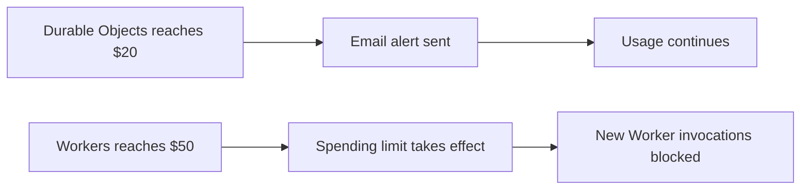

import { CopyPromptButton } from "~/components";

You can now set spending limits for Workers and Durable Objects to help control unexpected usage costs, or receive email alerts while your applications keep running.

Limits apply across your account for the current subscription billing period. Each product has its own spending controls.

:::note[Control Workers AI spending with AI Gateway]
AI Gateway offers spending limits for Workers AI and other AI providers, including per-user and per-model budgets. These controls apply to requests routed through your gateway. Learn how to [configure AI Gateway spend limits](/ai-gateway/features/spend-limits/).
:::

## Set your limits and alerts

In the [Cloudflare dashboard](https://dash.cloudflare.com/), select your account and go to **Billing** > **Spend limits**. Choose a spending limit, notification email, and alert thresholds for Workers or Durable Objects.

For example, configure a $10 Workers spending limit with email alerts at $5 and $9. To receive alerts while your applications keep running, turn off **Block usage**.


## See when a limit takes effect

The overview shows each product's recorded spend, alert thresholds, and pause status. Email alerts notify you without stopping usage. When a spending limit takes effect, Cloudflare blocks the product's supported operations.


To resume usage, raise the limit above current spend, turn it off, or remove it. Usage also resumes when the next billing period starts.

Usage reporting and blocking take time, so recorded spend can exceed a limit. Read about [what counts toward a limit](/billing/manage/spend-management/#what-counts-toward-a-limit).

## Choose alerts, limits, or both

For example, set a $50 spending limit for Workers and a $20 email alert for Durable Objects:



## Set a spending limit with the cf CLI

[Install the cf CLI and select your account](/cf/get-started/), then run this command to set a $50 spending limit for Workers usage in the current billing period:

```sh
cf billing spend-policies create \
  --name 'Workers $50 spending limit' \
  --product-id workers \
  --enabled true \
  --threshold-cents 5000 \
  --action usage_block
```

The amount is in US cents: `5000` means $50. To set a spending limit for Durable Objects, use `--product-id durable_objects` and update the name. Limits count usage already recorded in the current billing period.

You can also give this prompt to your coding agent. It will ask which product you want to manage and what spending limit to set, then use the CLI to configure it.

<CopyPromptButton
	tooltip="Set a spending limit with your agent"
	prompt="Help me set a Cloudflare spending limit using the cf CLI. Read https://developers.cloudflare.com/billing/manage/spend-management/cli/ and https://developers.cloudflare.com/billing/manage/spend-management/ first. Ask me which account and product (Workers or Durable Objects) I want to manage and what spending limit in US dollars I want to set. Wait for my answers; do not choose a limit for me. Use https://developers.cloudflare.com/cf/get-started/ to help me install cf and sign in if needed. Inspect existing policies before creating or updating a limit. Explain what the limit blocks and that it includes spend already recorded this billing period. Convert my chosen dollar amount to cents, apply the limit with cf, and verify the saved settings."
/>

## Use spending limits alongside budget alerts

The [budget alerts introduced earlier this year](/changelog/post/2026-04-13-billable-usage-dashboard-and-budget-alerts/) notify you about account-wide usage costs without stopping usage. You can keep using them alongside the new product-specific spending limits and email alerts for Workers and Durable Objects.

To configure account-wide alerts, go to **Billing** > **Billable Usage** or follow the [budget alerts guide](/billing/manage/budget-alerts/).

Read the [spending limits and alerts guide](/billing/manage/spend-management/) to learn how spending limits work and manage limits and alerts through the dashboard or cf CLI.
