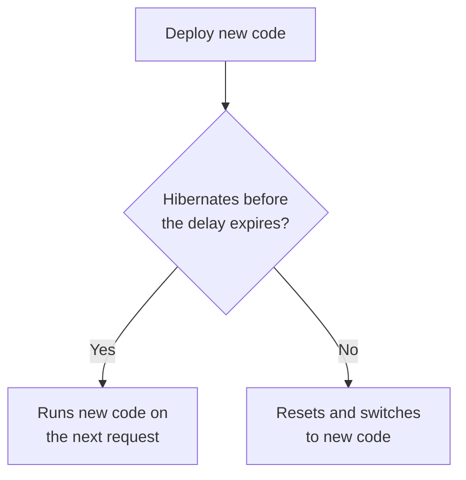

import { WranglerConfig, PackageManagers } from "~/components";

Durable Objects can stay active across requests, allowing you to run long-running [agents](/agents/), maintain [long-lived WebSocket connections](/durable-objects/best-practices/websockets/) and coordinate state across many clients. This is possible because each Durable Object is globally unique, and this means it must run only one version of your code at a time. Previously, when you deployed a change to your Durable Objects code, that change would be applied immediately, which could interrupt in-flight work and terminate open connections.

Durable Objects now defer code updates by default. When you deploy, an active Durable Object can keep running its current code for up to 5 minutes (300 seconds) while it waits to hibernate. This gives in-flight work time to finish. WebSocket connections that use the [Hibernation API](/durable-objects/examples/websocket-hibernation-server/) remain connected when an object adopts new code after hibernating.

During that delay, an active Durable Object follows this flow:



In `immediate` mode, the object resets and switches to new code immediately.

Deferral is best effort and does not guarantee that every operation finishes. The object can still reset before the delay expires, for example during a Cloudflare runtime update.

To change the delay, add `code_update_strategy` to `durable_objects` in your Wrangler configuration:

<WranglerConfig>

```jsonc
{
	"durable_objects": {
		"bindings": [
			{
				"name": "CHAT_ROOM",
				"class_name": "ChatRoom",
			},
		],
		"code_update_strategy": {
			"mode": "deferred",
			"max_delay": 60,
		},
	},
}
```

</WranglerConfig>

`max_delay` is in seconds, from `0` to `86400` (24 hours), with millisecond precision. Omit it to use the default of `300` seconds.

To set the strategy for a single deployment, pass `--durable-objects-code-update-mode` with `immediate` or `deferred <duration>`. For example, apply an update right away during an incident, or when your deployment tooling calls a Durable Object right after deploying and needs the new code:

<PackageManagers
	type="exec"
	pkg="wrangler"
	args="versions deploy <VERSION_ID>@100% --durable-objects-code-update-mode immediate"
/>

For more information, including how this interacts with gradual deployments and the REST API, refer to [Durable Objects code updates](/durable-objects/deployments/durable-objects-code-updates/).
