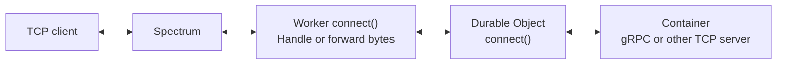

import { TypeScriptExample } from "~/components";

Inbound TCP connections to Workers and bidirectional gRPC in Containers are now in public beta.

Worker-origin Spectrum applications are available on Pro and Business zones, and on Enterprise zones with Spectrum Enterprise enabled. Without Spectrum Enterprise, Pro and Business zones support one Worker-origin application per zone, on one TCP port.



## Forward a Worker socket to a Durable Object

Spectrum sends public TCP connections to your Worker's `connect()` handler. The Worker opens a socket to the `GrpcContainer` Durable Object and pipes bytes in both directions:

<TypeScriptExample filename="src/index.ts">

```ts
export default {
	async connect(socket: Socket, env: Env): Promise<void> {
		const container = env.GRPC_CONTAINER.getByName("grpc-demo");
		const durableObjectSocket = container.connect("grpc-container:50051", {
			allowHalfOpen: true,
			secureTransport: "off",
		});

		try {
			await durableObjectSocket.opened;
			await Promise.all([
				socket.readable.pipeTo(durableObjectSocket.writable),
				durableObjectSocket.readable.pipeTo(socket.writable),
			]);
		} finally {
			await Promise.allSettled([socket.close(), durableObjectSocket.close()]);
		}
	},
} satisfies ExportedHandler<Env>;
```

</TypeScriptExample>

## Forward the Durable Object socket to its Container

The Durable Object receives the connection in its own `connect()` handler. Once its Container is running, `getTcpPort(50051).connect()` opens a socket to the gRPC server inside it:

<TypeScriptExample filename="src/index.ts">

```ts
import { DurableObject } from "cloudflare:workers";

export class GrpcContainer extends DurableObject<Env> {
	async connect(socket: Socket): Promise<void> {
		const containerSocket = this.ctx
			.container!.getTcpPort(50051)
			.connect("10.0.0.1:50051", {
				allowHalfOpen: true,
				secureTransport: "off",
			});

		try {
			await containerSocket.opened;
			await Promise.all([
				socket.readable.pipeTo(containerSocket.writable),
				containerSocket.readable.pipeTo(socket.writable),
			]);
		} finally {
			await Promise.allSettled([socket.close(), containerSocket.close()]);
		}
	}
}
```

</TypeScriptExample>

`allowHalfOpen: true` preserves TCP half-closes. The Worker and Durable Object forward encrypted bytes; the Container terminates TLS and handles HTTP/2 and gRPC.

## Run bidirectional gRPC in the Container

Run an existing gRPC server in any language, including services for real-time voice applications. This Node.js snippet shows the streaming handler and service registration. It sends a greeting, echoes incoming messages, and sends a final response when the client finishes:

```js title="container/server.js"
const path = require("node:path");
const grpc = require("@grpc/grpc-js");
const protoLoader = require("@grpc/proto-loader");

const definition = protoLoader.loadSync(
	path.resolve(__dirname, "../proto/bytes.proto"),
);
const proto = grpc.loadPackageDefinition(definition).cloudflare.grpcdemo;

function chat(call) {
	let count = 0;
	call.write({
		payload: Buffer.from("hello from the container gRPC server\n"),
	});
	call.on("data", ({ payload }) => {
		count += 1;
		call.write({
			payload: Buffer.concat([
				Buffer.from(`container echo ${count}: `),
				payload,
			]),
		});
	});
	call.on("end", () => {
		call.write({
			payload: Buffer.from("goodbye from the container gRPC server\n"),
		});
		call.end();
	});
	call.on("error", (error) => console.error("gRPC stream error", error));
}

const server = new grpc.Server();
server.addService(proto.ByteStream.service, { Chat: chat });
```

Follow the [complete gRPC example](/containers/examples/bidirectional-grpc/) for the protobuf definition, bindings, Spectrum routing, Secrets Store TLS credentials, and Container startup and readiness checks.
