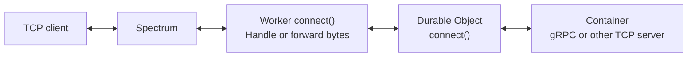

import { TypeScriptExample } from "~/components";

Inbound TCP connections to Workers and bidirectional gRPC in Containers are now in public beta.

Pro and Business zones support one Worker-origin Spectrum application per zone, on one TCP port.



## Handle inbound TCP in a Worker

Spectrum sends public TCP connections to your Worker's `connect()` handler. Read and write bytes directly, implement a custom TCP protocol, or forward traffic to a Container running a TCP service such as MQTT.

This Worker echoes each byte back to the client:

<TypeScriptExample filename="src/index.ts">

```ts
export default {
	async connect(socket: Socket): Promise<void> {
		await socket.readable.pipeTo(socket.writable);
	},
} satisfies ExportedHandler;
```

</TypeScriptExample>

## Run bidirectional gRPC in a Container

Run an existing gRPC server in any language, including services for real-time voice applications. Forward the connection through a Worker and Durable Object so client and server can stream messages in both directions:

```protobuf
syntax = "proto3";

service ByteStream {
  rpc Chat(stream ByteChunk) returns (stream ByteChunk);
}

message ByteChunk {
  bytes payload = 1;
}
```

To get started, [route TCP traffic to a Worker](/spectrum/how-to/route-tcp-traffic-to-a-worker/) or build the [bidirectional gRPC example](/containers/examples/bidirectional-grpc/).
