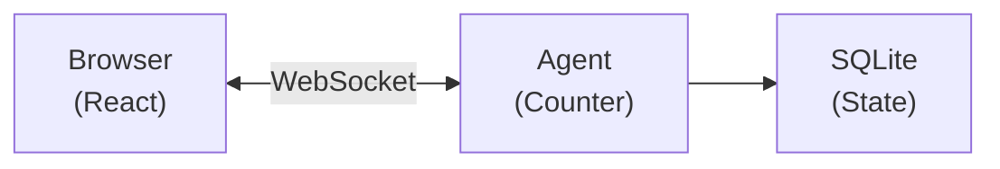

import {
	PackageManagers,
	TypeScriptExample,
	WranglerConfig,
	LinkCard,
} from "~/components";

This guide shows how to add an agent built on the [`Agent` class](/agents/agent-class/) to an existing Cloudflare Workers project. If you are starting fresh, refer to [Get started with the Agent class](/agents/agent-class/get-started/) instead.

To add the Lifecycle and only the capabilities you need to a Durable Object you already have, refer to [Add to an existing project](/agents/getting-started/add-to-existing-project/).

## Prerequisites

- An existing Cloudflare Workers project with a Wrangler configuration file
- Node.js 18 or newer

## 1. Install the package

<PackageManagers pkg="agents" />

For React applications, no additional packages are needed — React bindings are included.

For Hono applications:

<PackageManagers pkg="agents hono-agents" />

## 2. Create an Agent

Create a new file for your agent (for example, `src/agents/counter.ts`):

<TypeScriptExample>

```ts
import { Agent, callable } from "agents";

export type CounterState = {
	count: number;
};

export class CounterAgent extends Agent<Env, CounterState> {
	initialState: CounterState = { count: 0 };

	@callable()
	increment() {
		this.setState({ count: this.state.count + 1 });
		return this.state.count;
	}

	@callable()
	decrement() {
		this.setState({ count: this.state.count - 1 });
		return this.state.count;
	}
}
```

</TypeScriptExample>

## 3. Update Wrangler configuration

Add the Durable Object binding and migration:

<WranglerConfig>

```jsonc
{
	"name": "my-existing-project",
	"main": "src/index.ts",
	"upload_source_maps": true,
	"compatibility_date": "$today",
	"compatibility_flags": ["nodejs_compat"],

	"durable_objects": {
		"bindings": [
			{
				"name": "CounterAgent",
				"class_name": "CounterAgent",
			},
		],
	},

	"migrations": [
		{
			"tag": "v1",
			"new_sqlite_classes": ["CounterAgent"],
		},
	],
}
```

</WranglerConfig>

**Key points:**

- `name` in bindings becomes the property on `env` (for example, `env.CounterAgent`)
- `class_name` must exactly match your exported class name
- `new_sqlite_classes` enables SQLite storage for state persistence
- `nodejs_compat` flag is required for the agents package

## 4. Configure TypeScript and Vite

If you use `@callable()` decorators, as `CounterAgent` does, you need two build configurations.

**tsconfig.json** — extend `agents/tsconfig` (or set `"target": "ES2021"` manually):

```json
{
	"extends": "agents/tsconfig"
}
```

If you have an existing `tsconfig.json` with custom settings, you can extend and override:

```json
{
	"extends": "agents/tsconfig",
	"compilerOptions": {
		"paths": { "~/*": ["./src/*"] }
	}
}
```

**vite.config.ts** — add the `agents()` plugin (handles TC39 decorator transforms for Vite 8):

<TypeScriptExample>

```ts
import agents from "agents/vite";

export default defineConfig({
	plugins: [
		agents(),
		// ... your existing plugins
	],
});
```

</TypeScriptExample>

If your project does not use Vite, the `tsconfig.json` change alone is sufficient — your bundler must support TC39 decorators (stage 3, version `2023-11`).

For more details, refer to the [TypeScript configuration](/agents/runtime/operations/configuration/#typescript-configuration) and [Vite configuration](/agents/runtime/operations/configuration/#vite-configuration) reference.

## 5. Export the Agent class

Your agent class must be exported from your main entry point. Update your `src/index.ts`:

<TypeScriptExample>

```ts
// Export the agent class (required for Durable Objects)
export { CounterAgent } from "./agents/counter";

// Your existing exports...
export default {
	// ...
} satisfies ExportedHandler<Env>;
```

</TypeScriptExample>

## 6. Wire up routing

Choose the approach that matches your project structure:

### Plain Workers (fetch handler)

<TypeScriptExample>

```ts
import { routeAgentRequest } from "agents";
export { CounterAgent } from "./agents/counter";

export default {
	async fetch(request: Request, env: Env, ctx: ExecutionContext) {
		// Try agent routing first
		const agentResponse = await routeAgentRequest(request, env);
		if (agentResponse) return agentResponse;

		// Your existing routing logic
		const url = new URL(request.url);
		if (url.pathname === "/api/hello") {
			return Response.json({ message: "Hello!" });
		}

		return new Response("Not found", { status: 404 });
	},
} satisfies ExportedHandler<Env>;
```

</TypeScriptExample>

### Hono

<TypeScriptExample>

```ts
import { Hono } from "hono";
import { agentsMiddleware } from "hono-agents";
export { CounterAgent } from "./agents/counter";

const app = new Hono<{ Bindings: Env }>();

// Add agents middleware - handles WebSocket upgrades and agent HTTP requests
app.use("*", agentsMiddleware());

// Your existing routes continue to work
app.get("/api/hello", (c) => c.json({ message: "Hello!" }));

export default app;
```

</TypeScriptExample>

### With static assets

If you are serving static assets alongside agents, static assets are served first by default. Your Worker code only runs for paths that do not match a static asset:

<TypeScriptExample>

```ts
import { routeAgentRequest } from "agents";
export { CounterAgent } from "./agents/counter";

export default {
	async fetch(request: Request, env: Env, ctx: ExecutionContext) {
		// Static assets are served automatically before this runs
		// This only handles non-asset requests

		// Route to agents
		const agentResponse = await routeAgentRequest(request, env);
		if (agentResponse) return agentResponse;

		return new Response("Not found", { status: 404 });
	},
} satisfies ExportedHandler<Env>;
```

</TypeScriptExample>

Configure assets in the Wrangler configuration file:

<WranglerConfig>

```jsonc
{
	"assets": {
		"directory": "./public",
	},
}
```

</WranglerConfig>

## 7. Generate TypeScript types

Do not hand-write your `Env` interface. Run [`wrangler types`](/workers/wrangler/commands/general/#types) to generate a type definition file that matches your Wrangler configuration. This catches mismatches between your config and code at compile time instead of at deploy time.

Re-run `wrangler types` whenever you add or rename a binding.

```sh
npx wrangler types
```

This creates a type definition file with all your bindings typed, including your agent Durable Object namespaces. The `Agent` class defaults to using the generated `Env` type, so you do not need to pass it as a type parameter — `extends Agent` is sufficient unless you need to pass a second type parameter for state (for example, `Agent<Env, CounterState>`).

Refer to [Configuration](/agents/runtime/operations/configuration/#generating-types) for more details on type generation.

## 8. Connect from the frontend

### React

<TypeScriptExample>

```tsx
import { useState } from "react";
import { useAgent } from "agents/react";
import type { CounterAgent, CounterState } from "./agents/counter";

function CounterWidget() {
	const [count, setCount] = useState(0);

	const agent = useAgent<CounterAgent, CounterState>({
		agent: "CounterAgent",
		onStateUpdate: (state) => setCount(state.count),
	});

	return (
		<>
			{count}
			<button onClick={() => agent.stub.increment()}>+</button>
			<button onClick={() => agent.stub.decrement()}>-</button>
		</>
	);
}
```

</TypeScriptExample>

Key points:

- `useAgent` connects to your agent via WebSocket
- `onStateUpdate` fires whenever the agent's state changes
- `agent.stub.methodName()` calls methods marked with `@callable()` on your agent

### Vanilla JavaScript

<TypeScriptExample>

```ts
import { AgentClient } from "agents/client";

const agent = new AgentClient({
	agent: "CounterAgent",
	name: "user-123", // Optional: unique instance name
	onStateUpdate: (state) => {
		document.getElementById("count").textContent = state.count;
	},
});

// Call methods
document.getElementById("increment").onclick = () => agent.call("increment");
```

</TypeScriptExample>

## How it works

When you clicked the button:

1. **Client** called `agent.stub.increment()` over WebSocket
2. **Agent** ran `increment()`, updated state with `setState()`
3. **State** persisted to SQLite automatically
4. **Broadcast** sent to all connected clients
5. **React** updated via `onStateUpdate`



### Key concepts

| Concept              | What it means                                                                                         |
| -------------------- | ----------------------------------------------------------------------------------------------------- |
| **Agent instance**   | Each unique name gets its own agent. `CounterAgent:user-123` is separate from `CounterAgent:user-456` |
| **Persistent state** | State survives restarts, deploys, and hibernation. It is stored in SQLite                             |
| **Real-time sync**   | All clients connected to the same agent receive state updates instantly                               |
| **Hibernation**      | When no clients are connected, the agent hibernates (no cost). It wakes on the next request           |

## Deploy to Cloudflare

```sh
npm run deploy
```

Your agent is now live on Cloudflare's global network, running close to your users.

## Common integration patterns

### Agents behind authentication

Check auth before routing to agents:

<TypeScriptExample>

```ts
export default {
	async fetch(request: Request, env: Env) {
		// Check auth for agent routes
		if (request.url.includes("/agents/")) {
			const authResult = await checkAuth(request, env);
			if (!authResult.valid) {
				return new Response("Unauthorized", { status: 401 });
			}
		}

		const agentResponse = await routeAgentRequest(request, env);
		if (agentResponse) return agentResponse;

		// ... rest of routing
	},
} satisfies ExportedHandler<Env>;
```

</TypeScriptExample>

### Custom agent path prefix

By default, agents are routed at `/agents/{agent-name}/{instance-name}`. You can customize this:

<TypeScriptExample>

```ts

const agentResponse = await routeAgentRequest(request, env, {
	prefix: "/api/agents", // Now routes at /api/agents/{agent-name}/{instance-name}
});
```

</TypeScriptExample>

Refer to [Routing](/agents/agent-class/routing/) for more options including CORS, custom instance naming, and location hints.

### Accessing agents from server code

You can interact with agents directly from your Worker code:

<TypeScriptExample>

```ts

export default {
	async fetch(request: Request, env: Env) {
		if (request.url.endsWith("/api/increment")) {
			// Get a specific agent instance
			const counter = await getAgentByName(env.CounterAgent, "shared-counter");
			const newCount = await counter.increment();
			return Response.json({ count: newCount });
		}
		// ...
	},
} satisfies ExportedHandler<Env>;
```

</TypeScriptExample>

### Adding multiple agents

Add more agents by extending the configuration:

<TypeScriptExample>

```ts
// src/agents/chat.ts
export class Chat extends Agent {
	// ...
}

// src/agents/scheduler.ts
export class Scheduler extends Agent {
	// ...
}
```

</TypeScriptExample>

Update the Wrangler configuration file:

<WranglerConfig>

```toml
[[durable_objects.bindings]]
name = "CounterAgent"
class_name = "CounterAgent"

[[durable_objects.bindings]]
name = "Chat"
class_name = "Chat"

[[durable_objects.bindings]]
name = "Scheduler"
class_name = "Scheduler"

[[migrations]]
tag = "v1"
new_sqlite_classes = ["CounterAgent", "Chat", "Scheduler"]
```

</WranglerConfig>

Export all agents from your entry point:

<TypeScriptExample>

```ts
export { CounterAgent } from "./agents/counter";
export { Chat } from "./agents/chat";
export { Scheduler } from "./agents/scheduler";
```

</TypeScriptExample>

## Troubleshooting

### Agent not found, or 404 errors

1. **Check the export** - Agent class must be exported from your main entry point.
2. **Check the binding** - `class_name` in the Wrangler configuration file must exactly match the exported class name.
3. **Check the route** - Default route is `/agents/{'{agent-name}'}/{'{instance-name}'}`. Agent name in client matches the class name (case-insensitive).

### No such Durable Object class error

Add the migration to the Wrangler configuration file:

<WranglerConfig>

```toml
[[migrations]]
tag = "v1"
new_sqlite_classes = ["YourAgentClass"]
```

</WranglerConfig>

### WebSocket connection fails

Ensure your routing passes the response unchanged:

<TypeScriptExample>

```ts
// Correct - return the response directly
const agentResponse = await routeAgentRequest(request, env);
if (agentResponse) return agentResponse;

// Wrong - this breaks WebSocket connections
if (agentResponse) return new Response(agentResponse.body);
```

</TypeScriptExample>

### State not persisting

Check that:

1. You are calling `this.setState()`, not mutating `this.state` directly.
2. The agent class is in `new_sqlite_classes` in migrations.
3. You are connecting to the same agent instance name.
4. The `onStateUpdate` callback is wired up in your client.
5. WebSocket connection is established (check browser dev tools).

### "Method X is not callable" errors

Make sure your methods are decorated with `@callable()`:

<TypeScriptExample>

```ts

export class MyAgent extends Agent {
	@callable()
	increment() {
		// ...
	}
}
```

</TypeScriptExample>

### Type errors with `agent.stub`

Add the agent and state type parameters:

<TypeScriptExample>

```ts

// Pass the agent and state types to useAgent
const agent = useAgent<CounterAgent, CounterState>({
	agent: "CounterAgent",
	onStateUpdate: (state) => setCount(state.count),
});

// Now agent.stub is fully typed
agent.stub.increment();
```

</TypeScriptExample>

### `SyntaxError: Invalid or unexpected token` with `@callable()`

If your dev server fails with `SyntaxError: Invalid or unexpected token`, set `"target": "ES2021"` in your `tsconfig.json`. This ensures that Vite's esbuild transpiler downlevels TC39 decorators instead of passing them through as native syntax.

```json
{
	"compilerOptions": {
		"target": "ES2021"
	}
}
```

:::caution
Do not set `"experimentalDecorators": true` in your `tsconfig.json`. The Agents SDK uses [TC39 standard decorators](https://github.com/tc39/proposal-decorators), not TypeScript legacy decorators. Enabling `experimentalDecorators` applies an incompatible transform that silently breaks `@callable()` at runtime.
:::

## Next steps

Now that you have a working agent, explore these topics:

### Common next steps

| Learn how to             | Refer to                                                  |
| ------------------------ | --------------------------------------------------------- |
| Add AI/LLM capabilities  | [Using AI models](/agents/agent-class/using-ai-models/) |
| Expose tools via MCP     | [MCP servers](/agents/model-context-protocol/apis/handler-api/)     |
| Run background tasks     | [Schedule tasks](/agents/agent-class/schedule-tasks/)   |
| Handle emails            | [Email routing](/agents/agent-class/communication-channels/email/)             |
| Use Cloudflare Workflows | [Run Workflows](/agents/agent-class/run-workflows/)     |

### Explore more

<LinkCard
	title="State management"
	href="/agents/agent-class/state/"
	description="Deep dive into setState(), initialState, and onStateChanged()."
/>

<LinkCard
	title="Client SDK"
	href="/agents/agent-class/communication-channels/chat/client-sdk/"
	description="Full useAgent and AgentClient API reference."
/>

<LinkCard
	title="Callable methods"
	href="/agents/agent-class/callable-methods/"
	description="Expose methods to clients with @callable()."
/>

<LinkCard
	title="Schedule tasks"
	href="/agents/agent-class/schedule-tasks/"
	description="Run tasks on a delay, schedule, or cron."
/>

<LinkCard
	title="Agent class internals"
	href="/agents/agent-class/internals/"
	description="Full lifecycle and methods reference."
/>

<LinkCard
	title="Agent class"
	href="/agents/agent-class/"
	description="Capabilities and APIs of the Agent class."
/>
