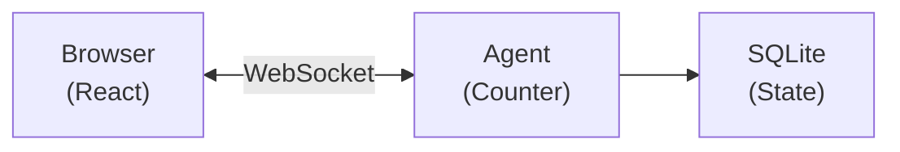

import {
	TypeScriptExample,
	WranglerConfig,
	PackageManagers,
	LinkCard,
} from "~/components";

Build an agent on the [`Agent` class](/agents/agent-class/), the preset that installs the Lifecycle, state, WebSockets, scheduling, and other capabilities on a Durable Object for you. The agent keeps state across requests and syncs it to clients in real time over WebSockets.

To start from a harness instead, refer to the [Quick start](/agents/getting-started/quick-start/). To compose the Lifecycle and capabilities on a plain Durable Object, refer to [Learn the runtime](/agents/getting-started/learn-the-runtime/).

**What you will build:** A counter agent with persistent state that syncs to a React frontend in real-time.

**Time:** ~10 minutes

## Create a new project

<PackageManagers
	type="create"
	pkg="cloudflare@latest"
	args={"--template cloudflare/agents-starter"}
/>

Then install dependencies and start the dev server:

```sh
cd agents-starter
npm install
npm run dev
```

This creates a project with:

- `src/server.ts` — Your agent code
- `src/client.tsx` — React frontend
- `wrangler.jsonc` — Cloudflare configuration
- `tsconfig.json` — Extends `agents/tsconfig` for correct decorator and module settings
- `vite.config.ts` — Includes the `agents/vite` plugin for decorator support

The starter template includes two important SDK integrations. If you are setting up a project manually, add both:

**tsconfig.json** — extends `agents/tsconfig`, which sets `target: "ES2021"` and other recommended options:

```json
{
	"extends": "agents/tsconfig"
}
```

**vite.config.ts** — includes the `agents()` plugin, which handles TC39 decorator transforms (required for `@callable()` in Vite 8):

```ts
import { cloudflare } from "@cloudflare/vite-plugin";
import react from "@vitejs/plugin-react";
import agents from "agents/vite";
import { defineConfig } from "vite";

export default defineConfig({
	plugins: [agents(), react(), cloudflare()],
});
```

Open [http://localhost:5173](http://localhost:5173) to see your agent in action.

## Your first agent

Build a simple counter agent from scratch. Replace `src/server.ts`:

<TypeScriptExample>

```ts title="src/server.ts"
import { Agent, routeAgentRequest, callable } from "agents";

// Define the state shape
export type CounterState = {
	count: number;
};

// Create the agent
export class CounterAgent extends Agent<Env, CounterState> {
	// Initial state for new instances
	initialState: CounterState = { count: 0 };

	// Methods marked with @callable can be called from the client
	@callable()
	increment() {
		this.setState({ count: this.state.count + 1 });
		return this.state.count;
	}

	@callable()
	decrement() {
		this.setState({ count: this.state.count - 1 });
		return this.state.count;
	}

	@callable()
	reset() {
		this.setState({ count: 0 });
	}
}

// Route requests to agents
export default {
	async fetch(request: Request, env: Env, ctx: ExecutionContext) {
		return (
			(await routeAgentRequest(request, env)) ??
			new Response("Not found", { status: 404 })
		);
	},
} satisfies ExportedHandler<Env>;
```

</TypeScriptExample>

Update `wrangler.jsonc` to register the agent:

<WranglerConfig>

```jsonc
{
	"name": "my-agent",
	"main": "src/server.ts",
	"upload_source_maps": true,
	"compatibility_date": "$today",
	"compatibility_flags": ["nodejs_compat"],
	"durable_objects": {
		"bindings": [
			{
				"name": "CounterAgent",
				"class_name": "CounterAgent",
			},
		],
	},
	"migrations": [
		{
			"tag": "v1",
			"new_sqlite_classes": ["CounterAgent"],
		},
	],
}
```

</WranglerConfig>

**Key points:**

- `name` in bindings becomes the property on `env` (for example, `env.CounterAgent`)
- `class_name` must exactly match your exported class name
- `new_sqlite_classes` enables SQLite storage for state persistence
- `nodejs_compat` flag is required for the agents package

## Connect from React

Replace `src/client.tsx`:

```tsx title="src/client.tsx"
import "./styles.css";
import { createRoot } from "react-dom/client";
import { useState } from "react";
import { useAgent } from "agents/react";
import type { CounterAgent, CounterState } from "./server";

export default function App() {
	const [count, setCount] = useState(0);

	// Connect to the Counter agent
	const agent = useAgent<CounterAgent, CounterState>({
		agent: "CounterAgent",
		onStateUpdate: (state) => setCount(state.count),
	});

	return (
		<div style={{ padding: "2rem", fontFamily: "system-ui" }}>
			<h1>Counter Agent</h1>
			<p style={{ fontSize: "3rem" }}>{count}</p>
			<div style={{ display: "flex", gap: "1rem" }}>
				<button onClick={() => agent.stub.decrement()}>-</button>
				<button onClick={() => agent.stub.reset()}>Reset</button>
				<button onClick={() => agent.stub.increment()}>+</button>
			</div>
		</div>
	);
}

const root = createRoot(document.getElementById("root")!);
root.render(<App />);
```

Key points:

- `useAgent` connects to your agent via WebSocket
- `onStateUpdate` fires whenever the agent's state changes
- `agent.stub.methodName()` calls methods marked with `@callable()` on your agent

## How it works

When you clicked the button:

1. **Client** called `agent.stub.increment()` over WebSocket
2. **Agent** ran `increment()`, updated state with `setState()`
3. **State** persisted to SQLite automatically
4. **Broadcast** sent to all connected clients
5. **React** updated via `onStateUpdate`



### Key concepts

| Concept              | What it means                                                                                         |
| -------------------- | ----------------------------------------------------------------------------------------------------- |
| **Agent instance**   | Each unique name gets its own agent. `CounterAgent:user-123` is separate from `CounterAgent:user-456` |
| **Persistent state** | State survives restarts, deploys, and hibernation. It is stored in SQLite                             |
| **Real-time sync**   | All clients connected to the same agent receive state updates instantly                               |
| **Hibernation**      | When no clients are connected, the agent hibernates (no cost). It wakes on the next request           |

## Connect from vanilla JavaScript

If you are not using React:

<TypeScriptExample>

```ts
import { AgentClient } from "agents/client";

const agent = new AgentClient({
	agent: "CounterAgent",
	name: "my-counter", // optional, defaults to "default"
	onStateUpdate: (state) => {
		console.log("New count:", state.count);
	},
});

// Call methods
await agent.call("increment");
await agent.call("reset");
```

</TypeScriptExample>

## Deploy to Cloudflare

```sh
npm run deploy
```

Your agent is now live on Cloudflare's global network, running close to your users.

## Common integration patterns

### Agents behind authentication

Check auth before routing to agents:

<TypeScriptExample>

```ts
export default {
	async fetch(request: Request, env: Env) {
		// Check auth for agent routes
		if (request.url.includes("/agents/")) {
			const authResult = await checkAuth(request, env);
			if (!authResult.valid) {
				return new Response("Unauthorized", { status: 401 });
			}
		}

		const agentResponse = await routeAgentRequest(request, env);
		if (agentResponse) return agentResponse;

		// ... rest of routing
	},
} satisfies ExportedHandler<Env>;
```

</TypeScriptExample>

### Custom agent path prefix

By default, agents are routed at `/agents/{agent-name}/{instance-name}`. You can customize this:

<TypeScriptExample>

```ts

const agentResponse = await routeAgentRequest(request, env, {
	prefix: "/api/agents", // Now routes at /api/agents/{agent-name}/{instance-name}
});
```

</TypeScriptExample>

Refer to [Routing](/agents/agent-class/routing/) for more options including CORS, custom instance naming, and location hints.

### Accessing agents from server code

You can interact with agents directly from your Worker code:

<TypeScriptExample>

```ts

export default {
	async fetch(request: Request, env: Env) {
		if (request.url.endsWith("/api/increment")) {
			// Get a specific agent instance
			const counter = await getAgentByName(env.CounterAgent, "shared-counter");
			const newCount = await counter.increment();
			return Response.json({ count: newCount });
		}
		// ...
	},
} satisfies ExportedHandler<Env>;
```

</TypeScriptExample>

### Adding multiple agents

Add more agents by extending the configuration:

<TypeScriptExample>

```ts
// src/agents/chat.ts
export class Chat extends Agent {
	// ...
}

// src/agents/scheduler.ts
export class Scheduler extends Agent {
	// ...
}
```

</TypeScriptExample>

Update the Wrangler configuration file:

<WranglerConfig>

```toml
[[durable_objects.bindings]]
name = "CounterAgent"
class_name = "CounterAgent"

[[durable_objects.bindings]]
name = "Chat"
class_name = "Chat"

[[durable_objects.bindings]]
name = "Scheduler"
class_name = "Scheduler"

[[migrations]]
tag = "v1"
new_sqlite_classes = ["CounterAgent", "Chat", "Scheduler"]
```

</WranglerConfig>

Export all agents from your entry point:

<TypeScriptExample>

```ts
export { CounterAgent } from "./agents/counter";
export { Chat } from "./agents/chat";
export { Scheduler } from "./agents/scheduler";
```

</TypeScriptExample>

## Troubleshooting

### Agent not found, or 404 errors

1. **Check the export** - Agent class must be exported from your main entry point.
2. **Check the binding** - `class_name` in the Wrangler configuration file must exactly match the exported class name.
3. **Check the route** - Default route is `/agents/{'{agent-name}'}/{'{instance-name}'}`. Agent name in client matches the class name (case-insensitive).

### No such Durable Object class error

Add the migration to the Wrangler configuration file:

<WranglerConfig>

```toml
[[migrations]]
tag = "v1"
new_sqlite_classes = ["YourAgentClass"]
```

</WranglerConfig>

### WebSocket connection fails

Ensure your routing passes the response unchanged:

<TypeScriptExample>

```ts
// Correct - return the response directly
const agentResponse = await routeAgentRequest(request, env);
if (agentResponse) return agentResponse;

// Wrong - this breaks WebSocket connections
if (agentResponse) return new Response(agentResponse.body);
```

</TypeScriptExample>

### State not persisting

Check that:

1. You are calling `this.setState()`, not mutating `this.state` directly.
2. The agent class is in `new_sqlite_classes` in migrations.
3. You are connecting to the same agent instance name.
4. The `onStateUpdate` callback is wired up in your client.
5. WebSocket connection is established (check browser dev tools).

### "Method X is not callable" errors

Make sure your methods are decorated with `@callable()`:

<TypeScriptExample>

```ts

export class MyAgent extends Agent {
	@callable()
	increment() {
		// ...
	}
}
```

</TypeScriptExample>

### Type errors with `agent.stub`

Add the agent and state type parameters:

<TypeScriptExample>

```ts

// Pass the agent and state types to useAgent
const agent = useAgent<CounterAgent, CounterState>({
	agent: "CounterAgent",
	onStateUpdate: (state) => setCount(state.count),
});

// Now agent.stub is fully typed
agent.stub.increment();
```

</TypeScriptExample>

### `SyntaxError: Invalid or unexpected token` with `@callable()`

If your dev server fails with `SyntaxError: Invalid or unexpected token`, set `"target": "ES2021"` in your `tsconfig.json`. This ensures that Vite's esbuild transpiler downlevels TC39 decorators instead of passing them through as native syntax.

```json
{
	"compilerOptions": {
		"target": "ES2021"
	}
}
```

:::caution
Do not set `"experimentalDecorators": true` in your `tsconfig.json`. The Agents SDK uses [TC39 standard decorators](https://github.com/tc39/proposal-decorators), not TypeScript legacy decorators. Enabling `experimentalDecorators` applies an incompatible transform that silently breaks `@callable()` at runtime.
:::

## Next steps

Now that you have a working agent, explore these topics:

### Common next steps

| Learn how to             | Refer to                                                  |
| ------------------------ | --------------------------------------------------------- |
| Add AI/LLM capabilities  | [Using AI models](/agents/agent-class/using-ai-models/) |
| Expose tools via MCP     | [MCP servers](/agents/model-context-protocol/apis/handler-api/)     |
| Run background tasks     | [Schedule tasks](/agents/agent-class/schedule-tasks/)   |
| Handle emails            | [Email routing](/agents/agent-class/communication-channels/email/)             |
| Use Cloudflare Workflows | [Run Workflows](/agents/agent-class/run-workflows/)     |

### Explore more

<LinkCard
	title="State management"
	href="/agents/agent-class/state/"
	description="Deep dive into setState(), initialState, and onStateChanged()."
/>

<LinkCard
	title="Client SDK"
	href="/agents/runtime/client/"
	description="Full useAgent and AgentClient API reference."
/>

<LinkCard
	title="Callable methods"
	href="/agents/agent-class/callable-methods/"
	description="Expose methods to clients with @callable()."
/>

<LinkCard
	title="Schedule tasks"
	href="/agents/agent-class/schedule-tasks/"
	description="Run tasks on a delay, schedule, or cron."
/>

<LinkCard
	title="Agent class internals"
	href="/agents/agent-class/internals/"
	description="Full lifecycle and methods reference."
/>

<LinkCard
	title="Agent class"
	href="/agents/agent-class/"
	description="Capabilities and APIs of the Agent class."
/>
