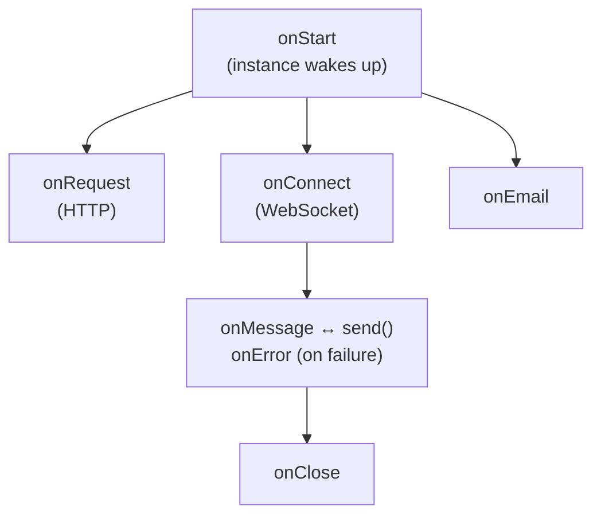

import { Render, LinkCard } from "~/components";

The `Agent` class is a preset. It is a [Durable Object](/durable-objects/) with the [Lifecycle](/agents/runtime/lifecycle/) and seven capabilities installed. Extend it when you want those capabilities wired together, or when you need an API that only the `Agent` class has, such as `@callable()` methods, fibers, Workflows, email, voice, or [chat agents](/agents/agent-class/communication-channels/chat/) with `AIChatAgent`. [Think](/agents/harnesses/think/) also extends `Agent`.

The capabilities the `Agent` class installs also run on a plain `DurableObject`. To compose only the capabilities you need, refer to [Lifecycle](/agents/runtime/lifecycle/) and [Capabilities](/agents/runtime/capabilities/).

:::note

Agents require [Cloudflare Durable Objects](/durable-objects/). Refer to [Configuration](/agents/runtime/operations/configuration/) to learn how to add the required bindings.

:::

## What the Agent class installs

`Agent` extends `DurableObject`, installs a `Lifecycle` on `this.lifecycle`, and calls `this.lifecycle.use()` for each capability below in its constructor. Each `Agent` method on the left calls the capability on the right.

| Agent API (on `this`)                                                                                                                                          | Capability                                                     |
| -------------------------------------------------------------------------------------------------------------------------------------------------------------- | -------------------------------------------------------------- |
| `lifecycle`, `onStart()`, `onRequest()`, `fetch()`, `alarm()`                                                                                                  | [`Lifecycle`](/agents/runtime/lifecycle/)                      |
| `schedule()`, `scheduleEvery()`, `getScheduleById()`, `listSchedules()`, `cancelSchedule()`, `scheduler`                                                       | [`Scheduler`](/agents/runtime/capabilities/scheduler/)         |
| `queue()`, `dequeue()`, `dequeueAll()`, `dequeueAllByCallback()`, `getQueue()`, `getQueues()`                                                                  | `Queue`                                                        |
| `mcp`, `addMcpServer()`, `removeMcpServer()`, `getMcpServers()`                                                                                                | [`MCPClientManager`](/agents/runtime/capabilities/mcp-client-manager/) |
| `state`, `initialState`, `setState()`, `validateStateChange()`, `onStateChanged()`                                                                             | [`State`](/agents/runtime/capabilities/state/)                 |
| `onConnect()`, `onMessage()`, `onClose()`, `onError()`, `broadcast()`, `getConnection()`, `getConnections()`, `getConnectionTags()`, `setConnectionReadonly()` | [`WebSockets`](/agents/runtime/capabilities/websockets/)       |
| `tasks`, `taskDefinitions`                                                                                                                                     | `Tasks`                                                        |
| `dynamicAgents`, `parentAgent()`, `parentPath`, `selfPath`, `onBeforeSubAgent()`                                                                               | Dynamic agents                                                 |

`Queue`, `Tasks`, and dynamic agents are installed by the `Agent` class, but are not documented as standalone capabilities. Use them through the `Agent` methods. For dynamic agents, refer to [Dynamic agents](/agents/agent-class/dynamic-agents/).

### APIs that only the Agent class has

These APIs are implemented by the `Agent` class itself, not by a capability. They are not available on a plain Durable Object.

| Feature           | Agent API                                                                                                             | Documentation                                                    |
| ----------------- | --------------------------------------------------------------------------------------------------------------------- | ---------------------------------------------------------------- |
| Callable methods  | `@callable()`, `getCallableMethods()`                                                                                 | [Callable methods](/agents/agent-class/callable-methods/)        |
| Durable execution | `runFiber()`, `startFiber()`, `stash()`, `onFiberRecovered()`, `keepAlive()`, `keepAliveWhile()`                      | [Durable execution](/agents/agent-class/durable-execution/)      |
| Workflows         | `runWorkflow()`, `sendWorkflowEvent()`, `approveWorkflow()`, `getWorkflow()`, `onWorkflowProgress()`, `AgentWorkflow` | [Run Workflows](/agents/agent-class/run-workflows/)              |
| Retries           | `retry()`                                                                                                             | [Retries](/agents/agent-class/retries/)                          |
| Email             | `onEmail()`, `sendEmail()`, `replyToEmail()`, `routeAgentEmail()`                                                     | [Email](/agents/agent-class/communication-channels/email/)       |
| Agents as tools   | `runAgentTool()`, `hasAgentToolRun()`, `clearAgentToolRuns()`, `agentTool()`                                          | [Agents as tools](/agents/agent-class/agent-tools/)              |
| SQL               | `` this.sql`...` ``                                                                                                   | [SQL API](#sql-api)                                              |
| HTTP and SSE      | `onRequest()` with streamed responses                                                                                 | [HTTP and SSE](/agents/agent-class/http-sse/)                    |
| Instance          | `name`, `destroy()`, static `options`                                                                                 | [Agent class internals](/agents/agent-class/internals/)          |
| Chat agents       | `AIChatAgent` from `@cloudflare/ai-chat`                                                                              | [Chat agents](/agents/agent-class/communication-channels/chat/)  |
| Chat SDK          | `ChatSdkStateAgent`, `createChatSdkState()`                                                                           | [Chat SDK](/agents/agent-class/communication-channels/chat-sdk/) |
| Voice             | `withVoice()`, `withVoiceInput()` from `agents/voice`                                                                 | [Voice](/agents/agent-class/communication-channels/voice/)       |

`getCurrentAgent()` works on the `Agent` class and on any Durable Object with a Lifecycle. On the `Agent` class, custom methods are wrapped automatically, so `getCurrentAgent()` works inside them. Refer to [getCurrentAgent()](/agents/runtime/lifecycle/get-current-agent/).

### Add another capability

To add a capability to an `Agent`, such as the [Pi harness](/agents/harnesses/pi/), install it on `this.lifecycle` in the constructor:

```ts
import { Agent } from "agents";
import { createModels } from "@earendil-works/pi-ai/models";
import { createRegistry, Harness } from "@earendil-works/pi-durable";
import { PiHarness } from "agents/harness/pi";
import { createAI } from "agents/models/pi-ai";

export class Assistant extends Agent<Env> {
	ai = createAI({ binding: this.env.AI });
	registry = createRegistry();

	harness = new PiHarness({
		harness: ({ storage, context, onWake }) => {
			const models = createModels();
			models.setProvider(this.ai.provider);
			return Harness.open(
				storage,
				{ models, registry: this.registry, onWake },
				context,
			);
		},
		defaults: { model: this.ai("@cf/zai-org/glm-5.3-flash") },
	});

	constructor(ctx: DurableObjectState, env: Env) {
		super(ctx, env);
		this.lifecycle.use(this.harness);
	}
}
```

## Define an Agent

An Agent is a class that extends the base `Agent` class:

```ts
import { Agent, routeAgentRequest } from "agents";

export class MyAgent extends Agent<Env, State> {
	// Your agent logic
}

export default {
	async fetch(request: Request, env: Env) {
		return (
			(await routeAgentRequest(request, env)) ||
			new Response("Not found", { status: 404 })
		);
	},
} satisfies ExportedHandler<Env>;
```

Each Agent can have millions of instances. Each instance is a separate micro-server that runs independently, allowing horizontal scaling. Instances are addressed by a unique identifier (user ID, email, ticket number, etc.).

<Render file="unique-agents" product="agents" />

## Hooks



| Method                                        | When it runs                                                                                                                                                                          |
| --------------------------------------------- | ------------------------------------------------------------------------------------------------------------------------------------------------------------------------------------- |
| `onStart(props?)`                             | When the instance starts, or wakes from hibernation. Receives optional [initialization props](/agents/agent-class/routing/#props) passed via `getAgentByName` or `routeAgentRequest`. |
| `onRequest(request)`                          | For each HTTP request to the instance                                                                                                                                                 |
| `onConnect(connection, ctx)`                  | When a WebSocket connection is established                                                                                                                                            |
| `onMessage(connection, message)`              | For each WebSocket message received                                                                                                                                                   |
| `onError(connection, error)`                  | When a WebSocket error occurs                                                                                                                                                         |
| `onClose(connection, code, reason, wasClean)` | When a WebSocket connection closes                                                                                                                                                    |
| `onEmail(email)`                              | When an email is routed to the instance                                                                                                                                               |
| `onStateChanged(state, source)`               | When state changes (from server or client)                                                                                                                                            |

The `Agent` class owns the Durable Object's `fetch()`, `alarm()`, and WebSocket handlers and forwards them into the Lifecycle. Do not override `alarm()` or call `ctx.storage.setAlarm()` from Agent code. Use `this.schedule()` instead.

## Core properties

| Property     | Type                 | Description                            |
| ------------ | -------------------- | -------------------------------------- |
| `this.env`   | `Env`                | Environment variables and bindings     |
| `this.ctx`   | `DurableObjectState` | Durable Object state and storage       |
| `this.name`  | `string`             | The instance name                      |
| `this.state` | `State`              | Current persisted state                |
| `this.sql`   | Function             | Execute SQL queries on embedded SQLite |

## SQL API

Each Agent instance has an embedded SQLite database accessed via `this.sql`:

```ts
// Create tables
this.sql`CREATE TABLE IF NOT EXISTS users (id TEXT PRIMARY KEY, name TEXT)`;

// Insert data
this.sql`INSERT INTO users (id, name) VALUES (${id}, ${name})`;

// Query data
const users = this.sql<User>`SELECT * FROM users WHERE id = ${id}`;
```

On a plain Durable Object, use [`ctx.storage.sql`](/durable-objects/api/sqlite-storage-api/) directly. For state that needs to sync with clients, use the [State API](/agents/agent-class/state/) instead.

## Connect from a client

Clients connect to an Agent with `useAgent()` from `agents/react` or `AgentClient` from `agents/client`, and call it over HTTP with `agentFetch()`. The same client works with any Durable Object that installs the `WebSockets` capability. Refer to [Client SDK](/agents/agent-class/communication-channels/chat/client-sdk/).

```ts
import { useAgent } from "agents/react";
import type { MyAgent } from "./server";

function App() {
	const agent = useAgent<MyAgent, State>({
		agent: "my-agent",
		name: "user-123",
	});

	// Call methods on the agent
	agent.stub.someMethod();

	// Update state (syncs to server and all clients)
	agent.setState({ count: 1 });
}
```

For chat UIs, `useAgentChat()` from `@cloudflare/ai-chat/react` connects to an `AIChatAgent`. Refer to [Chat agents](/agents/agent-class/communication-channels/chat/chat-agents/).

## Routing

Agents are accessed via URL patterns:

```txt
https://your-worker.workers.dev/agents/:agent-name/:instance-name
```

Use `routeAgentRequest()` in your Worker to route requests:

```ts
import { routeAgentRequest } from "agents";

export default {
	async fetch(request: Request, env: Env) {
		return (
			(await routeAgentRequest(request, env)) ??
			new Response("Not found", { status: 404 })
		);
	},
} satisfies ExportedHandler<Env>;
```

Refer to [Routing](/agents/agent-class/routing/) for custom paths, CORS, and instance naming patterns.

## Next steps

<LinkCard
	title="Get started with the Agent class"
	href="/agents/agent-class/get-started/"
	description="Build a counter agent with synced state in about 10 minutes."
/>

<LinkCard
	title="Agent class internals"
	href="/agents/agent-class/internals/"
	description="How the Agent class composes the Lifecycle and its capabilities."
/>

<LinkCard
	title="Configuration"
	href="/agents/runtime/operations/configuration/"
	description="Learn about wrangler.jsonc setup and deployment."
/>

<LinkCard
	title="Build a chat agent"
	href="/agents/examples/chat-agent/"
	description="Build AI applications with AIChatAgent."
/>
