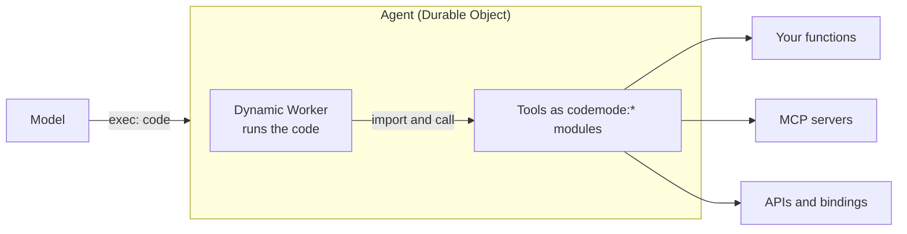

import { LinkCard } from "~/components";

Code Mode means letting the model write code to get work done. The model does not ask for one tool call, wait for the result, and then ask for the next. It writes a short program that calls the tools, loops over what comes back, keeps what matters, and returns an answer. A sandbox runs the program, and only the result goes back to the model.

Any time an agent runs code that a model wrote, it is using Code Mode. This page covers why that works well. To set it up, refer to [Code Mode in the runtime](/agents/runtime/code-mode/).

## Models are better at writing code

A tool call is a special token sequence that a model learns during fine-tuning, from a fairly small set of examples. Code is different. Models have trained on huge amounts of real programs, written by people solving real problems. They know how to call functions, read a type signature, write a loop, and handle an error.

Code Mode gives the model the task in the form it knows best. The tools become functions it can import, and the model writes ordinary JavaScript against them. For the longer argument, refer to [Code Mode: the better way to use MCP](https://blog.cloudflare.com/code-mode/).

## Code is a compact plan

Say a user asks for every blocked task across their active projects. With direct tool calls, the model lists the projects, reads the result, and then lists the tasks of each project in turn. Each step is a round trip through the model, and every intermediate result lands in its context.

With Code Mode, the model writes the whole plan once:

```js
import { listProjects, listTasks } from "codemode:projects";

export default async function () {
	const blocked = [];
	for (const project of await listProjects("active")) {
		const tasks = await listTasks(project.id);
		blocked.push(...tasks.filter((task) => task.status === "blocked"));
	}
	return blocked.map((task) => `${task.projectName}: ${task.title}`);
}
```

The program runs in one step and returns a short list. This changes a few things:

- **Fewer model turns.** Ten projects take one model turn, not eleven.
- **Less context.** The project and task records stay inside the sandbox. The model sees only the list it asked for.
- **Real control flow.** Loops, branches, `try`/`catch`, and `Promise.all()` work as the model expects. It does not have to fake them with a chain of tool calls.
- **A plan you can read.** The code says exactly what the agent did. You can log it, review it, and save it as a file to run again.

## Tools become modules

With direct tool calls, the agent sends the definition of every tool to the model on every turn. That cost grows with each tool you add. The Cloudflare API has more than 2,500 endpoints. Described as one tool each, their definitions would take about 1.17 million tokens, more than most models can read at once.

With Code Mode, tools are exports of a module that the code imports. The model gets one code tool and a short list of the modules it can import. Adding a tool adds an export, not another entry in every prompt. This is why an agent with Code Mode can have far more tools than an agent that calls them directly.

## The sandbox and the tools stay apart

Model-written code runs in an isolated [Dynamic Worker](/dynamic-workers/). It starts in milliseconds, and each run gets a fresh isolate. By default it has no network access, and it cannot read the agent's environment variables, bindings, or storage.

The tools do not run in the sandbox. When code calls `listTasks()`, the call crosses to the agent, and the function runs there with the agent's credentials. The sandbox sees only the arguments and the result. API keys and OAuth tokens never enter the sandbox, and they never enter the model's context.

## Code Mode in the agent

The agent can run the code itself. In MCP terms, this is Code Mode on the client: the agent owns the sandbox, so it can combine tools from any source in one program. That includes its own functions, the tools of every MCP server it is connected to, files in its workspace, and external APIs.



This is the recommended way to use Code Mode. [Cloudflare Computer](/agents/runtime/code-mode/computer/) gives the model an `exec` tool, and you give the code your tools as `codemode:*` modules. For example, `codemode:tools` exposes every tool the agent already has, and `codemode:projects` could expose your own functions.

## Code Mode on the server

An MCP server can also do Code Mode for its clients, so that a client without its own sandbox still gets the benefit. The [Cloudflare API MCP server](/agents/model-context-protocol/cloudflare/servers-for-cloudflare/) works this way. It exposes two tools, `search` and `execute`. The model writes code against the OpenAPI document to find the endpoints it needs, then writes code against an API client to call them.

| Approach                           | Tools | Token cost  |
| ---------------------------------- | ----- | ----------- |
| Native MCP (full schemas)          | 2,594 | ~1,170,000  |
| Native MCP (required params only)  | 2,594 | ~244,000    |
| Code Mode with `search`, `execute` | 2     | ~1,000      |

Server-side Code Mode composes only that server's tools. When the agent does Code Mode itself, one program can call tools from many servers at once. For the design of the Cloudflare server, refer to [Code Mode: give agents an entire API in 1,000 tokens](https://blog.cloudflare.com/code-mode-mcp/). For code to start from, refer to the [Cloudflare MCP server source](https://github.com/cloudflare/mcp) and the [search and execute example](https://github.com/cloudflare/agents/tree/main/examples/codemode-mcp-openapi).

## When to call tools directly

Code Mode is not always the better choice. Call tools directly when:

- The agent has a few tools, and most tasks need one call.
- A tool needs a person to approve each call before it runs.
- A tool runs in the browser, such as one that reads the user's location.

Many agents do both. They offer a handful of direct tools, plus a code tool for work that needs several calls.

## Related resources

<LinkCard
	title="Code Mode in the runtime"
	href="/agents/runtime/code-mode/"
	description="Run model-written code with Computer, the Code Mode executor, or a container."
/>

<LinkCard
	title="Tools"
	href="/agents/concepts/tools/"
	description="How tools are exposed to models, and where they run."
/>

<LinkCard
	title="Dynamic Workers"
	href="/dynamic-workers/"
	description="The isolates that run model-written code."
/>
