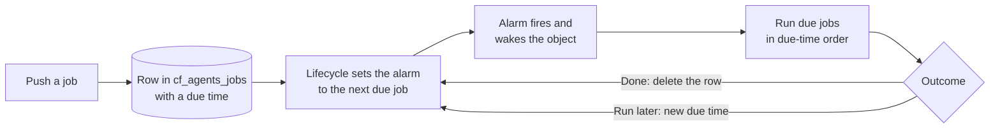

import { LinkCard, TypeScriptExample } from "~/components";

An agent's work often outlives a single request. A turn can call a model for minutes, wait on a tool, or sleep until tomorrow. A durable agent finishes that work, even if the code running it stops in the middle.

Serverless infrastructure makes this hard. This page explains why, how the Agents SDK solves it, and what that means for the code you write.

## Durable storage is not durable work

Serverless code is request-scoped. It runs when a request, a message, or an event arrives, and the platform can stop it once that event is handled. A request can also time out. There is no background thread that keeps running between events.

A [Durable Object](/durable-objects/) gives an agent two durable things:

- **Storage.** Each object has its own SQLite database. A write is transactional and survives anything that happens to the code.
- **One alarm.** The object can set a single time at which the platform wakes it, even if it is not in memory.

It does not give the agent durable work. An object leaves memory when:

- It is idle, and hibernates.
- You deploy a new version.
- It exceeds its memory limit, or its isolate crashes.

When that happens, anything held only in memory is gone: timers, promises, in-flight calls to a model, and local variables. A `setTimeout()` for tomorrow never fires. A loop that was halfway through a list does not continue.

So the rule for durable work is: **anything that must continue is written to SQLite first, and woken by the alarm.**

## How the Agents SDK makes work durable

The [Lifecycle](/agents/concepts/runtime/) turns the object's storage and its one alarm into a durable job queue.

### Write the intent first

A job is a row in the object's SQLite database, in a table named `cf_agents_jobs`. The row names the capability that owns the job, a function, a due time, and a payload. Pushing a job writes that row before your code moves on, so the intent to do the work is durable before the work starts.

A job has an id. Pushing a job with an id that already exists replaces that job, so repeating a push does not create a second job.

### The alarm loop

The Lifecycle owns the object's one alarm. Every capability and your own class push jobs to the same queue, and the Lifecycle sets the alarm for the earliest due job. Nothing else sets the alarm, so no capability overwrites another's wake-up time.



When the alarm fires:

1. The platform starts the object if it was evicted. The Lifecycle starts its capabilities.
2. The Lifecycle reads every job that is due, and runs them one at a time, in due-time order. Each job goes to the `onJob()` hook of the capability or class that pushed it.
3. Each job returns an outcome. Returning nothing completes the job and deletes its row. Returning a later time keeps the row and moves its due time. Returning `"yield"` leaves the job due, to run again on the next wake.
4. The Lifecycle sets the alarm again, from what is left in the queue.

The object can hibernate, be evicted, or be replaced by a deploy between any two wakes. The queue is in SQLite, so the next alarm finds it.

### Failures and crashes

The job queue handles the ways work can stop:

- **A job that throws is retried.** By default, the Lifecycle tries a job three times in the same wake, with a short backoff. If every attempt fails, the owner's `onJobError()` hook decides what happens. Without one, the job is complete.
- **A platform failure keeps the job.** If a deploy replaces the isolate, or the object is reset, the job is not retried in place and not deleted. The Lifecycle leaves it in the queue for a fresh run of the alarm.
- **A crash still wakes the object.** Before it runs any job, the Lifecycle sets a backup alarm 30 seconds ahead. If the isolate dies mid-job, that alarm starts the object again, and the job is still due.
- **A long job keeps a heartbeat.** A job can hand off long work, return a due time a short way ahead, and let the work continue. If the object is evicted, the job becomes due and the alarm wakes the object to pick up the work. If the work is still running when the job comes due, the job moves its due time out again.

### The memory-limit breaker

Some work fails the same way every time. If a job makes the object exceed its memory limit, the alarm fails, and the platform would retry the alarm, and run the same job, forever.

The Lifecycle breaks that loop. It counts memory-limit resets during alarms in durable storage:

- After each reset, it backs off the job that was running. Jobs that a capability marks as part of a recovery loop back off with it. The backoff is 30 seconds after the first reset, and longer after each one.
- After three resets in a row, it deletes those jobs. Other jobs are not touched.
- On each reset, it calls the `onMemoryLimit()` hook of each capability and your class's `onAlarmMemoryLimit()` hook, so they can clean up their own state.

A clean alarm resets the count. You can change the number of resets with the Lifecycle's `maxAlarmMemoryLimitStrikes` option.

### Built on the job queue

Every durable feature in the SDK is a job in this queue:

- **[Scheduler](/agents/runtime/capabilities/scheduler/)** runs your callbacks after a delay, at a set time, on a cron expression, or at an interval. Each schedule is one job. A recurring schedule returns its next due time as its outcome.
- **[The Pi harness](/agents/harnesses/pi/)** stores its sessions in SQLite and pushes one wake-up job before it hands Pi any work. While Pi is working, the job keeps a 30-second heartbeat. If the object is evicted mid-turn, the alarm wakes it, Pi reopens from SQLite, and resumes its tasks. When Pi has nothing left to do, the job completes. The wake-up job is part of a recovery loop, so the memory-limit breaker stops it if it crashes the object again and again.

## What this means for your code

The job queue makes sure work is not lost. It cannot make the work itself safe to repeat. Design for that:

- **Delivery is at least once.** A job can run more than once: after a retry, after a crash mid-job, or after a deploy. Make each job idempotent. Check durable state before you act, and pass an idempotency key to external services.
- **Persist progress.** Anything only in memory is lost on eviction. Write a checkpoint to SQLite after each step, so a rerun starts where the last run stopped.
- **Keep steps small.** The Lifecycle runs due jobs one at a time, so a slow `onJob()` delays every other job on the object. Do one bounded step per job, then return a new due time for the next one.
- **Know what survives.** Rows in SQLite and jobs in the queue survive. Open connections to other services, a model response that is still streaming, and in-memory timers do not.

This example writes the intent and the job in the same object, then checks for finished work before it acts:

<TypeScriptExample>

```ts
import { DurableObject } from "cloudflare:workers";
import { Lifecycle, type LifecycleJobContext } from "agents/lifecycle";

export class ReportAgent extends DurableObject<Env> {
	readonly lifecycle = Lifecycle.install(this);

	onStart(): void {
		this.ctx.storage.sql.exec(
			"CREATE TABLE IF NOT EXISTS reports (id TEXT PRIMARY KEY, sent INTEGER NOT NULL DEFAULT 0)",
		);
	}

	async requestReport(id: string): Promise<void> {
		await this.lifecycle.start();
		// Write the intent first. The row and the job are in SQLite before this method returns.
		this.ctx.storage.sql.exec(
			"INSERT OR IGNORE INTO reports (id) VALUES (?)",
			id,
		);
		await this.lifecycle.jobs.push({
			id: `report:${id}`,
			fn: "send",
			time: Date.now(),
			payload: { id },
		});
	}

	async onJob({ job }: LifecycleJobContext): Promise<void> {
		if (job.fn !== "send") return;
		const { id } = job.payload as { id: string };
		// A job can run more than once. Skip work that already finished.
		const [row] = this.ctx.storage.sql
			.exec<{ sent: number }>("SELECT sent FROM reports WHERE id = ?", id)
			.toArray();
		if (!row || row.sent === 1) return;

		await fetch("https://reports.example.com/send", {
			method: "POST",
			headers: { "Idempotency-Key": id },
		});
		this.ctx.storage.sql.exec("UPDATE reports SET sent = 1 WHERE id = ?", id);
	}
}
```

</TypeScriptExample>

## Leave the object for long work

Some work does not belong inside one Durable Object:

- **Many steps, with retries per step, that run for hours or days.** Use [Cloudflare Workflows](/workflows/). For when to choose a Workflow, refer to [Workflows](/agents/concepts/workflows/).
- **A long process with a full operating system.** Use [Containers](/containers/).

## On the `Agent` class

The `Agent` class adds fibers on top of the job queue. `runFiber()` runs a function that the agent recovers after an eviction, `stash()` saves checkpoints inside it, and `keepAlive()` keeps the object in memory during long work. Fibers exist only on the `Agent` class. For more information, refer to [Durable execution on the Agent class](/agents/agent-class/durable-execution/).

## Related resources

<LinkCard
	title="Jobs and alarms"
	href="/agents/runtime/lifecycle/job-queue/"
	description="Push jobs, handle failures, and control the alarm."
/>

<LinkCard
	title="Scheduler"
	href="/agents/runtime/capabilities/scheduler/"
	description="Run callbacks after a delay, at a set time, or on a cron schedule."
/>

<LinkCard
	title="Pi harness"
	href="/agents/harnesses/pi/"
	description="Run an agent loop that resumes after an eviction."
/>

<LinkCard
	title="Long-running agents"
	href="/agents/concepts/agentic-patterns/long-running-agents/"
	description="Design agents that run for days or weeks."
/>
