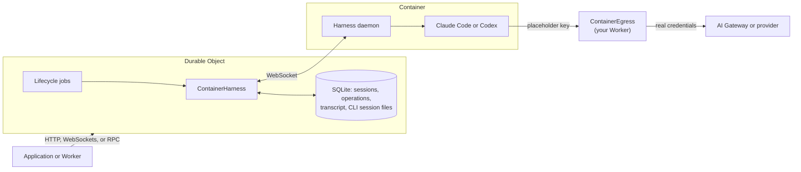

import {
	CopyPromptButton,
	LinkCard,
	PackageManagers,
	TypeScriptExample,
	WranglerConfig,
} from "~/components";

`ContainerHarness` runs an agent command-line interface (CLI), such as Claude Code or Codex, in a [Cloudflare Container](/containers/), and drives it from a [Durable Object](/durable-objects/). The CLI runs its own loop and tools in the container. The Durable Object keeps the session, holds the credentials, and decides when the container runs.

:::caution[Experimental]
`agents/harness/container` is experimental. Its API may change in any release.
:::

<CopyPromptButton
	tooltip="Build and deploy a Claude Code agent"
	prompt="Read https://developers.cloudflare.com/agents/harnesses/container/ and the example at https://github.com/cloudflare/agents/tree/main/examples/next/harnesses/container, then use them to build and deploy a Claude Code agent on Cloudflare with ContainerHarness from the Agents SDK. Use a plain Durable Object with the Lifecycle, an AI Gateway for model requests, and add authentication before exposing the routes. Explain the experimental API and recovery limitations. Give me the deployed URL."
/>

The [Container harness example](https://github.com/cloudflare/agents/tree/main/examples/next/harnesses/container) runs Claude Code and Codex side by side, with routes to prompt, stream events, and stop the container.

## When to use it

Use the Container harness when you want a specific CLI agent with its own tools, plugins, and settings, and you want it to behave the way it does on your laptop. Most CLI agents are binaries that need a Linux shell, so they cannot run in a Durable Object.

If you control the agent loop, use a harness that runs in the Durable Object, such as [Pi](/agents/harnesses/pi/), and give it a [sandbox](/agents/tools/sandbox/) as a tool. For the trade-offs between the two, refer to [Harness](/agents/concepts/harness/#where-the-pieces-live).

## How it works

`ContainerHarness` is a [Lifecycle capability](/agents/runtime/lifecycle/). You install it on a plain Durable Object, and it uses the object's attached container through `ctx.container`.



- **The object keeps the record.** Sessions, queued and running prompts, the transcript, and the CLI's own session files are stored in the object's SQLite database. The table names start with `container_`.
- **The container is disposable.** The harness starts it on the first prompt and stops it five minutes after its last work. Before it stops, the harness snapshots the container's file system. The next prompt starts a new container from that snapshot, and the CLI resumes its own session.
- **There is no image to build.** On first use, the harness starts the `cloudflare/debian-trixie` managed image, installs the CLI and a small daemon, and snapshots the result. Later starts restore the snapshot.
- **Credentials stay outside.** The CLI calls a placeholder host with a placeholder key. `ContainerEgress`, a Worker entrypoint in your Worker, swaps in the real credentials and forwards the request.
- **Runs survive an eviction.** Each session with open work has one Lifecycle job. If the object is evicted mid-run, the job's alarm restarts the object, which reconnects to the container and replays the output it missed.

Each prompt runs one CLI process as an unprivileged `agent` user, such as `claude -p --output-format stream-json` or `codex exec --json`. The daemon turns the CLI's output into transcript messages and events, and streams them to the object.

## Install

Install the Agents SDK:

<PackageManagers pkg="agents@latest" />

`ContainerHarness` is available in `agents` 0.27.0 and later.

Add a SQLite-backed Durable Object and a container for the same class. The container must use the [`durable_object` scheduling policy](/containers/configuration/scheduling-policy/#use-the-durable-object-scheduling-policy), so the object can start it from snapshots:

<WranglerConfig>

```jsonc
{
	"name": "claude-code-agent",
	"main": "src/index.ts",
	"compatibility_date": "$today",
	"compatibility_flags": ["nodejs_compat"],
	"durable_objects": {
		"bindings": [{ "name": "ClaudeCodeAgent", "class_name": "ClaudeCodeAgent" }],
	},
	"migrations": [{ "tag": "v1", "new_sqlite_classes": ["ClaudeCodeAgent"] }],
	"containers": [
		{ "class_name": "ClaudeCodeAgent", "scheduling_policy": "durable_object" },
	],
	"vars": {
		"AI_GATEWAY_URL": "https://gateway.ai.cloudflare.com/v1/<ACCOUNT_ID>/<GATEWAY_ID>",
	},
}
```

</WranglerConfig>

There is no `image` in the container configuration. The harness starts the managed image itself.

Store your AI Gateway token as a secret:

```sh
npx wrangler secret put AI_GATEWAY_TOKEN
```

To run containers locally, you need Docker and Wrangler 4.141.0 or later. For more information, refer to [Local development](/containers/guides/local-dev/).

## Create the agent

Create the harness with a preset, install a Lifecycle on the Durable Object, and add the harness to it. Export `ContainerEgress` from your Worker's main module, so `ctx.exports.ContainerEgress` exists:

<TypeScriptExample filename="src/index.ts">

```ts
import { DurableObject } from "cloudflare:workers";
import { routeAgentRequest } from "agents";
import { ContainerHarness, claudeCode } from "agents/harness/container";
import { Lifecycle } from "agents/lifecycle";

// Adds credentials to the CLI's model requests, outside the container.
export { ContainerEgress } from "agents/harness/container";

export class ClaudeCodeAgent extends DurableObject<Env> {
	readonly harness = new ContainerHarness({
		container: containerOf(this.ctx),
		egress: this.ctx.exports.ContainerEgress,
		agent: claudeCode({
			baseUrl: `${this.env.AI_GATEWAY_URL}/anthropic`,
			apiKey: this.env.AI_GATEWAY_TOKEN,
		}),
	});

	readonly lifecycle = Lifecycle.install(this).use(this.harness);

	async onRequest(request: Request): Promise<Response> {
		if (request.method !== "POST") {
			return Response.json(await this.harness.messages());
		}
		const { text } = await request.json<{ text: string }>();
		const result = await this.harness.prompt(text);
		return Response.json({ status: result.status, text: result.text });
	}
}

function containerOf(ctx: DurableObjectState): Container {
	if (!ctx.container) {
		throw new Error("Add a container for this class in wrangler.jsonc");
	}
	return ctx.container;
}

export default {
	async fetch(request: Request, env: Env) {
		return (
			(await routeAgentRequest(request, env)) ??
			new Response("Not found", { status: 404 })
		);
	},
} satisfies ExportedHandler<Env>;
```

</TypeScriptExample>

`routeAgentRequest()` sends `/agents/claude-code-agent/<name>` to the object with that name. Each object has its own container, workspace, and sessions. In an application, choose the object name from an authenticated user or project.

The first prompt to a new object takes longer, because the harness installs the CLI and takes the setup snapshot. Later containers start from a snapshot.

:::caution
These routes have no authentication. Each prompt runs commands and spends model credit. Add your own authentication before you deploy anywhere public.
:::

## Choose the CLI

A preset says what runs in the container. Switching between Claude Code and Codex changes only the preset:

<TypeScriptExample>

```ts
import { claudeCode, codex } from "agents/harness/container";

claudeCode({
	baseUrl: `${this.env.AI_GATEWAY_URL}/anthropic`,
	apiKey: this.env.AI_GATEWAY_TOKEN,
	model: "claude-sonnet-4-5",
});

codex({
	baseUrl: `${this.env.AI_GATEWAY_URL}/openai`,
	apiKey: this.env.AI_GATEWAY_TOKEN,
	model: "gpt-5.1",
});
```

</TypeScriptExample>

Each preset pins a CLI version. Pass `version` to choose another one. For every option, refer to the [API reference](/agents/harnesses/container/api/#presets).

## Connect to a model provider

Every preset takes the same connection options: `apiKey`, `baseUrl`, and `headers`. They describe where the CLI's model requests go, and which credentials they carry:

| Connection                                                                               | Options                                                                                              |
| ---------------------------------------------------------------------------------------- | ---------------------------------------------------------------------------------------------------- |
| Straight to the provider                                                                 | `apiKey` set to the provider key. Leave out `baseUrl`.                                               |
| [AI Gateway with Unified Billing](/ai-gateway/features/unified-billing/)                 | `baseUrl` set to your gateway URL plus `/anthropic` or `/openai`. `apiKey` set to the gateway token. |
| [AI Gateway with your own provider keys](/ai-gateway/configuration/bring-your-own-keys/) | `baseUrl` set to the gateway URL. `headers` set to `{ "cf-aig-authorization": "Bearer <TOKEN>" }`.   |

With Unified Billing, the gateway token is the only credential, and it never leaves the Durable Object.

## Keep credentials out of the container

The CLI never sees a real credential. The harness points it at a placeholder host, such as `http://anthropic.harness.internal`, with a placeholder key. `env` in the container shows only the placeholder.

When the container starts, the harness intercepts each placeholder host with [`interceptOutboundHttp()`](/containers/configuration/outbound-traffic/). `ContainerEgress` receives each intercepted request in your Worker. It removes the placeholder credentials, adds the real ones, and forwards the request over HTTPS to `baseUrl`. It does not follow redirects, so credentials are never sent to another host.

The container can still reach the Internet by default, because the managed image installs the CLI with `npm` during setup. Commands the agent runs can reach any host, but no host receives your model credentials. To allow only the placeholder hosts, set `enableInternet: false` and use a [custom image](#run-another-cli) that already has the CLI installed.

## Customize the CLI

Add `setup` steps to a preset to install plugins, settings, or a different build of the CLI. The steps run once, on the first start, and their result is kept in the setup snapshot.

A step runs as `root` by default. A step with `user: "agent"` runs as the user the CLI runs as, in its home. Every session's home starts as a copy of that home, so files such as `CLAUDE.md`, `~/.claude/settings.json`, skills, and `~/.codex/config.toml` work the way they do on your laptop:

<TypeScriptExample>

```ts
claudeCode({
	baseUrl: `${this.env.AI_GATEWAY_URL}/anthropic`,
	apiKey: this.env.AI_GATEWAY_TOKEN,
	appendSystemPrompt: "Run the tests before you report a change as done.",
	setup: [
		{
			name: "install review plugin",
			user: "agent",
			command: [
				"sh",
				"-c",
				"claude plugin marketplace add my-org/plugins && claude plugin install review@plugins",
			],
		},
	],
});
```

</TypeScriptExample>

Changing `setup`, the CLI version, or the Agents SDK version takes effect when a container next starts. A container that runs when you deploy keeps its old setup until it stops. The next container sets up from scratch, and starts without the previous workspace snapshot.

:::caution
A token that a setup step uses, for example to clone a private repository, stays in the snapshot. The agent can read it. Prefer public sources or short-lived URLs.
:::

## Run another CLI

To run a CLI that has no preset, build an image whose entrypoint serves the harness daemon, and pass it to `containerAgent()`. Describe the CLI with `cliAdapter()` from `agents/harness/container/runtime`:

<TypeScriptExample filename="daemon.ts">

```ts
import { cliAdapter, serveFromEnv } from "agents/harness/container/runtime";

await serveFromEnv(
	cliAdapter({
		id: "my-agent",
		// Where the CLI keeps its sessions, relative to $HOME.
		stateDirs: [".my-agent/sessions"],
		command: (turn) => ({
			argv: [
				"my-agent",
				"--json",
				...(turn.state.id ? ["--resume", turn.state.id] : []),
			],
			stdin: turn.prompt,
		}),
		parser: () => ({
			// Turn one line of output into events, state, and an outcome.
			line: (text) => parseMyAgentLine(JSON.parse(text)),
			end: ({ code }) => ({ status: "unanswered", reason: `exit ${code}` }),
		}),
	}),
);
```

</TypeScriptExample>

Declare the image in Wrangler under `images`, and select it with `ctx.container.images`:

<TypeScriptExample>

```ts
import { containerAgent } from "agents/harness/container";

containerAgent({
	image: this.ctx.container.images.agent,
	adapter: "my-agent",
});
```

</TypeScriptExample>

The adapter persists everything the CLI writes under `stateDirs`, and every `state` value the parser reports, to the Durable Object while a turn runs. A new container restores both before its first turn.

## Send prompts

`harness.prompt()` submits to the root session and waits for the answer. It returns `status`, the final `text` or a `reason`, and the session's transcript as `messages`. `status` is `"done"` when the CLI answered, and `"unanswered"` when the run failed, was aborted, or was lost with its container.

Coding tasks often take minutes. To return before the CLI finishes, submit and wait separately:

<TypeScriptExample>

```ts
const receipt = await this.harness.submit("Add a test for parse()", {
	operationId: "issue-42",
});

// In a later request to the same Durable Object:
const result = await this.harness.wait(receipt.operationId, {
	session: receipt.session,
});
```

</TypeScriptExample>

`submit()` resolves once the prompt is stored, before the CLI starts. An `operationId` makes submissions idempotent within a session: reusing one returns the first receipt with `accepted: false`.

A prompt submitted while the session runs waits for the current run, then runs as its own turn. Claude Code and Codex run one process per turn, so they cannot join a running turn. `whenBusy: "steer"` and `session.steer()` queue the prompt as a follow-up for these CLIs.

To stop work, call `harness.abort()`. Aborted operations end `unanswered` with the reason `aborted`.

## Work with sessions

The harness creates a root session with the ID `"root"`. Each session is a separate CLI session with its own transcript. Create and fork sessions through `harness.sessions`:

<TypeScriptExample>

```ts
const session = await this.harness.sessions.create();
await session.prompt("Draft a migration plan");

// Continue the same history on a branch.
const fork = await this.harness.sessions.fork(session.id);
await fork.prompt("Now try it without a schema change");

const all = await this.harness.sessions.list();
```

</TypeScriptExample>

`harness.session(id)` returns a handle to a session that already exists. Prompting a session that was never created throws.

Each session has its own `$HOME`, so sessions never see each other's CLI state. All sessions in one object share the `/workspace` working directory and the same container.

`session.reset(handoff)` starts a new CLI session without the old history. The optional `handoff` text is added to the start of the next prompt. `session.setModel(model)` changes the model for the next turn.

## Stream events to clients

`session.events()` returns a stream. Its `snapshot` holds the transcript, pending operations, and whether the session is busy. Call `start()` to receive every later event, in batches:

<TypeScriptExample>

```ts
const stream = await this.harness.session().events();
socket.send(JSON.stringify({ type: "snapshot", ...stream.snapshot }));

stream.start((events) => {
	for (const event of events) socket.send(JSON.stringify(event));
});

// When the client disconnects:
await stream.stop();
```

</TypeScriptExample>

Events include live `text-delta` and `reasoning-delta` output, finished `message` entries, `usage` figures, `operation-start` and `operation-end`, and `container` status changes. An event can repeat what the snapshot already shows, so key messages by ID. Events reach listeners only in the Durable Object that runs the harness. For the full list, refer to [Events](/agents/harnesses/container/api/#events).

The [example](https://github.com/cloudflare/agents/tree/main/examples/next/harnesses/container) serves the same stream over Server-Sent Events.

## Container lifecycle

The harness starts the container on demand, and stops it after `idleTimeoutMs`, five minutes by default. Before it stops the container, it snapshots the whole file system, including `/workspace`. The next prompt starts a new container from that snapshot.

To stop the container now, call `harness.stop()`. Sessions survive, and the next prompt resumes them in a new container. Snapshots expire 30 days after they were last used. Without a usable snapshot, the harness sets up a fresh container.

`harness.container()` reports whether the container is running.

## Recovery

The harness recovers differently depending on what was lost:

| What was lost                                    | What happens                                                                                                                                                                                               |
| ------------------------------------------------ | ---------------------------------------------------------------------------------------------------------------------------------------------------------------------------------------------------------- |
| The Durable Object, after an eviction or deploy  | The container keeps running. The Lifecycle job restarts the object, which reconnects and replays the output it missed.                                                                                     |
| The WebSocket to the container                   | The harness reconnects on the next heartbeat and replays the missed output.                                                                                                                                |
| The container, after a crash or platform restart | A new container starts from the last snapshot. Queued prompts run there. A prompt that was running ends `unanswered` with the reason `container_lost`, and the CLI resumes its session on the next prompt. |

A container that dies mid-run loses workspace edits made since the last snapshot. The CLI's session files are saved as each turn runs, so the conversation is not lost. To run an interrupted prompt again from the start, set `onContainerLost: "retry"`. Only do this when the agent's work is safe to repeat.

If a container fails to start five times in a row, the session's open prompts end `unanswered` with the reason `container_unavailable`. The next prompt tries again.

## Security

The container is the sandbox. Claude Code runs with `--dangerously-skip-permissions`, and Codex runs with `--dangerously-bypass-approvals-and-sandbox`, so neither CLI stops to ask before it runs a command. Treat everything in the container as readable by the agent, and keep credentials out of it.

- Put authentication in front of every route that reaches the harness.
- Use `allowedTools` and `disallowedTools` on `claudeCode()` to limit Claude Code's tools.
- Set `enableInternet: false` with a custom image to stop commands reaching the Internet.

## Limits

- One container runs per Durable Object, shared by every session in that object.
- Image parts in a prompt are not passed to the CLI. Only text reaches it.
- Events reach listeners only in the Durable Object that runs the harness.
- For instance sizes and container limits, refer to [Containers limits](/containers/platform/limits/).

## Related resources

<LinkCard
	title="API reference"
	href="/agents/harnesses/container/api/"
	description="Options, methods, presets, and types in agents/harness/container."
/>

<LinkCard
	title="Harness"
	href="/agents/concepts/harness/"
	description="Choose where an agent's loop, tools, and session run."
/>

<LinkCard
	title="Container harness example"
	href="https://github.com/cloudflare/agents/tree/main/examples/next/harnesses/container"
	description="Claude Code and Codex in Containers, with routes to prompt, stream, and stop."
/>
