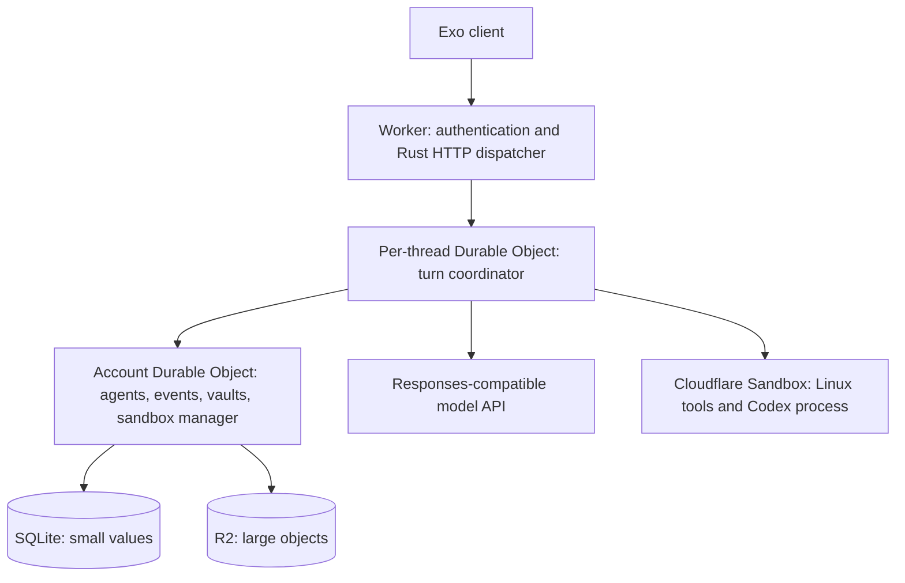

[Exo](https://github.com/exoharness/exo) is an open-source runtime for hosting agents behind an API. You define an agent in a Markdown file, choose its harness and model, and configure its tools, sandbox, and credentials. Exo separates the agent loop from the infrastructure that stores conversations and manages its working environment.

Use it when you want to build a hosted coding assistant or task-specific agent with control over its infrastructure and a choice of harnesses. Exo handles durable conversations, sandbox files, and credential access around the harness you select.

Its [Cloudflare adapter](https://github.com/exoharness/exo/tree/main/exoharness/cloudflare) runs shared Rust orchestration as WebAssembly in Workers and SQLite-backed Durable Objects. Linux tools and the Codex harness execute in Cloudflare Sandboxes backed by Containers. The Exo project maintains the adapter independently of Cloudflare. It provides its own host and recovery coordinator and does not require the Agents SDK.

## How it runs on Cloudflare

The Cloudflare adapter separates thread execution, account storage, and Linux processes:

Exo's `Runtime`, `LocalProvider`, and `BasicExoHarness` run as WebAssembly. JavaScript adapters supply storage, HTTP transport, and sandbox processes. Each thread has a `StoredTurnCoordinator` in its own Durable Object. The account object owns shared agents, events, encrypted vaults, and the sandbox manager.

The adapter supports Exo's basic and Codex harnesses, Responses-compatible models, Git URL resources, and remote HTTP MCP servers. The Codex process runs in the sandbox. This differs from the [SDK Codex example](/agents/harnesses/codex/), whose WebAssembly turn loop runs inside a Durable Object.

## Recovery boundaries

Turn acceptance stores the queue and recovery alarm atomically before returning HTTP `202`. Recovery alarms drain the queue for that thread. Use managed turn routes for coordinated execution. The authenticated `/exo/request` endpoint exposes account administration and store RPC.

Saved state does not guarantee exactly-once execution. Model calls can repeat after a crash. A tool with an ambiguous outcome fails instead of automatically replaying. Applications must reconcile external side effects.

## Files and sandboxes

Exo uses its own Cloudflare sandbox backend. The published adapter does not integrate `@cloudflare/computer` Workspaces. Connecting Computer would require a new adapter rather than a configuration switch.

Sandbox checkpoints preserve files, including Git checkouts and agent edits. Idle shutdown checkpoints files and stops processes. Snapshots preserve files, not running processes, and a crash can lose edits since the last checkpoint.

The Codex integration reuses its app-server and thread while warm. Its sandbox image includes Codex, and native history lives under `/home/exo/.codex`. Explicit stop and snapshot restoration have different behavior from idle shutdown. Refer to the [upstream sandbox lifecycle and limits](https://github.com/exoharness/exo/tree/main/exoharness/cloudflare#limits) before relying on recovery.

## Try Exo

Follow the [Cloudflare adapter's build and deployment instructions](https://github.com/exoharness/exo/tree/main/exoharness/cloudflare#build-and-deploy). They cover the Rust/WebAssembly build, R2, authentication, vault credentials, sandbox images, and live tests.

Exo maintains this integration independently. Use its [source and tests](https://github.com/exoharness/exo/tree/main/exoharness/cloudflare) as the reference for supported tools, transports, and recovery behavior.
