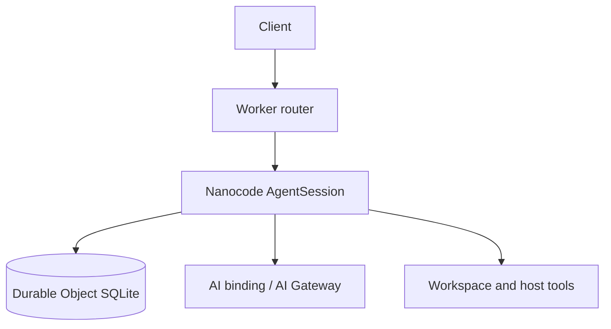
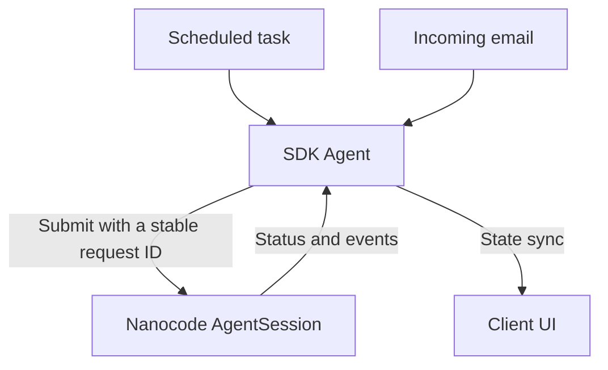

import { TypeScriptExample } from "~/components";

[Nanocode](https://github.com/gakonst/nanocode) is a Rust agent runtime that implements Codex and Claude Code prompt and tool conventions. Its TypeScript package runs the engine as [WebAssembly](/workers/runtime-apis/webassembly/) inside a [Durable Object](/durable-objects/).

Nanocode provides its own Cloudflare host. It does not require Agents SDK, and there is no `agents/harness/nanocode` export.



## Run on Workers

Start with the [Nanocode Workers guide](https://nanocode.xyz/docs/guides/workers) and [reference Worker](https://github.com/gakonst/nanocode-worker). Use the reference Worker for the complete host, including authentication, recovery alarms, and streaming.

The reference Worker uses `createNanocode()` from `nanocode-ts/cloudflare`. That factory returns the `AgentSession` Durable Object class and a Worker request handler.

Use the package version pinned by the reference Worker: it installs `nanocode-ts` from a GitHub release tarball.

Nanocode handles these parts of the deployment:

| Component        | Responsibility                                                          |
| ---------------- | ----------------------------------------------------------------------- |
| Rust/Wasm engine | Model calls, tools, checkpoints, and tool receipts                      |
| `AgentSession`   | SQLite storage, recovery alarms, and hibernating WebSockets             |
| Worker router    | Authenticate requests and route each account/session pair to its object |
| Host adapters    | Connect models, workspace operations, and external tools                |

## Submit a turn

After deploying the host, call its session API. The `provider` field selects Nanocode's harness implementation. This example uses `provider: "codex"` with Workers AI model `glm-5.3` through `aiGateway()`.

Configure the host with the `AI` binding, `AI_GATEWAY_ID`, and `WORKERS_AI_ACCOUNT_ID`. Run this helper in your backend, passing the deployment origin and its configured bearer token:

<TypeScriptExample>

```ts
export async function submitTurn(
	origin: string,
	token: string,
	requestId: string,
): Promise<unknown> {
	const response = await fetch(new URL("/sessions/demo/turns", origin), {
		method: "POST",
		headers: {
			authorization: `Bearer ${token}`,
			"content-type": "application/json",
		},
		body: JSON.stringify({
			request_id: requestId,
			prompt: "Explain durable agents in two sentences.",
			provider: "codex",
			model: "glm-5.3",
			thinking: "low",
		}),
	});

	if (!response.ok) {
		throw new Error(`Nanocode submission failed: ${response.status}`);
	}
	return response.json();
}
```

</TypeScriptExample>

Store the request ID before submitting. Reuse that ID and input when retrying. Different input under the same ID returns HTTP `409`.

HTTP `202` means the turn is pending, not complete. Use the same authentication when reading its status or events:

| Request                                                              | Result                                                         |
| -------------------------------------------------------------------- | -------------------------------------------------------------- |
| `GET /sessions/demo/turns/{request_id}`                              | Turn status and recorded result                                |
| `GET /sessions/demo/events?after=0` with `Accept: text/event-stream` | Server-sent events from the stored log, followed by new events |
| WebSocket upgrade to `/sessions/demo/socket`                         | Nanocode client connection                                     |

For reconnects, resume from the last event cursor your client processed. Use the [Nanocode Cloudflare transport](https://github.com/gakonst/nanocode-ts/blob/main/src/cloudflare/transport.ts) for its client protocol.

## Recovery boundaries

Nanocode journals turns and tool receipts. Its Cloudflare host uses alarms to resume pending work after an interruption.

- **Committed tool receipt:** Recovery reuses the saved result.
- **Tool started without a receipt:** Recovery reports an unknown outcome instead of automatically running the tool again. External effects still need idempotency or reconciliation.
- **External sandbox:** Session recovery does not restore its filesystem or running processes. Those depend on your workspace backend.

Refer to [Nanocode durability](https://nanocode.xyz/docs/guides/durability).

## Add Agents SDK capabilities

Use a separate SDK Agent when your application needs schedules, email, or synchronized application state:



For example, a [scheduled task](/agents/agent-class/schedule-tasks/) can submit a daily review. An [email handler](/agents/agent-class/communication-channels/email/) can submit a message, and [state sync](/agents/agent-class/state/) can show task progress in your UI.

This requires application code to map identities, submit turns, and track results. Nanocode retains its own transcript and recovery loop.

Keep SDK Lifecycle on the SDK object: `AgentSession` already owns its alarm and WebSocket handlers.
