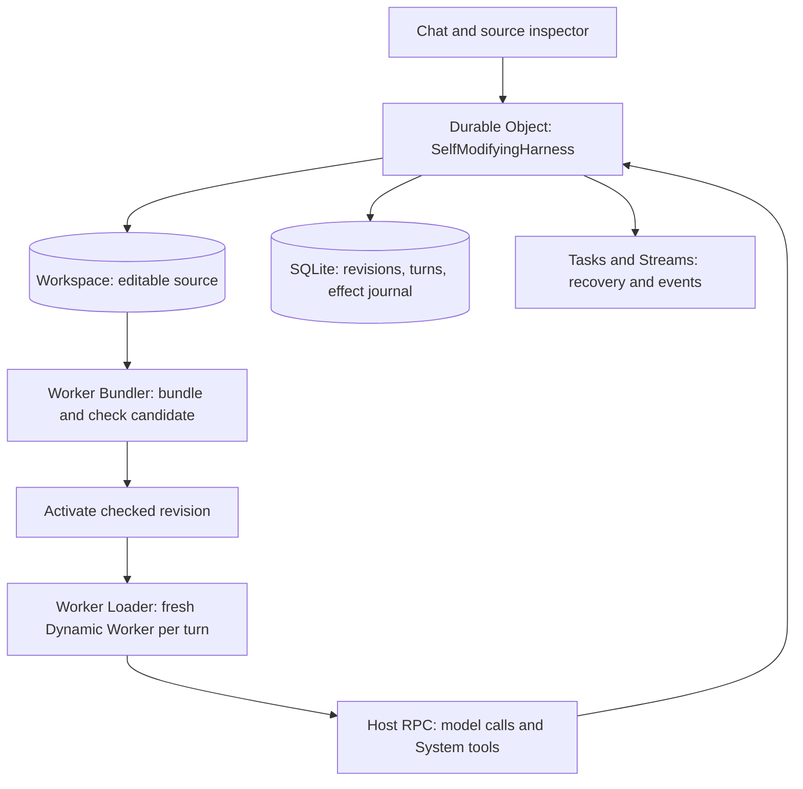

import { PackageManagers, Steps } from "~/components";

The [self-modifying harness example](https://github.com/cloudflare/agents/tree/main/examples/next/harnesses/self-modifying) lets an agent edit its own TypeScript loop and custom tools. Source files persist in a [Cloudflare Computer Workspace](/agents/tools/filesystem/). A Durable Object coordinates turns and revisions, while fresh [Dynamic Workers](/dynamic-workers/) execute the editable code.

`SelfModifyingHarness` is local to this experimental example. It uses internal SDK APIs and is not an exported Agents SDK harness.

## How it works

The example separates durable coordination from editable execution:



The editable source lives under `/harness`. Activation snapshots the source, bundles it with `@cloudflare/worker-bundler`, and checks it in an isolated Dynamic Worker. The active revision changes only after the check succeeds.

Each turn pins a revision and loads it with `WorkerLoader.load()`. Activating new source affects later turns. Module globals do not carry between turns. Restoring a prior revision provides a way to return to working code.

### System and custom tools

System tools execute through RPC in the Durable Object. They read and write source, activate or restore revisions, and append journal entries. Their definitions remain outside the editable harness.

Custom tools are TypeScript exports under `/harness/src/tools/`. They execute inside the turn's Dynamic Worker. Activation discovers their files and builds a registry. A custom tool cannot replace a System tool with the same name.

## Durability and workspace behavior

The Workspace stores editable files in Durable Object SQLite. The host also stores revisions, turn state, and a journal of model calls and System tool results. Tasks supplies durable execution, and Streams supplies persisted events for client replay.

Completed model and System tool calls reuse recorded results when their stable keys and inputs match. A call interrupted before its result is saved can run again. Custom tool code runs again when the editable turn restarts, so it must tolerate replay. Do not assume arbitrary external side effects execute exactly once.

A Dynamic Worker is a temporary execution environment. Its memory is not the checkpoint. Persistent source and host records allow a new Worker to run the pinned revision again.

This example uses Computer for source files and Worker Bundler for TypeScript compilation. It does not start a Linux container or provide the shell environment of a coding CLI.

## Run the example

You need Git, Node.js 24 or later, pnpm, a Cloudflare account, and Worker Loader access. The example calls Workers AI remotely during development.

The example has no authentication. Every connected client can edit, activate, and restore source. Add authentication before exposing it to other users.

<Steps>
1. Clone the Agents repository:

   ```sh
   git clone https://github.com/cloudflare/agents.git
   cd agents
   ```

2. Install dependencies and build the SDK:

   <PackageManagers type="install" managers={["pnpm"]} />

   <PackageManagers type="exec" pkg="nx" args="run agents:build" managers={["pnpm"]} />

3. Sign in with the [Cloudflare CLI](/cf/get-started/), then open the example:

   ```sh
   cf auth login
   cd examples/next/harnesses/self-modifying
   ```

4. Start the example's Vite app:

   <PackageManagers type="run" args="start" managers={["pnpm"]} />

   If you have access to multiple accounts, set `CLOUDFLARE_ACCOUNT_ID` before starting.

5. Open the printed URL and submit a prompt:

   ```txt
   Create a custom tool named roll_die that accepts a number of sides.
   Inspect the existing custom tool example, write the new tool file,
   activate the harness, and tell me the new revision.
   ```

   Send another message to use the activated revision. Inspect the source, revision history, and activity journal in the browser. Reload the page to check the persisted source and revision.
</Steps>

For the implementation and tests, refer to the [complete example](https://github.com/cloudflare/agents/tree/main/examples/next/harnesses/self-modifying).
