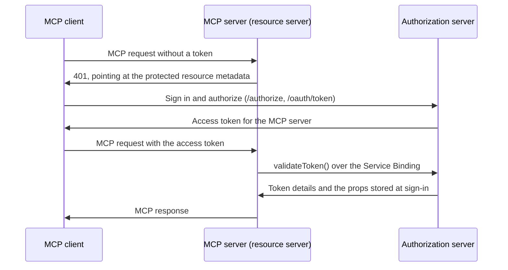

import {
	LinkCard,
	PackageManagers,
	TypeScriptExample,
	WranglerConfig,
} from "~/components";

When building a [Model Context Protocol (MCP)](https://modelcontextprotocol.io) server, you need both a way to allow users to login (authentication) and allow them to grant the MCP client access to resources on their account (authorization).

The Model Context Protocol uses [a subset of OAuth 2.1 for authorization](https://modelcontextprotocol.io/specification/2025-06-18/basic/authorization). OAuth allows your users to grant limited access to resources, without them having to share API keys or other credentials.

Cloudflare's [Workers OAuth Provider](https://github.com/cloudflare/workers-oauth-provider) implements both sides of MCP authorization on Workers. A deployment has two roles:

- The **authorization server** signs users in and issues access tokens. Build it with `OAuthAuthorizationServer`.
- The **resource server** is your MCP server. It accepts those tokens and checks each one with the authorization server over a [Service Binding](/workers/runtime-apis/bindings/service-bindings/). Build it with `OAuthResourceServer` around [`createMcpHandler`](/agents/model-context-protocol/apis/handler-api/).



One authorization server can issue tokens for several MCP servers, and each can run in its own Worker.

## Build the authorization server

Create a Worker for the authorization server and install the library:

<PackageManagers pkg="@cloudflare/workers-oauth-provider" />

The library serves discovery, client registration, and the token endpoint. The `/authorize` page is yours: it signs the user in, asks for consent, and calls `completeAuthorization()`. The `props` you pass there are encrypted and handed to your MCP server with every request.

<TypeScriptExample filename="auth-server/src/index.ts">

```ts
import {
	AuthorizationError,
	OAuthAuthorizationServer,
	type AuthRequest,
} from "@cloudflare/workers-oauth-provider";
import { env, WorkerEntrypoint } from "cloudflare:workers";

// Everything this server can grant.
const SCOPES = ["mcp:read", "mcp:write", "offline_access"];

const authorizationServer = new OAuthAuthorizationServer<Env>({
	issuer: env.ISSUER, // this Worker's URL
	resources: [env.MCP_SERVER_URL], // the MCP servers it issues tokens for
	scopesSupported: SCOPES,
	clientIdMetadataDocumentEnabled: true,
	// Optional: Dynamic Client Registration for older MCP clients.
	clientRegistrationEndpoint: "/oauth/register",
});

async function authorize(request: Request, env: Env): Promise<Response> {
	const oauth = authorizationServer.getOAuthApi(env);

	let authRequest: AuthRequest;
	try {
		// Validates the client, redirect URI, resource, and PKCE.
		authRequest = await oauth.parseAuthRequest(request);
	} catch (error) {
		if (!(error instanceof AuthorizationError)) throw error;
		if (error.redirectTo) return Response.redirect(error.redirectTo, 302);
		return new Response(error.description, { status: 400 });
	}

	// Replace with your own sign-in and consent page.
	const user = { id: "user-123", name: "Ada" };

	const { redirectTo } = await oauth.completeAuthorization({
		request: authRequest,
		userId: user.id,
		metadata: {},
		scope: authRequest.scope.filter((scope) => SCOPES.includes(scope)),
		props: { userId: user.id, name: user.name },
	});
	return Response.redirect(redirectTo, 302);
}

export default class AuthServer extends WorkerEntrypoint<Env> {
	fetch(request: Request) {
		if (new URL(request.url).pathname === "/authorize") {
			return authorize(request, this.env);
		}
		return authorizationServer.fetch(request, this.env, this.ctx);
	}

	// MCP servers call this over their Service Binding.
	validateToken(resource: string, token: string) {
		return authorizationServer.validateToken(resource, token, this.env);
	}
}
```

</TypeScriptExample>

The authorization server stores grants and tokens in a KV namespace bound as `OAUTH_KV`. Create one with `npx wrangler kv namespace create OAUTH_KV`. The `global_fetch_strictly_public` flag is required for Client ID Metadata Documents, because the server fetches client-supplied URLs.

<WranglerConfig>

```jsonc
{
	"name": "auth-server",
	"main": "src/index.ts",
	"compatibility_date": "$today",
	"compatibility_flags": ["nodejs_compat", "global_fetch_strictly_public"],
	"vars": {
		"ISSUER": "https://auth-server.<your-subdomain>.workers.dev",
		"MCP_SERVER_URL": "https://mcp-server.<your-subdomain>.workers.dev/mcp",
	},
	"kv_namespaces": [{ "binding": "OAUTH_KV", "id": "<YOUR_KV_NAMESPACE_ID>" }],
}
```

</WranglerConfig>

## Make your MCP server a resource server

Wrap your `createMcpHandler` handler in an `OAuthResourceServer`. It publishes the protected resource metadata that MCP clients use to find your authorization server, answers requests without a valid token with a `401`, and rejects tokens issued for any other resource. Your handler runs only for valid tokens.

<TypeScriptExample filename="mcp-server/src/index.ts">

```ts
import {
	OAuthResourceServer,
	insufficientScope,
	type AuthorizationServerBinding,
} from "@cloudflare/workers-oauth-provider";
import { McpServer } from "@modelcontextprotocol/server";
import { createMcpHandler, getMcpAuthContext } from "agents/mcp/server";
import { env } from "cloudflare:workers";

type AuthProps = { userId: string; name: string };

interface Env {
	AUTH_SERVER: AuthorizationServerBinding<AuthProps>;
	AUTH_SERVER_URL: string;
	MCP_SERVER_URL: string;
}

function createServer() {
	const server = new McpServer({ name: "my-mcp-server", version: "1.0.0" });
	const props = getMcpAuthContext()?.props as AuthProps;

	server.registerTool(
		"whoami",
		{ description: "Return the signed-in user" },
		async () => ({
			content: [{ type: "text", text: `Hello, ${props.name}!` }],
		}),
	);

	return server;
}

const mcpHandler = createMcpHandler(createServer);

export default new OAuthResourceServer<Env, AuthProps>({
	resourceMetadata: {
		resource: env.MCP_SERVER_URL, // the URL MCP clients connect to
		authorization_servers: [env.AUTH_SERVER_URL],
	},
	// Scopes every client must ask for. Advertised, not enforced: check them in the handler.
	requiredScopes: ["mcp:read"],
	validateToken: (env) => env.AUTH_SERVER.validateToken,
	handler: {
		fetch(request, env, ctx) {
			if (!ctx.auth.scope.includes("mcp:read")) {
				return insufficientScope(ctx.auth, ["mcp:read"]);
			}
			// ctx.props is what completeAuthorization() stored.
			// createMcpHandler exposes it to tools through getMcpAuthContext().
			return mcpHandler(request, env, ctx);
		},
	},
});
```

</TypeScriptExample>

The MCP server reaches the authorization server through a Service Binding, so token checks never leave Cloudflare's network and the MCP server needs no KV namespace of its own:

<WranglerConfig>

```jsonc
{
	"name": "mcp-server",
	"main": "src/index.ts",
	"compatibility_date": "$today",
	"compatibility_flags": ["nodejs_compat"],
	"vars": {
		"AUTH_SERVER_URL": "https://auth-server.<your-subdomain>.workers.dev",
		"MCP_SERVER_URL": "https://mcp-server.<your-subdomain>.workers.dev/mcp",
	},
	"services": [{ "binding": "AUTH_SERVER", "service": "auth-server" }],
}
```

</WranglerConfig>

Deploy the authorization server first, because the MCP server binds to it. Then deploy the MCP server and connect an MCP client to its `/mcp` URL. The client follows the `401` to the authorization server, signs the user in, and retries with a token.

`MCP_SERVER_URL` must be exactly the URL clients connect to, because every token is bound to it. For local development, run `npx wrangler dev` in each Worker on a different port, and set the URLs to their `http://localhost` values in each Worker's `.dev.vars` file. The library accepts `http` only on loopback hosts.

## Sign users in

Your `/authorize` page should call `completeAuthorization()` only after it has signed the user in and the user has approved the client. The library includes helpers for both:

- **Consent page**: `describeConsent()`, `beginConsent()`, `approveConsent()`, and `denyConsent()` build a consent page that cannot be framed or forged. Refer to [Building a consent page](https://github.com/cloudflare/workers-oauth-provider/blob/main/docs/consent-page.md).
- **Sign in with GitHub, Google, or another provider**: `beginUpstream()` and `finishUpstream()` send the user to the provider after consent, and finish when it redirects back. Store the provider's access token in `props` to call its API from your tools. Refer to [Signing in through another provider](https://github.com/cloudflare/workers-oauth-provider/blob/main/docs/upstream-sign-in.md).

### Cloudflare Access

Cloudflare Access can sign users in to your MCP server. Users authenticate with a [configured identity provider](/cloudflare-one/integrations/identity-providers/) or a [one-time PIN](/cloudflare-one/integrations/identity-providers/one-time-pin/), and are only granted access if they match your [Access policies](/cloudflare-one/access-controls/policies/). Refer to [Secure MCP servers with Access for SaaS](/cloudflare-one/access-controls/ai-controls/secure-mcp-servers/).

### Identity providers

You can also sign users in with an identity provider you already use. It can define scopes that map to your tools and present its own consent page.

#### Stytch

Get started with a [remote MCP server that uses Stytch](https://stytch.com/docs/guides/connected-apps/mcp-servers) to allow users to sign in with email, Google login or enterprise SSO and authorize their AI agent to view and manage their company's OKRs on their behalf. Stytch will handle restricting the scopes granted to the AI agent based on the user's role and permissions within their organization. When authorizing the MCP Client, each user will see a consent page that outlines the permissions that the agent is requesting that they are able to grant based on their role.

[](https://deploy.workers.cloudflare.com/?url=https://github.com/cloudflare/ai/tree/main/demos/mcp-stytch-b2b-okr-manager)

For more consumer use cases, deploy a remote MCP server for a To Do app that uses Stytch for authentication and MCP client authorization. Users can sign in with email and immediately access the To Do lists associated with their account, and grant access to any AI assistant to help them manage their tasks.

[](https://deploy.workers.cloudflare.com/?url=https://github.com/cloudflare/ai/tree/main/demos/mcp-stytch-consumer-todo-list)

#### Auth0

Get started with a remote MCP server that uses Auth0 to authenticate users through email, social logins, or enterprise SSO to interact with their todos and personal data through AI agents. The MCP server securely connects to API endpoints on behalf of users, showing exactly which resources the agent will be able to access once it gets consent from the user. In this implementation, access tokens are automatically refreshed during long running interactions.

To set it up, first deploy the protected API endpoint:

[](https://deploy.workers.cloudflare.com/?url=https://github.com/cloudflare/ai/tree/main/demos/remote-mcp-auth0/todos-api)

Then, deploy the MCP server that handles authentication through Auth0 and securely connects AI agents to your API endpoint.

[](https://deploy.workers.cloudflare.com/?url=https://github.com/cloudflare/ai/tree/main/demos/remote-mcp-auth0/mcp-auth0-oidc)

#### WorkOS

Get started with a remote MCP server that uses WorkOS's AuthKit to authenticate users and manage the permissions granted to AI agents. In this example, the MCP server dynamically exposes tools based on the user's role and access rights. All authenticated users get access to the `add` tool, but only users who have been assigned the `image_generation` permission in WorkOS can grant the AI agent access to the image generation tool. This showcases how MCP servers can conditionally expose capabilities to AI agents based on the authenticated user's role and permission.

[](https://deploy.workers.cloudflare.com/?url=https://github.com/cloudflare/ai/tree/main/demos/remote-mcp-authkit)

#### Descope

Get started with a remote MCP server that uses [Descope](https://www.descope.com/)'s Agentic Identity Hub to authenticate and authorize users (for example, email, social login, SSO) to interact with their data through AI agents. Define scopes on the MCP Server resource in Descope to manage fine-grained, per-tool permissions.

:::caution
If you enable Dynamic Client Registration on a Descope MCP Server resource, also configure an approval step. Without one, any client can self-register and immediately request permissions with no human review.
:::

[](https://deploy.workers.cloudflare.com/?url=https://github.com/cloudflare/ai/tree/main/demos/remote-mcp-server-descope-auth)

For every option, refer to the [Workers OAuth Provider documentation](https://github.com/cloudflare/workers-oauth-provider#readme). If you run an existing `OAuthProvider` deployment, which combines both roles in one Worker, refer to the [1.x migration guide](https://github.com/cloudflare/workers-oauth-provider/blob/main/docs/migration-1.x.md).

## Using authentication context in tools

The `props` you passed to `completeAuthorization()` reach the resource server handler as `ctx.props`, and `createMcpHandler` exposes them to your server through `getMcpAuthContext()`. The verified token's scopes and client are on `ctx.auth` in the handler.

The `whoami` tool in the [MCP server example](#make-your-mcp-server-a-resource-server) reads `props.name` this way.

Props often hold upstream access tokens. Do not log or return them.

## Permission-based tool access

You can control which tools are available based on user permissions. There are two approaches: check permissions inside the tool handler, or register tools only for users who can use them. `getMcpAuthContext()` works inside the server factory, so the factory can decide which tools to register for each request.

<TypeScriptExample>

```ts
import {
	OAuthResourceServer,
	insufficientScope,
	type AuthorizationServerBinding,
} from "@cloudflare/workers-oauth-provider";
import { McpServer } from "@modelcontextprotocol/server";
import { createMcpHandler, getMcpAuthContext } from "agents/mcp/server";
import { env } from "cloudflare:workers";

// Stored with completeAuthorization() when the user signed in.
type AuthProps = { userId: string; permissions: string[] };

interface Env {
	AUTH_SERVER: AuthorizationServerBinding<AuthProps>;
}

function createServer() {
	const server = new McpServer({ name: "Permissions Demo", version: "1.0.0" });
	const props = getMcpAuthContext()?.props as AuthProps;

	server.registerTool(
		"publicTool",
		{ description: "Available to all users" },
		async () => ({
			content: [{ type: "text", text: "Public result" }],
		}),
	);

	// Check inside the handler: the model sees the tool and the denial.
	server.registerTool(
		"adminAction",
		{ description: "Requires admin permission" },
		async () => {
			if (!props.permissions.includes("admin")) {
				return {
					isError: true,
					content: [{ type: "text", text: "Permission denied: requires admin" }],
				};
			}
			return {
				content: [{ type: "text", text: "Admin action completed" }],
			};
		},
	);

	// Register conditionally: the model never sees the tool.
	if (props.permissions.includes("special_feature")) {
		server.registerTool(
			"specialTool",
			{ description: "Special feature" },
			async () => ({
				content: [{ type: "text", text: "Special feature result" }],
			}),
		);
	}

	return server;
}

const mcpHandler = createMcpHandler(createServer);

export default new OAuthResourceServer<Env, AuthProps>({
	resourceMetadata: {
		resource: env.MCP_SERVER_URL,
		authorization_servers: [env.AUTH_SERVER_URL],
	},
	requiredScopes: ["mcp:read"],
	validateToken: (env) => env.AUTH_SERVER.validateToken,
	handler: {
		fetch(request, env, ctx) {
			if (!ctx.auth.scope.includes("mcp:read")) {
				return insufficientScope(ctx.auth, ["mcp:read"]);
			}
			return mcpHandler(request, env, ctx);
		},
	},
});
```

</TypeScriptExample>

Checking inside the handler returns an error message to the LLM, which can explain the denial to the user. Conditionally registering tools means the LLM never sees tools the user cannot access, so it cannot try to call them.

To gate access on OAuth scopes instead, check `ctx.auth.scope` in the resource server handler and return `insufficientScope(ctx.auth, [...])` when a scope is missing. The client then asks the user for the extra scope and retries. To use scopes inside tools, store the granted scopes in `props` when you call `completeAuthorization()`.

## Next steps

<LinkCard
	title="Workers OAuth Provider"
	href="https://github.com/cloudflare/workers-oauth-provider"
	description="OAuth provider library for Workers."
/>

<LinkCard
	title="MCP portals"
	href="/cloudflare-one/access-controls/ai-controls/mcp-portals/"
	description="Set up MCP portals to provide governance and security."
/>
