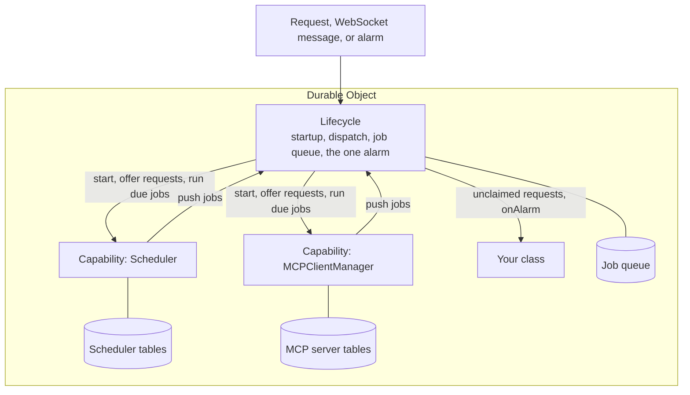

import { TypeScriptExample } from "~/components";

A capability is one feature of an agent, such as WebSocket connections, a scheduler, or an MCP client. You construct it as a field on your Durable Object and attach it to the [Lifecycle](/agents/runtime/lifecycle/) with `lifecycle.use()`.

## Why capabilities

A [Durable Object](/durable-objects/) stores state durably, but it does not run work durably. When the object is evicted, redeployed, or crashes, any code that was running stops, and nothing restarts it unless something wakes the object again. The only thing that can wake an idle object on its own is its single [alarm](/durable-objects/api/alarms/).

The Lifecycle owns that alarm and turns it into a queue of durable jobs. A capability is a feature built on top of it. Each capability:

- **Owns its tables.** It stores its data in its own SQLite tables in the object's database, such as the `Scheduler`'s list of schedules.
- **Schedules its work as jobs.** When it needs to do something later, or finish something after a crash, it pushes a job onto the Lifecycle's queue. The Lifecycle sets the alarm, wakes the object when the job is due, and calls the capability back.
- **Answers its own requests.** It can handle the requests that belong to it before they reach your code, such as the OAuth callback URL that `MCPClientManager` answers.



Because every capability schedules through the same queue, they share the one alarm without overwriting each other, and their work survives eviction. You write a feature as ordinary code, and the Lifecycle handles waking it up.

<TypeScriptExample>

```ts
import { DurableObject } from "cloudflare:workers";
import { Lifecycle } from "agents/lifecycle";
import { MCPClientManager } from "agents/mcp/client";
import { Scheduler } from "agents/schedules";
import { State } from "agents/state";
import { WebSockets } from "agents/websockets";

type Settings = { model: string };

export class MyAgent extends DurableObject<Env> {
	readonly mcp = new MCPClientManager("my-agent", "1.0.0");
	readonly scheduler = new Scheduler({
		callbacks: {
			dailySummary: async () => {
				for (const connection of this.webSockets.getConnections()) {
					connection.send("Time for your daily summary");
				}
			},
		},
	});
	readonly settings: State<Settings> = new State<Settings>({
		initialState: { model: "anthropic/claude-opus-5.5" },
		onChanged: (_state, source) => this.webSockets.broadcastState(source),
	});
	readonly webSockets: WebSockets = new WebSockets({ state: this.settings });

	readonly lifecycle = Lifecycle.install(this)
		.use(this.mcp)
		.use(this.scheduler)
		.use(this.settings)
		.use(this.webSockets);
}
```

</TypeScriptExample>

Capabilities share the object's storage and its one alarm, but they do not depend on each other. Pass what a capability needs, such as callbacks or another capability, to its constructor.

## Available capabilities

These capabilities ship with the `agents` package and are stable:

| Capability                                                             | Import              | What it does                                                                                  |
| ---------------------------------------------------------------------- | ------------------- | --------------------------------------------------------------------------------------------- |
| [`WebSockets`](/agents/runtime/capabilities/websockets/)               | `agents/websockets` | Accepts WebSocket connections from `useAgent` and other clients, and serves callables to them |
| [`State`](/agents/runtime/capabilities/state/)                         | `agents/state`      | Stores one validated value and syncs it to clients through `WebSockets`                       |
| [`Scheduler`](/agents/runtime/capabilities/scheduler/)                 | `agents/schedules`  | Runs callbacks after a delay, at a date, on a cron, or on an interval                         |
| [`MCPClientManager`](/agents/runtime/capabilities/mcp-client-manager/) | `agents/mcp/client` | Connects to MCP servers and keeps the connections across restarts                             |

These capabilities are experimental. Their APIs may change between releases:

| Capability                                           | Import            | What it does                                                        |
| ---------------------------------------------------- | ----------------- | ------------------------------------------------------------------- |
| [`Streams`](/agents/runtime/capabilities/streams/)   | `agents/streams`  | Stores incremental output that readers replay and follow            |
| [`Sessions`](/agents/runtime/capabilities/sessions/) | `agents/sessions` | Stores conversation history as a tree of messages                   |
| `Queue`                                              | `agents/queue`    | Runs background callbacks one at a time, in push order              |
| `Tasks`                                              | `agents/tasks`    | Runs replayable background work with journaled steps                |
| `RoutedAgents`                                       | `agents/routing`  | Keeps a catalog of independent agents and forwards requests to them |
| `Browser`                                            | `agents/browser`  | Keeps one persistent Browser Run session open for the agent         |

A [harness](/agents/harnesses/), such as `PiHarness`, is a capability that runs a whole agent loop.

To write a capability of your own, refer to [Build a capability](/agents/runtime/capabilities/build-a-capability/).

## Which capabilities you need

Every capability is optional. Install only the ones your agent uses:

- **Clients connect to the agent.** Install [`WebSockets`](/agents/runtime/capabilities/websockets/), and pass it [callables](/agents/runtime/capabilities/websockets/#callables) to let clients call methods. Add [`State`](/agents/runtime/capabilities/state/) to sync a value to them.
- **The agent does work later.** Install [`Scheduler`](/agents/runtime/capabilities/scheduler/).
- **The agent uses MCP tools.** Install [`MCPClientManager`](/agents/runtime/capabilities/mcp-client-manager/).

A [harness](/agents/harnesses/) brings its own storage for the conversation:

| Harness                                                      | Conversation storage                                                                        |
| ------------------------------------------------------------ | ------------------------------------------------------------------------------------------- |
| [Pi](/agents/harnesses/pi/)                                  | Pi Durable stores the transcript itself. You do not need `Sessions` or `Streams`.           |
| [Think](/agents/harnesses/think/)                            | Think installs `Sessions` and `Streams` for you.                                            |
| [Your own](/agents/runtime/capabilities/build-a-capability/) | Use `Sessions` for the transcript and `Streams` for in-progress output, or your own tables. |

## How capabilities run

- **Install before startup.** Call `use()` in a field initializer or in the constructor. The Lifecycle starts on the first request, alarm, or WebSocket message, and `use()` throws after that.
- **Declare fields before the Lifecycle.** Class fields initialize in order. Declare each capability field before the `lifecycle` field that installs it.
- **Install each capability once.** Each capability has a stable ID, such as `"scheduler"` or `"mcp"`. The ID namespaces its jobs and events, and `use()` throws on a duplicate.
- **Startup order.** At startup, the Lifecycle runs each capability's `onStart()` in install order, with a catch-all capability last. Then it runs your own `onStart()`.
- **Request order.** The Lifecycle offers each request to the capabilities in install order before your `onRequest()`. `WebSockets` accepts every WebSocket upgrade, so it always runs after the others. For more information, refer to [Request dispatch](/agents/runtime/lifecycle/#request-dispatch).
- **Shared alarm.** Capabilities that run work later, such as `Scheduler`, store it as Lifecycle [jobs](/agents/runtime/lifecycle/job-queue/), so they never overwrite each other's alarm.
- **Host context.** Callbacks you register, such as `Scheduler` callbacks, `WebSockets` handlers, and callables, run inside your object's context, where [`getCurrentAgent()`](/agents/runtime/lifecycle/get-current-agent/) returns your object.
- **RPC.** Native Durable Object RPC bypasses `fetch()`, so it does not start the Lifecycle. Call `await this.lifecycle.start()` at the top of an RPC method that uses a capability.

## On the Agent class

The [`Agent` class](/agents/agent-class/) is a preset: a Durable Object with the Lifecycle and several capabilities already installed, including `Scheduler`, `State`, `WebSockets`, and `MCPClientManager`. Its methods, such as `this.schedule()`, `this.setState()`, and `this.addMcpServer()`, call those capabilities.

To add another capability to an `Agent`, call `this.lifecycle.use()` in its constructor. Do not install a second copy of a capability the `Agent` already has, because `use()` throws on a duplicate ID.
