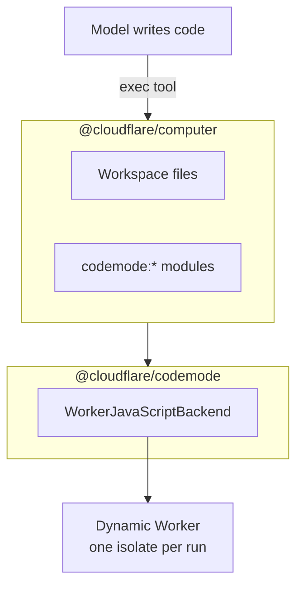

import { CardGrid, LinkCard } from "~/components";

Any code execution in an agent is Code Mode. The model writes a program, the agent runs it in a sandbox, and the result goes back to the model. For why this works better than calling tools one at a time, refer to the [Code Mode concept](/agents/concepts/code-mode/).

This section covers the ways to run that code.

## Choose how to run code

| Way                                                          | Code runs in                                 | Use when                                                                                       |
| ------------------------------------------------------------ | -------------------------------------------- | ---------------------------------------------------------------------------------------------- |
| [Computer](/agents/runtime/code-mode/computer/) (recommended) | A Dynamic Worker, against workspace files    | You want an `exec` tool for the model, with your tools supplied as modules.                     |
| [The executor](/agents/runtime/code-mode/executor/)           | A Dynamic Worker, against your own storage   | You have your own file storage or tool layer, or you are building your own code tool.          |
| [A container](/agents/tools/sandbox/)                         | A Linux virtual machine                      | The code needs a shell, native binaries, package installs, or a build toolchain.               |
| [Skill scripts](/agents/runtime/code-mode/skill-scripts/)     | A Dynamic Worker or the workspace            | You run scripts bundled with [Agent Skills](/agents/skills/).                                  |

Start with Computer. Drop down to the executor when you need to own the parts that Computer provides.

## How the packages fit together

Two packages do the work:

- **`@cloudflare/codemode`** holds the executor. `WorkerJavaScriptBackend` runs one ECMAScript module in a fresh [Dynamic Worker](/dynamic-workers/). The code reads files through `node:fs` and imports host modules, whose functions run in your Durable Object.
- **`@cloudflare/computer`** builds on that executor. It adds a persistent `Workspace` file system, the `exec` tool and file tools for the model, and prebuilt modules such as `codemode:tools`, `codemode:git`, and `codemode:container`.



You supply tools to the code as modules. Each module is imported under a `codemode:` name, and each of its functions runs in your agent, not in the sandbox:

```js
import { readFile } from "node:fs/promises";
import { lookup } from "codemode:orders";

export default async function () {
	const ids = JSON.parse(await readFile("/workspace/orders.json", "utf8"));
	return Promise.all(ids.map((id) => lookup(id)));
}
```

## Run code in a container

Some code needs a full Linux environment. Use a container when the model must run shell commands, install packages, or build and test a project.

- [Sandbox](/agents/tools/sandbox/) attaches a container to an agent and gives the model a tool that runs commands in it.
- Computer can also run a container backend next to its JavaScript backend. With the `codemode:container` module, JavaScript code can call the container, so the model only needs one `exec` tool. Refer to [Call a container from code](/agents/runtime/code-mode/computer/#call-a-container-from-code).

A container starts slower than a Dynamic Worker and costs more to run. If the code only calls functions that you provide, use Computer or the executor instead.

## The legacy Code Mode API

`createCodeTool()`, `DynamicWorkerExecutor`, connectors, the durable approval runtime, and the MCP server helpers in `@cloudflare/codemode` are feature-frozen. They keep working, but they get no new features or fixes. Refer to [Legacy Code Mode API](/agents/runtime/code-mode/legacy/) for what replaces each one.

## Pages in this section

<CardGrid>
	<LinkCard
		title="Run code with Computer"
		href="/agents/runtime/code-mode/computer/"
		description="Give the model an exec tool, and supply your tools, MCP servers, and APIs as modules."
	/>
	<LinkCard
		title="Use the executor"
		href="/agents/runtime/code-mode/executor/"
		description="Run model-written JavaScript with WorkerJavaScriptBackend from @cloudflare/codemode."
	/>
	<LinkCard
		title="Run skill scripts"
		href="/agents/runtime/code-mode/skill-scripts/"
		description="Run the scripts bundled with Agent Skills."
	/>
	<LinkCard
		title="Legacy Code Mode API"
		href="/agents/runtime/code-mode/legacy/"
		description="The frozen createCodeTool API, and what replaces each part."
	/>
</CardGrid>
