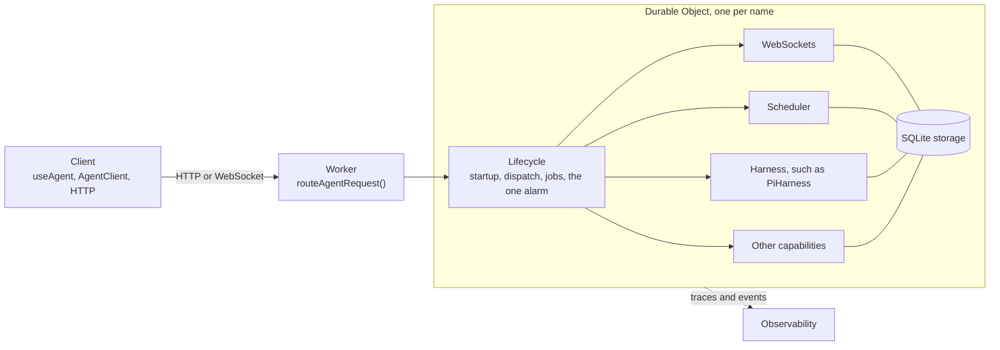

import { TypeScriptExample } from "~/components";

Every agent built with the Agents SDK runs on a [Durable Object](/durable-objects/). The runtime coordinates its startup, incoming events, and scheduled work. Your capabilities or harness use stored state to recover after interruptions:

- **[Lifecycle](/agents/runtime/lifecycle/)** (`agents/lifecycle`) runs startup, dispatches each request and WebSocket event, and owns a durable job queue and the object's single alarm.
- **[Routing](/agents/runtime/routing/)** (`agents/routing`) sends requests from your Worker to the right named object.
- **[Capabilities](/agents/runtime/capabilities/)** are features you attach with `lifecycle.use()`, such as WebSocket clients, shared state, a scheduler, and MCP connections.
- **[Observability](/agents/runtime/observability/)** traces model calls and publishes events from the Lifecycle and its capabilities.



## If you use a harness

You do not have to assemble all of this yourself. A [harness](/agents/harnesses/) sets up what it needs:

- **[Think](/agents/harnesses/think/)** extends the [`Agent` class](/agents/agent-class/), which installs the Lifecycle and its capabilities for you.
- **[Pi](/agents/harnesses/pi/)** is one capability. You install the Lifecycle and add the harness with `.use()`, and Pi handles its own storage and recovery.

With either harness, the parts of the runtime you work with directly are usually:

- **[Routing](/agents/runtime/routing/)**, to send requests to the right agent and check who is calling.
- **[WebSockets](/agents/runtime/capabilities/websockets/)**, to connect your frontend to the agent.
- **[Observability](/agents/runtime/observability/)**, to trace model calls and debug what the agent did.

The rest of this section matters when you build your own agent loop, or add a capability of your own.

## Compose the runtime yourself

You compose these parts on a plain `DurableObject`:

<TypeScriptExample filename="src/index.ts">

```ts
import { DurableObject } from "cloudflare:workers";
import { Lifecycle } from "agents/lifecycle";
import { routeAgentRequest } from "agents/routing";
import { Scheduler } from "agents/schedules";
import { WebSockets } from "agents/websockets";

export class MyAgent extends DurableObject<Env> {
	readonly scheduler = new Scheduler({ callbacks: {} });
	readonly webSockets = new WebSockets();
	readonly lifecycle = Lifecycle.install(this)
		.use(this.scheduler)
		.use(this.webSockets);

	onRequest(request: Request): Response {
		return new Response(`Hello from ${this.lifecycle.name}`);
	}
}

export default {
	async fetch(request: Request, env: Env): Promise<Response> {
		return (
			(await routeAgentRequest(request, env)) ??
			new Response("Not found", { status: 404 })
		);
	},
} satisfies ExportedHandler<Env>;
```

</TypeScriptExample>

The [`Agent` class](/agents/agent-class/) is a preset of the same runtime: a Durable Object with the Lifecycle and several capabilities already installed.

## Lifecycle

- [Lifecycle](/agents/runtime/lifecycle/) explains what the Lifecycle provides and how to install it.
- [Jobs and alarms](/agents/runtime/lifecycle/job-queue/) describes the durable job queue.
- [`getCurrentAgent()`](/agents/runtime/lifecycle/get-current-agent/) reads the current object, request, and connection from shared code.
- [Lifecycle API](/agents/runtime/lifecycle/api-reference/) is the complete reference for `agents/lifecycle`.

## Routing

- [Routing](/agents/runtime/routing/) covers `routeAgentRequest()`, the URL shape, and naming agents.
- [Routing options](/agents/runtime/routing/options/) covers CORS, placement, startup props, and retries.
- [Authentication](/agents/runtime/routing/authentication/) checks callers before a request reaches the object.
- [Custom routing](/agents/runtime/routing/custom-routing/) reaches objects with your own URLs, or over RPC.
- [HTTP and Server-Sent Events](/agents/runtime/routing/http-sse/) handles requests in `onRequest()` and streams responses.

## Capabilities

Capabilities are optional features. Start with [Choose capabilities](/agents/runtime/capabilities/#choose-capabilities) to check what your harness already provides and what to add yourself.

| Capability                                                             | Import              | What it adds                                 | Status       |
| ---------------------------------------------------------------------- | ------------------- | -------------------------------------------- | ------------ |
| [`WebSockets`](/agents/runtime/capabilities/websockets/)               | `agents/websockets` | Real-time client connections                 | Stable       |
| [`State`](/agents/runtime/capabilities/state/)                         | `agents/state`      | Shared state that syncs to clients           | Stable       |
| [`Scheduler`](/agents/runtime/capabilities/scheduler/)                 | `agents/schedules`  | Delayed, dated, cron, and interval callbacks | Stable       |
| [`MCPClientManager`](/agents/runtime/capabilities/mcp-client-manager/) | `agents/mcp/client` | Connections to MCP servers                   | Stable       |
| [`Streams`](/agents/runtime/capabilities/streams/)                     | `agents/streams`    | Durable incremental output                   | Experimental |
| [`Sessions`](/agents/runtime/capabilities/sessions/)                   | `agents/sessions`   | Durable conversation history                 | Experimental |

To write your own capability, refer to [Build a capability](/agents/runtime/capabilities/build-a-capability/).

## Observability

- [Tracing](/agents/runtime/observability/tracing/) records model calls, tool runs, and approvals as Workers traces.
- [Diagnostics channels](/agents/runtime/observability/diagnostics-channels/) publish structured events from the Lifecycle, its capabilities, and the `Agent` class.
