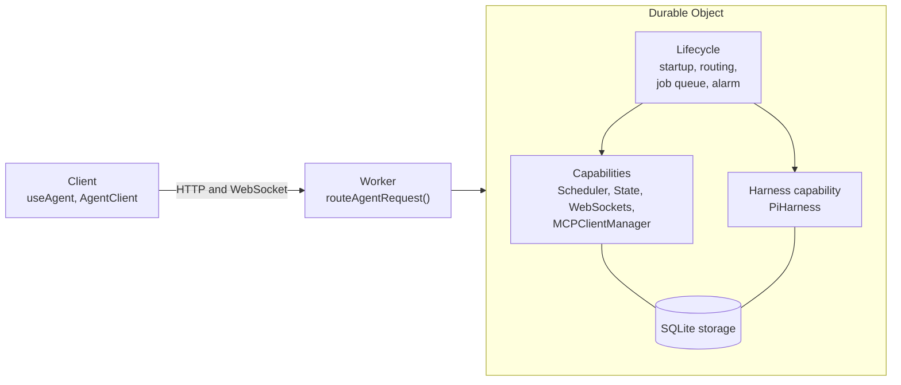

import { TypeScriptExample } from "~/components";

Every agent built with the Agents SDK runs on a [Durable Object](/durable-objects/). The runtime is what you add to that Durable Object so an agent can keep working across requests, evictions, deploys, and crashes. It has three parts:

- **Lifecycle** (`agents/lifecycle`) runs startup, routes each request and WebSocket event, and owns one durable job queue and the object's single alarm.
- **Capabilities** are reusable pieces you attach with `lifecycle.use()`, such as a scheduler, MCP connections, shared state, and real-time WebSocket clients. A [harness](/agents/harnesses/), the agent loop itself, is one kind of capability.
- **Client** libraries (`agents/client` and `agents/react`) connect browsers and other Workers to the Durable Object.



You compose these parts on a plain `DurableObject`:

<TypeScriptExample>

```ts
import { DurableObject } from "cloudflare:workers";
import { Lifecycle } from "agents/lifecycle";
import { Scheduler } from "agents/schedules";
import { WebSockets } from "agents/websockets";

export class MyAgent extends DurableObject<Env> {
	readonly scheduler = new Scheduler({ callbacks: {} });
	readonly webSockets = new WebSockets();
	readonly lifecycle = Lifecycle.install(this)
		.use(this.scheduler)
		.use(this.webSockets);
}
```

</TypeScriptExample>

The [`Agent` class](/agents/agent-class/) is a preset of the same runtime. It is a Durable Object with the Lifecycle and seven capabilities already installed.

## Lifecycle

The Lifecycle is the base every capability builds on. Start here to learn how startup, request routing, jobs, and alarms work.

- [Lifecycle](/agents/runtime/lifecycle/) explains what the Lifecycle does and how to install it.
- [Routing](/agents/runtime/lifecycle/routing/) covers how requests reach a Durable Object and its capabilities.
- [Jobs and alarms](/agents/runtime/lifecycle/job-queue/) describes the durable job queue.
- [Build a capability](/agents/runtime/lifecycle/build-a-capability/) shows how to write your own capability.
- [Capability API](/agents/runtime/lifecycle/capability-api/) is the complete reference for `agents/lifecycle`.
- [`getCurrentAgent()`](/agents/runtime/lifecycle/get-current-agent/) reads the current object, request, and connection from shared code.

## Capabilities

Each capability has its own export path and owns its own tables. The stable capabilities are:

| Capability         | Import              | What it adds                                                                        |
| ------------------ | ------------------- | ----------------------------------------------------------------------------------- |
| `MCPClientManager` | `agents/mcp/client` | [Connections to MCP servers](/agents/model-context-protocol/apis/client-api/)       |
| `PiHarness`        | `agents/harness/pi` | [The Pi agent loop](/agents/harnesses/pi/)                                          |
| `Scheduler`        | `agents/schedules`  | [Delayed, dated, cron, and interval callbacks](/agents/agent-class/schedule-tasks/) |
| `State`            | `agents/state`      | [Shared state that syncs to clients](/agents/agent-class/state/)                    |
| `WebSockets`       | `agents/websockets` | [Real-time client connections](/agents/agent-class/websockets/)                     |

## Client

`useAgent()` from `agents/react` and `AgentClient` from `agents/client` connect to any Durable Object that installs the `WebSockets` capability, including a plain `DurableObject`. For more information, refer to [WebSockets](/agents/agent-class/websockets/).
