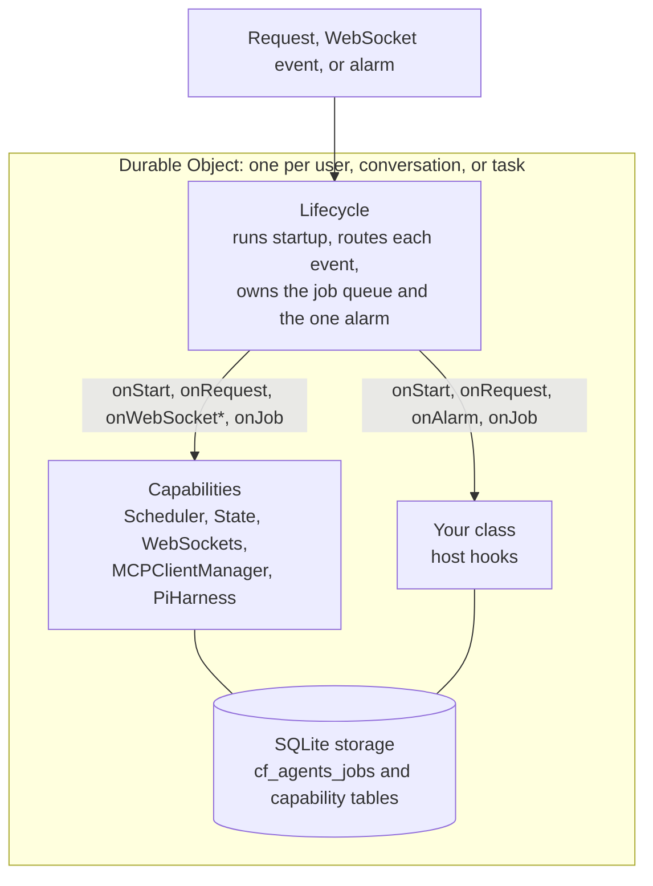

import { PackageManagers, TypeScriptExample } from "~/components";

`Lifecycle` from `agents/lifecycle` is the base of every agent built with the Agents SDK. You install it on a [Durable Object](/durable-objects/). It runs startup, offers each request and WebSocket event to the capabilities you installed, and owns the object's durable job queue and its single alarm. That is how an agent wakes up and finishes its work after an eviction, a deploy, or a crash.

`agents/lifecycle` is stable.

## Who owns what



The roles split like this:

- **The Durable Object** gives each agent an address, its own SQLite database, and one alarm.
- **The Lifecycle** decides when code runs. It starts every capability once per wake, offers each event to them in order, and runs due jobs when the alarm fires.
- **Capabilities** add behavior, such as schedules, MCP connections, real-time clients, or a whole agent loop. A [harness](/agents/harnesses/) is a capability. Each capability is independent of the others.
- **Your class** implements host hooks, such as `onStart()` and `onRequest()`, for anything no capability handles.

The [`Agent` class](/agents/agent-class/) is a preset of the same parts. It installs this Lifecycle with seven capabilities already attached.

## Install the Lifecycle

<PackageManagers pkg="agents" />

Construct the Lifecycle as a field on a class that extends `DurableObject`:

<TypeScriptExample>

```ts
import { DurableObject } from "cloudflare:workers";
import { Lifecycle } from "agents/lifecycle";

export class MyAgent extends DurableObject<Env> {
	readonly lifecycle = Lifecycle.install(this);

	onStart(): void {
		// Runs once for each in-memory lifetime, before any other work.
	}

	onRequest(request: Request): Response {
		return new Response(`Hello from ${this.lifecycle.name}`);
	}

	onAlarm(): void {
		// Runs once for each alarm, after due jobs.
	}
}
```

</TypeScriptExample>

`Lifecycle.install(this)` constructs the Lifecycle and installs the `fetch`, `alarm`, `webSocketMessage`, `webSocketClose`, and `webSocketError` handlers on your object. Do not define those methods yourself. If your class already defines one of them, the Lifecycle leaves it in place, and that handler does not run through the Lifecycle.

The expanded form separates construction from handler installation:

<TypeScriptExample>

```ts
import { DurableObject } from "cloudflare:workers";
import { Lifecycle } from "agents/lifecycle";

export class MyAgent extends DurableObject<Env> {
	readonly lifecycle = new Lifecycle(this);

	constructor(ctx: DurableObjectState, env: Env) {
		super(ctx, env);
		this.lifecycle.installHandlers();
	}
}
```

</TypeScriptExample>

Calling `installHandlers()` more than once throws an error. Both forms accept `LifecycleOptions` as a second argument. For more information, refer to [Memory-limit protection](/agents/runtime/lifecycle/job-queue/#memory-limit-protection).

## Host hooks

Implement these optional methods on your class. The Lifecycle calls them inside the host context, so [`getCurrentAgent()`](/agents/runtime/lifecycle/get-current-agent/) works inside them.

| Hook                          | When it runs                                                                         |
| ----------------------------- | ------------------------------------------------------------------------------------ |
| `onStart(props?)`             | Once per in-memory lifetime, after every capability has started                      |
| `onRequest(request)`          | For each HTTP request that no capability handled                                     |
| `onAlarm()`                   | Once per alarm, after the Lifecycle has run the due jobs                             |
| `onJob(context)`              | When a job the host pushed through `lifecycle.jobs` comes due                        |
| `onAlarmMemoryLimit(context)` | After an alarm ends in a memory-limit reset, after every capability's policy has run |

Without `onRequest()`, an HTTP request that no capability handles returns `404`. The type `LifecycleObject` describes a Durable Object with these hooks and a `lifecycle` field.

## Add capabilities

A capability is a reusable piece of a Durable Object. It owns its own tables and implements only the hooks it needs. Construct each capability as a field, then register it with `use()`:

<TypeScriptExample>

```ts
import { DurableObject } from "cloudflare:workers";
import { Lifecycle } from "agents/lifecycle";
import { MCPClientManager } from "agents/mcp/client";
import { Scheduler } from "agents/schedules";
import { WebSockets } from "agents/websockets";

export class MyAgent extends DurableObject<Env> {
	readonly mcp = new MCPClientManager("my-agent", "1.0.0");
	readonly scheduler = new Scheduler({
		callbacks: {
			sendReminder: (payload: { message: string }) => {
				console.log(payload.message);
			},
		},
	});
	readonly webSockets = new WebSockets({
		handlers: {
			onMessage: (connection, message) => connection.send(`echo: ${message}`),
		},
	});

	readonly lifecycle = Lifecycle.install(this)
		.use(this.mcp)
		.use(this.scheduler)
		.use(this.webSockets);
}
```

</TypeScriptExample>

Follow these rules when you register capabilities:

- **Declare capability fields before the `lifecycle` field.** Class fields initialize in order, so a capability declared after `lifecycle` is still `undefined` when `use()` runs.
- **Register every capability before startup.** `use()` throws once startup has begun.
- **Install each capability ID once.** `use()` throws when a capability with the same ID is already installed.
- **Order matters.** Capabilities start, and receive requests, in registration order. A capability that claims all traffic for a hook (a catch-all) always runs last. For more information, refer to [Routing](/agents/runtime/lifecycle/routing/#capability-order).

The stable capabilities are `Scheduler`, `State`, `WebSockets`, `MCPClientManager`, and `PiHarness`. To write your own, refer to [Build a capability](/agents/runtime/lifecycle/build-a-capability/).

## Startup

The Lifecycle starts on the first request, alarm, or WebSocket event of each in-memory lifetime:

1. The Lifecycle resolves the object's name.
2. Each capability runs its `onStart()` hook, in registration order.
3. The host runs `onStart(props)`.
4. The Lifecycle handles the event that woke the object.

Startup runs inside `blockConcurrencyWhile()`, so no other event reaches the object until it finishes. A warm object skips startup. If startup throws, the event fails and the next event tries again. While the job queue holds jobs, a fallback alarm also retries startup, so queued work does not wait for a new request.

## Call your agent over RPC

Public methods on a Durable Object are [RPC methods](/durable-objects/best-practices/create-durable-object-stubs-and-send-requests/). RPC calls do not pass through `fetch`, so the Lifecycle does not start the object for them. Call `lifecycle.start()` at the top of an RPC method that needs started capabilities:

<TypeScriptExample>

```ts
import { DurableObject } from "cloudflare:workers";
import { Lifecycle } from "agents/lifecycle";
import { Scheduler } from "agents/schedules";

type Props = { userId: string };

export class MyAgent extends DurableObject<Env> {
	readonly scheduler = new Scheduler({ callbacks: {} });
	readonly lifecycle = Lifecycle.install<Env, Props>(this).use(this.scheduler);

	#userId: string | undefined;

	onStart(props?: Props): void {
		this.#userId = props?.userId;
	}

	async pendingSchedules(props?: Props): Promise<number> {
		await this.lifecycle.start(props);
		return (await this.scheduler.list()).length;
	}
}

export default {
	async fetch(request: Request, env: Env): Promise<Response> {
		const stub = (env.MyAgent as DurableObjectNamespace<MyAgent>).getByName(
			"alice",
		);
		const count = await stub.pendingSchedules({ userId: "alice" });
		return Response.json({ count });
	},
} satisfies ExportedHandler<Env>;
```

</TypeScriptExample>

`start(props)` passes `props` to every capability's `onStart()` and to the host `onStart()`. Props are ignored when startup is already running or has finished. Concurrent calls to `start()` share one startup. A call made from inside startup returns immediately instead of waiting on itself.

`lifecycle.isStarted()` returns `true` once every capability and the host `onStart()` have finished. Many capability methods, such as `scheduler.set()`, wait for startup on their own.

## Object names

The Lifecycle reads the object's name from `ctx.id.name` and exposes it as `lifecycle.name`. Address objects by name with `getByName()` or `idFromName()`, or route to them with [`routeAgentRequest()`](/agents/runtime/lifecycle/routing/).

Startup fails for an object that has no name. This happens with IDs from `newUniqueId()` or `idFromString()`, and with names longer than 1,024 bytes. For objects created by older PartyServer releases, the Lifecycle also reads the legacy name record from storage. It never writes that record.

## Query SQLite

`lifecycle.sql` is a tagged template that runs a query against the object's SQLite database. Interpolated values become bound parameters, and the result is an array of rows:

<TypeScriptExample>

```ts
import { DurableObject } from "cloudflare:workers";
import { Lifecycle } from "agents/lifecycle";

export class NotesAgent extends DurableObject<Env> {
	readonly lifecycle = Lifecycle.install(this);

	onStart(): void {
		this.lifecycle
			.sql`CREATE TABLE IF NOT EXISTS notes (id TEXT PRIMARY KEY, body TEXT NOT NULL)`;
	}

	onRequest(request: Request): Response {
		const id = new URL(request.url).searchParams.get("id") ?? "";
		const rows = this.lifecycle.sql<{ id: string; body: string }>`
			SELECT id, body FROM notes WHERE id = ${id}
		`;
		return Response.json(rows);
	}
}
```

</TypeScriptExample>

Values must be strings, numbers, booleans, or `null`. For other queries, use [`ctx.storage.sql`](/durable-objects/api/sqlite-storage-api/) directly.

## Jobs and alarms

A Durable Object has one alarm. The Lifecycle owns it and sets it from a durable queue of jobs, so capabilities such as `Scheduler` and `PiHarness` never overwrite each other's alarms. The host can push its own jobs through `lifecycle.jobs`.

Do not call `ctx.storage.setAlarm()` on an object that uses the Lifecycle. For more information, refer to [Jobs and alarms](/agents/runtime/lifecycle/job-queue/).

## Tear down an object

The Lifecycle has two teardown methods:

- `lifecycle.disableAlarms()` stops the Lifecycle from setting the alarm again and deletes the current alarm. It cannot be undone for this instance.
- `lifecycle.dispose()` calls each capability's `dispose()` hook in reverse registration order. It releases live resources, such as MCP transports and listeners. It does not delete stored data.

Eviction calls neither method. To delete an object, call both, then delete its storage:

<TypeScriptExample>

```ts
import { DurableObject } from "cloudflare:workers";
import { Lifecycle } from "agents/lifecycle";
import { MCPClientManager } from "agents/mcp/client";

export class MyAgent extends DurableObject<Env> {
	readonly mcp = new MCPClientManager("my-agent", "1.0.0");
	readonly lifecycle = Lifecycle.install(this).use(this.mcp);

	async destroy(): Promise<void> {
		await this.lifecycle.disableAlarms();
		await this.lifecycle.dispose();
		await this.ctx.storage.deleteAll();
	}
}
```

</TypeScriptExample>

## On the `Agent` class

The `Agent` class installs this Lifecycle as its `lifecycle` field, with seven capabilities attached, including `Scheduler`, `MCPClientManager`, `State`, and `WebSockets`. Its own methods, such as `this.schedule()` and `onConnect()`, call into those capabilities. You can install your own capability on an `Agent` with `this.lifecycle.use()` in its constructor. The `Agent` class also starts the Lifecycle before its public `async` RPC methods run, so you do not call `lifecycle.start()` there. For more information, refer to [Agent class](/agents/agent-class/).

## Related resources

- [Routing](/agents/runtime/lifecycle/routing/) covers how requests reach your object and its capabilities.
- [Jobs and alarms](/agents/runtime/lifecycle/job-queue/) describes the durable job queue.
- [Build a capability](/agents/runtime/lifecycle/build-a-capability/) shows how to write your own.
- [Capability API](/agents/runtime/lifecycle/capability-api/) lists every export of `agents/lifecycle`.
