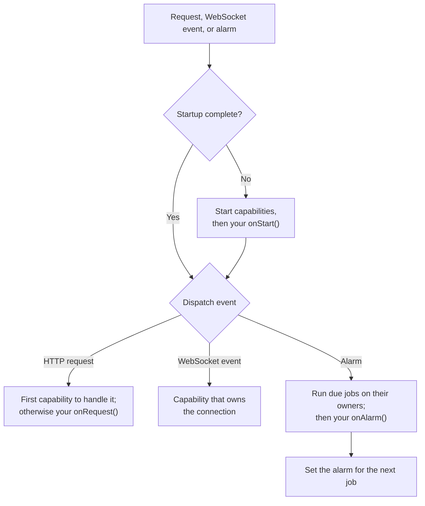
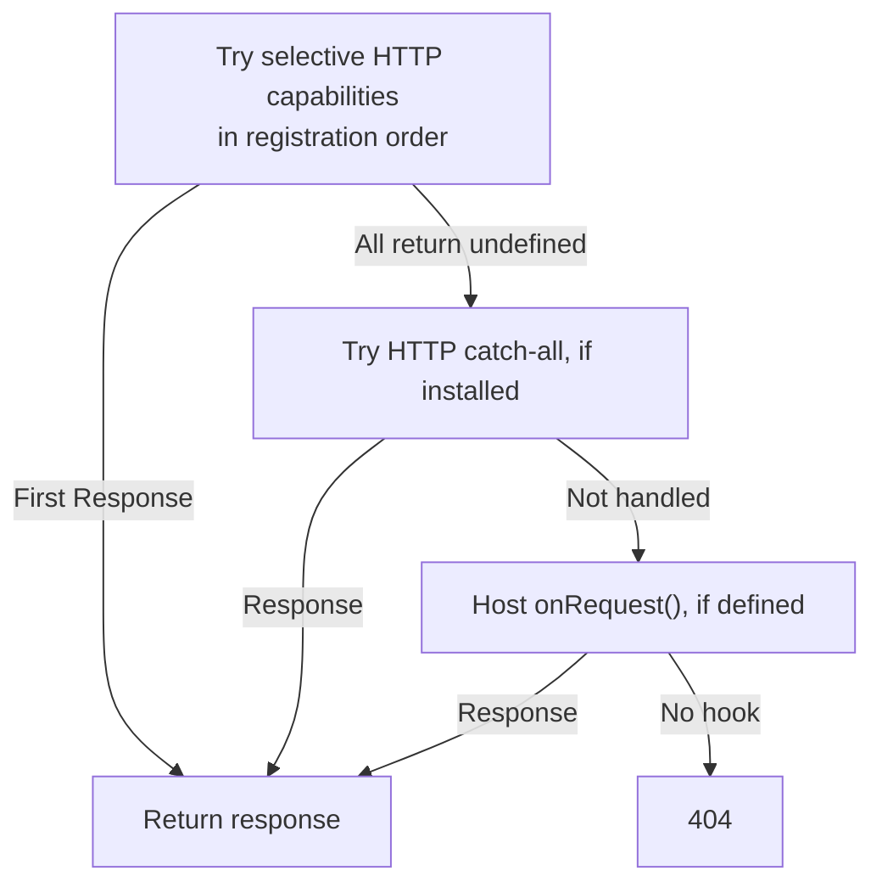

import { PackageManagers, TypeScriptExample } from "~/components";

`Lifecycle` from `agents/lifecycle` coordinates startup and incoming events for a [Durable Object](/durable-objects/). It also stores pending jobs in SQLite and manages the object's single alarm. Multiple features can schedule work without replacing each other's wake-up time.

`agents/lifecycle` is stable.

Once installed, the Lifecycle gives your Durable Object:

- **Startup.** Your `onStart()` runs once per in-memory lifetime, before the first request, alarm, or WebSocket event is handled.
- **Request dispatch.** Each request goes to the [capabilities](/agents/runtime/capabilities/) you installed. If none handles it, it reaches your `onRequest()`.
- **Durable jobs.** A job queue in SQLite that owns the object's single alarm, so scheduled work from different capabilities never overwrites each other. For more information, refer to [Jobs and alarms](/agents/runtime/lifecycle/job-queue/).
- **A name.** `lifecycle.name` is the name the object was addressed by.
- **Host context.** [`getCurrentAgent()`](/agents/runtime/lifecycle/get-current-agent/) returns the current object, request, and connection inside your hooks, and in any code they call.
- **Teardown.** Methods to release live resources and stop the alarm before you delete an object.

The handlers installed by Lifecycle run startup when needed, then dispatch the event:



After an eviction, deploy, or crash, Lifecycle starts the capabilities again. Pending jobs remain in SQLite, and the alarm can wake the object to run them. Each capability or harness reads its saved state to decide how to continue its work.

Lifecycle does not automatically checkpoint arbitrary JavaScript or resume a function where it stopped. For retry behavior and recovery patterns, refer to [Jobs and alarms](/agents/runtime/lifecycle/job-queue/).

## Install the Lifecycle

<PackageManagers pkg="agents" />

Construct the Lifecycle as a field on a class that extends `DurableObject`:

<TypeScriptExample>

```ts
import { DurableObject } from "cloudflare:workers";
import { Lifecycle } from "agents/lifecycle";

export class MyAgent extends DurableObject<Env> {
	readonly lifecycle = Lifecycle.install(this);

	onStart(): void {
		// Runs once for each in-memory lifetime, before any other work.
	}

	onRequest(request: Request): Response {
		return new Response(`Hello from ${this.lifecycle.name}`);
	}

	onAlarm(): void {
		// Runs once for each alarm, after due jobs.
	}
}
```

</TypeScriptExample>

`Lifecycle.install(this)` constructs the Lifecycle and installs the `fetch`, `alarm`, `webSocketMessage`, `webSocketClose`, and `webSocketError` handlers on your object. Do not define those methods yourself. If your class already defines one of them, the Lifecycle leaves it in place, and that handler does not run through the Lifecycle.

The expanded form separates construction from handler installation:

<TypeScriptExample>

```ts
import { DurableObject } from "cloudflare:workers";
import { Lifecycle } from "agents/lifecycle";

export class MyAgent extends DurableObject<Env> {
	readonly lifecycle = new Lifecycle(this);

	constructor(ctx: DurableObjectState, env: Env) {
		super(ctx, env);
		this.lifecycle.installHandlers();
	}
}
```

</TypeScriptExample>

Calling `installHandlers()` more than once throws an error. Both forms accept `LifecycleOptions` as a second argument. Its one option, `maxAlarmMemoryLimitStrikes`, is covered in [Memory-limit protection](/agents/runtime/lifecycle/job-queue/#memory-limit-protection).

To reach the object from your Worker, refer to [Routing](/agents/runtime/routing/).

## Host hooks

Implement these optional methods on your class. The Lifecycle calls them inside the host context, so [`getCurrentAgent()`](/agents/runtime/lifecycle/get-current-agent/) works inside them.

| Hook                          | When it runs                                                                         |
| ----------------------------- | ------------------------------------------------------------------------------------ |
| `onStart(props?)`             | Once per in-memory lifetime, after every capability has started                      |
| `onRequest(request)`          | For each HTTP request that no capability handled                                     |
| `onAlarm()`                   | Once per alarm, after the Lifecycle has run the due jobs                             |
| `onJob(context)`              | When a job the host pushed through `lifecycle.jobs` comes due                        |
| `onAlarmMemoryLimit(context)` | After an alarm ends in a memory-limit reset, after every capability's policy has run |

Without `onRequest()`, an HTTP request that no capability handles returns `404`. The type `LifecycleObject` describes a Durable Object with these hooks and a `lifecycle` field.

The host never receives WebSocket events. To accept WebSocket clients, install the [`WebSockets` capability](/agents/runtime/capabilities/websockets/).

## Start the Lifecycle

The Lifecycle starts on the first request, alarm, or WebSocket event of each in-memory lifetime:

1. It resolves the object's name.
2. Each capability runs its `onStart()` hook, in registration order, with a catch-all capability last.
3. The host runs `onStart(props)`.
4. The Lifecycle handles the event that woke the object.

Startup runs inside `blockConcurrencyWhile()`, so no other event reaches the object until it finishes. A warm object skips startup. If startup throws, the event fails and the next event tries again. While the job queue holds jobs, a fallback alarm also retries startup, so queued work does not wait for a new request.

`props` come from the [`props` routing option](/agents/runtime/routing/options/#props), or from `lifecycle.start(props)`.

### Start from an RPC method

Public methods on a Durable Object are [RPC methods](/durable-objects/best-practices/create-durable-object-stubs-and-send-requests/). RPC calls do not pass through `fetch`, so the Lifecycle does not start the object for them. Call `lifecycle.start()` at the top of an RPC method that needs started capabilities, or anything `onStart()` sets up:

<TypeScriptExample>

```ts
import { DurableObject } from "cloudflare:workers";
import { Lifecycle } from "agents/lifecycle";

type Props = { userId: string };

export class MyAgent extends DurableObject<Env> {
	readonly lifecycle = Lifecycle.install<Env, Props>(this);
	#userId: string | undefined;

	onStart(props?: Props): void {
		this.#userId = props?.userId;
	}

	async whoAmI(props?: Props): Promise<string | undefined> {
		await this.lifecycle.start(props);
		return this.#userId;
	}
}
```

</TypeScriptExample>

`start(props)` passes `props` to every capability's `onStart()` and to the host `onStart()`. Props are ignored when startup is already running or has finished. Concurrent calls to `start()` share one startup. A call made from inside startup returns immediately instead of waiting on itself.

`lifecycle.isStarted()` returns `true` once every capability and the host `onStart()` have finished. Many capability methods, such as `scheduler.set()`, wait for startup on their own.

## Request dispatch

Inside the object, the Lifecycle offers each HTTP request to the capabilities that implement `onRequest()`, and each WebSocket upgrade to the capabilities that implement `onWebSocketUpgrade()`. The first capability that returns a `Response` handles it. A capability that returns `undefined` passes it on. There is no `next()` callback, so a capability cannot wrap or observe a later response.

After startup, HTTP requests follow this path:



A capability declares how it claims traffic with `claims`:

| Value                   | Behavior                                                                                                                        |
| ----------------------- | ------------------------------------------------------------------------------------------------------------------------------- |
| `"selective"` (default) | Handles only the routes it recognizes, and returns `undefined` for the rest. Runs in registration order.                        |
| `"catch-all"`           | Handles everything offered to the hooks it implements. Always runs after every selective capability, whenever it was installed. |

Only one catch-all can exist for each hook. `use()` throws when you install a second catch-all for `onRequest()` or for `onWebSocketUpgrade()`, because it could never be reached. A catch-all for HTTP and a catch-all for upgrades can coexist.

| Event                              | Handled by                                                                                          |
| ---------------------------------- | --------------------------------------------------------------------------------------------------- |
| HTTP request                       | The first capability that returns a `Response`, otherwise the host's `onRequest()`, otherwise `404` |
| WebSocket upgrade                  | The first capability that returns a `Response`, otherwise `404`                                     |
| WebSocket message, close, or error | The capability that owns the connection, otherwise ignored                                          |
| Alarm                              | Due jobs, then the host's `onAlarm()`                                                               |

## Install capabilities

A capability is a reusable piece of a Durable Object, such as WebSocket connections or a scheduler. Construct each one as a field, then register it with `use()`:

<TypeScriptExample>

```ts
import { DurableObject } from "cloudflare:workers";
import { Lifecycle } from "agents/lifecycle";
import { Scheduler } from "agents/schedules";
import { WebSockets } from "agents/websockets";

export class MyAgent extends DurableObject<Env> {
	readonly scheduler = new Scheduler({ callbacks: {} });
	readonly webSockets = new WebSockets();

	readonly lifecycle = Lifecycle.install(this)
		.use(this.scheduler)
		.use(this.webSockets);
}
```

</TypeScriptExample>

`use()` returns the Lifecycle, so calls chain. It follows these rules:

- **Declare capability fields before the `lifecycle` field.** Class fields initialize in order, so a capability declared after `lifecycle` is still `undefined` when `use()` runs.
- **Register every capability before startup.** `use()` throws once startup has begun.
- **Install each capability ID once.** `use()` throws when a capability with the same ID is already installed.

For the capabilities that ship with the SDK, refer to [Capabilities](/agents/runtime/capabilities/).

## Object names

The Lifecycle reads the object's name from `ctx.id.name` and exposes it as `lifecycle.name`. Address objects by name with `getByName()` or `idFromName()`, or route to them with [`routeAgentRequest()`](/agents/runtime/routing/).

Startup fails for an object that has no name. This happens with IDs from `newUniqueId()` or `idFromString()`, and with names longer than 1,024 bytes. For objects created by older PartyServer releases, the Lifecycle also reads the legacy name record from storage. It never writes that record.

## Query SQLite

`lifecycle.sql` is a tagged template that runs a query against the object's SQLite database. Interpolated values become bound parameters, and the result is an array of rows:

<TypeScriptExample>

```ts
import { DurableObject } from "cloudflare:workers";
import { Lifecycle } from "agents/lifecycle";

export class NotesAgent extends DurableObject<Env> {
	readonly lifecycle = Lifecycle.install(this);

	onStart(): void {
		this.lifecycle
			.sql`CREATE TABLE IF NOT EXISTS notes (id TEXT PRIMARY KEY, body TEXT NOT NULL)`;
	}

	onRequest(request: Request): Response {
		const id = new URL(request.url).searchParams.get("id") ?? "";
		const rows = this.lifecycle.sql<{ id: string; body: string }>`
			SELECT id, body FROM notes WHERE id = ${id}
		`;
		return Response.json(rows);
	}
}
```

</TypeScriptExample>

Values must be strings, numbers, booleans, or `null`. For other queries, use [`ctx.storage.sql`](/durable-objects/api/sqlite-storage-api/) directly.

## Jobs and alarms

A Durable Object has one alarm. The Lifecycle owns it and sets it from a durable queue of jobs, so capabilities such as `Scheduler` never overwrite each other's alarms. Your class can push its own jobs through `lifecycle.jobs` and handle them in `onJob()`.

Do not call `ctx.storage.setAlarm()` on an object that uses the Lifecycle. For more information, refer to [Jobs and alarms](/agents/runtime/lifecycle/job-queue/).

## Tear down an object

The Lifecycle has two teardown methods:

- `lifecycle.disableAlarms()` stops the Lifecycle from setting the alarm again and deletes the current alarm. It cannot be undone for this instance.
- `lifecycle.dispose()` calls each capability's `dispose()` hook in reverse registration order. It releases live resources, such as MCP transports and open WebSocket connections. It does not delete stored data.

Eviction calls neither method. To delete an object, call both, then delete its storage:

<TypeScriptExample>

```ts
import { DurableObject } from "cloudflare:workers";
import { Lifecycle } from "agents/lifecycle";

export class MyAgent extends DurableObject<Env> {
	readonly lifecycle = Lifecycle.install(this);

	async destroy(): Promise<void> {
		await this.lifecycle.disableAlarms();
		await this.lifecycle.dispose();
		await this.ctx.storage.deleteAll();
	}
}
```

</TypeScriptExample>

## On the `Agent` class

The [`Agent` class](/agents/agent-class/) installs this Lifecycle as its `lifecycle` field, with several capabilities already attached. It also starts the Lifecycle before its public `async` RPC methods run.

## Related resources

- [Routing](/agents/runtime/routing/) covers how requests reach your object from a Worker.
- [Jobs and alarms](/agents/runtime/lifecycle/job-queue/) describes the durable job queue.
- [`getCurrentAgent()`](/agents/runtime/lifecycle/get-current-agent/) reads the current object, request, and connection from shared code.
- [Lifecycle API](/agents/runtime/lifecycle/api-reference/) lists every export of `agents/lifecycle`.
- [Build a capability](/agents/runtime/capabilities/build-a-capability/) shows how to write your own capability.
