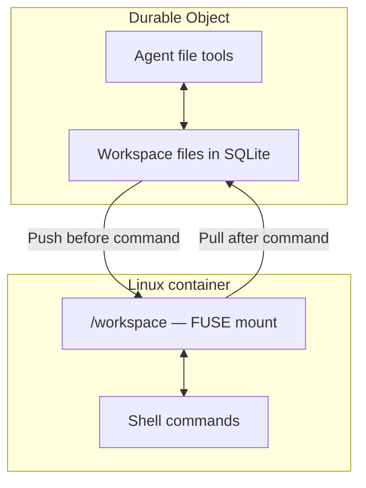

Workspace files and the processes that use them have different lifetimes. Saving a file does not keep the process that wrote it running.

## Workspace files

A Cloudflare Computer `Workspace` stores its files in the SQLite database of a Durable Object. Files remain after the object is evicted or restarted. No R2 bucket is required.

The agent's file tools and your code use `workspace.fs` to read and write these files. Each agent instance has its own workspace; users who share an instance share its files.

## JavaScript execution

The JavaScript backend runs code in a Dynamic Worker. Its `node:fs/promises` module accesses the same durable workspace, without a separate container filesystem to synchronize.

A Durable Object restart interrupts JavaScript that is still running. File persistence does not resume that execution. To configure the experimental restart and replay policies, refer to [Resume runs after a restart](/agents/tools/code-execution/run-javascript/#resume-runs-after-a-restart).

## Linux execution

The experimental container backend exposes a copy of the workspace at `/workspace`. Its `computerd` daemon mounts that copy through Filesystem in Userspace (FUSE).

`workspace.runtime.exec()` pushes workspace changes before a command and pulls container changes afterward. After synchronization completes, those files survive container replacement and Durable Object restarts.

| Files or state                               | Stored in the Durable Object?   |
| -------------------------------------------- | ------------------------------- |
| Files written through `workspace.fs`         | Yes                             |
| Container changes under `/workspace`         | After synchronization completes |
| Container files outside `/workspace`         | No                              |
| Container-created files excluded by `ignore` | No                              |
| Running Linux processes                      | No                              |

This persists workspace files, not the container's entire disk. For container disk snapshots, refer to [Save and restore a sandbox](/sandbox/files/save-and-restore-a-workspace/).

### Check container synchronization

Check both the command's exit code and `result.sync.status`. A command can succeed while its file changes still need synchronization.

| `result.sync.status` | Meaning                                                                    |
| -------------------- | -------------------------------------------------------------------------- |
| `"complete"`         | Post-command synchronization completed.                                    |
| `"pending"`          | Synchronization is incomplete. The command may already have changed files. |

Before retrying the command, refer to [Resume an incomplete sync](https://github.com/cloudflare/computer/tree/main/packages/computer#resuming-an-incomplete-sync). The [Linux guide](/agents/tools/code-execution/persistent-files/) checks the command and synchronization results in a complete example.

## Storage limits

- Workspace files share their Durable Object's [storage limits](/durable-objects/platform/limits/).
- The container's synchronized workspace copy is held in memory. Keep workspaces sized for an agent's working files.
- Keep rebuildable dependencies, such as `node_modules`, on container-local disk with the backend's `ignore` option. Refer to [Configure Linux tools](/agents/tools/code-execution/persistent-files/#configure-linux-tools).
