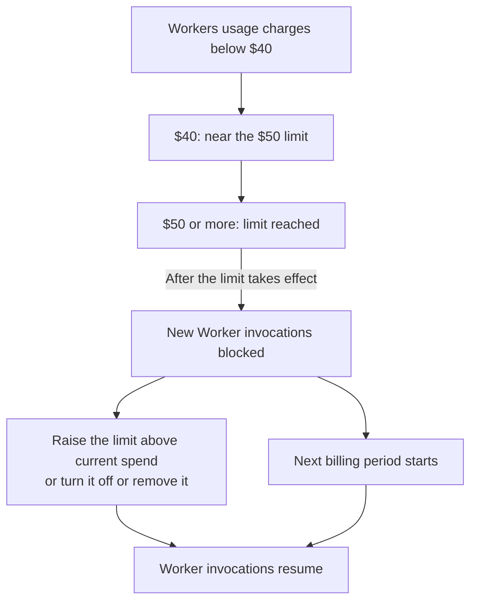

import { DashButton, Steps } from "~/components";

Set spending limits for Workers and Durable Objects, or receive email alerts when spending reaches a threshold. Support for more products is coming soon.

When a product reaches its spending limit, Cloudflare blocks supported operations until the next billing period or until you change the limit. Email alerts notify you without blocking usage.

Use these controls alongside [AI Gateway spend limits](/ai-gateway/features/spend-limits/) to manage compute and AI inference costs across your application. AI Gateway supports per-user and per-model budgets for Workers AI and other AI providers, applied to requests routed through your gateway.

In the billing API, a spending limit or email alert is called a _spend policy_.

Choose how to configure spending limits and email alerts for Workers or Durable Objects:

- **Dashboard:** [Set a spending limit](/billing/manage/spend-management/#set-a-spending-limit-in-the-dashboard) for Workers or Durable Objects.
- **cf CLI:** [Create and manage spending limits and email alerts](/billing/manage/spend-management/cli/) from your terminal or coding agent.

## Choose a control

| Control                                        | Scope                                           | What happens at the threshold                                           |
| ---------------------------------------------- | ----------------------------------------------- | ----------------------------------------------------------------------- |
| Spending limit                                 | Workers or Durable Objects, across your account | Cloudflare blocks the product's supported operations.                   |
| [AI Gateway spend limit](/ai-gateway/features/spend-limits/) | AI requests routed through your gateway, scoped by user, model, or provider | AI Gateway blocks matching requests until the budget window resets. |
| Email alert                                    | Workers or Durable Objects, across your account | Cloudflare emails the address you configure. The product keeps running. |
| [Budget alert](/billing/manage/budget-alerts/) | Account-wide usage-based spend                  | Cloudflare emails your recipients. Products keep running.               |

Workers and Durable Objects each have a separate product-wide limit. A Workers limit does not include Durable Objects, Workers AI, Workers KV, R2, or other products used by your application.

Workers and Durable Objects limits cannot target an individual Worker, Durable Object namespace, or billing metric. Choose each limit for the combined usage of that product across your account.

:::caution[Limits affect application availability]
A limit can interrupt every application that uses the affected product on your account. Choose an alert if you want notification without a service interruption.

A limit does not guarantee a maximum invoice amount. Usage reporting and blocking take time, and some charges continue during a pause.
:::

## What counts toward a limit

Workers and Durable Objects limits use estimated usage charges for the product's current subscription billing period. Included usage is deducted before Cloudflare calculates these charges. Amounts are in US dollars.

| Product         | Usage charges counted toward the limit                                                                     | Charges excluded from the limit                                  |
| --------------- | ---------------------------------------------------------------------------------------------------------- | ---------------------------------------------------------------- |
| Workers         | Requests and CPU time                                                                                      | The Workers Paid subscription fee and charges for other products |
| Durable Objects | Requests, duration, SQLite rows read and written, and key-value storage read, write, and delete operations | Stored data and the shared Workers Paid subscription fee         |

Stored data can continue to incur charges while Durable Objects are paused. Reaching a limit does not cancel your subscription or remove existing stored data.

Your [invoice](/billing/manage/invoices/) is the final record of charges. Metering delays, operations already in progress, and enforcement failures can allow spend to exceed a limit.

## Set a spending limit in the dashboard

You need permission to edit billing settings to manage limits. Before saving, review what stops for [Workers](/workers/platform/spend-management/) or [Durable Objects](/durable-objects/platform/spend-management/).

<Steps>

1. In the [Cloudflare dashboard](https://dash.cloudflare.com/), go to **Billing** for your account.

   <DashButton url="/?to=/:account/billing" />

2. Select **Spend Management**.
3. In the **Workers** or **Durable Objects** row, select **Edit the spending limit**.
4. Enter an amount greater than zero, with up to two decimal places, in **Monthly limit (USD)**. Select **Save limit**.
5. Confirm that the limit is **On**. Saving a new limit turns it on. Editing an existing limit preserves its on or off setting.

</Steps>

The limit applies to usage already recorded in the current period. For example, saving a $50 limit after the product has accrued $60 can trigger a pause as soon as Cloudflare evaluates the policy.

## Manage spending limits and email alerts with the cf CLI

Use the cf CLI to create spending limits or email alerts, update or remove them, and review their history. The [cf CLI guide](/billing/manage/spend-management/cli/) includes setup instructions and commands you can copy and run.

## Example: a $50 spending limit for Workers

Suppose you set a $50 spending limit for Workers for your account. Requests and CPU charges count together toward that limit, after included usage.

- At $40, the limit is **Near limit**: 80% of $50.
- At $50 or more, it is **Limit reached**. Blocking is not instantaneous.
- The Workers Paid subscription fee is charged separately.
- Durable Objects and other products have separate charges and controls. An application can still fail if it depends on a paused Worker.

## Email alerts and status

Policies with an email address send notifications at 80% and 100% of the threshold. If spend jumps past both thresholds between evaluations, you may only receive the 100% notification.

The dashboard's limit status reflects a recorded threshold event. **Limit reached** does not confirm that blocking has finished propagating. **On** means the policy is enabled, not that the product is running.

Spending limits created in the dashboard do not automatically have an email recipient. To receive limit notifications, [update the policy](/billing/manage/spend-management/cli/#update-a-policy) with a `notification_email` address.

## Resume service or change a limit

To lift a spending limit before the period ends, use one of these options in **Spend Management**:

| Action                                            | Result                                                              |
| ------------------------------------------------- | ------------------------------------------------------------------- |
| Raise the limit above the product's current spend | Restores supported operations and keeps a higher limit in place.    |
| Turn the limit **Off**                            | Restores supported operations and keeps the saved amount for later. |
| Select **Remove limit** and confirm               | Restores supported operations and removes the policy.               |

Changes can take a few minutes to apply. Further usage can incur charges once service resumes. Turning the same limit off and on does not reset this period's spend.

At the next subscription billing period, the block expires automatically. An enabled limit stays configured for the new period.

For example, if your subscription renews on the 15th, the limit resets on the 15th. It does not reset on the first day of each calendar month.

These actions only lift a block caused by a spending limit. They do not remove other account restrictions or product limits.

## Review history

In **Billing** > **Spend Management**, the **Audit log** panel shows changes to your spending limits, including who made each change and when. These actions also appear in [Cloudflare's account-wide Audit Logs](/fundamentals/account/account-security/audit-logs/).

Cloudflare also records when spending reaches 80% or 100% of a policy's threshold. These events happen automatically, without a user making an API request. Use the [cf CLI to review configuration changes and threshold events](/billing/manage/spend-management/cli/#review-history). A threshold event does not confirm that blocking or email delivery succeeded.

## Related resources

- [Workers spending limits](/workers/platform/spend-management/) — affected invocations, static assets, and errors.
- [Durable Objects spending limits](/durable-objects/platform/spend-management/) — storage, WebSockets, and alarms.
- [Monitor billable usage](/billing/manage/billable-usage/) — review usage-based costs across products.
