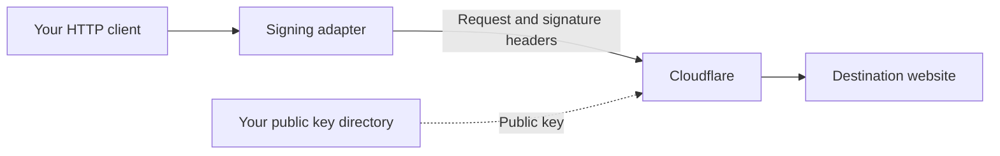

import {
	Code,
	CopyPromptButton,
	Details,
	Render,
	Tabs,
	TabItem,
} from "~/components";
import nodeSigner from "~/../public/web-bot-auth/signer.mjs?raw";
import pythonSigner from "~/../public/web-bot-auth/signer.py?raw";

Add a signing adapter once. Keep your existing request calls.



<CopyPromptButton
	tooltip="Add Web Bot Auth request signing"
	prompt="Read https://developers.cloudflare.com/bots/reference/bot-verification/web-bot-auth/sign-requests/ and its page for this project's HTTP client. Install the example adapter, configure allowed origins, load the Ed25519 private key from secret storage, and test signed requests, redirects, retries, and key changes. Never print or commit private keys."
/>

## Choose your HTTP client

<Render file="web-bot-auth-clients" product="bots" />

## Before you start

- Complete [key generation, directory hosting, and bot registration](/bots/reference/bot-verification/web-bot-auth/).
- Have your Ed25519 private key in PKCS#8 PEM format (`private-key.pem`).
- Know your signature-agent origin, such as `https://bot.example.com`. It hosts `/.well-known/http-message-signatures-directory`.
- Choose the HTTPS destination origins you want to sign for. An origin includes a scheme, hostname, and optional port.

The signature-agent origin identifies **your bot**. The destination origin identifies **the website you request**. They usually differ.

## Add the shared signer

Node.js and Python adapters use one shared helper per language. Go includes its signer in the transport file.

<Tabs>
<TabItem label="Node.js">

Save [signer.mjs](/web-bot-auth/signer.mjs) beside your adapter. It uses Node.js built-in cryptography.

<Details header="signer.mjs source">
<Code code={nodeSigner} lang="js" meta='title="signer.mjs"' />
</Details>

To inspect the public key and derived `keyid` locally:

```js title="inspect-key.mjs"
import { readFile } from "node:fs/promises";
import { createSigner } from "./signer.mjs";

const signer = createSigner({
  privateKey: await readFile("./private-key.pem"),
  signatureAgent: "https://bot.example.com",
  allowedOrigins: ["https://crawltest.com"],
});
console.log(JSON.stringify({ keyid: signer.keyId, keys: [signer.publicJwk] }));
```

</TabItem>
<TabItem label="Python">

Save [signer.py](/web-bot-auth/signer.py) beside your adapter. Install `cryptography` alongside your HTTP library.

<Details header="signer.py source">
<Code code={pythonSigner} lang="python" meta='title="signer.py"' />
</Details>

To inspect the public key and derived `keyid` locally:

```python title="inspect_key.py"
import json
from pathlib import Path
from signer import Signer

signer = Signer(
    Path("private-key.pem").read_bytes(),
    "https://bot.example.com",
    ["https://crawltest.com"],
)
print(json.dumps({"keyid": signer.key_id, "keys": [signer.public_jwk]}))
```

</TabItem>
</Tabs>

Compare this public key with your hosted directory. Publishing a key still requires [signing the directory response](/bots/reference/bot-verification/web-bot-auth/#2-host-a-key-directory).

## What the adapters sign

Each signature covers `@authority`, `@method`, `@path`, `@query`, and `signature-agent`. It includes a fresh nonce, the public key's JWK thumbprint, and a 60-second validity window.

The helpers use Cloudflare's supported `Signature-Agent` format: a quoted HTTPS origin. They implement [RFC 9421](https://www.rfc-editor.org/rfc/rfc9421.html) and the [Ed25519 JWK thumbprint format](https://www.rfc-editor.org/rfc/rfc8037.html#appendix-A.3).

- Set allowed origins explicitly. Requests to other origins continue unsigned.
- The adapters replace existing Web Bot Auth headers, including on redirects.
- Recreate the client after changing its private key.
- Keep your system clock synchronized. Reuse the client, never a generated signature.
- Retry through the signing layer. Retries inside an underlying transport can reuse expired headers; each guide describes its supported configuration.

These examples authenticate the bot and bind the signature to its request target. They do not sign request bodies or other application headers. Refer to [content signing considerations](/bots/reference/bot-verification/web-bot-auth/#41-choose-a-set-of-components-to-sign) if you need body integrity.

## Verify your requests

<Render file="web-bot-auth-verify" product="bots" />

After a key change, also run the [key-change checklist](/bots/reference/bot-verification/web-bot-auth/#change-signing-keys).
