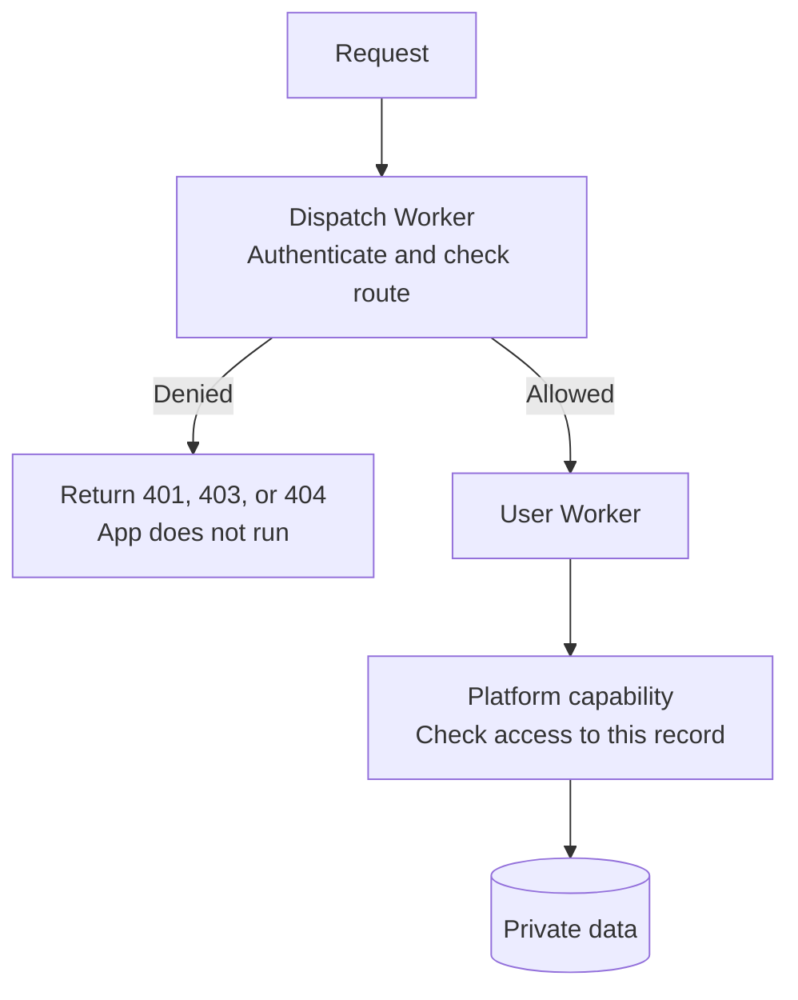
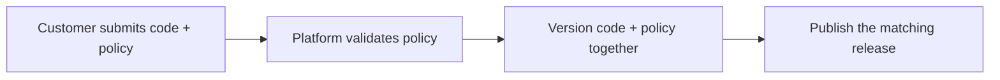
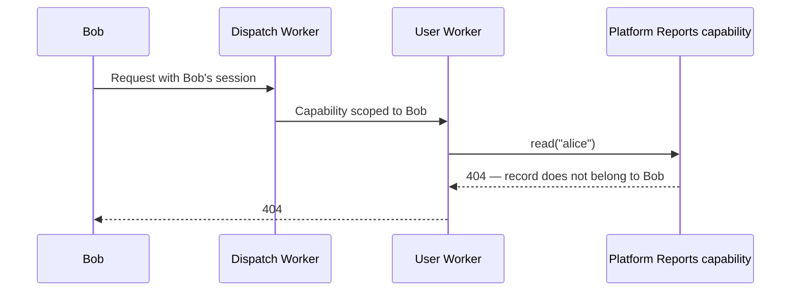

import { Render, TypeScriptExample } from "~/components";

When you build a platform that runs customer apps, you need to control who can use each app and which data they can access. An app may have both public and private endpoints.

Customers can add routes and change app code independently of your platform. Keep access rules in platform-owned code, so they do not depend on every app implementing authentication and authorization correctly.

Enforce access at two points:

- **Before the app runs:** require a list of public and private routes when the app is published. Validate that list and enforce its rules before invoking app code.
- **When the app accesses data:** check permissions inside platform-owned operations. Signing in must not let Bob read Alice's private report.

With Workers for Platforms, check requests in the dispatch Worker and pass scoped data operations to user Workers.



Authentication establishes identity. Authorization determines which routes, actions, and records that identity can access.

## Choose where to enforce access

Choose checks according to what needs protection:

| Requirement                                        | Enforcement point                            |
| -------------------------------------------------- | -------------------------------------------- |
| The whole app requires sign-in                     | [Dispatch Worker, before invocation](/cloudflare-for-platforms/workers-for-platforms/configuration/authentication/#authenticate-before-invoking-the-app) |
| Routes mix public and private access               | [Platform-owned method/path policy](/cloudflare-for-platforms/workers-for-platforms/configuration/authentication/#publish-code-and-route-policy-together) |
| Routes are unknown, but data permissions are known | [Platform-owned data operations](/cloudflare-for-platforms/workers-for-platforms/configuration/authentication/#protect-data-even-when-routes-change) |
| Routing and policy must stay together              | [Registered handlers with access metadata](/cloudflare-for-platforms/workers-for-platforms/configuration/authentication/#adapt-the-pattern) |
| Public code needs fewer privileges                 | [Separate Workers with different capabilities](/cloudflare-for-platforms/workers-for-platforms/configuration/authentication/#adapt-the-pattern) |
| App libraries call HTTP APIs                       | [Outbound Worker](/cloudflare-for-platforms/workers-for-platforms/configuration/outbound-workers/) |

Combine route checks with data-operation checks for mixed-access apps.

## Publish code and route policy together

Your platform does not need to predict every future route. Require each app to declare its routes when it publishes:

```json title="routes.json"
[
	{ "method": "GET", "path": "/", "access": "public" },
	{ "method": "GET", "path": "/profile", "access": "member" },
	{ "method": "GET", "path": "/admin", "access": "reports:admin" }
]
```

This manifest is a policy format your platform implements. Workers does not infer intended access from app code.



The platform owns these publication rules:

- Match the tenant to the authenticated app owner.
- Reject duplicate or ambiguous routes.
- Restrict which routes can become public.
- Prevent changes that weaken required permissions.
- Keep code and policy versions consistent during rollouts.

Upload a new script name first. Then switch the dispatch Worker to that script and its matching policy.

### Deny undeclared routes

Match both method and path. A new route stays inaccessible until the platform accepts its policy.

<Render file="platform-auth-route-policy" product="workers" />

Here, `member` means membership in the app tenant. Add an app-membership check if only some tenant members may enter.

Use one path interpretation across the gate and app. This example matches exact URL paths; it grants no wildcard access.

## Authenticate before invoking the app

Implement `authenticate(request)` in `auth.ts` using your existing identity provider or session service. This integration must:

- Verify the session or token, including expiry and intended audience.
- Return a verified identity, or `null` when credentials are absent.
- Reject invalid credentials rather than trust caller-supplied identity headers.

Resolve `deployment` from your platform's app registry. Its tenant, routes, and script name must not come from app code.

Place this gate in the dispatch Worker request handler:

<TypeScriptExample filename="gateway.ts">
```ts
import { checkRoute, type Identity } from "./policy";
import { authenticate } from "./auth";

let identity: Identity | null;
try {
	identity = await authenticate(request);
} catch {
	return new Response("Invalid session", { status: 401 });
}

const denied = checkRoute(
	request,
	deployment.routes,
	deployment.tenant,
	identity,
);
if (denied) return denied;

// Forward only what this GET-only example needs. Keep session credentials out.
const appRequest = new Request(request.url, { method: "GET" });
```

</TypeScriptExample>

After the gate succeeds, invoke the app through the [dispatch namespace binding](/cloudflare-for-platforms/workers-for-platforms/configuration/dynamic-dispatch/):

<TypeScriptExample filename="gateway.ts">
```ts
const app = env.DISPATCHER.get(deployment.scriptName, {
	props: { identity },
});
return app.fetch(appRequest);
```
</TypeScriptExample>

All app ingress must pass through the dispatch Worker.

For a wholly private app, require membership on every request. For mixed-access apps, use the route policy to select public exceptions.

## Protect data even when routes change

A route check can require Bob to sign in, but it cannot prevent app code from requesting Alice's report. Keep permission checks inside the platform operations that read private data, so every new route uses the same checks.

An app can omit `checkAuth()` or ignore its result. Give it an operation that performs authorization and data access together.



Keep the data and implementation in the dispatch Worker. This example uses synthetic records:

<Render file="platform-auth-reports" product="workers" />

Create the capability using verified platform context. The app can choose a record ID, but cannot choose the capability's identity:

<TypeScriptExample filename="gateway.ts">
```ts
const reports = ctx.exports.Reports({
	props: { identity, tenant: deployment.tenant },
});
```
</TypeScriptExample>

Pass the capability with the invocation:

<TypeScriptExample filename="gateway.ts">
```ts
const app = env.DISPATCHER.get(deployment.scriptName, {
	props: { reports },
});
return app.fetch(appRequest);
```
</TypeScriptExample>

The customer app calls the capability through [RPC](/workers/runtime-apis/rpc/):

<TypeScriptExample filename="app.ts">
```ts
const result = await this.ctx.props.reports.read(reportId);
return Response.json(result, { status: result.status });
```
</TypeScriptExample>

Use [Outbound Workers](/cloudflare-for-platforms/workers-for-platforms/configuration/outbound-workers/) to restrict network access to authorized destinations and operations. Otherwise, another data-access path could bypass the capability.

## Adapt the pattern

Use these variations when the app interface requires them:

| Pattern               | Example                                                                     | Why                                                                                                       |
| --------------------- | --------------------------------------------------------------------------- | --------------------------------------------------------------------------------------------------------- |
| Registered handlers   | `{ method: "GET", path: "/profile", access: "member", handler: "profile" }` | Select policy and handler from the same platform-owned entry. A handler name does not grant data access.  |
| Public app shell      | Public HTML; protected report reads through `reports.read(id)`              | The platform can protect data without enumerating every frontend route.                                   |
| Separate components   | Public Worker receives `{}`; private Worker receives `{ reports }`          | Public code has no private capability. Keep their storage separate too.                                   |
| Outbound HTTP gateway | Allow `GET https://reports.internal/reports/:id`, then check record access  | Existing HTTP clients can use the same authorization model. Ignore identity headers supplied by app code. |

If the outbound gateway injects credentials, authorize the destination and operation first. Hiding a token does not limit what that token can do.
