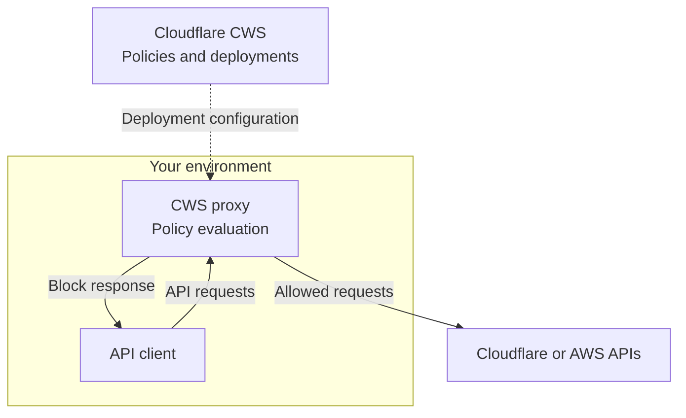

import { LinkButton } from "~/components";

Cloud Workload Security (CWS) helps you prevent risky cloud changes. Apply policy controls to API requests before they reach your cloud provider.

The Beta supports Cloudflare and Amazon Web Services (AWS). Refer to [Supported cloud providers](/cloudflare-one/cloud-workload-security/platform/#supported-cloud-providers) for availability.

:::note[Zero Trust subscription required]
Your account must have a [Zero Trust subscription](/cloudflare-one/setup/#2-create-a-zero-trust-organization). The Zero Trust Free plan is sufficient.
:::

Run the CWS proxy in your cloud infrastructure or another environment you control. Manage policies in Cloudflare, then route client requests through the proxy:

Use CWS to:

- Define policies to allow approved operations and block risky requests.
- Inspect request content, including parameters and request-body fields.
- Enforce guardrails across the cloud resources your policies cover.

For example, block requests that would make an R2 bucket public. Allow requests that keep the bucket private.

<LinkButton
	href="/cloudflare-one/cloud-workload-security/get-started/"
	variant="primary"
>
	Get started
</LinkButton>

## How it works

You manage CWS resources in the Cloudflare dashboard. A proxy you run in your environment loads a deployment's configuration and evaluates requests routed through it.

Workloads select requests, policies check them, and policy sets group those checks for a deployment.

To understand how these entities validate requests, refer to [Request Validation](/cloudflare-one/cloud-workload-security/concepts/request-validation/).

## CWS entities

### Workloads

A [workload](/cloudflare-one/cloud-workload-security/guides/configure-policies/#create-a-workload) is a reusable filter that selects a group of requests. For example, select Cloudflare API traffic or requests for production accounts. Include or exclude workloads in a policy set to choose where its policies apply.

### Policies

A [policy](/cloudflare-one/cloud-workload-security/guides/configure-policies/#create-a-policy) combines a request filter with a Rego check. Rego is the language used to write the check. Its Boolean `valid` rule determines whether a request passes. For example, reject a request that would make an R2 bucket public.

### Policy sets

A [policy set](/cloudflare-one/cloud-workload-security/guides/configure-policies/#create-a-policy-set) groups policies and defines their workload scope. Include or exclude workloads to choose which requests it covers. Each policy's own filter still applies.

Turn on **Enforce** for policies that should block failed checks. Attach the policy set to a deployment to apply it.

### Deployments

A [deployment](/cloudflare-one/cloud-workload-security/get-started/#create-a-deployment) is the configuration that a proxy loads. It references policy sets and can include a domain ACL and Basic Auth credentials. Its **Default mode** applies when no policy matches a request. Its **On error action** configures policy error handling.

### Proxies

A [CWS proxy](/cloudflare-one/cloud-workload-security/get-started/#set-up-the-proxy-locally) is the process that enforces a deployment's configuration. Run it on a Linux host using a deployment ID and Cloudflare API credential. The host can run in your cloud infrastructure, a pipeline runner, or a local environment. Route client API requests through it to apply your controls. The proxy refreshes its configuration and records request decisions.

### Domain ACLs

A [domain access control list (ACL)](/cloudflare-one/cloud-workload-security/guides/manage-traffic-scope/#create-a-domain-acl) controls which destinations a deployment can reach. It uses domain-specific allow or block rules and a default action. Allowing a destination does not bypass request policies.

### Basic Auth credentials

A [Basic Auth credential](/cloudflare-one/cloud-workload-security/guides/manage-traffic-scope/#create-a-basic-auth-credential) identifies a client using the proxy. It has a username and uses password secrets for authentication. Filters and Rego checks can match its authenticated [credential ID or username](/cloudflare-one/cloud-workload-security/reference/policy-input/#basic-auth-identity).

These credentials are separate from the proxy's Cloudflare API credential and the client's cloud-provider credentials.

### Credential secrets

A [secret](/cloudflare-one/cloud-workload-security/guides/manage-traffic-scope/#rotate-a-secret) is a password associated with a Basic Auth credential. A credential can have multiple secrets with optional expiration times. Use overlapping secrets so clients can switch passwords before the old one expires or is removed.

### Rego modules

A [Rego module](/cloudflare-one/cloud-workload-security/guides/policy-reference/#create-a-rego-module) stores reusable policy logic under a `lib.` package. Policies import its rules instead of duplicating the same checks. For example, share a private-bucket check across several policies.

### Rego metadata

[Rego metadata](/cloudflare-one/cloud-workload-security/guides/policy-reference/#create-rego-metadata) stores shared JSON data that policies can read. Use it for settings such as whether buckets must remain private. Update the shared value without rewriting each policy.

### Tenant structures

A [tenant structure](/cloudflare-one/cloud-workload-security/guides/policy-reference/#create-a-tenant-structure) describes the hierarchy of your cloud resources. Amazon Web Services (AWS) structures contain roots, organizational units, and accounts. Cloudflare structures contain organizations, accounts, and zones. Give the structure a package path to let Rego policies read its nodes.

## Target security profiles with workloads

Use workloads to apply different security profiles to different environments. For example, production accounts can require stricter policies than non-production accounts.

Create separate policy sets for production and non-production. Use workload filters to target AWS accounts or organizational units, or Cloudflare accounts or organizations.

Include the matching workload in each policy set. Attach both policy sets to the same deployment.

## Next steps

- [Configure policies](/cloudflare-one/cloud-workload-security/guides/configure-policies/) to define workloads and attach policy sets.
- [Policy input](/cloudflare-one/cloud-workload-security/reference/policy-input/) to look up request, application, and credential fields available to Rego.
- [Manage traffic scope](/cloudflare-one/cloud-workload-security/guides/manage-traffic-scope/) to configure domain access control lists and Basic Auth credentials.
- [Manage policy reference resources](/cloudflare-one/cloud-workload-security/guides/policy-reference/) to reuse Rego code, metadata, and cloud hierarchies.
- [Proxy configuration](/cloudflare-one/cloud-workload-security/configuration/) to choose authentication, connection, and caching settings.
- [Troubleshooting](/cloudflare-one/cloud-workload-security/troubleshooting/) to diagnose proxy, client, and policy issues.

For availability, proxy deployment options, and connection requirements, refer to [Platform](/cloudflare-one/cloud-workload-security/platform/).
