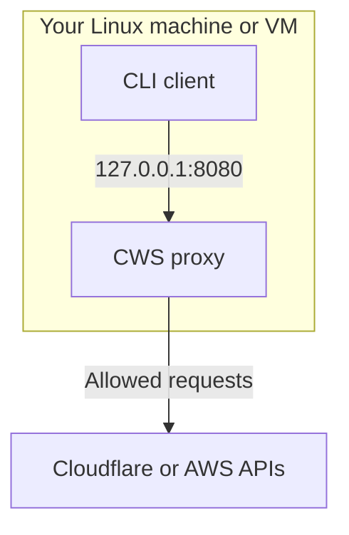
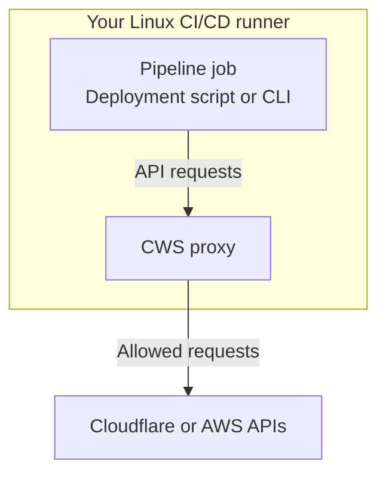
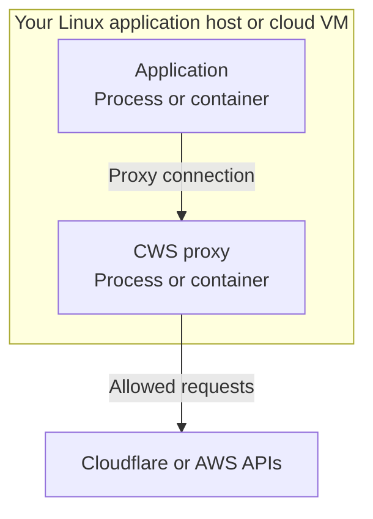
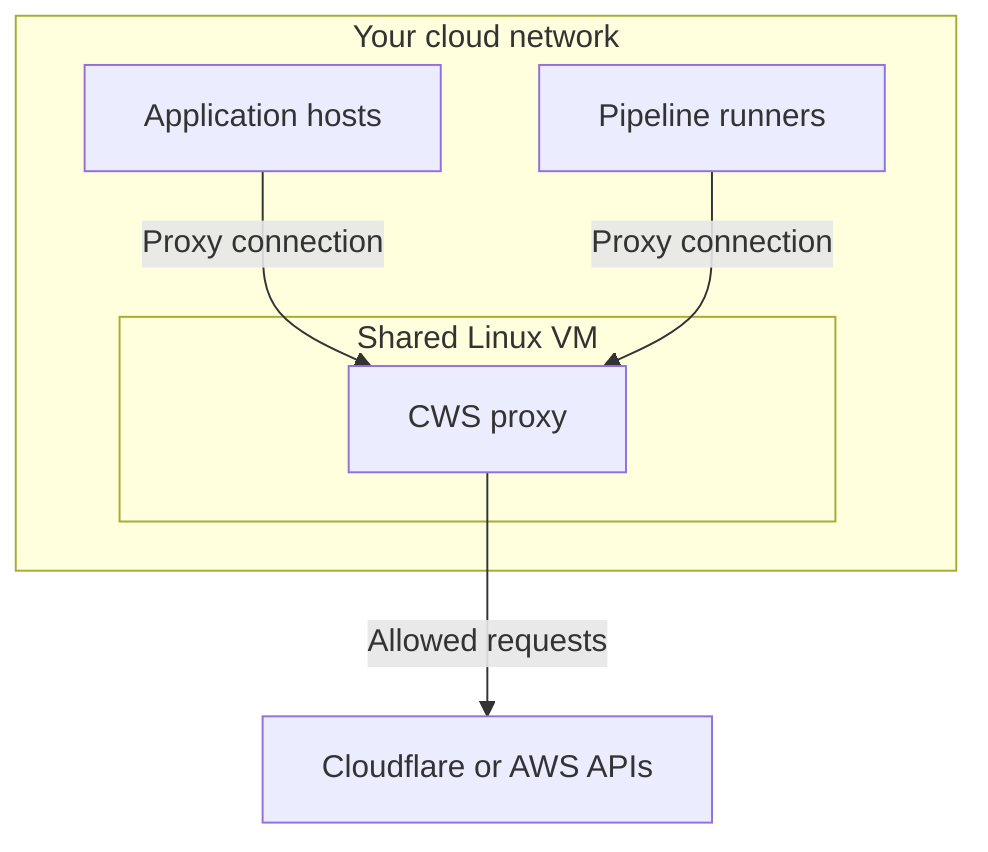

## Availability

Cloud Workload Security (CWS) is available in Beta. Manage CWS resources in the Cloudflare dashboard after selecting your account.

Your account must have a Zero Trust subscription. The Zero Trust Free plan is sufficient.

You need permission to manage the resources you change. The proxy also needs a Cloudflare API credential for the same account. Refer to [API connection and authentication](/cloudflare-one/cloud-workload-security/configuration/#api-connection-and-authentication) for API token and Global API Key setup.

## Supported cloud providers

The CWS Beta supports Cloudflare and Amazon Web Services (AWS). Microsoft Azure and Google Cloud are not supported in this Beta.

Use these application names in workload and policy filters:

| Cloud provider | `application.name` value |
|---|---|
| Cloudflare | `Cloudflare` |
| Amazon Web Services | `AWS` |

Use **Visual Builder** to select available services and operations for each application. For filter examples, refer to [Configure policies](/cloudflare-one/cloud-workload-security/guides/configure-policies/).

## Limits

CWS applies these standard resource and relationship limits.

### Entity quotas

Quotas apply per account unless otherwise indicated:

| Entity | Standard limit |
|---|---:|
| Deployments | 5 |
| Policy sets | 10 |
| Workloads | 10 |
| Domain ACLs | 10 |
| Basic Auth credentials | 10 |
| Policies | 50 |
| Rego modules — shared libraries | 10 |
| Rego metadata documents | 10 |
| Tenant structures | 5 |
| Tenant nodes per structure | 100 |

### Per-entity and relationship limits

The following limits apply to individual resources and relationships:

| Constraint | Standard limit |
|---|---:|
| Policy sets attached to a deployment | 10 |
| Basic Auth credentials attached to a deployment | 10 |
| Policies in a policy set | 50 |
| Included workloads in a policy set | 10 |
| Excluded workloads in a policy set | 10 |
| Entries in a domain ACL | 100 |
| Stored secrets per Basic Auth credential, including expired secrets | 10 |
| Tags per deployment, policy, policy set, or workload | 10 |
| Domain ACLs attached to a deployment | 1 |
| Roots in a tenant structure | 1 |

## Proxy deployment options

Run the CWS proxy in infrastructure you control, including a cloud-hosted Linux virtual machine (VM). You do not need an on-premises network or data center.

Choose a location that your cloud API clients can reach. Install the `cws-proxy` package using APT or DNF.

The proxy package requires Linux. Clients can use other operating systems if their tools support HTTP CONNECT and trust the proxy's certificate authority (CA) certificate.

In every pattern, the proxy loads its deployment configuration from Cloudflare. Each diagram shows the allowed request path, with blocked requests stopping at the proxy.

### Local machine

Run the proxy and client on the same Linux machine or VM to test a guardrail. The VM can run on your computer or in your cloud environment.

Follow [Set up the proxy locally](/cloudflare-one/cloud-workload-security/get-started/#set-up-the-proxy-locally) for the empty-R2-bucket walkthrough.

### CI/CD runner

Run the proxy alongside jobs in a continuous integration and continuous delivery (CI/CD) pipeline. This applies guardrails to cloud API requests made by applications and deployment scripts.

For this pattern, the runner needs:

- A proxy process that is ready before jobs make cloud API requests. After starting the proxy, check the proxy logs for `remote_config_loaded` and `action_mapper_loaded` to confirm startup.
- The API credential supplied through the CI secret store, and a certificate authority (CA) certificate and private key available to the proxy process.
- Client tools configured to use the proxy endpoint and trust its CA certificate. Apply client proxy settings to the cloud-request steps, separately from the proxy process.

Manage proxy startup and cleanup through your runner's process or service lifecycle. For the `cf` client settings, refer to [Route the CLI through the proxy](/cloudflare-one/cloud-workload-security/get-started/#route-the-cli-through-the-proxy).

### Application host or container

Run the proxy as a managed process on a Linux VM in your cloud infrastructure or another application host. For containers, use a Linux environment with APT or DNF and provide the proxy's configuration, credentials, and CA files.

Configure your application to use the proxy through its supported proxy and CA trust settings. Keep the proxy running while the application makes cloud API requests.

### Shared proxy host

Run a proxy on a Linux host reachable by multiple applications or pipeline jobs. For example, use a VM in your cloud network. Set `proxy.listen_addr` to a private IP address and port on that host, then configure clients with the corresponding proxy URL.

Restrict network access to the intended clients. Each client needs the CA certificate for trust. Keep the matching private key on the proxy host.

For package installation, refer to [Get started](/cloudflare-one/cloud-workload-security/get-started/). For listener, authentication, upstream proxy, and cache settings, refer to [Proxy configuration](/cloudflare-one/cloud-workload-security/configuration/).

## Traffic requirements

Policies evaluate API requests routed through your CWS proxy. Creating a deployment does not route application traffic automatically.

Clients must use the proxy and trust its CA certificate. Keep the matching private key on the proxy host.

Clients on other hosts or in separate containers need a reachable proxy address. A loopback address such as `127.0.0.1` only reaches processes in the same network namespace.

Domain ACLs control destination access separately from request policies. An allowed destination does not bypass policy checks.

## Configuration refresh

The proxy refreshes its deployment configuration at the interval configured in `cws.api_poll_interval_secs`. The minimum interval is `30` seconds.

After saving policy, policy set, or deployment changes, allow a refresh interval before verifying their effect. Restart the proxy after changing its local configuration file.

If changes do not affect requests, follow [Saved changes do not affect requests](/cloudflare-one/cloud-workload-security/troubleshooting/#saved-changes-do-not-affect-requests).

## Request authentication

Cloud provider authentication still applies to requests sent through the proxy. The proxy uses its Cloudflare API credential to load deployment configuration. Clients still need their own cloud provider credentials.

To identify the source of a block response, follow [Requests receive an unexpected 403](/cloudflare-one/cloud-workload-security/troubleshooting/#requests-receive-an-unexpected-403).

## Licenses

For the proxy's Beta terms, license notices, and acknowledgments, refer to [Legal](/cloudflare-one/cloud-workload-security/legal/).
