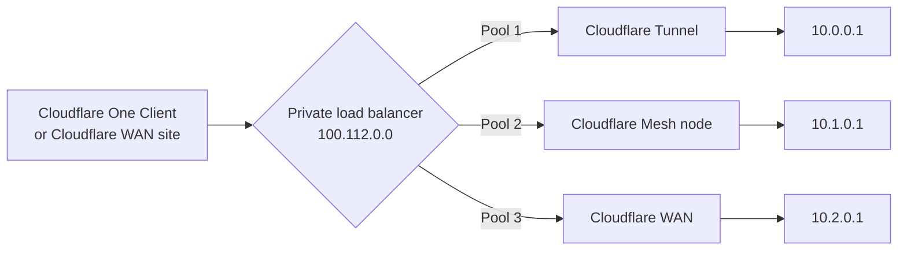

import { GlossaryTooltip } from "~/components";

Connectors such as Cloudflare Tunnel and Cloudflare Mesh make a private network reachable, but they do not spread traffic across multiple servers or sites. To do that, put a [private load balancer](/load-balancing/private-network/) in front of your private services.

A private load balancer gets an IP address that users reach through Cloudflare One. When a user connects to that IP, Cloudflare picks a healthy endpoint (a private IP address and its [virtual network](/cloudflare-one/networks/virtual-networks/)) based on your [steering policy](/load-balancing/understand-basics/traffic-steering/), and sends the traffic to it through whichever connector routes that endpoint.

## When to use a private load balancer

| You want to | Use |
| --- | --- |
| Keep a single tunnel or Mesh node online if one host fails | Connector redundancy: [`cloudflared` replicas](/cloudflare-one/networks/connectors/cloudflare-tunnel/configure-tunnels/tunnel-availability/#cloudflared-replicas) or [Mesh high availability](/mesh/features/high-availability/) |
| Spread traffic across several servers, or fail over between data centers | A private load balancer |
| Monitor the health of each server, not only the connector | A private load balancer with [health monitors](/load-balancing/monitors/) |
| Keep each user on the same server | A private load balancer with [hash steering or session affinity](#keep-users-on-the-same-endpoint) |

Connector redundancy and load balancing work together. A typical setup has one tunnel or Mesh node per site, with replicas for redundancy, and one load balancer pool per site.

## Supported connectors

Private load balancers accept traffic from the [Cloudflare One Client](/cloudflare-one/team-and-resources/devices/cloudflare-one-client/), [Cloudflare WAN](/cloudflare-wan/), and other <GlossaryTooltip term="on-ramp">on-ramps</GlossaryTooltip>. They can send traffic to endpoints behind any of these connectors:

- **Cloudflare Tunnel**: Add the private IPs from your tunnel's [CIDR routes](/cloudflare-one/networks/connectors/cloudflare-tunnel/private-net/cloudflared/connect-cidr/) as endpoints, with the tunnel's virtual network. Refer to [Set up Private Network Load Balancing with Client-to-Tunnel](/load-balancing/private-network/warp-to-tunnel/).
- **Cloudflare Mesh**: Add private IPs from a Mesh node's [CIDR routes](/mesh/features/routes/), or a node's Mesh IP, as endpoints, with the virtual network that contains the node's route. Routes use the default virtual network unless you assign them to another one. The setup is the same as for [Client-to-Tunnel](/load-balancing/private-network/warp-to-tunnel/), with Mesh routes in place of tunnel routes.
- **Cloudflare WAN**: Add private IPs reachable through your GRE, IPsec, or CNI connections, with your default virtual network. Refer to [Set up Private Network Load Balancing with Cloudflare WAN](/load-balancing/private-network/cloudflare-wan/).

### Overlapping IP addresses

An endpoint is identified by its IP address and virtual network. For Cloudflare Tunnel and Cloudflare Mesh endpoints, Cloudflare sends the traffic through the route that covers that IP address in that virtual network.

Cloudflare Tunnel and Cloudflare Mesh share the same [routes](/cloudflare-one/networks/routes/add-routes/) system. Within a virtual network, a CIDR can be assigned to only one tunnel or Mesh node, so you cannot add the same CIDR to both a tunnel and a Mesh node. For redundancy on the same route, run [`cloudflared` replicas](/cloudflare-one/networks/connectors/cloudflare-tunnel/configure-tunnels/tunnel-availability/#cloudflared-replicas) or [Mesh replicas](/mesh/features/high-availability/) instead of separate connectors.

To reach the same IP address at several sites through Cloudflare Tunnel or Cloudflare Mesh, assign each site's route to its own [virtual network](/cloudflare-one/networks/virtual-networks/), and put each site's endpoints in a separate pool.

Cloudflare WAN uses a separate routing table whose routes are not tied to a virtual network, so a WAN route can cover the same CIDR as a tunnel or Mesh route. A WAN prefix can also have several next hops, with different priorities or as equal-cost routes, so a WAN site can have redundant tunnels on the same prefix. For details, refer to [Traffic steering](/cloudflare-wan/reference/traffic-steering/).

### Combine connectors

You can mix connectors in the same load balancer, with one pool per site or connector. For example, use a site connected with Cloudflare WAN as the primary pool, and a site connected with a Mesh node as the [failover](/load-balancing/understand-basics/traffic-steering/steering-policies/standard-options/#off---failover) pool.

## Keep users on the same endpoint

To send each user to the same endpoint, set the pool's endpoint steering to [**Hash**](/load-balancing/understand-basics/traffic-steering/origin-level-steering/hash-origin-steering/#private-load-balancers), or set [session affinity](/load-balancing/understand-basics/session-affinity/#private-load-balancers) to `ip_cookie` with the API. Both key on the Cloudflare One Client device, or on the source IP for other on-ramps.

This pins the endpoint, not the connector replica. For applications that tie a session to the source IP, refer to [Source IP seen by your application](#source-ip-seen-by-your-application).

## Source IP seen by your application

Some applications, such as firewall or appliance admin interfaces, end a session when the client's source IP changes. What the application sees depends on the connector:

- **Cloudflare Tunnel**: `cloudflared` opens the connection to your application, so the application sees the IP of the host running `cloudflared`. Cloudflare sends traffic to the [replica](/cloudflare-one/networks/connectors/cloudflare-tunnel/configure-tunnels/tunnel-availability/#cloudflared-replicas) closest to the Cloudflare data center handling the request, so with several replicas the same user can arrive from different host IPs.
- **Cloudflare Mesh**: Only one replica of a Mesh node is active at a time, so traffic arrives through a single host until a failover moves it to the new active replica. For how return traffic reaches the node, refer to [Return traffic routing](/mesh/features/routes/#return-traffic-routing).

If your application needs a stable source IP behind Cloudflare Tunnel, use a single tunnel replica per endpoint, put a proxy in front of the application, or connect that site with a Mesh node instead.

## Limitations

- Endpoints must be IP addresses. [Private hostname routes](/cloudflare-one/networks/connectors/cloudflare-tunnel/private-net/cloudflared/connect-private-hostname/) and Mesh [hostname routes](/mesh/features/routes/#hostname-routes) cannot be used as load balancer endpoints.
