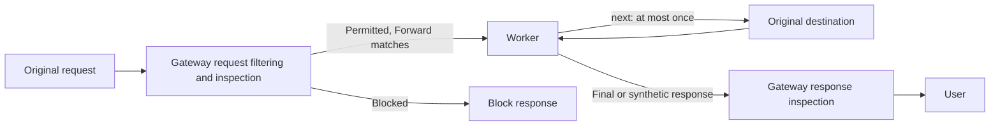

import {
	APIRequest,
	DashButton,
	PackageManagers,
	Steps,
	TypeScriptExample,
	WranglerConfig,
} from "~/components";

The **Forward** action invokes a Worker on HTTP traffic that Gateway permits. Use it to implement request and response transformations, application-specific controls, or background tasks without operating a separate HTTP proxy.

## How it works

Forward policies run in a dedicated phase after Gateway evaluates HTTP request headers and inspects the original request body. Gateway invokes the Worker selected by the first matching Forward policy, in [order of precedence](/cloudflare-one/traffic-controls/order-of-enforcement/#order-of-precedence). A request that is blocked does not reach the Worker. Permitted traffic that matches no Forward policy continues without invoking a Worker.



Gateway calls the named `GatewayMiddleware` entrypoint's `handle(request, context, next)` method:

- `request` is the original HTTP `Request`, including its body stream.
- `context` contains [Gateway metadata](/cloudflare-one/traffic-controls/integrate-workers/available-context/). It describes the original request and does not change when your Worker modifies the request.
- `next(request)` sends a request to its original destination through Gateway and returns the upstream `Response`. Gateway establishes the upstream connection when the Worker calls `next()`.

The Worker can modify the method, headers, cookies, or body before calling `next()`. It can modify the upstream response or return a synthetic response without calling `next()`. Call `next()` at most once per invocation. You cannot use it to change the destination URL or host, retry an upstream request, or send requests to several destinations.

Gateway inspects the **original request before the Worker** and the **final response after the Worker**, including synthetic responses. Gateway does not inspect modified request bytes a second time before sending them upstream. For example, a Worker cannot redact a request that Gateway has already blocked with DLP, and data the Worker adds to a permitted request does not receive another request-side DLP scan.

A normal Workers `fetch()` is an independent subrequest. Use `next()` to continue the user's request with Gateway's routing and egress configuration. Do not assume a `fetch()` call uses the user's Gateway policies or egress IP.

## Prerequisites

- Have a [Cloudflare account](/fundamentals/account/create-account/) with Workers set up. If you have not used Workers before, follow the [Workers getting started guide](/workers/get-started/guide/). Use the same account for Workers and Gateway.
- Set up [Gateway HTTP filtering](/cloudflare-one/traffic-controls/get-started/http/) and route your test device's traffic through Gateway.
- Enable [TLS decryption](/cloudflare-one/traffic-controls/http-policies/tls-decryption/) and install a trusted [root certificate](/cloudflare-one/team-and-resources/devices/user-side-certificates/) for HTTPS traffic.
- Use a deployed Worker in the same Cloudflare account as your Gateway policy. Configure a [Workers subdomain](/workers/configuration/routing/workers-dev/) for the account. The Worker does not need a public route.

## Set up Forward

<Steps>

1. Create a Worker project.

   <PackageManagers type="exec" pkg="wrangler" args="init gateway-worker" />

   Use the following configuration. Disabling `workers_dev` and `preview_urls` keeps this Worker from being exposed through those public URLs.

   <WranglerConfig>

   ```toml
   name = "gateway-worker"
   main = "src/index.ts"
   compatibility_date = "$today"
   workers_dev = false
   preview_urls = false
   ```

   </WranglerConfig>

2. Replace `src/index.ts` with the required named Worker entrypoint.

   Gateway invokes `GatewayMiddleware.handle()` through [Workers RPC](/workers/runtime-apis/rpc/). Keep the exported class name `GatewayMiddleware` exactly as shown.

   Install the [Gateway TypeScript types](/cloudflare-one/traffic-controls/integrate-workers/available-context/#typescript-types):

   <PackageManagers type="add" pkg="@cloudflare/zt-types" dev />

   This example passes the request through and adds a response header so you can verify the Worker ran. The [context reference](/cloudflare-one/traffic-controls/integrate-workers/available-context/) describes the fields you can use in other scripts.

   <TypeScriptExample filename="src/index.ts">

   ```ts
   import { WorkerEntrypoint } from "cloudflare:workers";
   import type {
     GatewayMiddlewareContext,
     GatewayMiddlewareNext,
   } from "@cloudflare/zt-types";

   export class GatewayMiddleware extends WorkerEntrypoint {
     async handle(
       request: Request,
       context: GatewayMiddlewareContext,
       next: GatewayMiddlewareNext,
     ): Promise<Response> {
       const response = await next(request);
       const headers = new Headers(response.headers);
       headers.set("x-gateway-worker", "gateway-worker");
       return new Response(response.body, {
         status: response.status,
         statusText: response.statusText,
         headers,
       });
     }
   }
   ```

   </TypeScriptExample>

3. Deploy the Worker to the account that contains your Gateway policies.

   <PackageManagers type="exec" pkg="wrangler" args="deploy" />

4. In Cloudflare One, go to **Traffic controls** > **Firewall policies** > **HTTP**.

   <DashButton url="/?to=/:account/gateway/policies" buttonName="Firewall policies" zeroTrust />

5. Select **Add a policy**, name the policy, and scope it to one test host and a test user or device group. Use request metadata selectors such as **Host**, **URL**, and **HTTP Method**. You can also add identity and device posture conditions.

6. Select **Forward** as the action, select your deployed Worker, and select **Create policy**. Gateway invokes its `GatewayMiddleware` entrypoint, rather than a default `fetch()` handler.

7. From the test device, request the selected host and check for the `x-gateway-worker: gateway-worker` response header. A matching filtering Block policy still takes precedence over Forward. Refer to [Troubleshooting](#troubleshooting) if the header is absent.

</Steps>

### Configure with the API

Use the [Create a Zero Trust Gateway rule](/api/resources/zero_trust/subresources/gateway/subresources/rules/methods/create/) endpoint with `action: "forward"` and the Worker's ID in `rule_settings.forward.worker_id`. The Worker ID is a 32-character lowercase hexadecimal identifier. Use its ID, rather than its name or a `workers.dev` URL.

<APIRequest
	path="/accounts/{account_id}/gateway/rules"
	method="POST"
	json={{
		name: "Forward example.com to a Worker",
		enabled: true,
		precedence: 1000,
		action: "forward",
		filters: ["http"],
		traffic: 'http.request.host == "example.com"',
		rule_settings: {
			forward: { worker_id: "<WORKER_ID>" },
		},
	}}
/>

For deployed Worker identifiers, refer to [List Workers](/api/resources/workers/subresources/beta/subresources/workers/methods/list/).

## Known limitations

Gateway resolves the selected Worker only when a Forward policy is saved. Deleting the Worker does not remove or disable the policy. Matching requests then fail with HTTP `500` and do not reach the origin. Before deleting a Worker, update all Forward policies that use it to select another Worker, or delete those policies.

Gateway drops HTTP traffic sent from the Cloudflare compute platform through [Workers VPC](/workers-vpc/) if it matches a Forward policy. Gateway does not invoke the selected Worker. Exclude this traffic from your Forward policies.

WebSocket traffic bypasses the Worker selected by a Forward policy. Gateway connects directly to the original upstream service. The Worker does not receive the WebSocket upgrade request or messages, so its logic does not apply to those connections.

| Area            | Behavior                                                                                                                                                                                            |
| --------------- | --------------------------------------------------------------------------------------------------------------------------------------------------------------------------------------------------- |
| Policy matching | Forward uses request metadata, identity, and device posture conditions. Body inspection results, DLP matches, and response selectors cannot select a Worker.                                        |
| Decryption      | HTTPS traffic must be decrypted. Gateway does not invoke a Worker for traffic matching Do Not Inspect.                                                                                              |
| Protocols       | Regular HTTP requests are supported. Gateway does not invoke a Worker for CONNECT tunnels, WebSocket connections, protocol upgrades, or HTTP trailers.                                              |
| Destination     | `next()` preserves the original destination URL and host.                                                                                                                                           |
| Continuation    | Call `next()` zero or one time. Repeated or concurrent calls are unsupported.                                                                                                                       |
| Response        | Return a final status from `200` to `599`. Return no body for HEAD requests or statuses `204`, `205`, and `304`.                                                                                    |
| Streaming       | Request and response bodies stream through Gateway with backpressure and cancellation. Avoid buffering entire bodies.                                                                               |
| Failure         | Invocation errors, Worker errors, or failures in communication between Gateway and the Worker fail closed. Gateway does not bypass the Worker and forward the original request.                     |
| Limits          | Existing [Gateway limits](/cloudflare-one/account-limits/) and [Workers limits](/workers/platform/limits/) apply. Workers usage is subject to normal [Workers pricing](/workers/platform/pricing/). |

Use `this.ctx.waitUntil()` for background tasks that can run after returning the response. These tasks remain subject to [Workers execution limits](/workers/platform/limits/#duration) and are not a durable job queue. Use [Queues](/queues/) or [Workflows](/workflows/) for work that requires retries or more time.

## Troubleshooting

If your Worker does not run, confirm that the device uses Gateway HTTP filtering, HTTPS is decrypted, and the request is permitted by filtering policies. Check whether a Do Not Inspect policy or an earlier Forward policy matches the request.

If requests fail after enabling Forward, confirm that the Worker exports `GatewayMiddleware`, its `handle()` method returns a `Response`, and it calls `next()` at most once. Check for exceptions, unsupported status codes, and bodies on responses that must have no body. Use [Workers Logs](/workers/observability/logs/workers-logs/) to inspect invocation errors. Disable the test Forward policy while correcting a failing script.

If matching requests return HTTP `500` after a Worker was deleted, update the Forward policy to select an existing Worker, or delete the policy. Saving a policy that still references the deleted Worker fails with API error `2294`.

Start with a [Worker template](/cloudflare-one/traffic-controls/integrate-workers/worker-templates/) once the pass-through example works.
