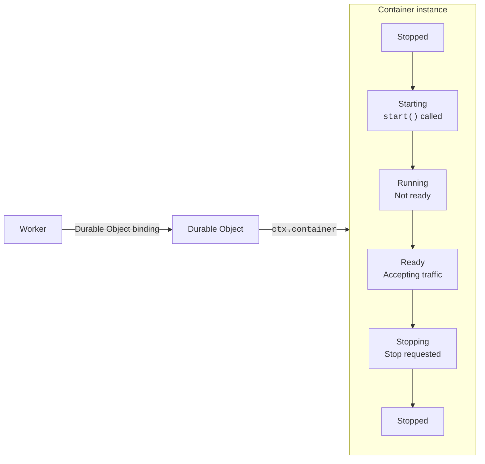

## Deployment

How images and running Container instances update depends on the [scheduling policy](/containers/configuration/scheduling-policy/) for the application.

With the `durable_object` policy, Wrangler prepares the named images for the application. Durable Object code can access their immutable references and selects an image and instance size when it calls `ctx.container.start()`. When an image reference changes, the Durable Object code decides whether to stop the running Container and start it with the new image or let it continue with the previous image. This application-controlled restart is how you roll out image changes with the `durable_object` policy. These instances do not participate in application-wide image rollouts.

With the `default` policy, Wrangler uploads or resolves the application image. Cloudflare distributes that image across its network and prepares capacity for new instances. Changes to the image or instance type use a [rollout](/containers/configuration/rollouts/).

Worker code goes live on deploy before any application-wide Container rollout finishes. Refer to [Deploy Containers](/containers/guides/deploy/).

## Container instance lifecycle

A Container can only be accessed through its [Durable Object](/durable-objects/). A Worker sends a request to the Durable Object, which accesses the Container through `ctx.container`.

An inactivity timeout, `signal()`, `destroy()`, a rollout, or a process exit can stop the instance. If startup fails or the process exits early, the instance returns to the stopped state.

The `ctx.container.running` property becomes `true` before the process is ready to accept traffic. Check port readiness before you send the first request.

Manage this lifecycle through the [Durable Object Container API](/containers/api/durable-object-container/). It lets the Durable Object coordinate container compute with persistent state and alarms.

## Lifecycle of a request

### Client to Worker

Recall that Containers are backed by [Durable Objects](/durable-objects/) and [Workers](/workers/).
Requests are first routed through a Worker, which is generally handled
by a datacenter in a location with the best latency between itself and the requesting user.
A different datacenter may be selected to optimize overall latency, if [Smart Placement](/workers/configuration/placement/)
is on, or if the nearest location is under heavy load.

HTTP requests reach a Container through the Worker's [`fetch()` handler](/workers/runtime-apis/handlers/fetch/).

For raw TCP traffic, a [Spectrum application with a Worker origin](/spectrum/how-to/route-tcp-traffic-to-a-worker/) invokes the Worker's [`connect()` handler](/workers/runtime-apis/handlers/connect/). The Worker can forward the socket through the Container's Durable Object to a process listening on a container port. This path supports protocols such as bidirectional gRPC. Refer to [Bidirectional gRPC with Workers and Containers](/containers/examples/bidirectional-grpc/) for a complete example.

:::note[Public beta]
Inbound TCP connections to Workers are in public beta.
:::

### Worker to Durable Object

From the Worker, a request passes through a Durable Object instance. The Durable Object class extends `DurableObject` and controls the container through `ctx.container`.
Each Durable Object instance is a globally routable isolate that can execute code and store state. This allows
developers to address and route to specific container instances, run code when a container exits, and store persistent state associated with each instance.

### Starting a Container

When a Durable Object requests a new Container instance, Cloudflare selects eligible capacity with the required image available. The `durable_object` policy uses the `image` and `instance` options supplied to `ctx.container.start()`. The `default` policy uses the application image and instance type from Wrangler configuration.

:::note
Durable Objects and their associated Container instances are not guaranteed to run in the
same location.

Container placement is optimized for request routing and startup speed, so a Container may
start in a different location than its Durable Object.
:::

Starting additional Container instances can use other locations where the image is available. Cloudflare prepares additional capacity as demand grows. Because prepared capacity is finite, some Container instances may start in locations farther from the end user. You are only charged for actively running instances, not for prepared images that are not running.

#### Cold starts

A cold start is when a container instance is started from a completely stopped state.
If you call `env.MY_CONTAINER.get(id)` with a completely novel ID and launch
this instance for the first time, it will result in a cold start.
This will start the container image from its entrypoint for the first time. Depending
on what this entrypoint does, it will take a variable amount of time to start.

Container cold starts can often be in the 1-3 second range, but this is dependent
on image size and code execution time, among other factors.

### Requests to running Containers

When a request _starts_ a new container instance, the nearest location with a pre-fetched image is selected.
Subsequent requests to a particular instance, regardless of where they originate, will be routed to this location as long as
the instance stays alive.

However, once that container instance stops and restarts, future requests could be routed to a _different_ location.
This location will again be the nearest location to the originating request with a pre-fetched image.

### Container runtime

Each container instance runs in a Firecracker microVM with its own kernel and network. No other workload on the Cloudflare network shares that kernel. Your image runs as a Linux container inside the VM.

Containers should be built for the `linux/amd64` architecture, and should stay within
[size limits](/containers/platform/limits/).

[Logging](/containers/faq/#how-do-container-logs-work), metrics collection, and
[networking](/containers/faq/#how-do-i-allow-or-disallow-egress-from-my-container) are automatically set up on each container, as configured by the developer.

### Container shutdown

Call [`setInactivityTimeout()`](/containers/api/durable-object-container/#setinactivitytimeout) to let the runtime stop the container after the Durable Object becomes inactive. The Durable Object becomes inactive when it stops receiving requests. The timeout can keep the container available while the Durable Object sleeps. You can also stop a container with [`signal()`](/containers/api/durable-object-container/#signal) or [`destroy()`](/containers/api/durable-object-container/#destroy).

When the platform is about to stop a container instance, it:

1. Sends `SIGTERM` to the main process in the container.
2. Waits up to 15 minutes for that process to exit.
3. Sends `SIGKILL` if the process is still running.

Handle `SIGTERM` in your image if you need cleanup before exit. The same sequence runs when a [rollout](/containers/configuration/rollouts/) replaces a container instance with a new image.

### Lifecycle events

The Durable Object runs its own code when the container changes state:

- Startup work runs after [`start()`](/containers/api/durable-object-container/#start) and a successful port readiness check.
- Exit work runs when the [`monitor()`](/containers/api/durable-object-container/#monitor) promise settles. The promise resolves when the main process exits with code `0`. It rejects with an error that has an `exitCode` property when the process exits with another code.
- Scheduled work runs from an [alarm](/durable-objects/api/alarms/), whether or not the container is running.

Refer to the [status hooks example](/containers/examples/status-hooks/) for a full implementation.

#### Use snapshots

All disk is ephemeral by default. When a Container instance goes to sleep, the
next time it starts, it uses a fresh disk from the container image.

If you need point-in-time filesystem state, Container applications that use the [`durable_object` scheduling policy](/containers/configuration/scheduling-policy/#use-the-durable-object-scheduling-policy) can create and restore a snapshot.
Snapshots are immutable, so later file changes require a new snapshot. For more
information, refer to [Snapshots](/containers/guides/snapshots/).

You can also use [FUSE](/containers/examples/r2-fuse-mount/) to persist disk
to R2 or other object storage backends. Though you should not expect native
SSD-like performance while using FUSE.

## An example request

- A developer deploys a Container. Cloudflare automatically readies instances across its Network.
- A request is made from a client in Bariloche, Argentina. It reaches the Worker in a nearby
  Cloudflare location in Neuquen, Argentina.
- This Worker request calls `env.MY_CONTAINER.getByName("session-1337")`. This brings up a Durable
  Object, which then calls `this.ctx.container.start()`.
- This requests the nearest free Container instance. Cloudflare recognizes that an instance is free in Buenos Aires, Argentina, and
  starts it there.
- A different user needs to route to the same container. This user's request reaches
  the Worker running in Cloudflare's location in San Diego, US.
- The Worker again calls `env.MY_CONTAINER.getByName("session-1337")`.
- If the initial container instance is still running, the request is routed to the original location
  in Buenos Aires. If the initial container has gone to sleep, Cloudflare will once
  again try to find the nearest "free" instance of the Container, likely
  one in North America, and start an instance there.
