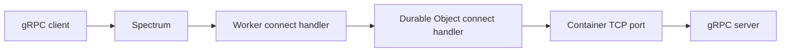

import {
	CopyPromptButton,
	PackageManagers,
	Steps,
	TypeScriptExample,
} from "~/components";

This example runs a bidirectional gRPC server in a Cloudflare Container. A Spectrum application sends each public TCP connection to a Worker, and the Worker forwards the raw byte stream through a Durable Object to the container.

:::note[Public beta]
Inbound TCP connections to Workers are in public beta.
:::

To have an AI coding agent deploy the example and create the Spectrum application, copy this prompt into your agent:

<CopyPromptButton
	tooltip="Deploy the bidirectional gRPC example"
	prompt="Follow https://developers.cloudflare.com/containers/examples/bidirectional-grpc/ to deploy the demo app, then use the cf CLI to create a Spectrum application, with the Worker you just deployed as the origin. Ask me for any missing account, zone, or hostname details, and test the gRPC connection end to end."
/>

The Worker does not parse gRPC. It pipes the client's HTTP/2 byte stream to the container in both directions:



## Prerequisites

- Access to [Cloudflare Containers](/containers/).
- [Node.js](https://nodejs.org/) and a Node.js package manager.
- The [Cloudflare CLI (`cf`)](/cf/get-started/) installed.
- A Docker-compatible CLI and engine installed and running. Refer to [Containers local development](/containers/guides/local-dev/) for setup and troubleshooting.
- A domain on Cloudflare on a Pro or Business plan, or with Spectrum Enterprise enabled, in the same account as the Worker.
- A TLS certificate and private key for the gRPC hostname. The container terminates TLS.

## Create the project

Create a Worker project with the Cloudflare CLI:

```sh
cf init grpc-in-container --package-manager npm
cd grpc-in-container
mkdir -p proto container
```

`cf init` installs the Worker dependencies and creates `cloudflare.config.ts`, `vite.config.ts`, `tsconfig.json`, and `src/index.ts`. Keep the generated Vite and TypeScript configuration. Replace the Worker configuration and entrypoint with the versions below.

Create `container/package.json`:

```json
{
	"name": "grpc-byte-stream-container",
	"private": true,
	"dependencies": {
		"@grpc/grpc-js": "^1.14.7",
		"@grpc/proto-loader": "^0.8.1"
	}
}
```

## Define the gRPC service

Create `proto/bytes.proto`:

```protobuf
syntax = "proto3";

package cloudflare.grpcdemo;

service ByteStream {
  rpc Chat(stream ByteChunk) returns (stream ByteChunk);
}

message ByteChunk {
  bytes payload = 1;
}
```

The `Chat` method accepts a stream of messages and returns a stream of responses.

## Create the container server

The example uses `@grpc/grpc-js` and `@grpc/proto-loader` to run the gRPC server.

Create `container/server.js`:

```js
const path = require("node:path");
const grpc = require("@grpc/grpc-js");
const protoLoader = require("@grpc/proto-loader");

const port = Number.parseInt(process.env.GRPC_PORT || "50051", 10);
const protoPath =
	process.env.PROTO_PATH || path.resolve(__dirname, "../proto/bytes.proto");

const definition = protoLoader.loadSync(protoPath, {
	keepCase: true,
	longs: String,
	enums: String,
	defaults: true,
	oneofs: true,
});
const proto = grpc.loadPackageDefinition(definition).cloudflare.grpcdemo;

function chat(call) {
	let count = 0;

	call.write({
		payload: Buffer.from("hello from the container gRPC server\n"),
	});

	call.on("data", (chunk) => {
		count += 1;
		const payload = Buffer.isBuffer(chunk.payload)
			? chunk.payload
			: Buffer.from(chunk.payload || "");

		call.write({
			payload: Buffer.concat([
				Buffer.from(`container echo ${count}: `),
				payload,
			]),
		});
	});

	call.on("end", () => {
		call.write({
			payload: Buffer.from("goodbye from the container gRPC server\n"),
		});
		call.end();
	});

	call.on("error", (error) => {
		console.error("gRPC stream error", error);
	});
}

// PEM values come from Worker secrets, never from the image.
const cert = process.env.GRPC_TLS_CERT;
const key = process.env.GRPC_TLS_KEY;
if (Boolean(cert) !== Boolean(key)) {
	throw new Error("Set both GRPC_TLS_CERT and GRPC_TLS_KEY");
}
const credentials = cert
	? grpc.ServerCredentials.createSsl(
			null,
			[
				{
					private_key: Buffer.from(key),
					cert_chain: Buffer.from(cert),
				},
			],
			false,
		)
	: grpc.ServerCredentials.createInsecure();

const server = new grpc.Server();
server.addService(proto.ByteStream.service, { Chat: chat });
server.bindAsync(`0.0.0.0:${port}`, credentials, (error, boundPort) => {
	if (error) {
		console.error(error);
		process.exitCode = 1;
		return;
	}

	console.log(
		JSON.stringify({
			event: "grpc_server_listening",
			port: boundPort,
		}),
	);
});
```

## Build the container image

Create `Dockerfile`:

```dockerfile
FROM node:22-slim

WORKDIR /app

COPY container/package*.json ./
RUN npm install --omit=dev

COPY proto ./proto
COPY container ./container

ENV GRPC_PORT=50051
EXPOSE 50051

CMD ["node", "container/server.js"]
```

`EXPOSE 50051` documents the port used by the gRPC server. The Worker connects to this port with `getTcpPort(50051)`.

Create `.dockerignore` so local dependencies, generated files, and TLS credentials stay out of the image build context:

```txt title=".dockerignore"
**/node_modules
.cloudflare
.git
.dev.vars*
.env*
certs
secrets.json
```

## Configure Workers and Containers

Replace `cloudflare.config.ts`:

```ts title="cloudflare.config.ts"
import {
	bindings,
	defineConfig,
	defineContainer,
	exports,
	triggers,
} from "cf/config";
import * as entrypoint from "./src/index.ts" with { type: "cf-worker" };

const grpcContainer = defineContainer({
	name: "grpc-in-container",
	image: { dockerfile: "./Dockerfile" },
	maxInstances: 1,
	instanceType: "lite",
});

export default defineConfig({
	worker: {
		name: "grpc-in-container",
		compatibilityDate: "2026-11-08",
		compatibilityFlags: ["nodejs_compat"],
		entrypoint,
		observability: { enabled: true },
		triggers: [triggers.connect({ protocol: "tcp", port: 8788 })],
		exports: {
			GrpcContainer: exports.durableObject({
				storage: "sqlite",
				container: grpcContainer,
			}),
		},
		env: {
			GRPC_CONTAINER: bindings.durableObject({
				worker: "grpc-in-container",
				exportName: "GrpcContainer",
			}),
			GRPC_TLS_CERT: bindings.secret(),
			GRPC_TLS_KEY: bindings.secret(),
		},
	},
	containers: [grpcContainer],
});
```

The Worker uses one Durable Object name, `grpc-demo`, to route connections to the same Container instance. The `triggers.connect()` configuration opens the local TCP listener on port `8788`. Local development uses plaintext; TLS credentials are uploaded before exposing the public endpoint.

## Forward sockets to the container

Create `src/index.ts`:

<TypeScriptExample filename="src/index.ts">

```ts
import { DurableObject } from "cloudflare:workers";

type GrpcEnv = Env & { GRPC_TLS_CERT?: string; GRPC_TLS_KEY?: string };

const CONTAINER_INSTANCE = "grpc-demo";
const GRPC_PORT = 50051;
const CONTAINER_CONNECT_ATTEMPTS = 20;
const CONTAINER_CONNECT_RETRY_MS = 100;
const CONTAINER_STARTUP_GRACE_MS = 3_000;
const SOCKET_OPTIONS: SocketOptions = {
	allowHalfOpen: true,
	secureTransport: "off",
};

export class GrpcContainer extends DurableObject<GrpcEnv> {
	async connect(socket: Socket): Promise<void> {
		console.log("Durable Object received TCP connection");
		const container = this.ctx.container;
		if (container === undefined) {
			throw new Error("This Durable Object requires a Container binding");
		}

		await this.ctx.blockConcurrencyWhile(async () => {
			if (!container.running) {
				container.start({
					enableInternet: false,
					env: {
						GRPC_PORT: String(GRPC_PORT),
						...(this.env.GRPC_TLS_CERT
							? { GRPC_TLS_CERT: this.env.GRPC_TLS_CERT }
							: {}),
						...(this.env.GRPC_TLS_KEY
							? { GRPC_TLS_KEY: this.env.GRPC_TLS_KEY }
							: {}),
					},
				});
				await scheduler.wait(CONTAINER_STARTUP_GRACE_MS);
			}
		});

		let upstream: Socket | undefined;
		for (let attempt = 1; attempt <= CONTAINER_CONNECT_ATTEMPTS; attempt++) {
			const candidate = container
				.getTcpPort(GRPC_PORT)
				.connect(`10.0.0.1:${GRPC_PORT}`, SOCKET_OPTIONS);

			try {
				await candidate.opened;
				const closedBeforeReady = await Promise.race([
					candidate.closed.then(
						() => true,
						() => true,
					),
					scheduler.wait(CONTAINER_CONNECT_RETRY_MS).then(() => false),
				]);

				if (!closedBeforeReady) {
					upstream = candidate;
					break;
				}
				await Promise.allSettled([candidate.close()]);
			} catch (error) {
				await Promise.allSettled([candidate.close()]);
				if (attempt === CONTAINER_CONNECT_ATTEMPTS) {
					throw error;
				}
				await scheduler.wait(CONTAINER_CONNECT_RETRY_MS);
			}
		}

		if (upstream === undefined) {
			throw new Error("Container gRPC port did not become ready");
		}

		try {
			await Promise.all([
				socket.readable.pipeTo(upstream.writable),
				upstream.readable.pipeTo(socket.writable),
			]);
		} finally {
			await Promise.allSettled([socket.close(), upstream.close()]);
		}
	}
}

export default {
	async connect(socket: Socket, env: Env): Promise<void> {
		console.log("Worker received TCP connection");
		const container = env.GRPC_CONTAINER.getByName(CONTAINER_INSTANCE);
		const durableObjectSocket = container.connect(
			`grpc-container:${GRPC_PORT}`,
			SOCKET_OPTIONS,
		);

		try {
			await durableObjectSocket.opened;
			await Promise.all([
				socket.readable.pipeTo(durableObjectSocket.writable),
				durableObjectSocket.readable.pipeTo(socket.writable),
			]);
		} finally {
			await Promise.allSettled([socket.close(), durableObjectSocket.close()]);
		}
	},
} satisfies ExportedHandler<Env>;
```

</TypeScriptExample>

The Worker and Durable Object use `allowHalfOpen: true` to preserve TCP half-closes. The gRPC client ends its request stream with HTTP/2 framing; this does not close the underlying TCP connection.

The Durable Object starts the container if it is stopped, then makes up to 20 attempts to connect to the gRPC port. The call to `getTcpPort(50051).connect()` returns a Workers [`Socket`](/workers/runtime-apis/tcp-sockets/#socket).

## Create the test client

Create `container/client.js`. The client uses TLS when `GRPC_TLS=1`:

```js
const fs = require("node:fs");
const path = require("node:path");
const grpc = require("@grpc/grpc-js");
const protoLoader = require("@grpc/proto-loader");

const definition = protoLoader.loadSync(
	path.resolve(__dirname, "../proto/bytes.proto"),
);
const proto = grpc.loadPackageDefinition(definition).cloudflare.grpcdemo;
const credentials =
	process.env.GRPC_TLS === "1"
		? grpc.credentials.createSsl(
				process.env.GRPC_CA_FILE
					? fs.readFileSync(process.env.GRPC_CA_FILE)
					: undefined,
			)
		: grpc.credentials.createInsecure();
const client = new proto.ByteStream(
	process.argv[2] || "localhost:8788",
	credentials,
);
const call = client.Chat({ deadline: Date.now() + 30_000 });
call.on("data", ({ payload }) => console.log(payload.toString()));
call.on("error", (error) => {
	console.error(error);
	process.exitCode = 1;
	client.close();
});
call.on("end", () => client.close());
call.write({ payload: Buffer.from("first message\n") });
call.write({ payload: Buffer.from("second message\n") });
call.end();
```

## Run the example locally

<Steps>
1. Install the gRPC dependencies in the `container` directory:

   ```sh
   cd container
   ```

   <PackageManagers type="install" />

   Return to the project root:

   ```sh
   cd ..
   ```

2. Generate Worker types:

   ```sh
   cf workers types
   ```

3. Start local development:

   ```sh
   cf dev
   ```

   The Cloudflare Vite plugin builds the container image during startup. The `triggers.connect()` configuration opens the raw TCP listener on port `8788`. The Durable Object starts the container when the first connection arrives. Missing `GRPC_TLS_CERT` and `GRPC_TLS_KEY` warnings are expected for this plaintext local test; configure both secrets before exposing the public endpoint.

4. In another terminal, run the gRPC client against the raw TCP listener:

   ```sh
   node container/client.js localhost:8788
   ```
</Steps>

The development server logs `Worker received TCP connection` and `Durable Object received TCP connection`. The client receives four responses:

```txt
hello from the container gRPC server

container echo 1: first message

container echo 2: second message

goodbye from the container gRPC server
```

## Deploy the example

<Steps>
1. Sign in and deploy the Worker and Container:

   ```sh
   cf auth login
   cf deploy
   ```

   Container provisioning can take several minutes. When redeploying, wait for the [Container rollout](/containers/configuration/rollouts/) to finish before testing.

2. Find the deployed Worker's tag:

   ```sh
   cf workers scripts search --name grpc-in-container
   ```

   A Worker tag is the immutable 32-character identifier that Cloudflare assigns to a Worker. It is different from the Worker name. Copy the Worker ID returned by the command. The Spectrum API uses this value as `origin_worker_id`.

3. Configure TLS before exposing the public endpoint. Obtain a PEM certificate chain and private key for your hostname from a CA trusted by your clients. Keep the private key out of the image and repository.

   For a reproducible test, create a short-lived self-signed certificate. Replace `grpc.example.com` with your hostname:

   ```sh
   mkdir -p certs
   openssl req -x509 -newkey rsa:2048 -nodes -days 2 \
     -keyout certs/key.pem -out certs/cert.pem \
     -subj "/CN=grpc.example.com" -addext "subjectAltName=DNS:grpc.example.com"
   ```

   Add `certs/` and `secrets.json` to `.gitignore` and `.dockerignore`. Create a secret file without printing the key and upload both secrets:

   ```sh
   node --input-type=module -e 'import fs from "node:fs"; fs.writeFileSync("secrets.json", JSON.stringify({GRPC_TLS_CERT: {type: "secret_text", text: fs.readFileSync("certs/cert.pem", "utf8")}, GRPC_TLS_KEY: {type: "secret_text", text: fs.readFileSync("certs/key.pem", "utf8")}}), {mode: 0o600})'
   cf workers secrets bulk --worker grpc-in-container --file secrets.json
   ```

   The Durable Object passes these secrets to the container at startup. Restart an existing container after certificate rotation. Without the secrets, the server uses plaintext for local development only.

4. [Create a Spectrum application with the Worker as its origin](/spectrum/how-to/route-tcp-traffic-to-a-worker/) and use:
   - Your public hostname, such as `grpc.example.com`, for `dns.name`.
   - The deployed Worker's tag for `origin_worker_id`.
   - `tcp/50051` for `protocol`.
   - `worker` for `traffic_type`.

   Omit `tls` on Pro and Business zones. Spectrum passes the encrypted TCP stream through unchanged. With Spectrum Enterprise, use `tls: "off"` for the same behavior.

5. Run the client against the Spectrum hostname, explicitly trusting the test certificate:

   ```sh
   GRPC_TLS=1 GRPC_CA_FILE=certs/cert.pem node container/client.js grpc.example.com:50051
   ```

   For a publicly trusted certificate, omit `GRPC_CA_FILE` to use system trust. Do not disable certificate or hostname verification.
</Steps>

The gRPC client establishes TLS directly with the container, which negotiates HTTP/2 through ALPN (`h2`). Spectrum, the Worker, and the Durable Object forward the encrypted bytes without terminating TLS.
