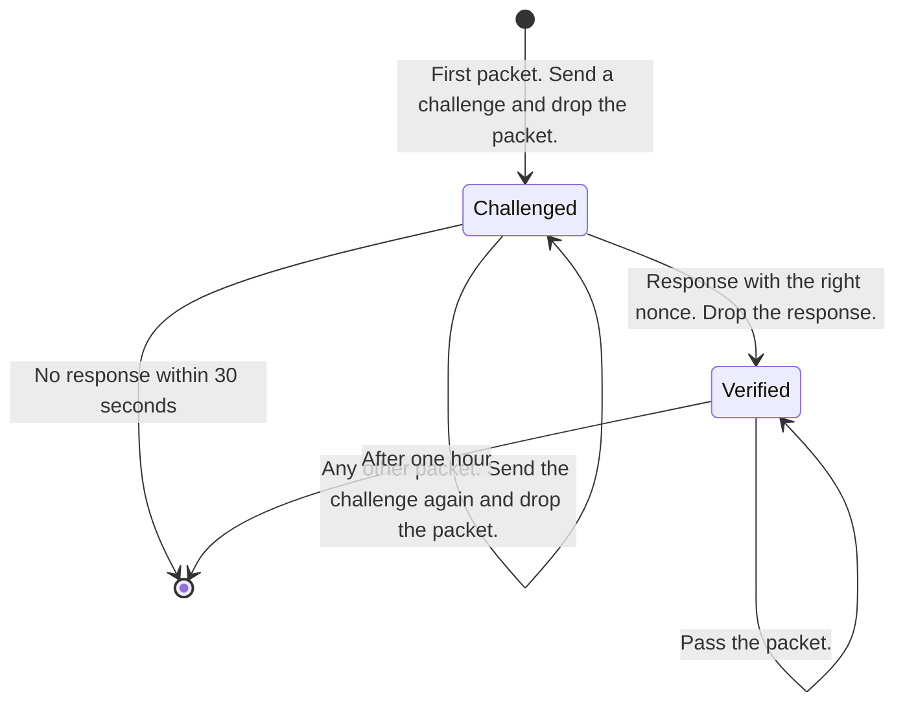

This program verifies that each source IP is genuine before it passes its traffic. It drops the first packet from an unknown source IP, and Cloudflare sends a [challenge](/ddos-protection/advanced-ddos-systems/programmable-flow-protection/concepts/#challenges) with a random value, called a nonce, to that source IP. A client that receives the challenge echoes the nonce back. Attackers that spoof source IPs never receive the challenge, so they cannot answer it.

The program requires the challenges and source IP state features. To enable them, contact your account team. If either feature is not enabled, the program passes all packets.

## How it works

The program uses the source IP status to track each client:



For each packet, the program:

1. Reads the source IP status with `get_src_ip_status`. Expired statuses read as `CF_EBPF_SRC_IP_STATUS_NONE`, so the program does not check expiry itself.
2. Passes the packet if the source IP is verified.
3. If the source IP was challenged, compares the packet with the nonce stored in the source IP data. A correct response verifies the source IP. Any other packet triggers the same challenge again.
4. Otherwise, generates a nonce with `rand`, sets it as the challenge with `set_challenge`, stores it, and marks the source IP as challenged.

The program drops the packet whenever it sends a challenge, because Cloudflare sends challenges only for dropped packets.

The program does not blocklist source IPs that send wrong responses. An attacker can spoof the source IP of a legitimate client, so blocklisting on a wrong response would let the attacker block that client. `set_challenge` limits how often each source IP is challenged.

## Program

```c title="challenge_response.c"
/*
 * Verify source IPs with a challenge-response exchange.
 *
 * The first packet from an unknown source IP is dropped, and Cloudflare sends
 * a challenge containing a random nonce back to that source IP. The client
 * proves that it can receive traffic at its source IP by echoing the nonce.
 * After a correct response, the source IP is verified and its packets pass
 * until the verification expires.
 *
 * Requires the challenges feature and the source IP state table. The client
 * must implement the challenge protocol defined below.
 */

#define CF_EBPF_HELPER_V0

#include <cf_ebpf_defs.h>
#include <cf_ebpf_helper.h>

#define CHALLENGE_MAGIC 0x43484C47 /* "CHLG": sent by Cloudflare */
#define RESPONSE_MAGIC 0x52455350  /* "RESP": sent by the client */

#define CHALLENGE_TIMEOUT_SECONDS 30 /* Time to answer a challenge. */
#define VERIFIED_SECONDS 3600        /* How long a verification lasts. */

/*
 * Challenge and response messages. The client echoes the nonce from the
 * challenge in its response. Multi-byte fields are in network byte order.
 */
struct challenge_msg {
    uint32_t magic;
    uint32_t reserved;
    uint64_t nonce;
} __attribute__((packed));

/* Sends the challenge for `nonce`. Returns the set_challenge() result. */
static inline int send_challenge(uint64_t nonce)
{
    struct challenge_msg msg = {
        .magic = htonl(CHALLENGE_MAGIC),
        .reserved = 0,
        .nonce = htonll(nonce),
    };
    return set_challenge((uint8_t *)&msg, sizeof(msg));
}

uint64_t cf_ebpf_main(void *state)
{
    struct cf_ebpf_generic_ctx *ctx = state;
    struct cf_ebpf_parsed_headers headers;
    struct cf_ebpf_packet_data *p;

    if (parse_packet_data(ctx, &p, &headers) != 0) {
        return CF_EBPF_DROP;
    }

    /*
     * Packets from blocklisted source IPs never reach the program, and
     * expired statuses read back as CF_EBPF_SRC_IP_STATUS_NONE, so there is
     * no need to check either case here.
     */
    uint8_t status = CF_EBPF_SRC_IP_STATUS_NONE;
    uint64_t expiry = 0;
    int ret = get_src_ip_status(&status, &expiry);
    if (ret != 0 && ret != -1) {
        /* The feature is not enabled for the account: fail open. */
        return CF_EBPF_PASS;
    }

    if (ret == 0 && status == CF_EBPF_SRC_IP_STATUS_VERIFIED) {
        return CF_EBPF_PASS;
    }

    if (ret == 0 && status == CF_EBPF_SRC_IP_STATUS_CHALLENGED) {
        uint64_t nonce = 0;
        ret = get_src_ip_data(&nonce);
        if (ret == -5) {
            /* Source IP state is not enabled for the account: fail open. */
            return CF_EBPF_PASS;
        }
        if (ret != 0) {
            return CF_EBPF_DROP;
        }

        struct challenge_msg *resp = (struct challenge_msg *)(headers.udp + 1);
        if ((uint8_t *)(resp + 1) <= headers.data_end &&
            ntohl(resp->magic) == RESPONSE_MAGIC &&
            ntohll(resp->nonce) == nonce) {
            set_src_ip_status(CF_EBPF_SRC_IP_STATUS_VERIFIED, VERIFIED_SECONDS);
            /* The response is not meant for the origin: drop it. */
            return CF_EBPF_DROP;
        }

        /*
         * Not a valid response, for example because the client did not
         * receive the challenge. Send the same nonce again. Do not blocklist
         * the source IP: UDP source IPs can be spoofed, so an attacker could
         * otherwise get a legitimate client blocked. set_challenge() limits
         * how often a source IP is challenged.
         */
        send_challenge(nonce);
        return CF_EBPF_DROP;
    }

    /* Unknown source IP, or a previous status expired: challenge it. */
    uint64_t nonce = 0;
    if (get_src_ip_data(&nonce) == -5) {
        /*
         * Source IP state is not enabled for the account, so the program
         * cannot store the nonce to check the response: fail open.
         */
        return CF_EBPF_PASS;
    }
    nonce = rand();
    ret = send_challenge(nonce);
    if (ret == -5) {
        /* Challenges are not enabled for the account: fail open. */
        return CF_EBPF_PASS;
    }
    if (ret != 0) {
        /* Rate limited: try again on a later packet. */
        return CF_EBPF_DROP;
    }
    if (set_src_ip_data(nonce) != 0) {
        /* The nonce could not be stored: do not send the challenge. */
        return CF_EBPF_PASS;
    }
    set_src_ip_status(CF_EBPF_SRC_IP_STATUS_CHALLENGED, CHALLENGE_TIMEOUT_SECONDS);

    /* The challenge is only sent when the program drops the packet. */
    return CF_EBPF_DROP;
}
```

## Implement the client

Clients must answer the challenge before they can send traffic. When the client receives a UDP packet from the server address with a payload that starts with the 4-byte value `CHLG`, it must send back a packet with the same 16-byte layout:

| Bytes | Field | Value |
| --- | --- | --- |
| 0–3 | `magic` | `RESP` (`0x52455350`) |
| 4–7 | `reserved` | `0` |
| 8–15 | `nonce` | The nonce from the challenge, unchanged |

The client must send the response from the same source IP that received the challenge, to the same server IP and port that sent the challenge, so that the response matches the rule expression. Until the source IP is verified, Cloudflare drops all other packets from it, so the client should also retry its first message after it answers the challenge.

## Adapt the program

- State is kept per Cloudflare server and can be reset. A verified client can be challenged again, for example when its traffic reaches another server. Make sure the client answers challenges at any time.
- Change `CHALLENGE_TIMEOUT_SECONDS` and `VERIFIED_SECONDS` to balance security and the number of challenges.
- In monitoring mode, the program updates the source IP status, but Cloudflare does not send challenges. Source IPs therefore stay in the challenged state until it expires.
