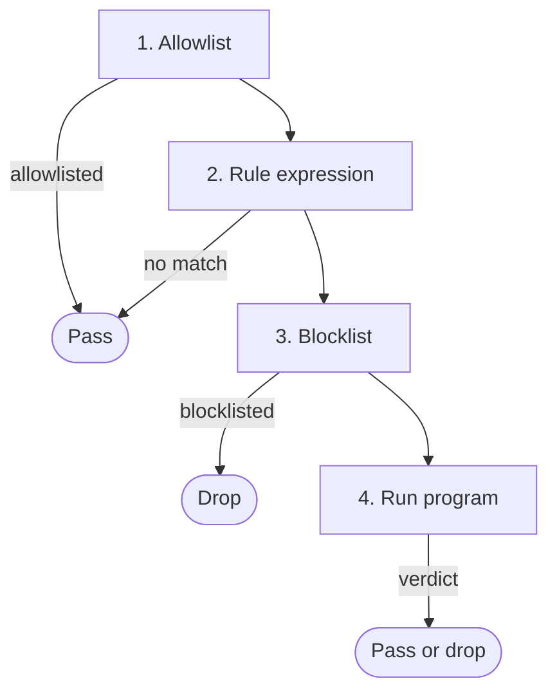

import { LinkCard, CardGrid } from "~/components";

Programmable Flow Protection lets you write a program in C that decides whether Cloudflare passes or drops each UDP packet sent to your network. Cloudflare runs the program on every server in its global network, so you can mitigate DDoS attacks against UDP protocols that generic DDoS protection does not understand, such as gaming, VoIP, telecom, streaming, and financial protocols.

Programmable Flow Protection is an add-on for [Magic Transit](/magic-transit/), with [BYOIP](/byoip/) or Cloudflare-leased IP addresses. To purchase it, contact your account team.

## What you can do

Your program receives each packet, starting at the IP header, and returns a verdict. A program can:

- Parse and validate your application protocol, and drop packets that do not conform.
- Keep state per source IP or per flow, for example to rate limit clients.
- Challenge unknown clients and only pass traffic from verified source IPs.
- Read per-IP values, such as allowlists or policies, that you update through the API.
- Tag packets with a custom value that appears in Network Analytics.

## How it works

Programmable Flow Protection runs on `flowtrackd`, Cloudflare's stateful mitigation platform, as part of the [Advanced DDoS Protection systems](/ddos-protection/advanced-ddos-systems/overview/). For each UDP packet sent to a protected prefix, the Cloudflare server that receives the packet does the following:

1. If the source IP is in the Advanced DDoS Protection [allowlist](/ddos-protection/advanced-ddos-systems/concepts/#allowlist), Cloudflare passes the packet.
2. Cloudflare selects the rule with the most specific scope for the data center. If the packet does not match the rule expression, Cloudflare passes the packet without running a program.
3. If the program has blocklisted the source IP, Cloudflare drops the packet without running the program.
4. Otherwise, Cloudflare runs the program, and applies its verdict: pass or drop.

In monitoring mode, Cloudflare passes every packet, including in steps 3 and 4, and records the verdict in Network Analytics.

You manage two kinds of resources:

- A **program** is the C source code that you upload. Cloudflare compiles it to an [eBPF](https://docs.kernel.org/bpf/) object and verifies that it is safe to run before it accepts it.
- A **rule** runs a program for a scope (global, region, or data center), in a mode (enabled, monitoring, or disabled), on the packets that match an expression.

For details, refer to [Concepts](/ddos-protection/advanced-ddos-systems/programmable-flow-protection/concepts/).

## Requirements

- A Magic Transit account with the Programmable Flow Protection add-on.
- [Advanced DDoS Protection enabled](/ddos-protection/advanced-ddos-systems/overview/#enablement), with the [prefixes](/ddos-protection/advanced-ddos-systems/overview/#prefixes) you want to protect added to it.

Some program features, such as state tables, challenges, and parameter maps, are enabled per account. To learn which features a program needs, refer to [Features that require enablement](/ddos-protection/advanced-ddos-systems/programmable-flow-protection/concepts/#features-that-require-enablement).

## Tools

The [`cloudflare/pfp-tools`](https://github.com/cloudflare/pfp-tools) repository on GitHub contains:

- `pfp-headers`: the C headers that every program includes.
- `pfp-verifier`: the verifier that Cloudflare runs on every uploaded program, which you can run locally.
- `examples`: complete example programs, with a build that uses the same compiler flags as Cloudflare.

## Next steps

<CardGrid>
	<LinkCard
		title="Get started"
		href="/ddos-protection/advanced-ddos-systems/programmable-flow-protection/get-started/"
		description="Write, verify, upload, and deploy your first program."
	/>
	<LinkCard
		title="Examples"
		href="/ddos-protection/advanced-ddos-systems/programmable-flow-protection/examples/"
		description="Complete programs for header validation, rate limiting, challenges, and more."
	/>
	<LinkCard
		title="Helper functions"
		href="/ddos-protection/advanced-ddos-systems/programmable-flow-protection/reference/helper-functions/"
		description="Every function a program can call, with arguments and return values."
	/>
	<LinkCard
		title="API"
		href="/ddos-protection/advanced-ddos-systems/api/programmable-flow-protection/"
		description="Manage programs, rules, and parameter maps with the Cloudflare API."
	/>
</CardGrid>
