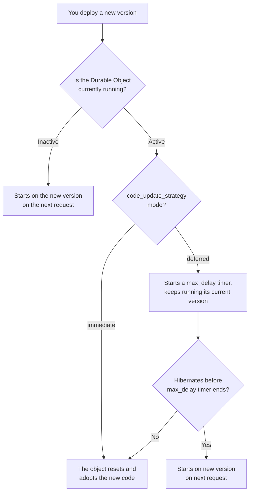
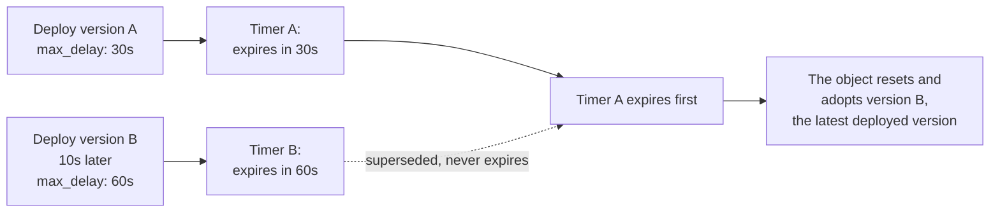

import { WranglerConfig, PackageManagers } from "~/components";

{/* TODO: Confirm the launch date for this feature before publication. */}

By default, Durable Objects defer code updates for up to 300 seconds (5 minutes) to give in-flight requests time to finish. An active object can keep running its current code until it hibernates or reaches this delay. Deferral is best effort and does not guarantee that every operation finishes.

Deploy a Worker with `--durable-objects-code-update-mode immediate` to apply a code update right away instead of waiting. For more information on when an object hibernates, refer to [Lifecycle of a Durable Object](/durable-objects/concepts/durable-object-lifecycle/).

## Code update strategy

| Mode        | Default `max_delay`     | Behavior                                                                                                                                                                                                  |
| ----------- | ----------------------- | --------------------------------------------------------------------------------------------------------------------------------------------------------------------------------------------------------- |
| `deferred`  | 300 seconds (5 minutes) | An active Durable Object can continue running its current code until it hibernates. If it is still active when `max_delay` is reached (86400 seconds maximum), the object resets and adopts the new code. |
| `immediate` | Not applicable          | An active Durable Object resets and adopts the new code immediately, without waiting to hibernate.                                                                                                        |

`deferred` with a 300-second `max_delay` is the default code update strategy. No configuration is required to use this default.

An explicit `code_update_strategy` — whether in your Wrangler configuration, passed as a CLI flag, or sent through the REST API — always overrides the default.

## How it works

1. You deploy a new version to 100% of traffic.
2. A client makes a request to a Durable Object that is not running. This uses the latest version of your code.
3. If a Durable Object is active with a `deferred` code update strategy, it can keep running its existing version and accepting new requests while it waits to hibernate. If the object hibernates before `max_delay` is reached, it starts on the new version on the next request.
4. If the object is still active when `max_delay` is reached, it resets and adopts the new code.



For each active Durable Object, consecutive Worker deployments have the following behavior:

- Each deployment starts a separate `max_delay` timer for that object.
- When the first timer expires, the object resets and adopts the latest deployed version, not necessarily the version that started that timer.

For example, consider an active Durable Object. You deploy version A with `max_delay: 30`, starting a 30-second timer for that object. Ten seconds later, you deploy version B with `max_delay: 60`, starting a separate 60-second timer for the same object. Version A's timer expires first, at the 30-second mark. When it expires, the object resets and adopts version B, the latest deployed version. If the object hibernates before either timer expires, it starts on the latest deployed version on the next request.



This means an `immediate` deploy always forces the update right away, even while an earlier `deferred` deploy's timer is still running, and it might skip versions you deployed in between.

## Configure a code update strategy

Set `code_update_strategy` for a deployment through your Wrangler configuration, the CLI flag, or the REST API. Wrangler supplies the configured strategy each time you deploy. The strategy does not carry over between deployments: a later deployment that omits it uses the default strategy.

`code_update_strategy` applies to every Durable Object class this Worker exports — you cannot set a different strategy for one class than another in the same Worker. This includes classes exported through [`ctx.exports`](/workers/runtime-apis/context/#exports) without an explicit `bindings` entry.

If a Durable Objects binding uses `script_name` to reference a class defined in a different Worker, that class's code updates are controlled by that other Worker's own `code_update_strategy`, not the Worker with the binding.

### Options

| `code_update_strategy`                     | Result                                                                                                          |
| ------------------------------------------ | --------------------------------------------------------------------------------------------------------------- |
| _(omitted)_                                | Defaults to `deferred` with a 300-second `max_delay`.                                                           |
| `{ "mode": "deferred" }`                   | Uses the default `max_delay` of 300 seconds (5 minutes).                                                        |
| `{ "mode": "deferred", "max_delay": 0 }`   | Applies the update immediately.                                                                                 |
| `{ "mode": "deferred", "max_delay": 120 }` | The code update is deferred for up to 120 seconds to give the object time to hibernate.                         |
| `{ "mode": "immediate" }`                  | The object adopts the new code immediately, without waiting to hibernate.                                       |
| `{ "mode": "immediate", "max_delay": 60 }` | The REST API returns an error. Wrangler silently drops `max_delay`; the object adopts the new code immediately. |

### Wrangler

Add `code_update_strategy` alongside `bindings` in the `durable_objects` object of your [Wrangler configuration file](/workers/wrangler/configuration/#durable-objects):

<WranglerConfig>

```jsonc
{
	"durable_objects": {
		"bindings": [
			{
				"name": "CHAT_ROOM",
				"class_name": "ChatRoom",
			},
		],
		"code_update_strategy": {
			"mode": "deferred",
			"max_delay": 60,
		},
	},
}
```

</WranglerConfig>

`max_delay` is in seconds and only applies when `mode` is `deferred`. It accepts values from `0` to `86400` (24 hours), with millisecond precision, such as `45.678`. Omit `max_delay` to use the default of `300` seconds (5 minutes).

If you're using [`ctx.exports`](/workers/runtime-apis/context/#exports) and don't need an explicit `bindings` entry, `code_update_strategy` still applies on its own:

<WranglerConfig>

```jsonc
{
	"durable_objects": {
		"code_update_strategy": {
			"mode": "deferred",
			"max_delay": 60,
		},
	},
}
```

</WranglerConfig>

### REST

Add `code_update_strategy` to a [Create deployment](/api/resources/workers/subresources/scripts/subresources/deployments/methods/create/) request. This field belongs to the deployment, not the Worker version:

```bash
curl "https://api.cloudflare.com/client/v4/accounts/$ACCOUNT_ID/workers/scripts/$SCRIPT_NAME/deployments" \
  --request POST \
  --header "Authorization: Bearer $CLOUDFLARE_API_TOKEN" \
  --header "Content-Type: application/json" \
  --data '{
    "strategy": "percentage",
    "versions": [
      {
        "version_id": "f3b5b2d2-75d6-4c3f-ae3d-4df2f9cfeb7a",
        "percentage": 100
      }
    ],
    "code_update_strategy": {
      "mode": "deferred",
      "max_delay": 60
    }
  }'
```

`code_update_strategy` is write-only. Create, get, and list deployment responses do not include it.

### Set strategy for a single deployment

Pass `--durable-objects-code-update-mode` to `wrangler deploy`, `wrangler versions deploy`, or `wrangler rollback` to replace the entire configured strategy for a single deployment. The flag accepts `immediate` or `deferred <duration>`. A duration is required with `deferred`:

<PackageManagers
	type="exec"
	pkg="wrangler"
	args="versions deploy <VERSION_ID>@100% --durable-objects-code-update-mode immediate"
/>

<PackageManagers
	type="exec"
	pkg="wrangler"
	args="versions deploy <VERSION_ID>@100% --durable-objects-code-update-mode deferred 30s"
/>

Wrangler selects the entire code update strategy in this order:

1. The `--durable-objects-code-update-mode` flag, including its duration when `deferred`.
2. `durable_objects.code_update_strategy` in your Wrangler configuration.
3. The default: `{ "mode": "deferred", "max_delay": 300 }`.

For a `deferred` strategy in your Wrangler configuration, omitting `max_delay` uses `300` seconds. Setting `max_delay` to `0` applies the update immediately. Flag values do not inherit `max_delay` from the configuration file.

A single-deployment override is most useful when waiting is worse than resetting. For example, set `code_update_strategy` to `{ "mode": "immediate" }` (or pass `--durable-objects-code-update-mode immediate`) when:

- You need to ship a correctness or security fix immediately, even if it interrupts active objects.
- Some of your objects rarely or never hibernate, and you need to force them onto new code, or reduce their duration costs, without waiting.

## Gradual deployments

During a [gradual deployment](/workers/versions-and-deployments/gradual-deployments/with-durable-objects/), Cloudflare assigns each Durable Object to one of the versions in the deployment. Increasing a version's traffic percentage assigns more objects to that version. Only the newly assigned objects follow the mechanism described in [How it works](/durable-objects/deployments/durable-objects-code-updates/#how-it-works) above — for example, increasing a version's traffic percentage from 20% to 50% starts a `max_delay` wait only for the additional 30% of objects newly assigned to it. Objects that already run that version are not affected.

Keep your Worker and Durable Object code forward and backward compatible for as long as any version might still be running, not just for the length of the deployment. Refer to [Code updates](/durable-objects/platform/known-issues/#code-updates).

## Limitations

- A `deferred` code update strategy is best effort. Cloudflare does not guarantee that every operation finishes or that an object keeps running its current code for the entire `max_delay`.
- A code update strategy does not delay restarts unrelated to code updates, such as Workers runtime updates.

## Related resources

- [Lifecycle of a Durable Object](/durable-objects/concepts/durable-object-lifecycle/)
- [Gradual deployments with Durable Objects](/workers/versions-and-deployments/gradual-deployments/with-durable-objects/)
- [Code updates](/durable-objects/platform/known-issues/#code-updates)
- [Troubleshoot Durable Object resets](/durable-objects/observability/troubleshooting/#durable-object-reset-because-its-code-was-updated)
