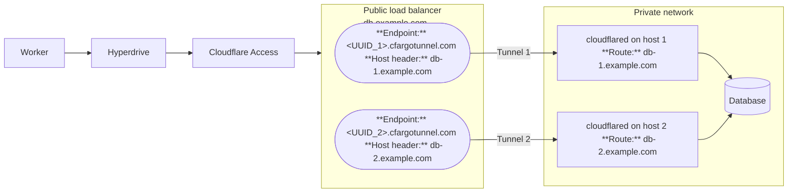

import {
	DashButton,
	PackageManagers,
	Render,
	Steps,
	TabItem,
	Tabs,
} from "~/components";

A single `cloudflared` host has a finite capacity for requests and bandwidth. To give a high-traffic private database more capacity, place several [Cloudflare Tunnels](/cloudflare-one/networks/connectors/cloudflare-tunnel/) behind a [public load balancer](/load-balancing/load-balancers/). Hyperdrive then connects to the load balancer hostname instead of a single tunnel hostname.

This guide extends [Connect to a private database using Tunnel](/hyperdrive/configuration/connect-to-private-database/). Start with that guide if you do not need more than one tunnel.

## How it works

Hyperdrive opens each pooled database connection as a WebSocket connection to the hostname in your Hyperdrive configuration. When that hostname is a load balancer, the load balancer selects a tunnel each time Hyperdrive opens a connection. The connection stays on that tunnel until it closes.



Each host must run a tunnel with its own tunnel UUID. [Replicas](/cloudflare-one/networks/connectors/cloudflare-tunnel/configure-tunnels/tunnel-availability/) of one tunnel provide redundancy, but they do not distribute traffic evenly. A load balancer also treats all replicas of one tunnel as a single endpoint.

## Prerequisites

- A database in your private network, [configured to use TLS/SSL](/hyperdrive/examples/connect-to-postgres/).
- A zone on your Cloudflare account for the load balancer and tunnel hostnames.
- A [Load Balancing](/load-balancing/get-started/) subscription that allows at least two endpoints, one for each tunnel.
- Two or more dedicated hosts in the private network that can reach the database.

This guide uses the following example values:

| Item                   | Example value             |
| ---------------------- | ------------------------- |
| Load balancer hostname | `db.example.com`          |
| Tunnel 1 route         | `db-1.example.com`        |
| Tunnel 2 route         | `db-2.example.com`        |
| Database address       | `localhost:5432`          |
| Health check path      | `/healthz`                |

## 1. Create one tunnel per host

Repeat the steps in this section on every `cloudflared` host. Give each tunnel a distinct name and route hostname, such as `db-1.example.com` and `db-2.example.com`.

### 1.1. Create a tunnel

<Render file="tunnel/create-tunnel" product="cloudflare-one" />

### 1.2. Add the database and health check routes

Each tunnel needs two routes on the same hostname:

- A health check route that returns HTTP `200` for the path `/healthz`. The load balancer monitor uses this route, because TCP monitors are not supported for tunnel endpoints.
- A TCP route to your database for every other request.

`cloudflared` evaluates routes in order, so the health check route must come first. The route path is a regular expression. Use `^/healthz$` so that the health check route matches only the exact path `/healthz`.

<Tabs>
<TabItem label="Dashboard">

<Steps>

1. In the **Published application routes** tab of your tunnel, add a route for the health check:
   - **Subdomain** and **Domain**: the route hostname for this tunnel, such as `db-1.example.com`
   - **Path**: `^/healthz$`
   - **Service Type**: _HTTP_STATUS_
   - **HTTP Status Code**: `200`

2. Add a second route for the database:
   - **Subdomain** and **Domain**: the same hostname, such as `db-1.example.com`
   - **Path**: leave empty
   - **Service Type**: _TCP_
   - **URL**: the address and port of your database, such as `localhost:5432`

3. Confirm that the health check route is listed before the database route.

</Steps>

</TabItem>
<TabItem label="Configuration file">

For a [locally-managed tunnel](/cloudflare-one/networks/connectors/cloudflare-tunnel/do-more-with-tunnels/local-management/), add both rules to the [configuration file](/cloudflare-one/networks/connectors/cloudflare-tunnel/do-more-with-tunnels/local-management/configuration-file/):

```yaml
tunnel: <TUNNEL_UUID>
credentials-file: /etc/cloudflared/<TUNNEL_UUID>.json

ingress:
  # Health check for the load balancer monitor. Must come first.
  - hostname: db-1.example.com
    path: ^/healthz$
    service: http_status:200
  # Database traffic from Hyperdrive.
  - hostname: db-1.example.com
    service: tcp://localhost:5432
  - service: http_status:404
```

</TabItem>
</Tabs>

The load balancer reaches each tunnel through `<TUNNEL_UUID>.cfargotunnel.com`, so the route hostnames do not need DNS records.

:::caution

When you add a route in the dashboard, Cloudflare automatically creates a `CNAME` record that points the route hostname, such as `db-1.example.com`, at the tunnel. That record lets clients reach the tunnel directly, without going through the load balancer. Either [delete the record](/dns/manage-dns-records/how-to/create-dns-records/#delete-dns-records), or protect the route hostname with Access in [3.2. Create an Access application](#32-create-an-access-application). Routes that you add through a configuration file or the API do not create DNS records.

:::

### 1.3. Prepare each host for high traffic

To avoid resource limits on the `cloudflared` hosts:

- Run `cloudflared` on a dedicated host. Refer to [System requirements](/cloudflare-one/networks/connectors/cloudflare-tunnel/configure-tunnels/tunnel-availability/system-requirements/) for sizing, port, and `ulimit` recommendations.
- Increase the UDP receive buffer size. Refer to the `failed to sufficiently increase receive buffer size` entry in [Common errors](/cloudflare-one/networks/connectors/cloudflare-tunnel/troubleshoot-tunnels/common-errors/).
- Use a current version of `cloudflared`.

## 2. Create the load balancer

### 2.1. Create a monitor

<Steps>

1. In the Cloudflare dashboard, go to the **Load Balancing** page.

   <DashButton url="/?to=/:account/load-balancing" />

2. Select the **Monitors** tab, then select **Create monitor**.

3. Enter the following values:
   - **Type**: _HTTPS_
   - **Path**: `/healthz`
   - **Port**: `443`
   - **Expected Code(s)**: `200`

4. Leave the `Host` header unset. Each endpoint supplies its own `Host` header in the next section.

5. Select **Save**.

</Steps>

This monitor verifies that `cloudflared` is reachable on each host. It does not check whether the database accepts connections.

### 2.2. Create a pool with one endpoint per tunnel

<Steps>

1. On the **Load Balancing** page, select the **Pools** tab, then select **Create pool**.

2. Enter a name for the pool, such as `hyperdrive-db-tunnels`.

3. For **Endpoint steering**, select _Random_.

4. Add one endpoint for each tunnel with the following values:
   - **Endpoint Name**: a name for the host, such as `db-host-1`
   - **Endpoint Address**: `<TUNNEL_UUID>.cfargotunnel.com`
   - **Header value**: the route hostname of that tunnel, such as `db-1.example.com`
   - **Weight**: `1`

5. Attach the monitor you created in [2.1. Create a monitor](#21-create-a-monitor).

6. For **Health Monitor Regions**, select one or two regions close to your `cloudflared` hosts.

7. Select **Save**.

</Steps>

To find a tunnel UUID, go to the **Tunnels** page. A pool cannot reference the same tunnel UUID twice.

<DashButton url="/?to=/:account/tunnels" />

With equal weights and _Random_ steering, the load balancer spreads new Hyperdrive connections evenly across the tunnels.

Each [health monitor region](/load-balancing/monitors/#health-monitor-regions) sends its own health check requests to every endpoint. Checking from all regions or all data centers sends a large, constant volume of requests through every tunnel, which uses capacity that you want for database traffic.

### 2.3. Create the load balancer hostname

<Steps>

1. On the **Load Balancing** page, select **Create load balancer**, then select **Public load balancer**.

2. Under **Select website**, select the zone for your hostnames.

3. On the **Hostname** page, enter the load balancer hostname, such as `db.example.com`. Keep the hostname proxied, and leave **Session affinity** turned off.

4. On the **Pools** page, select the pool you created in [2.2. Create a pool with one endpoint per tunnel](#22-create-a-pool-with-one-endpoint-per-tunnel). Select the same pool as the **Fallback pool**.

5. On the **Monitors** page, confirm that the monitor is attached to the pool.

6. Save and deploy the load balancer.

</Steps>

Before you continue, confirm that the pool reports every endpoint as healthy.

## 3. Restrict access to Hyperdrive

Use [Cloudflare Access](/cloudflare-one/access-controls/policies/) so that only your Hyperdrive configuration can reach the database. The automatic setup in the Hyperdrive dashboard selects a single tunnel hostname, so create the Access resources manually.

### 3.1. Create a service token

<Steps>

1. In the [Cloudflare dashboard](https://dash.cloudflare.com/), go to **Zero Trust** > **Access controls** > **Service credentials** > **Service Tokens**.

   <DashButton url="/?to=/:account/access/service-auth/service-tokens" zeroTrust />

2. Select **Create Service Token**.

3. Enter a name, and set **Service Token Duration** to `Non-expiring`.

4. Select **Generate token**.

5. Copy the Client ID and Client Secret. Access displays the Client Secret only once.

</Steps>

### 3.2. Create an Access application

<Steps>

1. In the [Cloudflare dashboard](https://dash.cloudflare.com/), go to **Zero Trust** > **Access controls** > **Applications**.

   <DashButton url="/?to=/:account/access/apps" zeroTrust />

2. Select **Create new application**, then select **Self-hosted and private**.

3. Select **Add public hostname** and enter the load balancer hostname, such as `db.example.com`.

4. (Optional) If you kept the DNS records for the tunnel route hostnames, select **Add public hostname** again for each one, such as `db-1.example.com` and `db-2.example.com`. This prevents direct access to a tunnel that bypasses the load balancer hostname.

5. Select **Create new policy**. Enter a **Policy name** and set the **Action** to _Service Auth_.

6. Create an **Include** rule. Specify a **Selector** of _Service Token_ and the **Value** of the service token you created in [3.1. Create a service token](#31-create-a-service-token).

7. Save the policy.

8. In **Identity providers**, turn off _Accept all available identity providers_ and clear all identity providers.

9. In **Session Duration**, select `No duration, expires immediately`.

10. Select **Create**.

</Steps>

## 4. Create the Hyperdrive configuration

To create a Hyperdrive configuration that connects through the load balancer, set the host to the load balancer hostname and provide the service token credentials:

<PackageManagers
	type="exec"
	pkg="wrangler"
	args="hyperdrive create <CONFIG_NAME> --host=db.example.com --user=<DATABASE_USER> --password=<DATABASE_PASSWORD> --database=<DATABASE_NAME> --access-client-id=<ACCESS_CLIENT_ID> --access-client-secret=<ACCESS_CLIENT_SECRET>"
	cfCommand="cf hyperdrive create --name <CONFIG_NAME> --origin-scheme postgres --origin-host db.example.com --origin-user <DATABASE_USER> --origin-password <DATABASE_PASSWORD> --origin-database <DATABASE_NAME> --origin-access-client-id <ACCESS_CLIENT_ID> --origin-access-client-secret <ACCESS_CLIENT_SECRET>"
/>

Omit the port. Each tunnel uses its own TCP route to reach the database. For a MySQL database, set the scheme to `mysql`.

### Move an existing configuration to the load balancer

To move an existing Hyperdrive configuration to the load balancer, update its host to the load balancer hostname and provide the service token credentials in the same command. Hyperdrive rejects a host update that has neither a port nor Access credentials.

<PackageManagers
	type="exec"
	pkg="wrangler"
	args="hyperdrive update <HYPERDRIVE_ID> --origin-host=db.example.com --access-client-id=<ACCESS_CLIENT_ID> --access-client-secret=<ACCESS_CLIENT_SECRET>"
	cfCommand={`cf hyperdrive edit <HYPERDRIVE_ID> --body '{"origin":{"host":"db.example.com","access_client_id":"<ACCESS_CLIENT_ID>","access_client_secret":"<ACCESS_CLIENT_SECRET>"}}'`}
/>

The service token must be allowed by the Access application that protects the load balancer hostname. If the configuration used a different service token for a single tunnel, either add that token to the policy in [3.2. Create an Access application](#32-create-an-access-application) or use the new token here.

To use the configuration from a Worker, refer to [Query your Hyperdrive configuration from a Worker](/hyperdrive/configuration/connect-to-private-database/#3-query-your-hyperdrive-configuration-from-a-worker-optional).

## 5. Verify traffic distribution

<Steps>

1. Send queries through a Worker that uses the Hyperdrive configuration.

2. On the **Load Balancing** page, confirm that every endpoint in the pool is healthy.

3. On each `cloudflared` host, confirm that the host is serving requests. Refer to [Tunnel metrics](/cloudflare-one/networks/connectors/cloudflare-tunnel/monitor-tunnels/metrics/) for the available `cloudflared` metrics.

4. Run a load test at your expected peak traffic before you rely on this setup in production.

</Steps>

## Behavior and limitations

- **Balance is per connection, not per query.** The load balancer selects a tunnel when Hyperdrive opens a connection.
- **Unhealthy tunnels stop receiving new connections.** After the monitor marks a tunnel unhealthy, the load balancer routes new connections to the healthy tunnels.
- **A tunnel failure interrupts the queries on that tunnel.** Connections that are open on a failed tunnel are lost, and queries that use them fail with an error such as `Connection to the origin database was lost`. Queries can keep failing until the monitor marks the tunnel unhealthy. Retry failed queries in your application.
- **Each tunnel must handle more than its even share.** Size the hosts so that the remaining tunnels can carry the load when one tunnel is unavailable.
- **The connection limit is unchanged.** All tunnels lead to the same database, so the [origin connection limit](/hyperdrive/configuration/tune-connection-pool/) of the Hyperdrive configuration still applies to the database as a whole.
- **Replicas do not add predictable capacity.** A second `cloudflared` replica on a tunnel provides failover for that tunnel. To add capacity, add a tunnel with a new UUID and a new pool endpoint.

## Troubleshooting

In addition to the [general troubleshooting steps](/hyperdrive/observability/troubleshooting/) for Hyperdrive:

- **All endpoints are unhealthy.** Confirm that the health check route is listed before the TCP route in each tunnel. Confirm that the monitor path is `/healthz` and that each endpoint `Host` header matches the route hostname of its tunnel.
- **Connections fail with an Access error.** Confirm that the Access application includes the load balancer hostname and that the Hyperdrive configuration uses the matching service token.
- **Connections fail with a `websocket: bad handshake` error.** If your organization uses [Super Bot Fight Mode](/bots/get-started/super-bot-fight-mode/), keep **Definitely Automated** set to **Allow**.
- **One tunnel receives most of the traffic.** Confirm that each endpoint has a distinct tunnel UUID, equal weights, and that session affinity is turned off.
