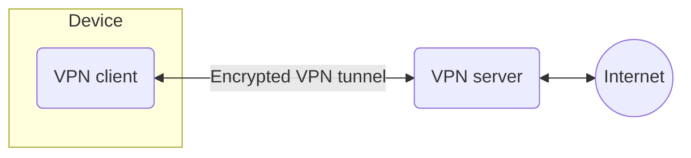
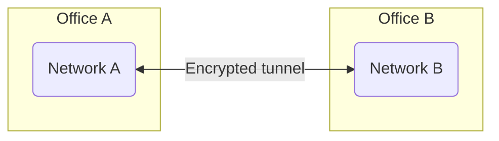
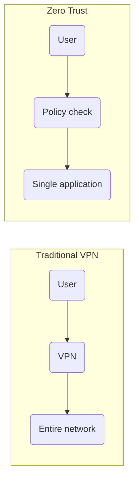

A virtual private network (VPN) is an Internet security service that allows users to access the Internet as though they were connected to a private network. A VPN encrypts Internet communications between a device and a VPN server and hides the user's IP address from the websites they visit. Some of the most common reasons people use VPNs are to protect against snooping on public WiFi, to circumvent Internet censorship, or to connect to a business's internal network for the purpose of remote work.

## Why use a VPN

Ordinarily, most Internet traffic is unencrypted and very public. When a user creates an Internet connection, such as visiting a website in a browser, the user's device will connect to their Internet Service Provider (ISP). The ISP will then connect to the Internet to find the appropriate web server to communicate with to fetch the requested website.

Information about the user is exposed in every step of the website request. Since the user's IP address is exposed throughout the process, the ISP and any other intermediary can keep logs of the user's browsing habits. Additionally, the data flowing between the user's device and the web server may be unencrypted; this creates opportunities for malicious actors to spy on the data or perpetrate attacks on the user, such as an [on-path attack](https://www.cloudflare.com/learning/security/threats/on-path-attack/).

## How a VPN works

A user connecting to the Internet using a VPN service has a higher level of security and privacy.

A VPN connection involves the following steps:

1. The VPN client authenticates with the VPN server, for example with a username and password, a certificate, or a pre-shared key.
2. The client and server negotiate encryption keys and establish an encrypted VPN tunnel.
3. The client sends all of its traffic, or only selected traffic, through the tunnel. The tunnel passes through the ISP, but since all the data is encrypted, the ISP cannot see the user's activity.
4. The VPN server decrypts the traffic and forwards it to its destination on the Internet. The destination web server sees only the IP address of the VPN server, which gives it no information about the user's real IP address.
5. Responses from the destination travel back to the VPN server, which encrypts them and sends them to the client through the tunnel.

:::note
Traffic between the VPN server and the destination is protected only if the destination uses HTTPS (TLS). A VPN does not replace end-to-end encryption.
:::

### What a VPN provider can and cannot see

A VPN moves trust from your ISP to your VPN provider. The two parties see different things:

| Party | Without a VPN | With a VPN |
| --- | --- | --- |
| ISP | Your IP address, the destinations you connect to, and any unencrypted content | That you are connected to a VPN server, and the volume and timing of your traffic |
| VPN provider | Not applicable | Your real IP address, the destinations you connect to, and any unencrypted content |
| Destination website | Your real IP address | The IP address of the VPN server |

Whether a VPN provider keeps logs depends on the provider's policies and implementation. A VPN does not make you anonymous: websites can still identify you through logins, cookies, and browser fingerprinting.

## Types of VPNs

| Type | Description | Typical use |
| --- | --- | --- |
| Remote access VPN | A single device connects to a private network. | Remote work |
| Site-to-site VPN | Two networks are connected through a tunnel. | Linking branch offices |
| Consumer VPN | Provided by a commercial service. | Privacy on public WiFi, bypassing censorship |
| Corporate VPN | Operated by an organization. | Access to internal resources |

**Remote access VPN.** A VPN client installed on a user's device connects to a VPN server or gateway. Once connected, the device behaves as if it were on the private network. This is the most common model for remote work.

**Site-to-site VPN.** Two networks, such as a headquarters and a branch office, are connected through a VPN tunnel between gateways at each site. Devices on either network can communicate without running VPN software on each device.

**Consumer VPN.** A commercial service routes your traffic through its servers. Consumer VPNs are typically used to protect traffic on untrusted networks, to appear to browse from another location, or to circumvent censorship. They do not provide access to a private network.

**Corporate VPN.** An organization operates the VPN to give employees access to internal applications, file shares, and servers. The organization controls authentication and decides which resources are reachable.

## Common VPN protocols

| Protocol | Speed | Security | Complexity | Notes |
| --- | --- | --- | --- | --- |
| IPsec / IKEv2 | Fast, often hardware accelerated | Strong when configured with current cipher suites | Higher; many configuration options | Built into most operating systems and widely used in enterprises |
| OpenVPN | Moderate; depends on configuration and transport | Strong; uses TLS for key exchange | Moderate | Open source and flexible; runs over UDP or TCP |
| WireGuard | Fast; lightweight design | Strong; uses a fixed set of modern cryptographic primitives | Low; small codebase and simple configuration | Newer than IPsec and OpenVPN; some deployments need extra work for dynamic address assignment |

The right protocol depends on your environment. Choose IPsec/IKEv2 for broad native device support, OpenVPN for flexibility and compatibility with restrictive networks, and WireGuard for simplicity and performance.

## Key VPN features

- **Split tunneling:** only selected traffic goes through the VPN, and the rest goes directly to the Internet. Enable it to reduce load on the VPN and keep local network access. Disable it when all traffic must be inspected or protected.
- **Kill switch:** blocks Internet traffic if the VPN connection drops, so traffic is never sent unprotected. Enable it on untrusted networks or whenever your real IP address must stay hidden.
- **DNS leak protection:** keeps DNS queries inside the tunnel, so your ISP cannot see which domains you look up. Enable it whenever you want the VPN to hide your browsing destinations.

## Limitations of VPNs

- **Trust shifts to the VPN provider.** The provider can see your traffic and may keep logs.
- **Added latency.** Traffic takes a longer route through the VPN server, which can reduce speed.
- **Broad network access.** Once connected, users can often reach the entire internal network, not only the applications they need. If a device or credential is compromised, an attacker can move laterally across the network.
- **Hard to scale.** Managing gateways, capacity, and client software for many remote users and devices adds operational overhead.
- **Limited visibility and control.** Traditional VPNs typically grant access based on a single login and offer limited per-application logging or policy enforcement.

## Common misconceptions

- **"A VPN makes me completely anonymous."** A VPN hides your IP address from websites and your browsing from your ISP, but the VPN provider can still see your traffic, and websites can identify you through logins, cookies, and fingerprinting.
- **"A VPN protects me from malware and phishing."** A VPN encrypts traffic in transit. It does not scan files, block malicious sites, or stop you from entering credentials on a phishing page.
- **"A VPN makes any website safe to use."** A VPN does not change what a website does. Traffic between the VPN server and the website is protected only if the site uses HTTPS.

## VPN vs Zero Trust

| | Traditional VPN | Zero Trust (ZTNA) |
| --- | --- | --- |
| Access scope | Whole network | Per application |
| Trust model | Implicit trust after login | Verify every request |
| Visibility | Limited | Per-user, per-application logs |
| Scalability | Depends on hardware or gateway capacity | Cloud-delivered |

### When to move from a VPN to Zero Trust

Consider replacing or supplementing a VPN with Zero Trust in scenarios like these:

- **Contractors and third parties.** Instead of giving a contractor VPN access to the whole network, grant access to only the one application they need.
- **Growing remote workforce.** Instead of scaling VPN gateways as headcount grows, use a cloud-delivered service.
- **Compliance and auditing.** Instead of relying on connection-level logs, record which user accessed which application and when.
- **Reducing lateral movement risk.** Instead of exposing the internal network to every connected device, expose individual applications behind identity-based policies.

Many organizations migrate gradually: they keep the VPN for legacy resources and move applications to Zero Trust one at a time.

## How Cloudflare One relates to VPNs

Cloudflare One provides Zero Trust alternatives to the functions a traditional VPN performs:

- **Tunnel:** connects your servers and networks to Cloudflare without opening inbound ports. See [Cloudflare Tunnel](https://developers.cloudflare.com/cloudflare-one/networks/connectors/cloudflare-tunnel/).
- **Access:** controls who can reach each application, based on identity and other signals. See [Access](https://developers.cloudflare.com/cloudflare-one/access-controls/policies/).
- **Gateway:** filters and inspects outbound traffic from your users and devices. See [Gateway](https://developers.cloudflare.com/cloudflare-one/traffic-controls/).

## Glossary

- **Tunnel:** an encrypted connection between two endpoints through which network traffic is sent.
- **Encryption:** the process of encoding data so that only parties with the correct key can read it.
- **IP address:** a numerical label that identifies a device on a network and is used to route traffic to it.
- **ISP:** an Internet Service Provider, the company that connects a user's device to the Internet.
- **On-path attack:** an attack in which a malicious actor intercepts communication between two parties to read or alter it.

## Next steps

- Learn how to connect applications and networks with [Cloudflare Tunnel](/cloudflare-one/connections/connect-networks/).
- Control application access with [Access policies](/cloudflare-one/policies/access/).
- Filter and inspect traffic with [Gateway policies](/cloudflare-one/policies/gateway/).
- Read more about [Zero Trust Network Access (ZTNA)](https://www.cloudflare.com/learning/access-management/what-is-ztna/) in the Cloudflare Learning Center.
