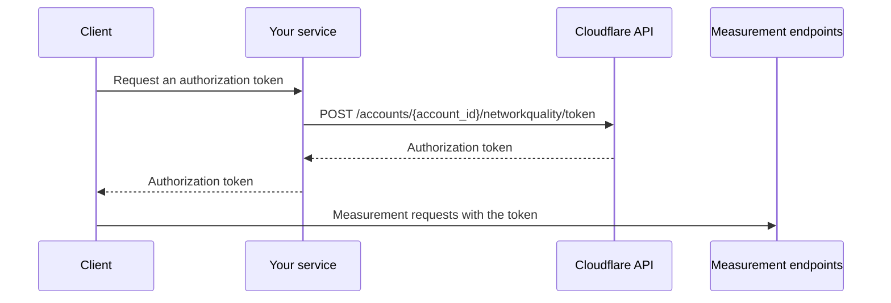

import {
	DashButton,
	Details,
	PackageManagers,
	Render,
	Steps,
	TabItem,
	Tabs,
	TypeScriptExample,
	WranglerConfig,
} from "~/components";

This guide walks you through running your first authorized test. In this guide, you turn on Network Quality for your account, create an API token, set up your service to request authorization tokens, and run a test from a client.

A client is the software that runs tests for an end user or device, such as a website, a mobile app, or a router. The flow has three parts:

1. Your client asks your service for a Network Quality authorization token.
2. Your service decides whether the end user or device is authorized. If it is, your service requests a token from the Cloudflare API with an API token that only your service knows. Cloudflare issues and signs the token, and your service returns it to the client unchanged.
3. Your client runs the test and sends the authorization token with every measurement request.



## Prerequisites

- A Cloudflare account with access to Network Quality. Network Quality is in private beta. To request access, contact your account team.
- A service you operate that can decide which end users or devices are authorized, and make HTTPS requests to the Cloudflare API.

## 1. Turn on Network Quality

<Tabs syncKey="dashPlusAPI">
<TabItem label="Dashboard">

<Steps>

1. In the Cloudflare dashboard, go to **Networking** > **Network Quality**.

   <DashButton url="/?to=/:account/network-quality" />

2. Select **Turn on**.

</Steps>

To turn off Network Quality later, use the **Network Quality API** toggle at the top of the same page.

You need the **Network Quality Edit** permission to change this setting.

</TabItem>
<TabItem label="API">

Send a `PUT` request to the Network Quality settings endpoint:

```sh
curl --request PUT \
  "https://api.cloudflare.com/client/v4/accounts/$ACCOUNT_ID/networkquality/settings" \
  --header "Authorization: Bearer $CLOUDFLARE_API_TOKEN" \
  --header "Content-Type: application/json" \
  --data '{ "enabled": true }'
```

```json output
{
	"success": true,
	"errors": [],
	"messages": [],
	"result": {
		"enabled": true,
		"updated_at": "2026-01-01T00:00:00.000Z"
	}
}
```

The API token must have the _Account_ > _Network Quality_ > _Edit_ permission.

To check the current setting, send a `GET` request to the same endpoint. The _Account_ > _Network Quality_ > _Read_ permission is enough for this request. If Network Quality has never been turned on for the account, the `result` object is `{ "enabled": false }`, without `updated_at`.

</TabItem>
</Tabs>

## 2. Create an API token

Your service uses a Cloudflare API token to request authorization tokens.

<Steps>

1. [Create an API token](/fundamentals/api/get-started/create-token/) with the following permission:
   - _Account_ > _Network Quality_ > _Edit_

2. Scope the token to the account where you turned on Network Quality.
3. Copy the token value. You store it as a secret in the next step.

</Steps>

:::caution
Never expose this API token in client-side code. Anyone with the token can request authorization tokens that count toward the usage of your account.
:::

## 3. Request authorization tokens from your service

Your service requests an authorization token from Cloudflare when a client is about to run a test and does not have a valid token. One token authorizes all the requests of one or more tests, until it expires or its byte budget runs out. You can use any language or platform. For each token request, your service should:

1. Check that the end user or device is authorized to use Network Quality on your behalf. You define the policy. For examples, refer to [Decide who can get a token](/network-quality/guides/authorization-tokens/#decide-who-can-get-a-token).
2. Request a token from the Cloudflare API with your API token, using the token attributes that fit your authorization model.
3. Return the token to the client unchanged.

To request a token, send a `POST` request to the token endpoint:

```sh
curl --request POST \
  "https://api.cloudflare.com/client/v4/accounts/$ACCOUNT_ID/networkquality/token" \
  --header "Authorization: Bearer $CLOUDFLARE_API_TOKEN" \
  --header "Content-Type: application/json" \
  --data '{
    "bytes": 2000000000,
    "eyeball_id": "3f8a1c9e2b7d4f60a5e1"
  }'
```

```json output
{
	"success": true,
	"errors": [],
	"messages": [],
	"result": {
		"token": "<TOKEN>"
	}
}
```

For each request field, including the optional `source_ips` restriction, refer to [Authorization tokens](/network-quality/guides/authorization-tokens/#request-a-token).

<Details header="Example: Request tokens from a Cloudflare Worker">

The following Worker exposes a `POST /speedtest-token` endpoint to your client. It checks whether the end user or device is authorized, requests a token, and returns it unchanged. It requires [Node.js](https://nodejs.org/) and [Wrangler](/workers/wrangler/install-and-update/).

<Steps>

1. Create a new Worker project. `my-token-server` is the name of the project folder, and you can choose any name:

   <PackageManagers type="create" pkg="cloudflare@latest" args="my-token-server" />

   <Render
   	file="c3-post-run-steps-hello-world"
   	product="workers"
   	params={{
   		type: "Worker only",
   		lang: "TypeScript",
   	}}
   />

2. Add your account ID as a variable in your Wrangler configuration file:

   <WranglerConfig>

   ```toml
   name = "my-token-server"
   main = "src/index.ts"
   compatibility_date = "$today"

   [vars]
   ACCOUNT_ID = "<ACCOUNT_ID>"
   ```

   </WranglerConfig>

3. Store your API token as a secret:

   <PackageManagers
   	type="exec"
   	pkg="wrangler"
   	args="secret put NETWORK_QUALITY_API_TOKEN"
   />

4. Replace the contents of `src/index.ts` with the following code:

   <TypeScriptExample filename="src/index.ts">

   ```ts
   interface Env {
   	ACCOUNT_ID: string;
   	NETWORK_QUALITY_API_TOKEN: string;
   }

   // Maximum data that tests can transfer with each token. Adjust it to your client.
   const TOKEN_BYTES = 2_000_000_000;

   // Replace with your own authorization policy, such as a session check or Turnstile verification.
   // Return a stable, pseudonymous ID for the end user or device, or null to reject the request.
   async function authorize(request: Request): Promise<string | null> {
   	return null;
   }

   export default {
   	async fetch(request, env): Promise<Response> {
   		const url = new URL(request.url);
   		if (request.method !== "POST" || url.pathname !== "/speedtest-token") {
   			return new Response("Not found", { status: 404 });
   		}

   		const eyeballId = await authorize(request);
   		if (!eyeballId) {
   			return new Response("Unauthorized", { status: 401 });
   		}

   		try {
   			const response = await fetch(
   				`https://api.cloudflare.com/client/v4/accounts/${env.ACCOUNT_ID}/networkquality/token`,
   				{
   					method: "POST",
   					signal: AbortSignal.timeout(10_000),
   					headers: {
   						Authorization: `Bearer ${env.NETWORK_QUALITY_API_TOKEN}`,
   						"Content-Type": "application/json",
   					},
   					body: JSON.stringify({
   						bytes: TOKEN_BYTES,
   						eyeball_id: eyeballId,
   						// source_ips: ["<CLIENT_IP>"],
   					}),
   				},
   			);

   			if (!response.ok) {
   				const headers = new Headers();
   				const retryAfter = response.headers.get("Retry-After");
   				if (retryAfter) {
   					headers.set("Retry-After", retryAfter);
   				}
   				return new Response("Unable to get token", {
   					status: response.status === 429 ? 429 : 502,
   					headers,
   				});
   			}

   			const { result } = await response.json<{ result: { token: string } }>();
   			return Response.json(
   				{ token: result.token },
   				{ headers: { "Cache-Control": "no-store" } },
   			);
   		} catch {
   			return new Response("Unable to get token", { status: 502 });
   		}
   	},
   } satisfies ExportedHandler<Env>;
   ```

   </TypeScriptExample>

5. Deploy the Worker:

   <PackageManagers type="exec" pkg="wrangler" args="deploy" />

</Steps>

The Worker must run on the same hostname as your website, for example with a [route](/workers/configuration/routing/routes/). Otherwise, add Cross-Origin Resource Sharing (CORS) headers to its responses, and answer `OPTIONS` preflight requests.

</Details>

## 4. Send the token with measurement requests

Your client sends the authorization token in an `Authorization` header with every request to the [measurement endpoints](/network-quality/reference/measurement-endpoints/). Only send the token over HTTPS.

For example, to download 1 MB:

```sh
curl --output /dev/null \
  "https://speed.cloudflare.com/__down?bytes=1000000" \
  --header "Authorization: Bearer $NETWORK_QUALITY_TOKEN" \
  --write-out "%{speed_download} bytes/s\n"
```

## Next steps

- Learn how to choose token values and handle errors in [Authorization tokens](/network-quality/guides/authorization-tokens/).
- Review the [measurement endpoints](/network-quality/reference/measurement-endpoints/) for all parameters, response headers, and status codes.
- Review [Limits](/network-quality/platform/limits/) and [Error codes](/network-quality/reference/error-codes/).
