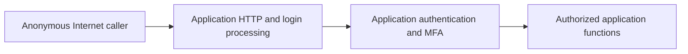
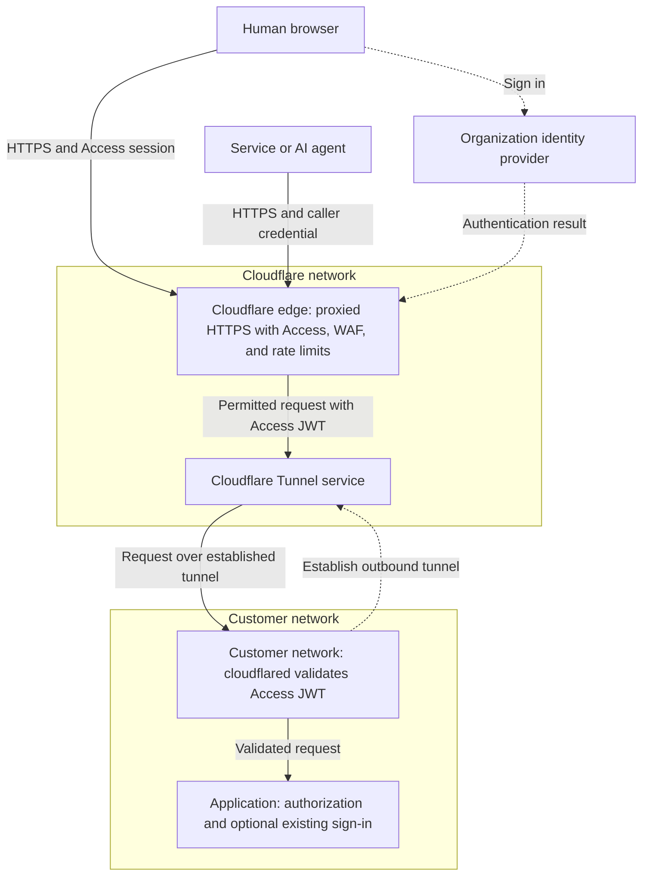

An identity-gated edge authenticates and authorizes callers before their requests reach an application's HTTP interface. Cloudflare Access provides the identity gate. Cloudflare Tunnel or a restricted origin connection prevents callers from going around it. A token validator checks the Access assertion before forwarding requests to application code.

Use this architecture for self-hosted administration consoles, partner portals, file-transfer web interfaces, and remote-access web portals. It supports people, services, and compatible AI agents, with different credentials for each caller type.

This reference architecture explains the problem, trust boundaries, and product choices. The companion [identity-gated edge design guide](/reference-architecture/design-guides/identity-gated-edge/) provides configuration recommendations, deployment stages, and acceptance tests.

## Architecture at a glance

The recommended starting point is an Access-protected hostname connected through Tunnel:

| Decision               | Starting point                                          | Design constraint                                                |
| ---------------------- | ------------------------------------------------------- | ---------------------------------------------------------------- |
| Public entry point     | An HTTPS hostname proxied by Cloudflare                 | Cover every application hostname and path                        |
| Human authentication   | Access with an existing identity provider (IdP)         | Allow entitled users and require appropriate MFA                 |
| Service authentication | Service Auth policies with named service tokens or mTLS | Do not create an anonymous exception for automation              |
| User-authorized agents | Access managed OAuth, where compatible                  | Obtain user authorization without sharing browser cookies        |
| Origin connection      | Tunnel with public inbound access removed               | Tunnel alone does not restrict the public hostname               |
| Origin-side validation | Access JWT validation before application code           | Validate signature, issuer, audience, and lifetime               |
| Request filtering      | WAF managed and custom rules with scoped rate limits    | Filtering complements identity, not a guarantee against exploits |
| Change management      | Versioned configuration and automated acceptance tests  | Verify deployed state, not only intended configuration           |

## The problem: authentication code is still application code

A login page can expose more than a password prompt. The server may parse headers, process redirects, deserialize messages, or load session data before authenticating the caller. A vulnerability in that processing can be reachable without an account.

Application MFA protects the sign-in decision. It does not prevent anonymous requests from reaching the application's pre-authentication code. Patching remains necessary, but cannot protect against every undisclosed vulnerability. WAF rules can block recognized attacks, but should not be treated as complete coverage for unknown flaws.

Without an independent gate, anonymous callers can reach the application's HTTP stack:

The identity-gated design moves the first authentication decision outside that stack. Anonymous callers can still reach Cloudflare's entry point and the IdP's sign-in interface. They should not reach the protected application's login handler.

This design reduces the application's anonymous attack surface. It does not make the application invisible, repair vulnerable software, or stop an attacker who already has an authorized identity.

## Four design requirements

Treat the following as requirements to demonstrate, not automatic product guarantees:

| Requirement                                                | Enforcement                                                                        | Evidence                                                                             |
| ---------------------------------------------------------- | ---------------------------------------------------------------------------------- | ------------------------------------------------------------------------------------ |
| Only authorized callers reach the protected HTTP interface | Access policies cover the complete hostname and required paths                     | Anonymous, unauthorized, and revoked callers do not reach application code           |
| There is no unprotected alternate origin path              | Remove public inbound access, or require a restricted and authenticated connection | Direct IPs, alternate hostnames, IPv6, and failover endpoints cannot bypass the gate |
| The application boundary verifies the assertion            | A trusted validator checks the Access JWT before forwarding                        | Missing, forged, expired, and wrong-audience tokens are rejected                     |
| Enforcement remains consistent after changes               | Configuration as code, restricted administration, audit logs, and regression tests | Deployed settings match reviewed configuration and negative tests pass               |

Retaining application authentication adds a separate check against the application's IdP. Validating an Access JWT alone verifies an assertion signed by Cloudflare, not an independently issued IdP token.

## Reference topology

The following topology uses Tunnel. Solid arrows show application requests. Dashed arrows show authentication exchanges or connector establishment, not an alternate application route:

The controls box represents required checks, not a fixed execution order. Blocking or redirecting a request may terminate processing before another control runs. Refer to [security feature interoperability](/waf/feature-interoperability/) when designing rules and interpreting logs.

### Request flow

1. A browser, service, or agent connects to the proxied hostname.
2. Cloudflare applies the configured request-security and Access controls. A browser without a session starts an Access login. A service presents its machine credential.
3. Access evaluates the selected application's policies. An authenticated user still needs authorization to that application.
4. Permitted traffic carries an Access JWT in `Cf-Access-Jwt-Assertion` toward the origin boundary.
5. `cloudflared`, a reverse proxy, or the application validates that JWT. The application then enforces resource and operation permissions.

A redirect to Access alone is not proof that alternate origin routes are closed.

### Trust boundaries

Each boundary has a separate responsibility:

| Boundary                        | Trusted for                                                    | Not a substitute for                                   |
| ------------------------------- | -------------------------------------------------------------- | ------------------------------------------------------ |
| IdP to Access                   | User authentication and supported identity attributes          | Application permissions or origin isolation            |
| Caller to Cloudflare            | Presenting a valid session, service credential, or OAuth token | Origin-side token validation                           |
| Cloudflare to origin            | Delivering traffic over the protected connection               | Application-level authorization                        |
| JWT validator to application    | Admitting requests with an expected Access assertion           | Independent verification of the user's IdP credentials |
| Application to back-end systems | Enforcing data and operation permissions                       | Protection from an authorized but malicious caller     |

Protect the validator-to-application hop too. If other machines can reach the application directly, they can bypass a validator running on a different host.

## Choose the origin connection

Keep the identity gate and token validation in every connection pattern:

| Pattern                  | Products and settings                                                                                                                                                                     | Choose when                                                         | Remaining responsibility                                        |
| ------------------------ | ----------------------------------------------------------------------------------------------------------------------------------------------------------------------------------------- | ------------------------------------------------------------------- | --------------------------------------------------------------- |
| Outbound-only connector  | [Cloudflare Tunnel](/cloudflare-one/networks/connectors/cloudflare-tunnel/) and **Protect with Access**                                                                                   | You can run `cloudflared` and remove public inbound access          | Restrict local access and operate redundant connectors          |
| Restricted public origin | Proxied DNS, [Full (strict)](/ssl/origin-configuration/ssl-modes/full-strict/), a firewall, and [custom Authenticated Origin Pulls](/ssl/origin-configuration/authenticated-origin-pull/) | You must retain a public load balancer or inbound connection        | Require the custom client certificate at every origin site      |
| Dedicated origin egress  | Restricted public origin plus [Dedicated CDN Egress IPs](/smart-shield/configuration/dedicated-egress-ips/)                                                                               | Your firewall requires source addresses assigned to your deployment | Allow the complete assigned pool and plan failover and capacity |

Cloudflare's published IP ranges are shared across customers. Allowlisting them does not identify your deployment. The global Authenticated Origin Pulls certificate also proves Cloudflare network origin, not your specific account. Use a custom zone-level or per-hostname certificate for the restricted-public-origin pattern.

Authenticated Origin Pulls is not compatible with Tunnel origins. Do not add it to the Tunnel pattern. An origin server certificate, such as an Origin CA certificate, authenticates the server. It does not restrict which clients can connect.

Dedicated CDN Egress IPs are optional, not a prerequisite for Tunnel. A public-origin firewall also cannot prevent a direct flood from consuming upstream capacity. Consider [Magic Transit](/magic-transit/) where network-layer protection of public address space is required.

## Match identity to the caller

People, services, and user-authorized agents need different authentication paths:

| Caller                                   | Recommended control                                                                                             | Important limitation                                                                            |
| ---------------------------------------- | --------------------------------------------------------------------------------------------------------------- | ----------------------------------------------------------------------------------------------- |
| Human using a browser                    | Access Allow policy with IdP groups, MFA, and device posture where appropriate                                  | IdP authentication does not automatically grant application access                              |
| Autonomous service or agent              | Access Service Auth policy with a caller-specific credential                                                    | A shared service token identifies the credential, not each end user behind it                   |
| CLI or agent acting for a user           | [Managed OAuth](/cloudflare-one/access-controls/applications/http-apps/managed-oauth/) with a compatible client | This Beta feature requires supported OAuth behavior and is not a general token-exchange service |
| API client with an existing token issuer | [API Shield JWT validation](/api-shield/security/jwt-validation/) where that architecture fits                  | Another issuer's valid JWT is not an Access session or automatic Access authorization           |

Managed OAuth issues an opaque client access token. Access validates that token and forwards an Access JWT to the origin. Do not assume the client's bearer token is a JWT the application can validate locally. Confirm compatibility before enabling managed OAuth on an application that serves its own OAuth discovery and challenges.

For MCP registration, authorization, and tool governance, use the [MCP security documentation](/cloudflare-one/access-controls/ai-controls/). Those workflows are not prerequisites for protecting an ordinary web application.

## Keep non-HTTP protocols separate

An HTTP identity gate does not automatically protect a native client's TCP, UDP, or vendor-specific session protocol. Inventory the web sign-in flow and session connection separately.

Use [Access for Infrastructure](/cloudflare-one/access-controls/applications/non-http/infrastructure-apps/) for supported infrastructure access, or the Cloudflare One Client with [private application access](/cloudflare-one/access-controls/applications/non-http/self-hosted-private-app/) for managed-device paths. [Browser-rendered connections](/cloudflare-one/access-controls/applications/non-http/browser-rendering/) provide clientless access for supported protocols.

[Spectrum](/spectrum/) and Magic Transit protect network reachability and availability, but do not by themselves provide the HTTP Access identity gate. Do not assume a native remote-desktop client inherits the browser's Access session. Test every client and protocol before closing its existing path.

## Scope and residual risks

This design does not remove the following responsibilities:

- Patch the application, connectors, and supporting systems. Authorized callers can still reach vulnerable code.
- Enforce application authorization. An Access policy controls entry, not every record or action.
- Protect the IdP and Cloudflare administrators. Both remain part of the trust model.
- Protect internal network paths and back-end credentials. Closing Internet ingress does not prevent lateral movement.
- Treat public callbacks, webhooks, health checks, and Bypass policies as explicit exceptions. An unauthenticated interface cannot meet the no-anonymous-access requirement.
- Plan for IdP, connector, and edge outages without exposing the origin as a fallback.

## Next steps

Use the [design guide](/reference-architecture/design-guides/identity-gated-edge/) to select settings and run acceptance tests. For broader policy design, refer to [designing ZTNA access policies](/reference-architecture/design-guides/designing-ztna-access-policies/).

Build the [Tunnel pilot companion](/reference-architecture/implementation-guides/identity-gated-edge/) for a minimal reproducible demonstration. Its browser checks do not replace production acceptance.
