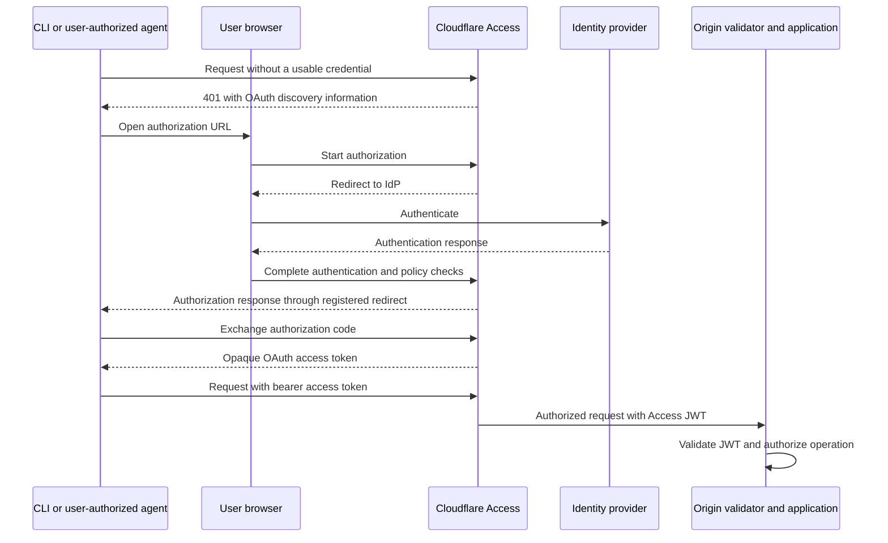

This guide turns the [identity-gated edge architecture](/reference-architecture/architectures/identity-gated-edge/) into a deployment plan. It covers product selection, security settings, origin connectivity, and acceptance tests. Start with one HTTP application, then repeat the verified pattern.

The target state has four requirements: authorized entry, no alternate origin path, validated identity at the application boundary, and tested configuration changes. Adding Access or changing DNS alone does not establish all four.

## Prerequisites and deployment inputs

Before changing traffic, identify the application owner and collect these inputs:

| Input                    | Record                                                                                           |
| ------------------------ | ------------------------------------------------------------------------------------------------ |
| Application destinations | Production, test, failover, and alternate hostnames, including IPv4 and IPv6 listeners           |
| Application behavior     | Paths, methods, redirects, cookies, WebSockets, uploads, and required callback URLs              |
| Callers                  | Browser users, partners, services, agents, native clients, and health monitors                   |
| Identity                 | Entitled groups, allowed IdPs, required MFA, device requirements, and revocation owner           |
| Origin                   | Tunnel or restricted public origin, TLS server name, certificate trust, and local firewall rules |
| Access configuration     | Account, application ID, team domain, application audience (AUD), and policy IDs                 |
| Operations               | Expected traffic, availability targets, log destination, rollout owner, and rollback conditions  |

Use a hostname in a [Cloudflare-proxied DNS setup](/dns/proxy-status/) supported by Access. Configure your [IdP integration](/cloudflare-one/integrations/identity-providers/) before testing human authentication. Confirm the application supports an intermediate proxy and that you can restrict every path to its origin.

Check availability before selecting optional controls. Access, WAF, load balancing, log datasets, and enterprise origin features have different plans and entitlements. Dedicated CDN Egress IPs require the applicable [Smart Shield offering](/smart-shield/configuration/dedicated-egress-ips/). Do not assume a single subscription includes every control in this guide.

## Choose a deployment profile

Select one profile and record any deviations:

| Profile                          | Required components                                                                                        | Optional additions                                                      |
| -------------------------------- | ---------------------------------------------------------------------------------------------------------- | ----------------------------------------------------------------------- |
| Recommended Tunnel profile       | Proxied hostname, Access, Tunnel, JWT validation before application code, no public origin ingress         | WAF tuning, rate limits, redundant connectors, device posture           |
| Restricted public-origin profile | Proxied hostname, Access, Full (strict), custom Authenticated Origin Pulls, origin firewall, JWT validator | Dedicated CDN Egress IPs, Load Balancing, network-layer DDoS protection |
| Managed-device private profile   | Cloudflare One Client, private routing, and appropriate private Access and network policies                | Device posture and protocol-specific controls                           |

The private profile is an alternative for applications that do not need a public hostname. Use the [private application guide](/cloudflare-one/access-controls/applications/non-http/self-hosted-private-app/) for that configuration. A public-hostname WAF policy does not automatically apply to a private-network flow.

## Configure the identity gate

Create a [self-hosted Access application](/cloudflare-one/access-controls/applications/http-apps/self-hosted-public-app/) before publishing a new Tunnel route. Otherwise, the route can expose the application before its policy exists.

### Human access

Use the following starting settings, then adjust them to the application's risk and client requirements:

| Control                    | Setting or configuration                                                   | Design guidance                                                                                                             |
| -------------------------- | -------------------------------------------------------------------------- | --------------------------------------------------------------------------------------------------------------------------- |
| Destination coverage       | Application hostname and path                                              | Cover the complete hostname first. Review more-specific applications and path exceptions separately                         |
| Authorization              | **Allow** policy with **Include** rules for entitled groups or named users | Avoid broad email-domain membership as the only entitlement for sensitive applications                                      |
| Additional conditions      | **Require** rules                                                          | Use for conditions every admitted user must meet, such as device posture or a supported authentication method               |
| Login providers            | Application login methods                                                  | Allow only approved IdPs. Do not leave a weaker fallback method available unintentionally                                   |
| IdP MFA                    | **Require** > **Authentication method**                                    | Confirm your IdP reports the required method. Generic `mfa` does not establish phishing resistance                          |
| Access independent MFA     | Organization enrollment plus application or policy enforcement             | Require an approved factor where a second check independent of the IdP is needed                                            |
| Session lifetime           | Application and policy session durations                                   | Select an explicit duration and test reauthentication. The Access session is separate from the IdP and application sessions |
| Browser session protection | **HttpOnly**, **SameSite**, and **Binding Cookie** where compatible        | Test redirects and cross-site workflows before tightening cookie settings                                                   |

Access is deny by default. Understand [policy actions and rule logic](/cloudflare-one/access-controls/policies/) before combining policies. Multiple Include rules are alternatives, not conditions every user must satisfy. Review policy ordering and all Service Auth and Bypass policies, not only the main human Allow policy.

[IdP-based MFA requirements](/cloudflare-one/access-controls/policies/mfa-requirements/) reject a user whose reported method does not satisfy the policy. They do not guarantee that Access can make the IdP perform a stronger authentication flow.

For [independent MFA](/cloudflare-one/access-controls/access-settings/independent-mfa/), leave **Use identity provider MFA** off if Access must always perform its own factor check. Review policy-level overrides as well as application settings. Test enrollment, recovery, and the weakest permitted sign-in method.

Use the [cookie settings reference](/cloudflare-one/access-controls/applications/http-apps/authorization-cookie/) and [session management reference](/cloudflare-one/access-controls/access-settings/session-management/) for exact behavior. A binding cookie reduces some replay opportunities. It is not proof that a compromised device cannot use the session.

For browser APIs, configure [CORS preflight responses](/cloudflare-one/access-controls/applications/http-apps/authorization-cookie/cors/) at Cloudflare where supported. Forwarding anonymous `OPTIONS` requests to application code creates an exception to the no-anonymous-access requirement. Do not solve a CORS failure by bypassing authentication for the API.

### Session lifecycle

Coordinate Access logout, IdP logout, and application logout explicitly. Ending one session does not necessarily end the others. Test the [Access logout and revocation behavior](/cloudflare-one/access-controls/access-settings/session-management/) and any [SCIM integration](/cloudflare-one/team-and-resources/users/scim/) used for deprovisioning. Session revocation alone does not remove a user's entitlement to sign in again.

### Services and autonomous agents

Give each workload its own credential and [Service Auth policy](/cloudflare-one/access-controls/policies/#service-auth). Select named [service tokens](/cloudflare-one/access-controls/service-credentials/service-tokens/) rather than any token in the account. Where appropriate, use [Access mTLS authentication](/cloudflare-one/access-controls/service-credentials/mutual-tls-authentication/) instead.

Keep credentials in the caller's secret store. Set expiry, assign an owner, and test rotation and revocation. Do not embed a service token in a browser application or use it to represent every end user. Continue to authorize operations inside the application.

An API client must handle denial without following an interactive login indefinitely. Test the real client with missing, expired, and revoked credentials. Do not assume every authentication failure returns the same HTTP status or response format.

### Agents acting for a user

Use [managed OAuth](/cloudflare-one/access-controls/applications/http-apps/managed-oauth/) when the client supports its authorization flow and resource indicators. Managed OAuth is Beta. It is not required for autonomous workloads using service credentials.

The following flow distinguishes the client's opaque token from the assertion the origin validates:



Do not copy a user's `CF_Authorization` cookie into an agent. Keep OAuth tokens in protected client storage and test expiry and reauthorization. If the application already serves its own OAuth metadata or `WWW-Authenticate` challenges, resolve that compatibility before turning on managed OAuth.

## Close the origin path

### Tunnel profile

Use [Cloudflare Tunnel](/cloudflare-one/networks/connectors/cloudflare-tunnel/) to establish outbound connections from your network. Remove public inbound access to the application and restrict internal access to the intended connector or validating proxy.

In the published application's [origin parameters](/cloudflare-one/networks/connectors/cloudflare-tunnel/configure-tunnels/origin-parameters/#access), turn on **Protect with Access**. Configure the team and the expected application AUD. This makes `cloudflared` validate the Access JWT before forwarding the request.

For a [locally managed tunnel](/cloudflare-one/networks/connectors/cloudflare-tunnel/do-more-with-tunnels/local-management/configuration-file/), an ingress configuration can use the following structure:

```yaml
tunnel: <TUNNEL_UUID>
credentials-file: /etc/cloudflared/<TUNNEL_UUID>.json

ingress:
  - hostname: app.example.com
    service: https://app.internal.example.com:443
    originRequest:
      access:
        required: true
        teamName: <TEAM_NAME>
        audTag:
          - <ACCESS_APPLICATION_AUD>
  - service: http_status:404
```

Replace the placeholders with your tunnel and Access application values. The internal hostname must resolve from the connector and present a valid TLS certificate. Configure the appropriate CA trust when using a private CA. Do not turn off TLS verification to make a failing certificate check pass.

The catch-all rule rejects unmatched ingress. Also inspect other routes on the same tunnel: an alternate hostname or less-protected ingress rule must not reach the same application without validation. Keep `cloudflared` current and review its [origin parameters](/cloudflare-one/networks/connectors/cloudflare-tunnel/configure-tunnels/origin-parameters/) for version-specific URL normalization behavior.

For availability, run [Tunnel replicas](/cloudflare-one/networks/connectors/cloudflare-tunnel/configure-tunnels/tunnel-availability/deploy-replicas/). Test a connector failure without reopening public ingress.

### Restricted public-origin profile

When Tunnel is not suitable, protect both the network connection and the application assertion:

| Layer                     | Configuration                                                                                    | Verification                                                                |
| ------------------------- | ------------------------------------------------------------------------------------------------ | --------------------------------------------------------------------------- |
| Server authentication     | **Full (strict)** with a valid origin certificate                                                | Cloudflare rejects an invalid or mismatched server certificate              |
| Client authentication     | Custom zone-level or per-hostname Authenticated Origin Pulls certificate, required by the origin | Missing or untrusted client certificates fail the TLS handshake             |
| Network restriction       | Firewall allows only the intended origin traffic sources                                         | Direct Internet connections fail, including IPv6 and alternate ports        |
| Optional source isolation | Dedicated CDN Egress IPs                                                                         | All assigned addresses work across every origin and failover site           |
| Application admission     | A JWT-validating reverse proxy or application                                                    | Missing or invalid Access assertions are rejected before protected handlers |

Follow the [zone-level](/ssl/origin-configuration/authenticated-origin-pull/set-up/zone-level/) or [per-hostname](/ssl/origin-configuration/authenticated-origin-pull/set-up/per-hostname/) AOP instructions. Restrict the origin's trust to the intended client certificate or issuing CA. Do not retain a second listener that accepts connections without it.

Keep shared Cloudflare IP allowlisting and custom AOP distinct. The first narrows network sources. The second authenticates the origin connection. Neither replaces Access policy or JWT validation.

### Health checks and failover

Health monitors need their own design. They do not establish an end-user Access session. Use a minimal health endpoint that returns status without application data. If it cannot require an Access assertion, isolate it from protected application handlers and explicitly document that exception.

For [Load Balancing monitors](/load-balancing/monitors/) connecting directly to a restricted public origin, configure **Simulate Zone** when the monitor must use that zone's AOP or dedicated-egress settings. Set the expected Host header and validate the actual response. This does not authenticate the monitor as an Access user.

Apply the same origin restrictions to standby pools. A failover endpoint that accepts anonymous traffic is a bypass, even if normal traffic never uses it.

## Validate identity before application code

Use [programmatic Access JWT validation](/cloudflare-one/access-controls/applications/http-apps/authorization-cookie/validating-json/) in the application or its trusted proxy. With the Tunnel profile, `cloudflared` can perform admission validation for software that cannot read JWTs.

The validator must perform these checks:

| Check                                       | Expected behavior                                                                                   |
| ------------------------------------------- | --------------------------------------------------------------------------------------------------- |
| Signature                                   | Verify using the configured team's published keys and the expected signing algorithm                |
| Issuer (`iss`)                              | Match the configured team authentication URL exactly                                                |
| Audience (`aud`)                            | Require the AUD for the destination application                                                     |
| Lifetime (`exp` and applicable time claims) | Reject expired or not-yet-valid assertions, with bounded clock tolerance                            |
| Key rotation                                | Select a trusted key by `kid` and refresh keys safely. Do not trust a key URL supplied by the token |
| Failure                                     | Reject missing or invalid assertions without forwarding to protected handlers                       |

Read `Cf-Access-Jwt-Assertion`, not an unverified email header. Decoding a JWT without validating its signature is not authentication. Do not fetch verification keys from an issuer chosen by an incoming token.

Map the verified subject to application permissions. Human and service assertions do not necessarily contain the same claims. Do not require a human email field for every authorized service request.

If the application keeps its own SAML or OIDC sign-in, configure redirects and callback URLs for the protected public hostname. Test the two sessions separately. Do not assume Access transparently exchanges arbitrary IdP tokens or replaces the application's existing authentication protocol.

Trust `CF-Connecting-IP` only after establishing the trusted proxy path. Do not use client-supplied `X-Forwarded-For` values as an authorization decision. Refer to [Cloudflare request headers](/fundamentals/reference/http-headers/#request-headers) for address restoration and IPv6 behavior.

## Add request filtering and response controls

Apply these controls to the same protected hostname:

| Product or feature                               | Recommended configuration                                                               | Caveat                                                                               |
| ------------------------------------------------ | --------------------------------------------------------------------------------------- | ------------------------------------------------------------------------------------ |
| [WAF managed rules](/waf/managed-rules/)         | Deploy the rules available to your plan and tune against legitimate application traffic | Managed rules do not guarantee prevention of every known or unknown exploit          |
| [WAF custom rules](/waf/custom-rules/)           | Restrict unused methods and paths where the application supports an explicit allowlist  | Test redirects, callbacks, encoded paths, uploads, and WebSockets before enforcement |
| [Rate limiting rules](/waf/rate-limiting-rules/) | Set thresholds by endpoint and expected caller traffic                                  | Shared source IPs and retry behavior can affect legitimate callers                   |
| [Bot Management](/bots/)                         | Add where bot signals and application risk justify it                                   | Interactive challenges can break services and agent clients                          |
| [API Shield](/api-shield/)                       | Add schema or JWT validation for APIs that need those controls                          | API validation does not create an Access identity                                    |
| [Cache Rules](/cache/how-to/cache-rules/)        | Set **Cache eligibility** to **Bypass cache** for the authenticated hostname            | Audit overlapping rules, Workers caches, and application-side caches too             |

Return `Cache-Control: private, no-store` for sensitive responses. Test the same URL as two users and anonymously. Do not infer isolation from `CF-Cache-Status` alone.

WAF custom-rule **Skip** actions and Access **Bypass** policies affect different controls. Neither is a general way to admit an authenticated service. Record their exact scope and test them independently. Refer to [feature interoperability](/waf/feature-interoperability/) for execution behavior.

## Operate the architecture as code

Manage Access applications and policies, DNS, Tunnel configuration, rulesets, cache rules, and origin restrictions through reviewed configuration. Use the [Cloudflare Terraform provider](/terraform/) or documented APIs, and pin the tool and provider versions used by your deployment.

Keep secrets and private keys out of configuration repositories. Protect Terraform state and CI credentials. Before updating an existing resource, retrieve its configuration and preserve fields your change does not own.

Divide responsibilities explicitly:

| Owner              | Responsibilities                                                                                    |
| ------------------ | --------------------------------------------------------------------------------------------------- |
| Identity team      | IdPs, MFA requirements, group lifecycle, service-credential ownership, and revocation               |
| Edge security team | WAF baseline, administrative permissions, audit review, and emergency controls                      |
| Application team   | Destinations, callback compatibility, JWT validation, application authorization, and cache behavior |
| Network team       | Origin firewall, certificates, Tunnel placement, segmentation, and failover connectivity            |

Detect drift through both configuration comparison and [audit logs](/fundamentals/account/account-security/review-audit-logs/). An audit event records a change, but does not by itself establish whether the resulting configuration meets the design.

Export the [available Logpush datasets](/logs/logpush/) needed for HTTP requests, security events, and Access activity. Confirm plan availability and fields before promising a combined audit trail. Correlate edge and origin requests with `Cf-Ray`, timestamps, application identifiers, and a verified subject where available. Do not log bearer tokens, service-token secrets, or session cookies.

An anonymous login redirect is not necessarily a failed authentication event. A `403` alone does not prove the WAF blocked a request. Confirm which control acted using its corresponding logs and the request identifier.

## Roll out without reopening the origin

Use the following stages and exit criteria. A pilot passing is not evidence that every production origin is closed:

| Stage           | Work                                                                              | Exit criterion                                                                        |
| --------------- | --------------------------------------------------------------------------------- | ------------------------------------------------------------------------------------- |
| Inventory       | Map all hostnames, paths, clients, listeners, and owners                          | Each route has an intended identity and connection model                              |
| Pilot           | Deploy the complete pattern on a controlled hostname                              | Legitimate browser, service, and native-client workflows pass                         |
| Prepare origins | Apply certificates, validators, firewall restrictions, and failover configuration | Direct-path and invalid-assertion tests pass                                          |
| Cut over        | Move controlled cohorts or applications to the protected path                     | Authentication success, latency, errors, and application behavior meet agreed targets |
| Enforce         | Resolve false positives and remove temporary exceptions                           | Negative tests pass on the production configuration                                   |
| Retest          | Exercise credential rotation, connector failover, and emergency procedures        | Recovery preserves authentication and origin restrictions                             |

Any migration phase that still permits direct anonymous origin access has not reached the target state. Give that exposure an owner and a deadline. Prefer a pilot hostname or controlled user cohorts over a design that depends on leaving a bypass open.

Define rollback before cutover. Revert to the last verified protected configuration or return a maintenance response. Do not turn off the proxy, publish origin IPs, or add a broad Bypass policy as an availability workaround.

For an IdP outage, test what happens to existing sessions and new logins. For an edge outage, any independent recovery path must preserve its own authentication and origin isolation. A second gated path requires separate design and testing. It is not provided by changing a DNS record alone.

## Acceptance tests

Run tests only against systems you own or are authorized to assess. Use harmless requests and dedicated test identities. Record the configuration version, UTC time, hostname, result, request identifier where available, and origin-side evidence.

| Requirement               | Test                                                                                                 | Pass condition                                                                                    |
| ------------------------- | ---------------------------------------------------------------------------------------------------- | ------------------------------------------------------------------------------------------------- |
| Authorized entry          | Request a protected login page without credentials                                                   | Access redirects or rejects the caller. The protected handler receives no request                 |
| Authorized entry          | Sign in as an authenticated but unentitled user                                                      | Access denies application entry                                                                   |
| MFA                       | Use the weakest permitted IdP method against a stronger-method policy                                | The weaker authentication does not satisfy the policy                                             |
| Machine access            | Present valid, missing, expired, and revoked service credentials                                     | Only the permitted credential reaches the protected handler                                       |
| User-authorized agent     | Complete managed OAuth, then test expiry and an unentitled user                                      | Compatible clients work without browser-cookie reuse. Denied clients do not reach the application |
| Origin isolation          | Connect to direct IPv4, IPv6, alternate ports, hostnames, and standby origins                        | No route admits anonymous application requests                                                    |
| Origin isolation          | For public origins, omit or replace the required AOP client certificate                              | The origin rejects the TLS connection                                                             |
| Assertion validation      | In a controlled origin-side test, present missing, forged, expired, wrong-issuer, and wrong-AUD JWTs | The validator rejects each case before application code                                           |
| Assertion validation      | Exercise trusted signing-key rotation                                                                | Valid requests continue and untrusted keys remain rejected                                        |
| Application authorization | Use a valid identity to request another user's resource                                              | The application denies the unauthorized operation                                                 |
| Filtering                 | Send an agreed harmless marker matched by a dedicated test rule                                      | A matching security event confirms the intended rule acted                                        |
| Cache isolation           | Request the same sensitive URL as two users and anonymously                                          | No caller receives another user's response                                                        |
| Lifecycle                 | Revoke a user session and a workload credential                                                      | Access ceases admitting them according to the tested revocation behavior                          |
| Availability              | Stop a connector or fail over an origin pool                                                         | Traffic uses another protected route or fails closed                                              |
| Change control            | Compare deployed configuration and rehearse an approved emergency change                             | Drift is detected and recovery preserves the gate                                                 |

Test JWT rejection at the validator boundary as well as through the public hostname. An edge rejection or an overwritten client header does not demonstrate that the origin validator works.

Use existing request logs to establish whether application code ran. A successful redirect, an empty log query, or a browser error alone is insufficient evidence. Document logging coverage and distinguish connector rejection from application execution.

## Next steps

Apply the verified deployment profile to the next application. Keep its own identity policy, audience, exception list, and test record. Use the [reference architecture](/reference-architecture/architectures/identity-gated-edge/) when reviewing trust boundaries or explaining why origin isolation is part of the identity design.
