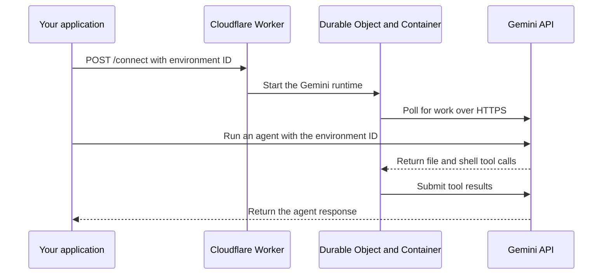

import { PackageManagers, Steps } from "~/components";

Run Gemini API managed agents on Cloudflare with Bring Your Own Sandbox (BYOS). Google hosts the agent loop. File and shell tools run in a Linux sandbox in your Cloudflare account.

Google publishes a [Cloudflare provider example on GitHub](https://github.com/google-gemini/gemini-api-cli/tree/main/docs/self-hosted/providers/cloudflare) for its [self-hosted environments](https://github.com/google-gemini/gemini-api-cli/blob/main/docs/self-hosted/README.md). The example deploys a Worker and a [Container](/containers/), with one Durable Object for each Gemini environment ID.

## How it works

Your application sends an authenticated `POST /connect` request to the Worker. The Worker routes the environment ID to its Durable Object, which starts a container and runs `gemini-api environments connect` inside it.

The runtime polls Google over outbound HTTPS and executes file and shell tools in `/workspace`. The container needs no inbound ports. Your application still calls the public Worker endpoint to start the runtime.



The example uses the [Durable Object Container API](/containers/api/durable-object-container/) directly. Its Durable Object calls `this.ctx.container.start()` and `this.ctx.container.exec()` to start the instance and runtime. Refer to the [Worker source](https://github.com/google-gemini/gemini-api-cli/blob/main/docs/self-hosted/providers/cloudflare/src/index.ts) for the implementation.

## Prerequisites

You need:

- A Cloudflare Workers Paid account with access to Containers
- The [`gemini-api` CLI](https://github.com/google-gemini/gemini-api-cli#installation) installed locally
- A [Gemini API key](https://ai.google.dev/gemini-api/docs/api-key)

For manual deployment, you also need [Git](https://git-scm.com/), [Node.js 22.12](https://nodejs.org/) or later, npm, and a running [Docker](https://www.docker.com/) daemon to build the container image.

## Create a Gemini environment

<Steps>
1. Set your Gemini API key in your local shell:

   ```sh
   export GEMINI_API_KEY="<GEMINI_API_KEY>"
   ```

2. Create a self-hosted environment:

   ```sh
   curl --fail-with-body \
     --request POST \
     "https://generativelanguage.googleapis.com/v1beta/environments" \
     --header "x-goog-api-key: $GEMINI_API_KEY" \
     --header "Content-Type: application/json" \
     --data '{"mode": "self_hosted"}'
   ```

3. Save the response's `id` and `environment_key` in your shell. Use the `id` without an `environments/` prefix:

   ```sh
   export GEMINI_ENVIRONMENT_ID="<ENVIRONMENT_ID>"
   export GEMINI_ENVIRONMENT_KEY="<ENVIRONMENT_KEY>"
   export CLOUDFLARE_DISPATCH_SECRET="$(openssl rand -hex 32)"
   ```

   The API returns `environment_key` only when it creates the environment. Save it before closing the response.
</Steps>

The integration uses three credentials with different scopes:

| Credential                   | Purpose                                                | Where it is used                                       |
| ---------------------------- | ------------------------------------------------------ | ------------------------------------------------------ |
| `GEMINI_API_KEY`             | Create environments and run agents                     | Your local CLI or application                          |
| `GEMINI_ENVIRONMENT_KEY`     | Connect the runtime to one Gemini environment          | A Worker secret passed to the runtime in the container |
| `CLOUDFLARE_DISPATCH_SECRET` | Authorize requests to the Worker's `/connect` endpoint | A Worker secret and your application                   |

## Deploy and connect the runtime

Choose the dashboard or manual deployment instructions. Both deploy the same Worker and container image.

### Deploy through the dashboard

<Steps>
1. Select **Deploy to Cloudflare** and follow the prompts to create a repository:

   [](https://deploy.workers.cloudflare.com/?url=https://github.com/google-gemini/gemini-api-cli/tree/main/docs/self-hosted/providers/cloudflare)

2. Enter these values when prompted, then complete the deployment:

   | Variable name                | Value                                                     |
   | ---------------------------- | --------------------------------------------------------- |
   | `GEMINI_ENVIRONMENT_KEY`     | The `environment_key` returned when you created the environment |
   | `CLOUDFLARE_DISPATCH_SECRET` | The dispatch secret you generated in your local shell      |
</Steps>

### Deploy manually

The example includes a Wrangler configuration. Run these commands in the same shell where you saved your Gemini environment credentials.

<Steps>
1. Clone Google's repository and open the Cloudflare example directory:

   ```sh
   git clone https://github.com/google-gemini/gemini-api-cli.git
   cd gemini-api-cli/docs/self-hosted/providers/cloudflare
   ```

2. Install the example's dependencies:

   <PackageManagers type="install" managers={["npm"]} />

3. Log in to your Cloudflare account:

   <PackageManagers type="exec" pkg="wrangler" args="login" managers={["npm"]} />

4. Copy the example secrets file:

   ```sh
   cp .env.example .env
   ```

   In `.env`, fill in `GEMINI_ENVIRONMENT_KEY` and `CLOUDFLARE_DISPATCH_SECRET` with the values you saved earlier. This local file is excluded from version control.

5. With Docker running, deploy the Worker, container image, and secrets together:

   <PackageManagers type="exec" pkg="wrangler" args="deploy --secrets-file .env" managers={["npm"]} />
</Steps>

Keep `GEMINI_API_KEY` in your local application. The runtime needs only the scoped environment key.

### Connect the runtime

After either deployment method, connect your Gemini environment to the deployed Worker.

<Steps>
1. Save the Worker URL from your deployment output or the Worker's **Settings** > **Domains & Routes**:

   ```sh
   export WORKER_URL="https://gemini-api-self-hosted-cloudflare.<YOUR_SUBDOMAIN>.workers.dev"
   ```

2. Start the runtime for your environment:

   ```sh
   curl --fail-with-body \
     --request POST "$WORKER_URL/connect" \
     --header "Authorization: Bearer $CLOUDFLARE_DISPATCH_SECRET" \
     --header "Content-Type: application/json" \
     --data "{\"environment_id\": \"$GEMINI_ENVIRONMENT_ID\"}"
   ```
</Steps>

The Worker returns HTTP `202` with a `connecting` or `already_connected` status. A `connecting` response accepts the startup request. It does not confirm that the runtime has connected to Google. Run an agent to verify the connection.

## Run an agent

From your local machine, run the example agent with your environment ID:

```sh
gemini-api agent run \
  "Write hello to /workspace/hello.txt, read it back, and run uname -a in bash." \
  --agent antigravity-preview-05-2026 \
  --body "{\"environment\": \"$GEMINI_ENVIRONMENT_ID\"}"
```

The agent uses the runtime in your Cloudflare container to write and read the file, then run the shell command. Check that the tool results include `hello` and the Linux kernel information. Use an agent identifier available to your Gemini project. Google's [provider example](https://github.com/google-gemini/gemini-api-cli/tree/main/docs/self-hosted/providers/cloudflare#run-an-interaction) documents its example identifier.

## Sandbox lifetime

The example maps each `environment_id` to a Durable Object with `getByName()`. Requests for the same environment reach the same Durable Object. Separate environments use separate containers. Agent runs that use the same environment share its running container and workspace.

The Durable Object sets a 10-minute inactivity timeout. A process running inside the container does not by itself keep the Durable Object active. The example does not save snapshots or restore workspace files after an instance stops.

If the runtime exits or its instance stops, call `/connect` again to start the runtime. A new instance starts from the container image. Its `/workspace` does not contain files from the previous instance.

For more information, refer to [Sandbox lifetime](/sandbox/concepts/lifetime/). To add workspace persistence, refer to [Save and restore a sandbox with snapshots](/sandbox/files/save-and-restore-a-workspace/).

## Credentials and network access

The runtime receives `GEMINI_ENVIRONMENT_KEY` inside the container. Treat it as accessible to code that runs there. The project API key and dispatch secret do not need to enter the container.

### Add or update secrets

After deployment, use `wrangler secret put` to add a secret or replace its value. Run these commands from the project directory containing your deployed Worker's Wrangler configuration:

<PackageManagers
	type="exec"
	pkg="wrangler"
	args="secret put GEMINI_ENVIRONMENT_KEY"
	managers={["npm"]}
/>

<PackageManagers
	type="exec"
	pkg="wrangler"
	args="secret put CLOUDFLARE_DISPATCH_SECRET"
	managers={["npm"]}
/>

Each command prompts for the value, creates a new Worker version, and deploys it immediately. To add another secret, use its binding name instead.

If you also use `.env`, update the matching value there before your next `wrangler deploy --secrets-file .env`, so it does not restore an old value. Secrets omitted from the file are preserved. Keep the dispatch secret in your calling application in sync with the Worker secret. For more information, refer to [Secrets](/workers/configuration/secrets/).

### Network access

The example starts the container with `enableInternet: true`. Commands that the agent runs can also reach the Internet. To restrict destinations, refer to [Outbound traffic](/containers/configuration/outbound-traffic/). For more information about the isolation boundary, refer to [Sandbox security](/sandbox/concepts/security/).

## Troubleshooting

Use [Workers Logs](/workers/observability/logs/) to inspect the deployment. The example exposes `GET /healthz`, which checks that the Worker responds. It does not check the runtime's connection to Google.

| Symptom                                        | What to check                                                                                                                                                                               |
| ---------------------------------------------- | ------------------------------------------------------------------------------------------------------------------------------------------------------------------------------------------- |
| `/connect` returns `401`                       | Send the dispatch secret as a bearer token. Confirm that it matches the deployed `CLOUDFLARE_DISPATCH_SECRET` Worker secret.                                                                |
| `/connect` returns `400`                       | Check the response body. Supply the environment `id` and configure the `GEMINI_ENVIRONMENT_KEY` Worker secret with the key returned for that environment.                                   |
| `/connect` returns `202`, but tools do not run | Check the runtime's logs, environment key, outbound connectivity, and the environment ID passed to `gemini-api agent run`. A startup response does not confirm a working Google connection. |
| Files disappear after an instance stops        | The example does not persist the workspace. Add snapshots or copy files to durable storage.                                                                                                 |

## Clean up

Follow the [cleanup instructions](https://github.com/google-gemini/gemini-api-cli/tree/main/docs/self-hosted/providers/cloudflare#cleanup) to delete both the Worker and its backing Container application. Deleting only the Worker leaves the Container application behind. Container instances that remain running continue to incur charges.

## Related resources

- [Google's Cloudflare provider example](https://github.com/google-gemini/gemini-api-cli/tree/main/docs/self-hosted/providers/cloudflare)
- [Gemini API self-hosted environments](https://github.com/google-gemini/gemini-api-cli/blob/main/docs/self-hosted/README.md)
- [Durable Object Container API](/containers/api/durable-object-container/)
- [Sandbox lifetime](/sandbox/concepts/lifetime/)
