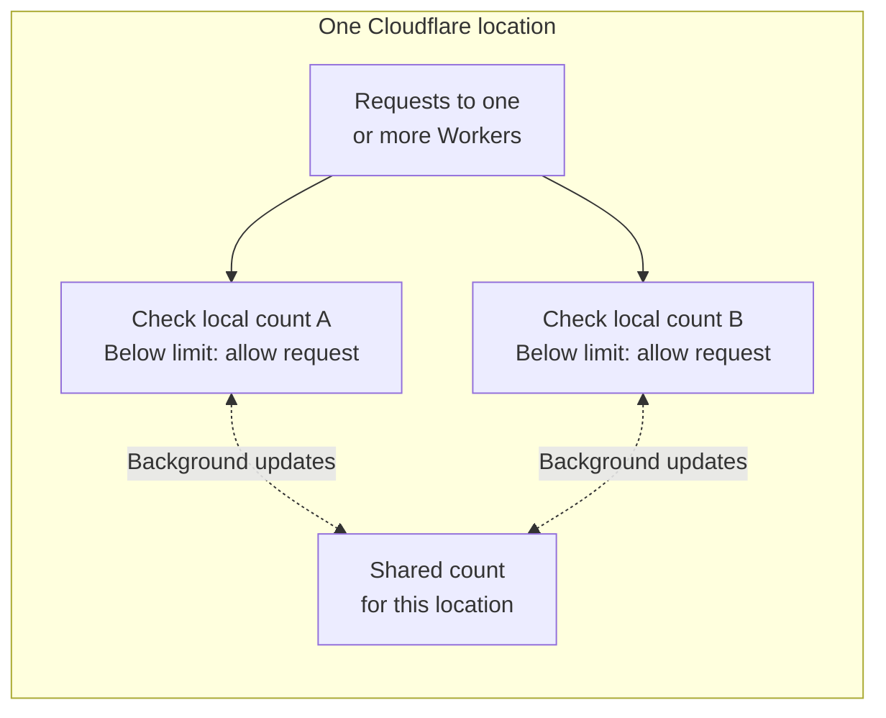

import { TabItem, Tabs, WranglerConfig } from "~/components";

The Rate Limiting API lets you define rate limits and write code around them in your Worker.

Rate limits are approximate and apply separately in each Cloudflare location. Requests can exceed your configured limit while counts update in the background. For a strict limit across locations, refer to [Strict limits](#strict-limits).

You can use it to enforce:

- Rate limits that are applied after your Worker starts, only once a specific part of your code is reached
- Different rate limits for different types of customers or users (ex: free vs. paid)
- Resource-specific or path-specific limits (ex: limit per API route)
- Any combination of the above

The Rate Limiting API is backed by the same infrastructure that serves [rate limiting rules](/waf/rate-limiting-rules/).

:::note
You must use version 4.36.0 or later of the [Wrangler CLI](/workers/wrangler).
:::

## Get started

First, add a [binding](/workers/runtime-apis/bindings) to your Worker that gives it access to the Rate Limiting API:

<WranglerConfig>

```jsonc
{
	"main": "src/index.js",
	"upload_source_maps": true,
	"ratelimits": [
		{
			"name": "MY_RATE_LIMITER",
			// An identifier you define, that is unique to your Cloudflare account.
			// Must be an integer.
			"namespace_id": "1001",
			// Limit: the request threshold within a given period in a single
			// Cloudflare location. Requests can exceed this threshold.
			// Period: the duration of the period, in seconds. Must be either 10 or 60
			"simple": {
				"limit": 100,
				"period": 60
			}
		}
	]
}
```

</WranglerConfig>

This binding makes the `MY_RATE_LIMITER` binding available, which provides a `limit()` method:

<Tabs> <TabItem label="JavaScript" icon="seti:javascript">

```javascript
export default {
  async fetch(request, env) {
    const { pathname } = new URL(request.url)

    const { success } = await env.MY_RATE_LIMITER.limit({ key: pathname }) // key can be any string of your choosing
    if (!success) {
      return new Response(`429 Failure – rate limit exceeded for ${pathname}`, { status: 429 })
    }

    return new Response(`Success!`)
  }
}
```

</TabItem> <TabItem label="TypeScript" icon="seti:typescript">

```ts
interface Env {
  MY_RATE_LIMITER: RateLimit;
}

export default {
  async fetch(request, env): Promise<Response> {
    const { pathname } = new URL(request.url)

    const { success } = await env.MY_RATE_LIMITER.limit({ key: pathname }) // key can be any string of your choosing
    if (!success) {
      return new Response(`429 Failure – rate limit exceeded for ${pathname}`, { status: 429 })
    }

    return new Response(`Success!`)
  }
} satisfies ExportedHandler<Env>;
```

</TabItem> </Tabs>

The `limit()` API accepts a single argument — a configuration object with the `key` field.

- The key you provide can be any `string` value.
- A common pattern is to define your key by combining a string that uniquely identifies the actor initiating the request (ex: a user ID or customer ID) and a string that identifies a specific resource (ex: a particular API route).

You can define and configure multiple rate limiting configurations per Worker, which allows you to define different limits against incoming request and/or user parameters as needed to protect your application or upstream APIs.

For example, here is how you can define two rate limiting configurations for free and paid tier users:

<WranglerConfig>

```jsonc
{
	"main": "src/index.js",
	"upload_source_maps": true,
	"ratelimits": [
		// Free user rate limiting
		{
			"name": "FREE_USER_RATE_LIMITER",
			"namespace_id": "1001",
			"simple": {
				"limit": 100,
				"period": 60
			}
		},
		// Paid user rate limiting
		{
			"name": "PAID_USER_RATE_LIMITER",
			"namespace_id": "1002",
			"simple": {
				"limit": 1000,
				"period": 60
			}
		}
	]
}
```

</WranglerConfig>

## Configuration

A rate limiting binding has the following settings:

| Setting         | Type     | Description                                                                                                                                                                                                                                     |
| --------------- | -------- | ----------------------------------------------------------------------------------------------------------------------------------------------------------------------------------------------------------------------------------------------- |
| `namespace_id`  | `string` | A string containing a positive integer that uniquely defines this rate limiting namespace within your Cloudflare account (for example, `"1001"`). Although the value must be a valid integer, it is specified as a string. This is intentional. |
| `simple`        | `object` | The rate limit configuration. `simple` is the only supported type.                                                                                                                                                                              |
| `simple.limit`  | `number` | The request threshold for calls to `limit()` within the given `period`, per Cloudflare location. Requests can exceed this threshold; refer to [Accuracy](#accuracy).                                                                            |
| `simple.period` | `number` | The duration of the rate limit window, in seconds. Must be either `10` or `60`.                                                                                                                                                                 |

:::note
Two rate limiting bindings that share the same `namespace_id` on the same account share counters for a given key within each Cloudflare location, including across different Workers. Updates reach other running instances in the background, so sharing a namespace does not guarantee a strict combined limit. Refer to [Accuracy](#accuracy).

If you do not want to share rate limit state between bindings, use a unique `namespace_id` for each binding.
:::

For example, to apply a rate limit of 1500 requests per minute, you would define a rate limiting configuration as follows:

<WranglerConfig>

```jsonc
{
	"ratelimits": [
		{
			"name": "MY_RATE_LIMITER",
			"namespace_id": "1001",
			// 1500 requests - calls to limit() increment this
			"simple": {
				"limit": 1500,
				"period": 60
			}
		}
	]
}
```

</WranglerConfig>

## Best practices

The `key` passed to the `limit` function, that determines what to rate limit on, should represent a unique characteristic of a user or class of user that you wish to rate limit.

- Good choices include API keys in `Authorization` HTTP headers, URL paths or routes, specific query parameters used by your application, and/or user IDs and tenant IDs. These are all stable identifiers and are unlikely to change from request-to-request.
- It is not recommended to use IP addresses or locations (regions or countries), since these can be shared by many users in many valid cases. You may find yourself unintentionally rate limiting a wider group of users than you intended by rate limiting on these keys.

```ts
// Recommended: use a key that represents a specific user or class of user
const url = new URL(req.url);
const userId = url.searchParams.get("userId") || "";
const { success } = await env.MY_RATE_LIMITER.limit({ key: userId });

// Not recommended:  many users may share a single IP, especially on mobile networks
// or when using privacy-enabling proxies
const ipAddress = req.headers.get("cf-connecting-ip") || "";
const { success } = await env.MY_RATE_LIMITER.limit({ key: ipAddress });
```

## Locality

Rate limits that you define and enforce in your Worker are local to the [Cloudflare location](https://www.cloudflare.com/network/) that your Worker runs in.

For example, if you configure 100 requests per 60 seconds for a particular path, requests served in Sydney count toward the limit in Sydney. Requests served in another Cloudflare location count toward a separate limit, even with the same namespace and key. These counts do not combine into one worldwide limit.

Each location applies an approximate limit. Requests can exceed the configured threshold within a location, as described in [Accuracy](#accuracy).

## Performance

The Rate Limiting API in Workers is designed to be fast.

Each check uses a locally cached count. Cloudflare updates shared counts in the background within the same Cloudflare location.

This means that while in your code you `await` a call to the `limit()` method:

```javascript
const { success } = await env.MY_RATE_LIMITER.limit({ key: customerId });
```

The promise resolves with the rate limit decision. It does not wait for counts to synchronize across every running instance. This lets you check the limit without waiting for that synchronization.

## Accuracy

The Rate Limiting API provides an approximate limit. Counts are eventually consistent: each check uses a local count, and updates reach other running instances in the background.

Requests can exceed your configured limit before those updates arrive. This can happen with one Worker or multiple Workers, even when every request uses the same namespace and key within one Cloudflare location.

The following diagram shows two local checks for the same namespace and key. Both can allow requests before their counts synchronize:



Other Cloudflare locations maintain separate counts. Local counts do not correspond to an independent allowance per Worker.

For example, if you configure 30 requests per 10 seconds, a burst of requests can result in more than 30 calls to `limit()` returning `success: true`. Sharing a namespace across Workers or awaiting each call does not make the combined limit strict. The number of Workers does not determine how many requests can exceed the limit.

### Strict limits

If you need one strict limit across all locations, implement a rate limiter with [Durable Objects](/durable-objects/concepts/what-are-durable-objects/).

For an upstream API quota per credential, route requests for that credential through the same Durable Object. Check and update its counter together before allowing a request, and persist the counter in durable storage. Use a separate object for each credential.

Match your limiter to the upstream API's rate limit rules, and handle HTTP 429 responses from that API.

## Monitoring

Rate limiting bindings are not currently visible in the Cloudflare dashboard. To monitor rate-limited requests from your Worker:

- **[Workers Observability](/workers/observability/)** — Use [Workers Logs](/workers/observability/logs/workers-logs/) and [Traces](/workers/observability/traces/) to observe HTTP 429 responses returned by your Worker when rate limits are exceeded.
- **[Workers Analytics Engine](/analytics/analytics-engine/)** — Add an Analytics Engine binding to your Worker and emit custom data points (for example, a `rate_limited` event) when `limit()` returns `{ success: false }`. This lets you build dashboards and query rate limiting metrics over time.

## Examples

- [`@elithrar/workers-hono-rate-limit`](https://github.com/elithrar/workers-hono-rate-limit) — Middleware that lets you easily add rate limits to routes in your [Hono](https://hono.dev/) application.
- [`@hono-rate-limiter/cloudflare`](https://github.com/rhinobase/hono-rate-limiter) — Middleware that lets you easily add rate limits to routes in your [Hono](https://hono.dev/) application, with multiple data stores to choose from.
- [`hono-cf-rate-limit`](https://github.com/bytaesu/hono-cf-rate-limit) — Middleware for Hono applications that applies rate limiting in Cloudflare Workers, powered by Wrangler’s built-in features.
