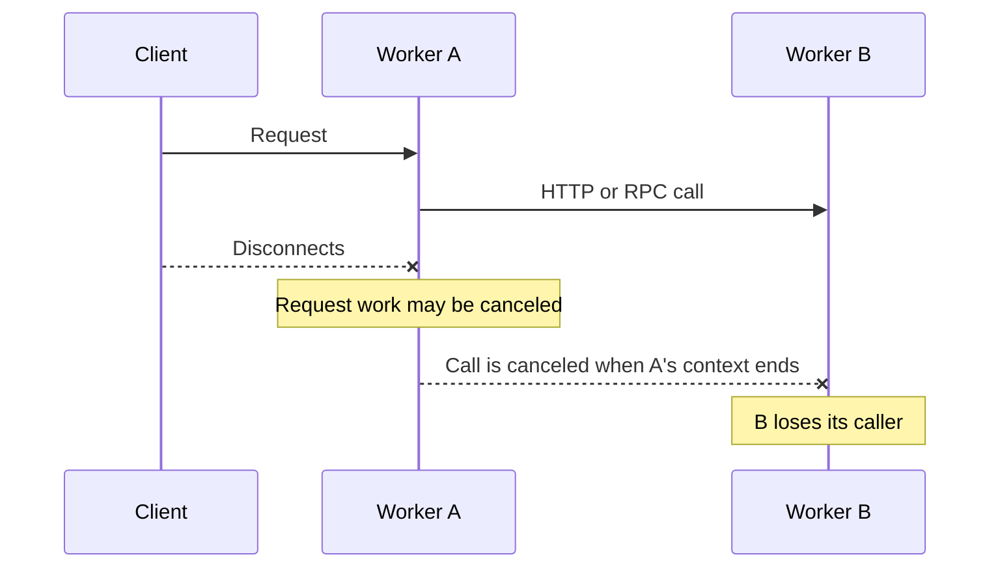

import { WranglerConfig } from "~/components";

## About Service bindings

Service bindings allow one Worker to call into another, without going through a publicly-accessible URL. A Service binding allows Worker A to call a method on Worker B, or to forward a request from Worker A to Worker B.

Service bindings provide the separation of concerns that microservice or service-oriented architectures provide, without configuration pain, performance overhead or need to learn RPC protocols.

- **Service bindings are fast.** When you use Service Bindings, there is zero overhead or added latency. By default, both Workers run on the same thread of the same Cloudflare server. And when you enable [Smart Placement](/workers/configuration/placement/), each Worker runs in the optimal location for overall performance.
- **Service bindings are not just HTTP.** Worker A can expose methods that can be directly called by Worker B. Communicating between services only requires writing JavaScript methods and classes.
- **Service bindings don't increase costs.** You can split apart functionality into multiple Workers, without incurring additional costs. Learn more about [pricing for Service Bindings](/workers/platform/pricing/#service-bindings).


Service bindings are commonly used to:

- **Provide a shared internal service to multiple Workers.** For example, you can deploy an authentication service as its own Worker, and then have any number of separate Workers communicate with it via Service bindings.
- **Isolate services from the public Internet.** You can deploy a Worker that is not reachable via the public Internet, and can only be reached via an explicit Service binding that another Worker declares.
- **Allow teams to deploy code independently.** Team A can deploy their Worker on their own release schedule, and Team B can deploy their Worker separately.

## Configuration

You add a Service binding by modifying the [Wrangler configuration file](/workers/wrangler/configuration/) of the caller — the Worker that you want to be able to initiate requests.

For example, if you want Worker A to be able to call Worker B — you'd add the following to the [Wrangler configuration file](/workers/wrangler/configuration/) for Worker A:

<WranglerConfig>

```jsonc
{
	"services": [
		{
			"binding": "<BINDING_NAME>",
			"service": "<WORKER_NAME>"
		}
	]
}
```

</WranglerConfig>

- `binding`: The name of the key you want to expose on the `env` object.
- `service`: The name of the target Worker you would like to communicate with. This Worker must be on your Cloudflare account. If the target Worker uses an [environment](/workers/wrangler/environments/#service-bindings), use `<WORKER_NAME>-<ENVIRONMENT_NAME>`.

## Interfaces

Worker A that declares a Service binding to Worker B can call Worker B in two different ways:

1. [RPC](/workers/runtime-apis/bindings/service-bindings/rpc) lets you communicate between Workers using function calls that you define. For example, `await env.BINDING_NAME.myMethod(arg1)`. This is recommended for most use cases, and allows you to create your own internal APIs that your Worker makes available to other Workers.
2. [HTTP](/workers/runtime-apis/bindings/service-bindings/http) lets you communicate between Workers by calling the [`fetch()` handler](/workers/runtime-apis/handlers/fetch) from other Workers, sending `Request` objects and receiving `Response` objects back. For example, `env.BINDING_NAME.fetch(request)`.
3. [Connect](/workers/runtime-apis/handlers/connect/) forwards a raw TCP connection to the [`connect()` handler](/workers/runtime-apis/handlers/connect/) of another Worker.

:::note[Cloudflare Access context]
Cloudflare Access does not propagate `ctx.access` from Worker A to Worker B. This applies to HTTP requests and RPC invocations. Do not treat the downstream invocation as authenticated by the caller's Access context. For more information, refer to [`ctx.access` limitations](/workers/configuration/cloudflare-access/#ctxaccess-limitations).
:::

## Example — build your first Service binding using RPC

This example [extends the `WorkerEntrypoint` class](/workers/runtime-apis/bindings/service-bindings/rpc/#the-workerentrypoint-class) to support RPC-based Service bindings.
First, create the Worker that you want to communicate with. Let's call this "Worker B". Worker B exposes the public method, `add(a, b)`:

<WranglerConfig>

```jsonc
{
	"$schema": "./node_modules/wrangler/config-schema.json",
	"name": "worker_b",
	"main": "./src/workerB.js",
	"upload_source_maps": true
}
```

</WranglerConfig>

```js
import { WorkerEntrypoint } from "cloudflare:workers";

export default class WorkerB extends WorkerEntrypoint {
	// Currently, entrypoints without a named handler are not supported
	async fetch() {
		return new Response(null, { status: 404 });
	}

	async add(a, b) {
		return a + b;
	}
}
```

Next, create the Worker that will call Worker B. Let's call this "Worker A". Worker A declares a binding to Worker B. This is what gives it permission to call public methods on Worker B.

<WranglerConfig>

```jsonc
{
	"$schema": "./node_modules/wrangler/config-schema.json",
	"name": "worker_a",
	"main": "./src/workerA.js",
	"upload_source_maps": true,
	"services": [
		{
			"binding": "WORKER_B",
			"service": "worker_b"
		}
	]
}
```

</WranglerConfig>

```js
export default {
	async fetch(request, env) {
		const result = await env.WORKER_B.add(1, 2);
		return new Response(result);
	},
};
```

To run both Worker A and Worker B in local development, you must run two instances of [Wrangler](/workers/wrangler) in your terminal. For each Worker, open a new terminal and run [`npx wrangler@latest dev`](/workers/wrangler/commands#dev).

Each Worker is deployed separately.

## Lifecycle

Use `return` or `await` for service-binding calls needed to answer a request. Otherwise, work in the called Worker can stop when the caller finishes. For a short task that should continue after the response, pass the whole task to [`ctx.waitUntil()`](/workers/runtime-apis/context/#waituntil).

### Request cancellation

When a client disconnects, work handling its request may be canceled. This includes pending subrequests and open streams or connections tied to that request.

If Worker A calls Worker B through an HTTP or RPC service binding, cancellation can continue down that chain. Worker A is Worker B's client. When Worker A's execution context ends, Worker B loses its caller, even though it has no direct connection to the original client.



The original client can be any application or service, such as a browser or mobile app. The calling Worker can also be a Pages Function.

Using `await` does not prevent cancellation when the client disconnects. Use `ctx.waitUntil()` for short tasks that should continue after the request ends.

- **HTTP:** Follow [Handle canceled requests](/workers/runtime-apis/bindings/service-bindings/http/#handle-canceled-requests) to handle response bodies and compare logs from both Workers.
- **RPC:** When the caller's execution context ends, the called Worker's RPC execution context is canceled, even if RPC object references still exist. Refer to [RPC lifecycle](/workers/runtime-apis/rpc/lifecycle/#end-of-event-handler--execution-context) for object lifetimes and extending work with `ctx.waitUntil()`.

### Choose when work should stop

Choose how to run the work based on what should happen if the client disconnects:

| What you need                                                              | What to do                                                                                                                                                                                                                                               |
| -------------------------------------------------------------------------- | -------------------------------------------------------------------------------------------------------------------------------------------------------------------------------------------------------------------------------------------------------- |
| Work only needed to answer this request                                    | Return or await the call. For HTTP calls, forward the response or finish reading its body. Let the work stop if the client disconnects.                                                                                                                  |
| A short task that should finish after the response, such as a cache update | Pass the whole task to [`ctx.waitUntil()`](/workers/runtime-apis/context/#waituntil), including any response-body processing it needs. For HTTP-triggered Workers, it can run for up to 30 seconds after the response is sent or the client disconnects. |
| A job that must finish even if the client disconnects                      | Send the job to [Queues](/queues/) or start a [Workflow](/workflows/). Wait for the message to be accepted or the workflow instance to be created before telling the client the job was accepted.                                                        |

`waitUntil()` gives work more time. It does not guarantee completion or send a response to a disconnected client. For jobs that can retry, make it safe to run the same operation more than once. For example, [Queues can deliver the same message more than once](/queues/reference/delivery-guarantees/).

## Local development

Local development is supported for Service bindings. For each Worker, open a new terminal and use [`wrangler dev`](/workers/wrangler/commands/general/#dev) in the relevant directory. When running `wrangler dev`, service bindings will show as `connected`/`not connected` depending on whether Wrangler can find a running `wrangler dev` session for that Worker. For example:

```sh
$ wrangler dev
...
Your worker has access to the following bindings:
- Services:
  - SOME_OTHER_WORKER: some-other-worker [connected]
  - ANOTHER_WORKER: another-worker [not connected]
```

Wrangler also supports running multiple Workers at once with one command. To try it out, pass multiple `-c` flags to Wrangler, like this: `wrangler dev -c wrangler.json -c ../other-worker/wrangler.json`. The first config will be treated as the _primary_ worker, which will be exposed over HTTP as usual at `http://localhost:8787`. The remaining config files will be treated as _secondary_ and will only be accessible via a service binding from the primary worker.

:::caution

Support for running multiple Workers at once with one Wrangler command is experimental, and subject to change as we work on the experience. If you run into bugs or have any feedback, [open an issue on the workers-sdk repository](https://github.com/cloudflare/workers-sdk/issues/new)

:::

## Deployment

Workers using Service bindings are deployed separately.

When getting started and deploying for the first time, this means that the target Worker (Worker B in the examples above) must be deployed first, before Worker A. Otherwise, when you attempt to deploy Worker A, deployment will fail, because Worker A declares a binding to Worker B, which does not yet exist.

When making changes to existing Workers, in most cases you should:

- Deploy changes to Worker B first, in a way that is compatible with the existing Worker A. For example, add a new method to Worker B.
- Next, deploy changes to Worker A. For example, call the new method on Worker B, from Worker A.
- Finally, remove any unused code. For example, delete the previously used method on Worker B.

## Smart Placement

[Smart Placement](/workers/configuration/placement/) automatically places your Worker in an optimal location that minimizes latency.

You can use Smart Placement together with Service bindings to split your Worker into two services:


Refer to the [docs on Smart Placement](/workers/configuration/placement/#multiple-workers) for more.

## Limits

Service bindings have the following limits:

- Each request to a Worker via a Service binding counts toward your [subrequest limit](/workers/platform/limits/#subrequests).
- A single request has a maximum of 32 Worker invocations, and each call to a Service binding counts towards this limit. Subsequent calls will throw an exception.
- Calling a service binding does not count towards [simultaneous open connection limits](/workers/platform/limits/#simultaneous-open-connections)
