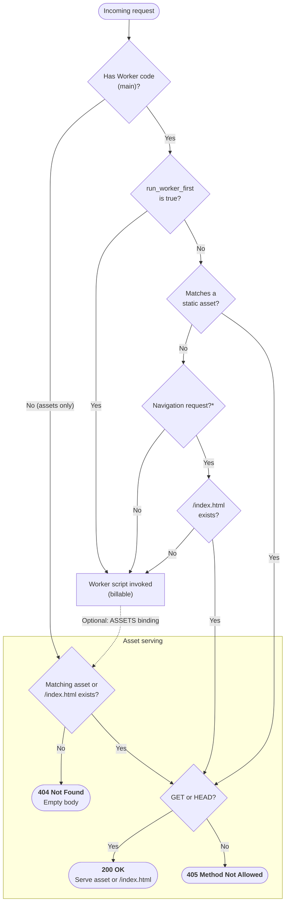
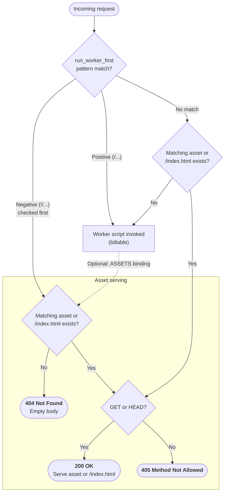

import {
	WranglerConfig,
	TypeScriptExample,
	Render,
	Details,
	Tabs,
	TabItem,
} from "~/components";

Single Page Applications (SPAs) are web applications which are client-side rendered (CSR). They are often built with a framework such as [React](/workers/framework-guides/web-apps/react/), [Vue](/workers/framework-guides/web-apps/vue/) or [Svelte](/workers/framework-guides/web-apps/sveltekit/). The build process of these frameworks will produce a single `/index.html` file and accompanying client-side resources (e.g. JavaScript bundles, CSS stylesheets, images, fonts, etc.). Typically, data is fetched by the client from an API with client-side requests.

When you configure `single-page-application` mode, Cloudflare provides default routing behavior that automatically serves your `/index.html` file for navigation requests (those with `Sec-Fetch-Mode: navigate` headers) which don't match any other asset. For more control over which paths invoke your Worker script, you can use [advanced routing control](#advanced-routing-control).

## Configuration

In order to deploy a Single Page Application to Workers, you must configure the `assets.directory` and `assets.not_found_handling` options in your [Wrangler configuration file](/workers/wrangler/configuration/#assets):

<WranglerConfig>

```json
{
	"name": "my-worker",
	"compatibility_date": "$today",
	"assets": {
		"directory": "./dist/",
		"not_found_handling": "single-page-application"
	}
}
```

</WranglerConfig>

Configuring `assets.not_found_handling` to `single-page-application` overrides the default serving behavior of Workers for static assets. When an incoming request does not match a file in the `assets.directory`, Workers will serve the contents of the `/index.html` file with a `200 OK` status.

<Render file="navigation_requests" product="workers" />

## Advanced routing control

For more explicit control over SPA routing behavior, you can use `run_worker_first` with an array of route patterns. This approach disables the automatic `Sec-Fetch-Mode: navigate` detection and gives you explicit control over which requests should be handled by your Worker script vs served as static assets.

:::note
Advanced routing control is supported in:

- [Wrangler](/workers/wrangler/install-and-update/) v4.20.0 and above
- [Cloudflare Vite plugin](/workers/vite-plugin/get-started/) v1.7.0 and above
  :::

<WranglerConfig>

```json
{
	"name": "my-worker",
	"compatibility_date": "$today",
	"main": "./src/index.ts",
	"upload_source_maps": true,
	"assets": {
		"directory": "./dist/",
		"not_found_handling": "single-page-application",
		"binding": "ASSETS",
		"run_worker_first": ["/api/*", "!/api/docs/*"]
	}
}
```

</WranglerConfig>

This configuration provides explicit routing control without relying on browser navigation headers, making it ideal for complex SPAs that need fine-grained routing behavior. Your Worker script can then handle the matched routes and (optionally using [the assets binding](/workers/static-assets/binding/#binding)) and serve dynamic content.

**For example:**

<TypeScriptExample filename="./src/index.ts">

```ts
export default {
	async fetch(request, env): Promise<Response> {
		const url = new URL(request.url);

		if (url.pathname === "/api/name") {
			return new Response(JSON.stringify({ name: "Cloudflare" }), {
				headers: { "Content-Type": "application/json" },
			});
		}

		return new Response(null, { status: 404 });
	},
} satisfies ExportedHandler;
```

</TypeScriptExample>

When `run_worker_first` is an array, Workers check unmatched paths for a matching static asset or the SPA fallback (`/index.html`). If either exists, requests other than `GET` or `HEAD` return `405 Method Not Allowed` without invoking your Worker script, unless a matching [redirect](/workers/static-assets/redirects/) takes precedence.

If neither asset is available, unmatched paths can fall through to your Worker script.

To route a path to your Worker script regardless of the HTTP method, match it with a positive `run_worker_first` pattern and make sure no negative pattern matches it.

Using the `run_worker_first: ["/api/*", "!/api/docs/*"]` example configuration, requests resolve as follows:

| Request | Asset state | Outcome | Worker invoked |
| --- | --- | --- | --- |
| `GET /dashboard` | `/index.html` exists | `200 OK` (`/index.html` served) | No |
| `POST /login` | `/index.html` exists | `405 Method Not Allowed` | No |
| `POST /login` | No matching asset or `/index.html` | Handled by Worker | Yes (billable) |
| `POST /api/login` | Any | Handled by Worker | Yes (billable) |
| `POST /api/docs/page` | Matching asset or `/index.html` exists | `405 Method Not Allowed` | No |
| `POST /api/docs/page` | No matching asset or `/index.html` | `404 Not Found` | No |

You can also use `run_worker_first` to inject data into your SPA shell before it reaches the browser. For a full example using HTMLRewriter to prefetch API data and embed it in the HTML stream, refer to [SPA shell with bootstrap data](/workers/examples/spa-shell/).

## Local Development

If you are using a Vite-powered SPA framework, you might be interested in using our [Vite plugin](/workers/vite-plugin/) which offers a Vite-native developer experience.

### Reference

The following diagrams show how Workers route requests in SPA mode. They do not show [redirects or rewrites](/workers/static-assets/redirects/).

<Details header="Full routing decision diagrams">
<Tabs>
<TabItem label="Default routing">



\* Navigation requests (`Sec-Fetch-Mode: navigate`) use the SPA fallback when [`assets_navigation_prefers_asset_serving`](/workers/configuration/compatibility-flags/#navigation-requests-prefer-asset-serving) is active (default for compatibility dates on or after `2025-04-01`, unless disabled with `assets_navigation_has_no_effect`).

</TabItem>
<TabItem label="With run_worker_first array">



</TabItem>
</Tabs>
</Details>

Requests are only billable if a Worker script is invoked. From there, it is possible to serve assets using the assets binding (depicted as the dotted line in the routing diagrams).

Although unlikely to impact how a SPA is served, you can read more about how we match assets in the [HTML handling docs](/workers/static-assets/routing/advanced/html-handling/).
