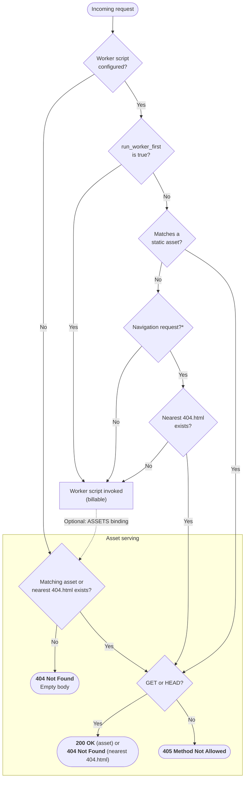
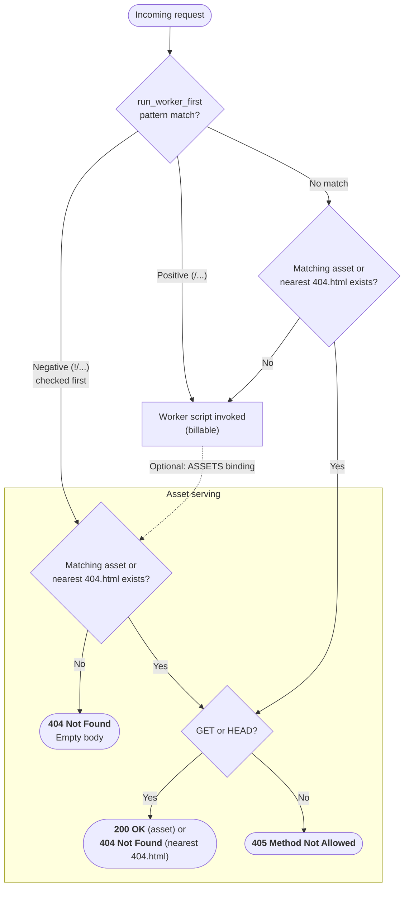

import {
	WranglerConfig,
	Render,
	Details,
	Tabs,
	TabItem,
} from "~/components";

Static Site Generation (SSG) applications are web applications which are predominantly built or "prerendered" ahead-of-time. They are often built with a framework such as [Gatsby](/workers/framework-guides/web-apps/more-web-frameworks/gatsby/) or [Docusaurus](/workers/framework-guides/web-apps/more-web-frameworks/docusaurus/). The build process of these frameworks will produce many HTML files and accompanying client-side resources (e.g. JavaScript bundles, CSS stylesheets, images, fonts, etc.). Data is either static, fetched and compiled into the HTML at build-time, or fetched by the client from an API with client-side requests.

Often, an SSG framework will allow you to create a custom 404 page.

## Configuration

In order to deploy a Static Site Generation application to Workers, you must configure the `assets.directory`, and optionally, the `assets.not_found_handling` and `assets.html_handling` options in your [Wrangler configuration file](/workers/wrangler/configuration/#assets):

<WranglerConfig>

```json
{
	"name": "my-worker",
	"compatibility_date": "$today",
	"assets": {
		"directory": "./dist/",
		"not_found_handling": "404-page",
		"html_handling": "auto-trailing-slash"
	}
}
```

</WranglerConfig>

`assets.html_handling` defaults to `auto-trailing-slash` and this will usually give you the desired behavior automatically: individual files (e.g. `foo.html`) will be served _without_ a trailing slash and folder index files (e.g. `foo/index.html`) will be served _with_ a trailing slash. Alternatively, you can force trailing slashes (`force-trailing-slash`) or drop trailing slashes (`drop-trailing-slash`) on requests for HTML pages.

### Custom 404 pages

Configuring `assets.not_found_handling` to `404-page` overrides the default serving behavior of Workers for static assets. When an incoming request does not match a file in the `assets.directory`, Workers will serve the contents of the nearest `404.html` file with a `404 Not Found` status.

<Render file="navigation_requests" product="workers" />

## Local Development

If you are using a Vite-powered SPA framework, you might be interested in using our [Vite plugin](/workers/vite-plugin/) which offers a Vite-native developer experience.

### Reference

The following diagrams show how Workers route requests in `404-page` mode. They do not show [redirects or rewrites](/workers/static-assets/redirects/).

<Details header="Full routing decision diagrams">
<Tabs>
<TabItem label="Default routing">



\* Navigation requests (`Sec-Fetch-Mode: navigate`) use the `404.html` fallback when [`assets_navigation_prefers_asset_serving`](/workers/configuration/compatibility-flags/#navigation-requests-prefer-asset-serving) is active (default for compatibility dates on or after `2025-04-01`, unless disabled with `assets_navigation_has_no_effect`).

</TabItem>
<TabItem label="With run_worker_first array">



</TabItem>
</Tabs>
</Details>

Requests are only billable if a Worker script is invoked. From there, it is possible to serve assets using the assets binding (depicted as the dotted line in the routing diagrams).

You can read more about how we match assets in the [HTML handling docs](/workers/static-assets/routing/advanced/html-handling/).
