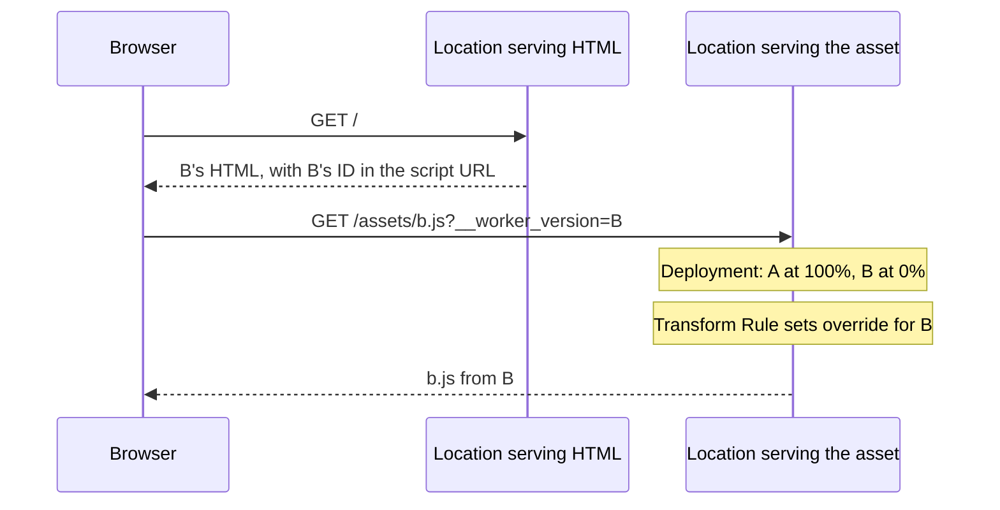

import { Steps, TypeScriptExample, WranglerConfig } from "~/components";

You can use version overrides to send a request to a specific version of your Worker in the current deployment, even those set to serve 0% of traffic.

## How to set version overrides

To specify a version override in your request, set the `Cloudflare-Workers-Version-Overrides` header on the request to your Worker. `Cloudflare-Workers-Version-Overrides` is a [Dictionary Structured Header](https://www.rfc-editor.org/rfc/rfc8941#name-dictionaries) that can contain multiple key-value pairs. Each **key** indicates the name of the Worker the override should be applied to. The **value** indicates the version ID that should be used and must be a [String](https://www.rfc-editor.org/rfc/rfc8941#name-strings). For example:

```sh
curl -s https://example.com -H 'Cloudflare-Workers-Version-Overrides: my-worker-name="dc8dcd28-271b-4367-9840-6c244f84cb40"'
```

:::caution[Version must be in current deployment]

A version override will only be applied if the specified version is in the current deployment. The versions in the current deployment can be found using the [`wrangler deployments list`](/workers/wrangler/commands/general/#deployments-list) command or on the [**Workers & Pages** page of the Cloudflare dashboard > select your Worker > **Deployments** > **Active Deployment**](https://dash.cloudflare.com/?to=/:account/workers/services/view/:worker/production/deployments).

{/* To be removed/changed once this limit is increased for skew protection */}
Workers currently only supports serving **two** different versions in one deployment. Follow the instructions for [gradual deployments](/workers/versions-and-deployments/gradual-deployments/#use-gradual-deployments) to ensure the requested version is in the current deployment. You can set the new version to 0% traffic to avoid normal traffic being routed to it.

:::

### Versions in the deployment

A version must be in a deployment before an override can select it. Its traffic percentage can be 0%:

| Deployment at the location handling the request | Traffic by default | With a version override                                                                 |
| ----------------------------------------------- | ------------------ | --------------------------------------------------------------------------------------- |
| Only A; B has been uploaded                     | A                  | An override for B is ignored because B is outside the deployment. The request uses A.   |
| A at 100%, B at 0%                              | A                  | An override can select B and its assets.                                                |
| A at 0%, B at 100%                              | B                  | An override can still select A.                                                         |
| Only B                                          | B                  | An override for A is ignored, even if A remains in version history. The request uses B. |

You can also turn on a [Version URL](/workers/versions-and-deployments/version-urls/) to access an uploaded version. This does not require adding it to the production deployment.

Deployment changes take time to reach every location on the network. A location ignores an override if its deployment does not yet include the requested version. It uses the configured traffic percentages instead. Refer to [Version skew and static assets](/workers/versions-and-deployments/version-skew/) before using overrides for related requests.

### Verify that version overrides were applied

There are a number of reasons why a request's version override may not be applied. For example:

- The deployment at the location handling the request may not include the version. This can happen while a deployment change spreads across the network.
- The header value may not be a valid [Dictionary](https://www.rfc-editor.org/rfc/rfc8941#name-dictionaries).

In the case that a request's version override is not applied, the request will be routed according to the percentages set in the gradual deployment configuration.

Use [Observability](/workers/observability/), including [Logpush](/workers/observability/logs/logpush/), to check which Worker version handled a request. Alternatively, use the [version metadata binding](/workers/runtime-apis/bindings/version-metadata/) to return the version ID in the response. Check the version as well as the status code. An ignored override can still return a successful response.

## Use version overrides for asset requests

To keep HTML and asset requests on the same version, include the HTML's Worker version ID in each asset URL. A [Request Header Transform Rule](/rules/transform/request-header-modification/) can turn that ID into a version override.

For example, version A contains `/assets/a.js` and version B contains `/assets/b.js`. Both versions belong to the deployment. B's HTML can request B's asset even when the location handling the asset request still has B at 0%:



In this diagram, `B` represents the full Worker version ID.

This approach requires a proxied hostname on your Cloudflare zone. The Transform Rule does not run on `workers.dev`.

<Steps>

1. Include the version ID in asset URLs.

   Configure the [version metadata binding](/workers/runtime-apis/bindings/version-metadata/) and [assets binding](/workers/static-assets/binding/). This example runs the Worker for `/` to generate HTML:

   <WranglerConfig>

   ```jsonc
   {
     "version_metadata": {
       "binding": "CF_VERSION_METADATA"
     },
     "assets": {
       "directory": "./public",
       "binding": "ASSETS",
       "run_worker_first": ["/"]
     }
   }
   ```

   </WranglerConfig>

   In version B, place `b.js` in `public/assets/`. Read the serving version's ID when generating its script URL:

   <TypeScriptExample>

   ```ts
   interface Env {
     CF_VERSION_METADATA: WorkerVersionMetadata;
     ASSETS: Fetcher;
   }

   export default {
     async fetch(request, env): Promise<Response> {
       if (new URL(request.url).pathname === "/") {
         const version = encodeURIComponent(env.CF_VERSION_METADATA.id);
         return new Response(
           `<!doctype html>
   <html lang="en">
   <meta charset="utf-8">
   <title>Version B</title>
   <script src="/assets/b.js?__worker_version=${version}"></script>
   </html>`,
           { headers: { "content-type": "text/html; charset=utf-8" } },
         );
       }

       return env.ASSETS.fetch(request);
     },
   } satisfies ExportedHandler<Env>;
   ```

   </TypeScriptExample>

   Version A uses the same pattern with `/assets/a.js`. Each version reads its own ID, so older HTML keeps requesting that version's assets.

2. Set the override before Cloudflare selects the Worker version.

   The query parameter alone does not select a version. [Create a Request Header Transform Rule](/rules/transform/request-header-modification/create-dashboard/) with this filter expression. Replace the hostname and two version IDs with your values:

   ```txt
   (http.host eq "example.com"
     and starts_with(http.request.uri.path, "/assets/")
     and http.request.uri.args["__worker_version"][0] in {
       "db7cd8d3-4425-4fe7-8c81-01bf963b6067"
       "dc8dcd28-271b-4367-9840-6c244f84cb40"
     })
   ```

   Select **Set dynamic** for the `Cloudflare-Workers-Version-Overrides` header. Use this value expression, replacing `my-worker` with your Worker name:

   ```txt
   concat("my-worker=\"", http.request.uri.args["__worker_version"][0], "\"")
   ```

   For a request with B's version ID, the rule produces:

   ```http
   Cloudflare-Workers-Version-Overrides: my-worker="dc8dcd28-271b-4367-9840-6c244f84cb40"
   ```

   The override selects B and its assets before asset routing runs. Setting the header inside the selected Worker's handler does not change which version handles that request.

3. Keep both versions in the deployment.

   Use a [gradual deployment](/workers/versions-and-deployments/gradual-deployments/#use-gradual-deployments) to add B at 0% before sending normal traffic to it. Then promote B while keeping A at 0%:

   ```mermaid
   flowchart LR
       Stage["A at 100%, B at 0%"] --> Wait["Allow deployment to propagate"]
       Wait --> Promote["A at 0%, B at 100%"]
       Promote --> Old["Older HTML requests A's assets"]
       Promote --> New["New HTML requests B's assets"]
   ```

   Deployment changes take up to a few seconds to propagate. If the receiving location still has a deployment containing only A, an override for B is ignored. A fixed wait or a check at one location does not prove that every location includes B.

</Steps>

Apply the version ID to every related asset URL, including imported JavaScript chunks, stylesheets, and URLs within CSS. A script's query string does not carry over to files it imports.

Keep the Transform Rule's allowed version IDs in sync with your deployment. When you later replace A with C, pages loaded from A can no longer select their version.

For a runnable example, refer to the [Workers version skew reproduction](https://github.com/irvinebroque/workers-skew-protection-repro). It demonstrates asset requests selecting a version at 0% traffic. It does not test requests reaching different locations during deployment propagation.

## Smoke test example

You may want to test a new version in production before gradually deploying it to an increasing proportion of external traffic. This is commonly referred to as a "smoke test".

In this example, your deployment is initially configured to route all traffic to a single version:

|              Version ID              | Percentage |
| :----------------------------------: | :--------: |
| db7cd8d3-4425-4fe7-8c81-01bf963b6067 |    100%    |

Create a new deployment using [`wrangler versions deploy`](/workers/wrangler/commands/general/#versions-deploy) and specify 0% for the new version whilst keeping the previous version at 100%.

|              Version ID              | Percentage |
| :----------------------------------: | :--------: |
| dc8dcd28-271b-4367-9840-6c244f84cb40 |     0%     |
| db7cd8d3-4425-4fe7-8c81-01bf963b6067 |    100%    |

Now test the new version with a version override before gradually progressing the new version to 100%:

```sh
curl -s https://example.com -H 'Cloudflare-Workers-Version-Overrides: my-worker-name="dc8dcd28-271b-4367-9840-6c244f84cb40"'
```

## Service bindings

You can set the `Cloudflare-Workers-Version-Overrides` header when making a subrequest from one Worker to another using a [service binding](/workers/runtime-apis/bindings/service-bindings/). This lets you test a specific version of a downstream Worker from an upstream Worker.

If you forward the original request object, the override header carries through automatically:

<TypeScriptExample>

```ts
// The override header from the inbound request is forwarded to the downstream Worker.
export default {
	async fetch(request: Request, env: Env): Promise<Response> {
		return env.MY_SERVICE.fetch(request);
	},
};
```

</TypeScriptExample>

Alternatively, you can set an override header explicitly:

<TypeScriptExample>

```ts
// Replace the version ID with the target version from `wrangler versions list`.
export default {
	async fetch(request: Request, env: Env): Promise<Response> {
		const response = await env.MY_SERVICE.fetch("https://example.com/", {
			headers: {
				"Cloudflare-Workers-Version-Overrides":
					'my-downstream-worker="dc8dcd28-271b-4367-9840-6c244f84cb40"',
			},
		});
		return response;
	},
};
```

</TypeScriptExample>

:::note
Version overrides only apply to `fetch()`-based service binding calls. There is currently no way to specify version overrides when calling a service binding via RPC (`env.MY_SERVICE.someMethod()`), because RPC calls do not support attaching headers.
:::

## Related resources

- [Version affinity](/workers/versions-and-deployments/gradual-deployments/version-affinity/) - Keep requests with the same key on one version while the deployment configuration stays the same.
- [Version skew and static assets](/workers/versions-and-deployments/version-skew/) - Understand deployment propagation and asset availability across releases.
- [Gradual deployments](/workers/versions-and-deployments/gradual-deployments/) - Learn how percentage-based traffic splitting works.
- [Service bindings](/workers/runtime-apis/bindings/service-bindings/) - How Workers communicate with each other.
- [Version metadata binding](/workers/runtime-apis/bindings/version-metadata/) - Access version ID and tag from within your Worker.
