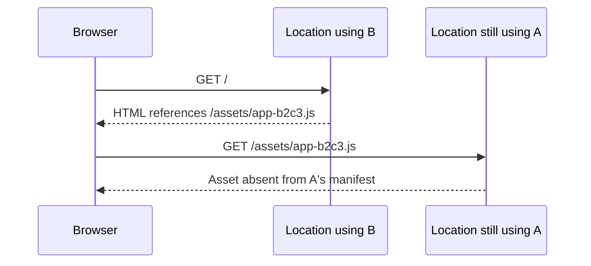

**Version skew** occurs when related requests use incompatible application versions. For example, a browser can receive HTML from one version, then request a JavaScript file from another version that does not contain it.

This can happen during deployment propagation, during a [gradual deployment](/workers/versions-and-deployments/gradual-deployments/), or when an older page requests assets after a deployment changes.

## Versions, deployments, and asset sets

A [Worker version](/workers/versions-and-deployments/#versions) associates your code and configuration with a particular set of static assets. Its **asset manifest** maps file paths to uploaded files. Asset requests use the asset set associated with the selected version, whether Cloudflare serves them directly or your Worker uses `env.ASSETS.fetch()`.

A [deployment](/workers/versions-and-deployments/#deployments) configures which versions receive requests and their traffic percentages. Deployment changes propagate across Cloudflare's network. Different locations can temporarily use different deployment configurations.

Uploading assets, creating a version, and deploying that version are separate operations. Uploading a file does not add its path to other versions' manifests. Reusing an unchanged file during upload also does not make every version expose that file.

A browser page makes separate requests for HTML, scripts, stylesheets, images, and imported JavaScript chunks. Serving the HTML does not reserve its version for those later requests. Configuring a deployment for 100% of traffic does not make the page's requests a single transaction.

## Causes of version skew

### Deployment propagation

Suppose version A is serving traffic. You deploy version B, whose HTML references a new file, `/assets/app-b2c3.js`. Version A's manifest does not contain that path.

During propagation, a location using the new deployment can serve B's HTML. A later request can reach a location still using the previous deployment and select A:

The file can be missing from the selected manifest even though its upload succeeded. The resulting response depends on your [asset routing and fallback configuration](/workers/static-assets/#routing-behavior). For example, a missing file can return a `404` response.

This case applies to ordinary deployments as well as gradual deployments. Separating upload from promotion lets you choose when to create a deployment. It does not make the deployment change propagate simultaneously everywhere.

### Traffic split between versions

During a gradual deployment, each request independently selects a version according to the configured percentages. Requests from the same browser can select different versions, even after the deployment configuration has propagated.

[Version affinity](/workers/versions-and-deployments/gradual-deployments/version-affinity/) uses a stable request identifier to make that selection deterministic for a given deployment configuration. Every relevant request must carry the same version key. Changing the traffic percentages can move users to the new version while their existing page remains open.

### Older pages and rollbacks

A page can remain open after a newer version starts serving traffic. If that page later imports a JavaScript chunk, it requests a file from its original release. The selected version must contain that path for the asset lookup to succeed.

[Rollbacks](/workers/versions-and-deployments/rollbacks/) create the reverse situation: pages loaded from the newer version can request files absent from the restored version. Allow for both directions when planning which assets each version includes.

## Plan for related requests

Choose a strategy based on how long your application's pages can remain open and which versions can serve their requests.

| Strategy                                                                                    | Scope and constraints                                                                                                                                                                               |
| ------------------------------------------------------------------------------------------- | --------------------------------------------------------------------------------------------------------------------------------------------------------------------------------------------------- |
| [Version affinity](/workers/versions-and-deployments/gradual-deployments/version-affinity/) | Keeps requests with the same key assigned consistently under a given deployment configuration. It does not preserve an older version after its traffic allocation or deployment membership changes. |
| [Version overrides](/workers/versions-and-deployments/version-overrides/)                   | Selects an explicit version that belongs to the receiving location's deployment configuration, including one at 0%. An unavailable override falls back to normal traffic routing.                   |
| Include assets needed by older pages                                                        | Allows a newer version to serve older content-hashed asset paths. It does not add a new release's files to an earlier version.                                                                      |

When retaining assets across releases, use content-hashed filenames so different contents have different paths. Include every required dependency, such as imported chunks, stylesheet imports, and font files.

Keeping old files in a new release addresses requests from older pages. To address requests for new files reaching an earlier version, that earlier version must also include the required files, or the request must select a version that contains them.

For example, an application can first deploy its existing HTML with both releases' asset files. A later deployment can change the HTML while retaining those files. Each deployment still propagates across the network; a fixed waiting period or a successful request from one location does not establish global completion.

If your application carries an explicit version identifier in asset URLs, preserve it throughout the dependency graph. A query string on a parent script is not automatically copied to imported chunks or stylesheet URLs. A query parameter alone also does not select a Worker version: the incoming request must set the [version override header](/workers/versions-and-deployments/version-overrides/#how-to-set-version-overrides).

### Multiple hostnames and connections

If assets use another hostname, ensure the same routing strategy applies there. A cookie set without a `Domain` attribute is only sent to its originating hostname. Check which cookies and headers reach each asset hostname.

Apply the same version-selection strategy across all asset hostnames and connections, including HTTP/3 connections. Pointing multiple hostnames at the same Worker does not automatically carry a cookie or version header between their requests.

## Asset availability across releases

Distinguish these questions when investigating a missing asset:

| Question                                                   | What to check                                                                                                                               |
| ---------------------------------------------------------- | ------------------------------------------------------------------------------------------------------------------------------------------- |
| Does the selected version expose the path?                 | Check that version's build output and asset manifest.                                                                                       |
| Can the request select the intended version?               | Check deployment membership, traffic percentages, and any version key or override.                                                          |
| Is the file cached at this location?                       | Inspect [cache response headers](/workers/static-assets/headers/#default-headers). A cache miss is different from a missing manifest entry. |
| Is this a later request or a response already in progress? | Inspect the browser's network log for the request URL, start time, status, and any network error.                                           |

Omitting a file from a new version's asset set makes that path unavailable through that version's asset lookup. This does not, by itself, show that the file was deleted from storage. Likewise, presence in version history does not make a version eligible for a production override.

Keep required asset paths in the versions that must serve them. Do not use cache residency, upload deduplication, or the [deployment history limit](/workers/versions-and-deployments/deployment-management/#deployments-limit) as an asset retention period.

A lazy-loaded chunk or a later range request is a separate HTTP request. A failed lookup for that request does not establish that deployment interrupted a response already being downloaded. Diagnose failures after a response begins separately from missing-path responses.

## Diagnose version skew

Compare the version serving the HTML with the version handling the failing request. Use the [version metadata binding](/workers/runtime-apis/bindings/version-metadata/) to identify Worker invocations, or attach a build identifier to asset responses with [`_headers`](/workers/static-assets/headers/#custom-headers).

Record the requested path, response status, content type, deployment configuration, and any version-selection headers. When testing overrides, verify the actual serving version and response content as well as the status code: an ignored override falls back to normal routing.

By default, matching static assets bypass your Worker script. Code that logs a version or sets a cookie only runs when the request [invokes your Worker](/workers/static-assets/routing/worker-script/). Account for this when instrumenting asset requests.

Test an older page across multiple deployments, a page that loads assets after a rollback, and requests through every asset hostname. These cases cover more than repeated requests to the application's root URL.
