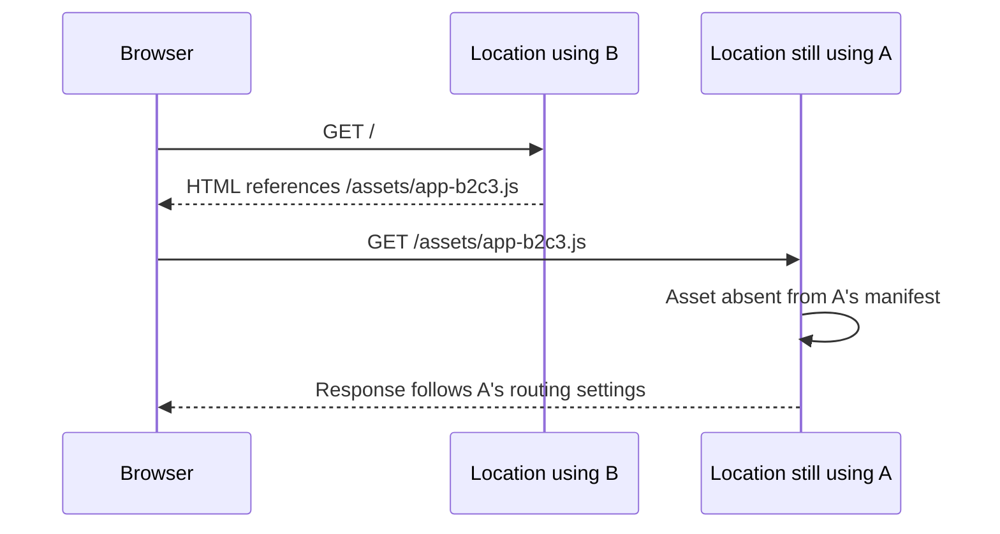

**Version skew** occurs when related requests use incompatible application versions. For example, a browser can receive HTML from one version, then request a JavaScript file from another version that does not contain it.

This can happen during a deployment change or a [gradual deployment](/workers/versions-and-deployments/gradual-deployments/). Older pages can also request assets after a deployment changes.

## Versions, deployments, and asset sets

A [Worker version](/workers/versions-and-deployments/#versions) includes your code, configuration, and static assets. Its **asset manifest** maps request paths to uploaded files.

Each asset request uses the files from the selected version. This applies whether Cloudflare serves assets directly or your Worker uses `env.ASSETS.fetch()`.

A [deployment](/workers/versions-and-deployments/#deployments) sets which versions receive requests and their traffic percentages.

Deployment changes take up to a few seconds to reach every location on Cloudflare's network. This is called **deployment propagation**. Until the change reaches every location, locations can use different deployment configurations.

Uploading assets, creating a version, and deploying it are separate steps. Uploading a file does not add it to other versions' manifests. Reusing a previously uploaded file does not add it to every version either.

A browser makes separate requests for HTML, scripts, stylesheets, images, and imported JavaScript chunks. Serving HTML from one version does not keep later requests on that version. This also applies when you deploy a version to 100% of traffic.

## Causes of version skew

### Deployment propagation

Suppose version A is serving traffic. You deploy version B, whose HTML references a new file, `/assets/app-b2c3.js`. Version A's manifest does not contain that path.

During propagation, one location can serve B's HTML. The asset request can then reach a location still using A:

The file can be missing from the selected manifest even though its upload succeeded. The resulting response depends on your [asset routing and fallback configuration](/workers/static-assets/#routing-behavior). For example, a missing file can return a `404` response.

Uploading a version separately allows you to choose when to deploy it. The deployment change still takes time to reach every location.

### Traffic split between versions

During a gradual deployment, Cloudflare selects a version for each request using the configured percentages. Requests from the same browser can use different versions. This can happen even after every location has the same deployment configuration.

[Version affinity](/workers/versions-and-deployments/gradual-deployments/version-affinity/) sends requests with the same key to the same version. This applies while the deployment configuration stays the same. Every related request must carry that key. Changing traffic percentages can move users to a new version while their page remains open.

### Older pages and rollbacks

A page can remain open after a newer version starts serving traffic. For example, a browser loads version A's HTML, which references `/assets/app-a1b2.js`. You then deploy version B without that file. A later request for the file can reach B, which cannot find it in its own assets.

[Rollbacks](/workers/versions-and-deployments/rollbacks/) can cause the same problem in reverse. Pages loaded from the newer version can request files missing from the restored version. Plan for both cases when choosing which assets each version includes.

## Requests for missing assets

With default [asset-first routing](/workers/static-assets/routing/worker-script/), a missing asset goes to the selected version's `fetch()` handler if you have a Worker script. The handler decides what response to return. A missing asset does not automatically produce a `404` response.

If the handler calls `env.ASSETS.fetch(request)`, it still uses that version's assets and [`not_found_handling` setting](/workers/static-assets/binding/#fetch). It does not search other versions' assets. Without a Worker script, the default response for a missing asset is `404`.

Routing settings can change this flow. For example, [single-page application routing](/workers/static-assets/routing/single-page-application/) can serve `/index.html` for navigation requests without invoking your Worker.

## Plan for related requests

Choose a strategy based on how long your application's pages can remain open and which versions can serve their requests.

| Strategy                                                                                    | What it does and where it applies                                                                                                                                                                     |
| ------------------------------------------------------------------------------------------- | ----------------------------------------------------------------------------------------------------------------------------------------------------------------------------------------------------- |
| [Version affinity](/workers/versions-and-deployments/gradual-deployments/version-affinity/) | Sends requests with the same key to the same version while the deployment configuration stays the same. Changing traffic percentages or removing a version can change where requests go.              |
| [Version overrides](/workers/versions-and-deployments/version-overrides/)                   | Selects a version in the deployment at the location handling the request, even at 0% of traffic. If that deployment does not include the version, Cloudflare uses the configured traffic percentages. |
| Include assets needed by older pages                                                        | Allows a newer version to serve files from earlier releases. It does not add new files to earlier versions.                                                                                           |

When keeping assets across releases, use content-hashed filenames. Different file contents then have different paths. Include every file the page needs, such as imported chunks, stylesheets, and fonts.

Keeping old files in a new release helps older pages. But new pages can still request new files from an earlier version. That earlier version must include those files, or the request must select a version that has them.

For example, first deploy the existing HTML with both releases' asset files. Then change the HTML in a later deployment, keeping those files. Each deployment still takes time to reach every location. Waiting a fixed time or testing one location does not prove that every location has the change.

If you include a version ID in asset URLs, include it in every script, stylesheet, and other asset URL the page loads. A script's query string is not automatically copied to the URLs it loads. A query parameter alone does not select a Worker version. The incoming request must set the [version override header](/workers/versions-and-deployments/version-overrides/#how-to-set-version-overrides).

### Multiple hostnames and connections

If assets use another hostname, apply the same routing strategy there. Without a `Domain` attribute, a cookie only reaches the hostname that set it. Check which cookies and headers reach each asset hostname.

Use the same routing strategy across all connections, including HTTP/3 connections. Pointing multiple hostnames at one Worker does not make browsers share cookies or version headers between those hostnames.

## Asset availability across releases

Check these separately when investigating a missing asset:

| Question                                          | What to check                                                                                                                                       |
| ------------------------------------------------- | --------------------------------------------------------------------------------------------------------------------------------------------------- |
| Does the selected version include the file?       | Check that version's build output and asset manifest.                                                                                               |
| Can the request select the intended version?      | Check the versions in the deployment, their traffic percentages, and any version key or override.                                                   |
| Is the file cached at this location?              | Inspect [cache response headers](/workers/static-assets/headers/#default-headers). A cache miss is different from a file missing from the manifest. |
| Did a later request fail, or did a download stop? | Inspect the browser's network log for the request URL, start time, status, and any network error.                                                   |

If a version's manifest omits a file, that version cannot serve it as a static asset. This does not tell you whether Cloudflare deleted the file from storage.

An older version must still belong to the deployment to accept a version override. Keeping it in version history does not meet this requirement.

Include required files in every version that needs to serve them. How long a file stays cached, whether uploads reuse it, and the [deployment history limit](/workers/versions-and-deployments/deployment-management/#deployments-limit) do not tell you how long Cloudflare stores it.

### Downloads already in progress

Deploying a new version does not cancel static asset downloads already in progress.

A request for a lazy-loaded chunk or a later range request is a new HTTP request. It can use a different version's assets and fail to find the file. Investigate these missing file errors separately from interrupted downloads.

## Diagnose version skew

Compare the version serving the HTML with the version handling the failing request. Use the [version metadata binding](/workers/runtime-apis/bindings/version-metadata/) to report which version handles each Worker request. For asset responses, add a build identifier with [`_headers`](/workers/static-assets/headers/#custom-headers).

Record the requested path, response status, content type, deployment configuration, and any version headers. When testing overrides, check the version and response content as well as the status code. An ignored override uses the configured traffic percentages and can still return a successful response.

By default, matching static assets bypass your Worker script. Code that logs a version or sets a cookie only runs when the request [invokes your Worker](/workers/static-assets/routing/worker-script/). Check whether your logging code runs for asset requests.

Keep an older page open across several deployments and test its asset requests. Also test pages after a rollback and requests through every asset hostname. Testing only the application's root URL does not cover these cases.
