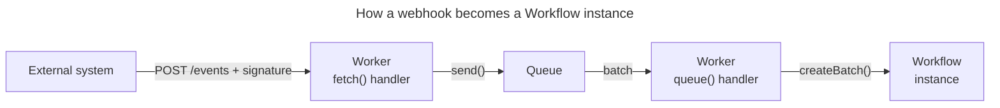

import {
	Render,
	WranglerConfig,
	TypeScriptExample,
	PackageManagers,
} from "~/components";

You can [trigger](/workflows/build/trigger-workflows/) a Workflow from a Worker binding, the REST API, Wrangler, or a cron schedule. When the event that should start a Workflow happens in a system outside Cloudflare, that system sends you a webhook and you connect it to the Workflow yourself. For example, a tenant pushes new code to storage you manage, a row changes in your own database, or a third-party service reports a change.

This example shows how to do that. You will build:

1. A Workflow that does the work.
2. A Worker with an HTTPS endpoint that receives the webhook, verifies its signature, and writes it to a [Queue](/queues/).
3. A queue consumer, in the same Worker, that turns each message into a Workflow instance.



The example event is `tenant.code.changed`, sent by a platform backend when one of its tenants uploads new code that needs a rebuild and redeploy. The pattern is the same for any JSON webhook.

## Choose an approach

How you bring the event in depends on who sends it:

| The event comes from                                                                                  | Use                                                                                                                                                                          |
| ----------------------------------------------------------------------------------------------------- | ---------------------------------------------------------------------------------------------------------------------------------------------------------------------------- |
| A third-party service, or any system that cannot hold a Cloudflare API token and expects a fast `2xx` | The steps on this page. A Worker receives and verifies the webhook, and a queue delivers it to the Workflow.                                                                 |
| Your own backend, which can hold a Cloudflare API token                                               | The [Workflows REST API](#create-an-instance-over-the-rest-api). No Worker or queue is needed.                                                                               |
| A Cloudflare product, such as R2, KV, or Workers Builds                                               | [Event subscriptions](/queues/event-subscriptions/). No webhook receiver is needed: Cloudflare sends the event directly to your queue, and the event has a published schema. |

## Why put a queue in front of the Workflow

Once an instance exists, Workflows handles durability, retries, and state for every step. The gap is before that: the `fetch` handler has to create the instance while the sender waits. Calling `env.MY_WORKFLOW.create()` directly from `fetch` is the shortest path and works for low, steady volumes. A queue between the receiver and instance creation covers that gap:

- **The sender always gets a fast `202`**, even when instance creation is briefly unavailable or [rate limited](/workflows/reference/limits/) (100 per second per Workflow, 300 per account on Workers Paid). Bursts wait in the queue instead of returning HTTP 429.
- **Failed instance creation is retried**, and events that keep failing go to a dead-letter queue instead of being lost.

If you do not need either, skip the queue and call `create()` where this example calls `env.EVENTS.send()`.

## Prerequisites

<Render file="prereqs" product="workers" />

3. Access to the system that sends the event, or a webhook provider that lets you set a signing secret, so that you and the sender can agree on how requests are signed (step 3).

## 1. Define the Workflow

Create a Workers project:

```sh
npm create cloudflare@latest external-event-trigger -- --template "cloudflare/workflows-starter"
cd external-event-trigger
```

The starter creates a basic Worker with a `public` directory and a `test` directory. You will replace `src/index.ts` and `wrangler.jsonc` in the next steps, and you can delete `public` and `test`.

Add the Workflow in `src/workflow.ts`. The parameters type is the event your sender will post. Cloudflare does not define this shape. You do.

The `id` field is the unique event ID assigned by the sender. You will reuse it as the Workflow instance ID in step 5 so that a redelivered event does not start a second instance.

<TypeScriptExample filename="src/workflow.ts">

```ts
import {
	WorkflowEntrypoint,
	type WorkflowEvent,
	type WorkflowStep,
} from "cloudflare:workers";

// The shape of the event your external system sends. You define this; Cloudflare does not.
export interface TenantCodeChanged {
	id: string; // unique event ID from the sender, reused as the Workflow instance ID for idempotency
	type: "tenant.code.changed";
	tenantId: string;
	source: string; // where the new code lives, for example r2://tenant-code/acme/v42/
	occurredAt: string; // ISO 8601
}

export class RebuildTenantSite extends WorkflowEntrypoint<
	Env,
	TenantCodeChanged
> {
	async run(event: WorkflowEvent<TenantCodeChanged>, step: WorkflowStep) {
		const { tenantId, source } = event.payload;

		const manifest = await step.do("fetch tenant source", async () => {
			// In production: list objects under `source` in R2, or read the tenant row from your database.
			return { tenantId, source, files: ["index.html", "styles.css"] };
		});

		const build = await step.do(
			"build",
			{ retries: { limit: 3, delay: "10 seconds", backoff: "exponential" } },
			async () => {
				return {
					artifact: `builds/${tenantId}/${Date.now()}.tar`,
					fileCount: manifest.files.length,
				};
			},
		);

		await step.do("deploy", async () => {
			// In production: upload the artifact and flip the active version for the tenant.
			return { deployed: true, artifact: build.artifact };
		});

		return { tenantId, artifact: build.artifact };
	}
}
```

</TypeScriptExample>

## 2. Configure Wrangler

:::note
This example shows Wrangler commands. Where the [Cloudflare CLI](/cf/) (`cf`) has an equivalent, use the selector on the command or configuration block to switch. To use `cf` for the project commands (`cf dev`, `cf deploy`), run `cf migrate` in the project directory first. It adds `cf` to the project and writes the `cloudflare.config.ts` shown below. Make sure `package.json` contains `"type": "module"`.
:::

Replace the contents of `wrangler.jsonc`, or of `cloudflare.config.ts` if you use the Cloudflare CLI, to bind the Workflow, register the Worker as a producer for `external-events`, and register it as the consumer of the same queue:

<WranglerConfig
	cfConfig={`
import { bindings, defineConfig, exports, triggers } from "cf/config";

export default defineConfig({
	worker: {
		name: "external-event-trigger",
		compatibilityDate: "$today",
		entrypoint: "src/index.ts",
		observability: {
			enabled: true,
		},
		triggers: [
			triggers.queue({
				name: "external-events",
				maxBatchSize: 25,
				maxBatchTimeout: 0,
				maxRetries: 3,
				deadLetterQueue: "external-events-dlq",
			}),
		],
		env: {
			EVENTS: bindings.queue({
				name: "external-events",
			}),
			REBUILD: bindings.workflow({
				name: "rebuild-tenant-site",
				worker: "external-event-trigger",
				exportName: "RebuildTenantSite",
			}),
		},
		exports: {
			RebuildTenantSite: exports.workflow({
				name: "rebuild-tenant-site",
			}),
		},
	},
});
`}
>

```jsonc
{
	"$schema": "./node_modules/wrangler/config-schema.json",
	"name": "external-event-trigger",
	"main": "src/index.ts",
	"compatibility_date": "$today",
	"observability": { "enabled": true },
	"workflows": [
		{
			"name": "rebuild-tenant-site",
			"binding": "REBUILD",
			"class_name": "RebuildTenantSite",
		},
	],
	"queues": {
		"producers": [{ "binding": "EVENTS", "queue": "external-events" }],
		"consumers": [
			{
				"queue": "external-events",
				"max_batch_size": 25,
				"max_batch_timeout": 0,
				"max_retries": 3,
				"dead_letter_queue": "external-events-dlq",
			},
		],
	},
}
```

</WranglerConfig>

The consumer settings control how events reach your Workflow:

- `max_batch_size` and `max_batch_timeout` decide how many events the `queue` handler receives per invocation and how long to wait to fill a batch. Keep `max_batch_size` at or below 100 so a batch fits in a single `createBatch()` call. With `max_batch_timeout` set to `0`, the consumer runs as soon as the queue delivers an event. That usually takes a few seconds, but queue delivery time varies and can occasionally exceed a minute, so do not depend on a fixed delay. If you receive high volumes, raise it (up to 60 seconds) so each invocation collects a larger batch for `createBatch()`, at the cost of every event waiting up to that long.
- `max_retries` is how many times a failed batch is redelivered before it goes to `dead_letter_queue`.

You do not need to create the queues yourself. When you deploy in step 6, `wrangler deploy` (or `cf deploy`) creates `external-events` and the dead-letter queue `external-events-dlq` if they do not exist.

Events that still fail after `max_retries` redeliveries move to `external-events-dlq`. This example does not attach a consumer to it. Inspect it from the Cloudflare dashboard or [add a consumer](/queues/configuration/dead-letter-queues/) when you need to replay events. Messages in a dead-letter queue without a consumer are deleted when the queue's retention period ends: four days by default on Workers Paid, 24 hours on Workers Free. Without a dead-letter queue, failed messages are deleted permanently.

## 3. Create a shared secret and choose a signature scheme

Anyone who can reach the URL of your Worker can post to it. The receiver must verify that each event came from your sender. There is no universal webhook signature format. This example uses the same format as [Cloudflare Stream webhooks](/stream/manage-video-library/using-webhooks/#verify-webhook-authenticity):

- The sender computes `HMAC-SHA256(secret, "<unix timestamp>.<raw body>")`, hex encoded.
- The sender puts both values in one header: `Webhook-Signature: time=<unix timestamp>,sig1=<hex digest>`.
- The receiver recomputes the digest over the exact bytes it received, compares in constant time, and rejects timestamps more than five minutes old to limit replays.

If you are receiving webhooks from a third party, use their scheme and headers instead. Generate a secret and store it on the Worker:

```sh
openssl rand -hex 32
npx wrangler secret put WEBHOOK_SECRET
```

The Cloudflare CLI has no command that sets a single secret yet. If you deploy with `cf`, keep this Wrangler command, or pass `--secrets-file` to `cf deploy`.

For local development, `wrangler dev` reads secrets from a `.dev.vars` file instead. Use a separate, local-only value here. It only needs to match what your local test script sends:

```txt
WEBHOOK_SECRET=dev-secret
```

Generate the `Env` type that the code in the next steps uses. Wrangler reads your bindings and `.dev.vars`:

<PackageManagers
	type="exec"
	pkg="wrangler"
	args="types"
	cfCommand="cf workers types"
/>

Share the secret with the sender through a secure channel. To rotate it without downtime, extend `verifySignature` to accept both the old and the new secret, deploy, switch the sender, then remove the old secret.

## 4. Write the webhook receiver

Replace the contents of `src/index.ts`. The `fetch` handler accepts `POST /events`, verifies the signature, validates the payload, and writes it to the queue. It returns HTTP 202 only after the queue has stored the message, so a 202 response means Cloudflare will process the event.

<TypeScriptExample filename="src/index.ts" code={{ collapse: "88-153" }}>

```ts
import type { TenantCodeChanged } from "./workflow";
export { RebuildTenantSite } from "./workflow";

// Reject events whose timestamp is further than this from the clock of the Worker (replay protection).
const MAX_CLOCK_SKEW_SECONDS = 300;
// Queue messages are limited to 128 KB, including about 100 bytes of metadata. Leave headroom.
// For larger events, send a reference such as an R2 object key and read the content inside the Workflow.
const MAX_EVENT_BYTES = 120_000;

export default {
	// 1. Receive the webhook, verify it, and enqueue it.
	async fetch(request, env): Promise<Response> {
		const url = new URL(request.url);
		if (request.method !== "POST" || url.pathname !== "/events") {
			return new Response("Not found", { status: 404 });
		}

		// Verify the signature over the raw body before parsing it. Re-serialized JSON can differ byte for byte.
		const body = await request.text();
		if (!(await verifySignature(request, body, env.WEBHOOK_SECRET))) {
			return new Response("Invalid signature", { status: 401 });
		}

		let event: TenantCodeChanged;
		try {
			event = parseEvent(body);
		} catch (err) {
			const message = err instanceof Error ? err.message : String(err);
			return new Response(`Bad request: ${message}`, { status: 400 });
		}

		// Reject oversize events here. Otherwise send() throws and the sender gets an unexplained HTTP 500.
		if (new TextEncoder().encode(body).byteLength > MAX_EVENT_BYTES) {
			return new Response("Payload too large: send a reference instead", {
				status: 413,
			});
		}

		await env.EVENTS.send(event);
		return new Response(null, { status: 202 });
	},

	// 2. Drain the queue and start one Workflow instance per event.
	async queue(batch, env): Promise<void> {
		const instances = batch.messages.map((message) => ({
			// Reusing the event ID from the sender makes redelivery safe: createBatch reports IDs that
			// already exist in `errors` instead of starting a second instance.
			id: message.body.id,
			params: message.body,
		}));

		try {
			const { errors } = await env.REBUILD.createBatch({ instances });
			// 10405: an instance with this ID already exists. 10415: the same ID appears earlier in this batch.
			// Both mean the event was already accepted, which is expected with at-least-once delivery.
			const unexpected = errors.filter(
				(error) => error.code !== 10405 && error.code !== 10415,
			);
			if (unexpected.length > 0) {
				console.error({
					event: "workflow_create_batch_errors",
					errors: unexpected,
				});
			}
			batch.ackAll();
		} catch (err) {
			// Covers HTTP 429 from the instance creation rate limit and transient failures.
			// After max_retries the batch lands in the dead-letter queue.
			const attempts = Math.max(
				...batch.messages.map((message) => message.attempts),
			);
			// Exponential backoff with jitter: about 30s, 60s, 120s, capped at five minutes.
			const delaySeconds =
				Math.min(300, 30 * 2 ** (attempts - 1)) +
				Math.floor(Math.random() * 10);
			console.error({
				event: "workflow_create_batch_failed",
				instanceIds: instances.map((instance) => instance.id),
				attempts,
				delaySeconds,
				error: err instanceof Error ? err.message : String(err),
			});
			batch.retryAll({ delaySeconds });
		}
	},
} satisfies ExportedHandler<Env, TenantCodeChanged>;

// Signature header, same format as Cloudflare Stream webhooks:
//   Webhook-Signature: time=<unix seconds>,sig1=<hex HMAC-SHA256 of "<time>.<body>">
async function verifySignature(
	request: Request,
	body: string,
	secret: string,
): Promise<boolean> {
	const header = request.headers.get("Webhook-Signature");
	if (!header) return false;
	const parts: Record<string, string> = {};
	for (const part of header.split(",")) {
		const [key, value] = part.trim().split("=", 2);
		if (key && value) parts[key] = value;
	}
	const timestamp = parts["time"];
	const signature = parts["sig1"];
	if (!timestamp || !signature) return false;

	const ageSeconds = Math.abs(Date.now() / 1000 - Number(timestamp));
	if (!Number.isFinite(ageSeconds) || ageSeconds > MAX_CLOCK_SKEW_SECONDS)
		return false;

	const encoder = new TextEncoder();
	const key = await crypto.subtle.importKey(
		"raw",
		encoder.encode(secret),
		{ name: "HMAC", hash: "SHA-256" },
		false,
		["sign"],
	);
	const mac = await crypto.subtle.sign(
		"HMAC",
		key,
		encoder.encode(`${timestamp}.${body}`),
	);
	const expected = [...new Uint8Array(mac)]
		.map((b) => b.toString(16).padStart(2, "0"))
		.join("");

	// Hash both values to a fixed length before the constant-time compare so a length mismatch
	// does not leak timing information.
	const [a, b] = await Promise.all([
		crypto.subtle.digest("SHA-256", encoder.encode(expected)),
		crypto.subtle.digest("SHA-256", encoder.encode(signature)),
	]);
	return crypto.subtle.timingSafeEqual(a, b);
}

function parseEvent(body: string): TenantCodeChanged {
	const parsed: unknown = JSON.parse(body);
	if (typeof parsed !== "object" || parsed === null || Array.isArray(parsed)) {
		throw new Error("body must be a JSON object");
	}
	const data = parsed as Record<string, unknown>;
	if (data.type !== "tenant.code.changed") {
		throw new Error(`unsupported event type: ${String(data.type)}`);
	}
	for (const field of ["id", "tenantId", "source", "occurredAt"] as const) {
		const value = data[field];
		if (typeof value !== "string" || value.length === 0) {
			throw new Error(`missing field: ${field}`);
		}
	}
	// Every field has been checked above, so this cast is post-validation.
	return data as unknown as TenantCodeChanged;
}
```

</TypeScriptExample>

## 5. Write the queue consumer

The `queue` handler is the second handler in the `src/index.ts` file from step 4. Queues calls it with batches of verified events, and it starts one Workflow instance per event:

- **Idempotency.** Queues deliver at least once, and senders often retry. Using the event ID from the sender as the instance ID means `createBatch()` does not start a second instance for an event that already has one within the [retention period](/workflows/reference/limits/). It reports those entries in `errors` with code `10405`, or `10415` when the same ID appears twice in one batch, and the consumer treats both as already accepted. Note that `create()` behaves differently: it throws on a duplicate ID.
- **Backpressure.** If `createBatch()` throws, for example with HTTP 429 when you exceed the creation rate limit, the consumer retries the whole batch with exponential backoff, using the delivery count that Queues tracks in `message.attempts`. After `max_retries` attempts the batch moves to `external-events-dlq`.
- **Instance IDs** must be 1 to 100 characters of letters, digits, `_`, or `-`, and cannot start with `-`. `createBatch()` rejects the whole batch if any ID is invalid, so if the IDs from your sender do not fit these rules, hash them first.

## 6. Deploy

<PackageManagers
	type="exec"
	pkg="wrangler"
	args="deploy"
	cfCommand="cf deploy"
/>

Give the sender the Worker URL with the `/events` path, for example `https://external-event-trigger.<YOUR_SUBDOMAIN>.workers.dev/events`, and the secret from step 3.

## 7. Send a test event and verify

Sign a test event with the same scheme the sender will use, and post it. Replace the URL with your deployed Worker, or use `http://127.0.0.1:8787/events` against `npx wrangler dev` or `cf dev`.

The script below uses the local value from `.dev.vars`. When you test the deployed Worker, set `SECRET` to the value you generated in step 3.

```sh
SECRET="dev-secret"
URL="http://127.0.0.1:8787/events"
BODY='{"id":"evt_valid_001","type":"tenant.code.changed","tenantId":"acme","source":"r2://tenant-code/acme/v42/","occurredAt":"2026-10-08T17:30:00Z"}'
TS=$(date +%s)
SIG=$(printf '%s.%s' "$TS" "$BODY" | openssl dgst -sha256 -hmac "$SECRET" | sed 's/^.* //')

curl -s -o /dev/null -w "HTTP %{http_code}\n" -X POST "$URL" \
  -H "content-type: application/json" \
  -H "Webhook-Signature: time=$TS,sig1=$SIG" \
  --data "$BODY"
```

```sh output
HTTP 202
```

Shortly after, the consumer drains the queue and creates the instance. List instances for the Workflow (with Wrangler, add `--local` when running against `wrangler dev`; `cf` returns the same list as JSON):

<PackageManagers
	type="exec"
	pkg="wrangler"
	args="workflows instances list rebuild-tenant-site --local"
	cfCommand="cf workflows instances list --workflow-name rebuild-tenant-site"
/>

```sh output
Showing 1 instances from page 1:
┌───────────────┬───────────────────────┬──────────────┐
│ Instance ID   │ Created               │ Status       │
├───────────────┼───────────────────────┼──────────────┤
│ evt_valid_001 │ 10/8/2026, 9:33:52 AM │ ✅ Completed │
└───────────────┴───────────────────────┴──────────────┘
```

Describe the instance to see each step and its output:

<PackageManagers
	type="exec"
	pkg="wrangler"
	args="workflows instances describe rebuild-tenant-site evt_valid_001 --local"
	cfCommand="cf workflows instances get evt_valid_001 --workflow-name rebuild-tenant-site"
/>

```sh output
  Name:      deploy-1
  Type:      🎯 Step
  Success:   ✅ Yes
  Output:    {"deployed":true,"artifact":"builds/acme/1791473632724.tar"}
```

Confirm the checks work:

- Post the same body again with a fresh timestamp and signature. You get a second HTTP 202, but `instances list` still shows one instance for `evt_valid_001`.
- Change one character of the `sig1` value. You get `401 Invalid signature` and no instance.
- Post `{"type":"something.else","id":"x"}` with a valid signature. You get `400 Bad request: unsupported event type: something.else`.

## Other ways to start the Workflow

### Create an instance over the REST API

If the sender is your own backend and can hold a Cloudflare API token, call the [Workflows REST API](/api/resources/workflows/subresources/instances/methods/create/) and skip the Worker and the queue. The token needs the Workers Scripts Write permission. `params` is a JSON-encoded string.

```sh
curl "https://api.cloudflare.com/client/v4/accounts/$ACCOUNT_ID/workflows/rebuild-tenant-site/instances" \
  -X POST \
  -H "Authorization: Bearer $CLOUDFLARE_API_TOKEN" \
  -H "Content-Type: application/json" \
  --data '{
    "instance_id": "evt_valid_001",
    "params": "{\"id\":\"evt_valid_001\",\"type\":\"tenant.code.changed\",\"tenantId\":\"acme\",\"source\":\"r2://tenant-code/acme/v42/\",\"occurredAt\":\"2026-10-08T17:30:00Z\"}"
  }'
```

Trade-offs compared with the queued path:

- The sender holds a token with the Workers Scripts Write permission, which can modify every Worker in the account. Create a dedicated token with only this permission and rotate it as you would any credential.
- There is no buffer. If you exceed the instance creation rate limit, the sender receives HTTP 429 and must retry.
- Pass `instance_id` so a redelivered event maps to the same instance. If an instance with that ID already exists, the API returns error `10405` (`workflows.api.error.instance.already_exists`). Treat that specific error as a duplicate delivery and any other error as a failure to retry, so the sender does not drop events on unrelated failures.

### Other sources

- **Publish straight to the queue over HTTP.** If the sender can hold a Cloudflare API token with the Queues Edit permission, it can [publish to the queue via the REST API](/queues/examples/publish-to-a-queue-via-http/) and you can drop the `fetch` handler and signature code. Create a dedicated token with only that permission. You still need the Workflow, the queue configuration, and the consumer from steps 1, 2, and 5.
- **The event originates in a Cloudflare product.** If what you are waiting for is an R2 object being written, a KV change, a Workers Build finishing, or another supported source, use [event subscriptions](/queues/event-subscriptions/). Cloudflare publishes a structured event to your queue and you only write the consumer.
- **The Workflow is already running.** To deliver an event to an in-flight instance rather than start a new one, use [`step.waitForEvent()`](/workflows/build/events-and-parameters/) in the Workflow and `instance.sendEvent()` from the receiver.

## Next steps

- [Events and parameters](/workflows/build/events-and-parameters/) for how the payload reaches `event.payload` and why it is immutable.
- [Rules of Workflows](/workflows/build/rules-of-workflows/) for batching and idempotency guidance.
- [Python Workflows SDK](/workflows/python/) (beta) to write the Workflow in Python. The webhook receiver and queue consumer on this page stay TypeScript.
- [Workflows event subscriptions](/workflows/reference/event-subscriptions/) to receive instance completion and failure events on a queue, so the sender can learn the outcome.
